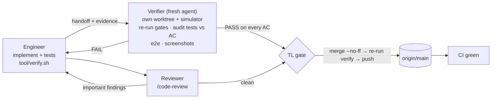

# ADR-0006: Verification strategy (no merge without independent evidence)

- **Status:** Accepted (policy). Feasibility and exact commands confirmed by the T-0009 spike ([F-0004](../findings/F-0004-ios-verification-pipeline.md)). Test libraries can be adjusted to the PO stack (Q-006) without changing the policy.
- **Date:** 2026-11-22
- **Deciders:** Product Owner (requirement: verify all agent work before merge, through tests, e2e at the end, and visual testing on iOS), Tech Lead (design)
- **Related:** ADR-0003, ADR-0004, T-0005, T-0009, T-0010, T-0011, Q-009

## Context
Crew agents can produce plausible code that doesn't do what was asked. A self-reported "tests pass" isn't evidence. When the implementer writes the only tests, those tests can encode its own misunderstanding. The PO wants every piece of crew work verified before it reaches `main`: through automated tests, with an end-to-end suite by the end, and through visual testing of the iOS app. iOS simulators are available on this machine; the Android SDK is not (Q-009).

## Decision

### 1. Acceptance criteria are executable specs
Before dispatch, the TL writes each task's acceptance criteria as numbered **Given / When / Then** scenarios (`T-XXXX-AC1`, `-AC2`, …). Every AC maps to **at least one automated test whose name contains the AC ID**, or, if it's purely visual, to a **screenshot checkpoint**. The task file has a traceability table: AC, then test(s) and checkpoint, then status.

### 2. Verification layers
| Layer | Checks | Tool (stack may refine) | Required for | Runs on |
|---|---|---|---|---|
| **L0 Static** | Format, analyze with zero issues, layer import rules | `dart format`, `fvm flutter analyze` | Every task | Local + CI |
| **L1 Unit** | Domain logic, `mocked_backend`, repositories, state holders | `fvm flutter test` | Any logic change | Local + CI |
| **L2 Widget** | Every screen state: loading, content, empty, error (mock with zero latency and injected failures) | `fvm flutter test` | Any UI change | Local + CI |
| **L3 Golden** | Key screens, light and dark, at the reference size, with **real fonts loaded and the iOS platform set** (the default Ahem font renders text as boxes, F-0004) | `matchesGoldenFile` (library TBD by stack) | UI tasks | macOS only (font rendering differs on Linux) |
| **L4 E2E** | One user journey per feature on a real simulator, with the app wired to `mocked_backend` (deterministic data, zero latency) | `integration_test`, plus `flutter drive` for in-test screenshots | Feature tasks; the **full MVP journey** at phase-2 exit (T-0011) | iOS simulator (Android deferred, §7) |
| **L5 Visual acceptance** | Screenshots at each checkpoint, inspected by an agent against the ACs and attached as evidence | `xcrun simctl io … screenshot`, in-test screenshots | UI tasks | iOS simulator |

**Coverage gate:** at least 80 % line coverage for domain, data and `mocked_backend` code, measured from `lcov.info`. The UI layer is gated on per-state widget tests instead of a percentage.

### 3. Separation of duties: the implementer never grades its own work
- **Engineer:** implements, writes L1 to L4 tests, runs the local gate (`tool/verify.sh`, T-0005), and attaches the output to the handoff.
- **Verifier:** a new crew role, always a **fresh agent**, never the implementer. Working in its own worktree on the task branch, it:
  1. re-runs every gate independently
  2. **audits the tests against the ACs.** Does each mapped test actually assert the behaviour? Were any tests deleted, skipped or weakened, or lints suppressed?
  3. runs the e2e tests on **its own simulator**
  4. does visual acceptance for UI tasks, looking at every screenshot
  5. returns a [verification report](../templates/verification-report.md) with **PASS / FAIL per AC** and the evidence
- **Reviewer:** runs `/code-review` on the diff for correctness.
- **TL gate:** merges only when the Verifier reports PASS on every AC and no important review findings are unresolved. After `merge --no-ff`, the TL **re-runs `tool/verify.sh` on the merge result** before pushing (ADR-0004). Once CI exists, `main` must be green.

### 4. Anti-gaming rules
- Tests are not deleted, skipped (`skip:`) or loosened, and lints are not suppressed (`// ignore:`), without a justification in the task log that the TL has approved.
- Golden updates (`--update-goldens`) are listed in the handoff with before and after images.
- Test data is deterministic. An e2e test that fails intermittently is a bug to root-cause and record as a finding, never something to retry until it passes.

### 5. Evidence
Each task's evidence lives in `documents/evidence/T-XXXX/`: the verification report (Markdown) plus PNG screenshots no taller than 1200 px. Downscale with `sips -Z 1200` **only when the image is larger**, since `sips` also enlarges small images (F-0004). In-test screenshots (`binding.takeScreenshot`) cover every checkpoint after launch. `simctl io … screenshot` adds the real status bar but can't tap, so it only covers launch. The task's Outcome links them. This is a deliberate exception to ADR-0002's "no binary images", which is about diagrams.

### 6. Simulator hygiene
Every agent that runs e2e **creates its own simulator** (`xcrun simctl create mc-<task>-<role> …`; never `clone`, which fails on a booted device), waits with `xcrun simctl bootstatus <udid> -b`, and deletes it afterwards, even on failure (`trap`). Agents never boot or modify the shared or default simulators. Each agent builds in its own worktree, so `build/` folders never collide (F-0004). Reference devices:
- **Primary:** iPhone 17 Pro, iOS 26.2
- **Small screen and older OS** (layout checks at phase-2 exit): iPhone SE (3rd gen), iOS 18.2

### 7. Android: deferred
_Updated 2026-11-22: the PO decided to ignore Android for now and focus on iOS testing (Q-009)._ There is no Android verification of any kind, local or CI, until the PO re-enables it ([P-014](../pending-work.md)). Shared Dart code is platform-neutral and still covered by L0 to L3; only Android-specific behaviour goes unverified (R-009).

## Gate flow

## Consequences
- **Positive:** independent, reproducible evidence for every merge; ACs are traceable to tests; the PO can browse screenshots per task; regressions get caught at the merge result, not just on the branch.
- **Negative:** each task takes longer (a Verifier pass plus simulator e2e) and costs more agent time. E2E suites can get flaky, which the anti-gaming rules and deterministic mock data mitigate (R-008).
- **Follow-ups:** T-0005 (`tool/verify.sh` + CI), T-0010 (e2e and screenshot harness), T-0011 (full MVP journey e2e), Q-009 (Android deferred), T-0012 (simulator e2e runner).
