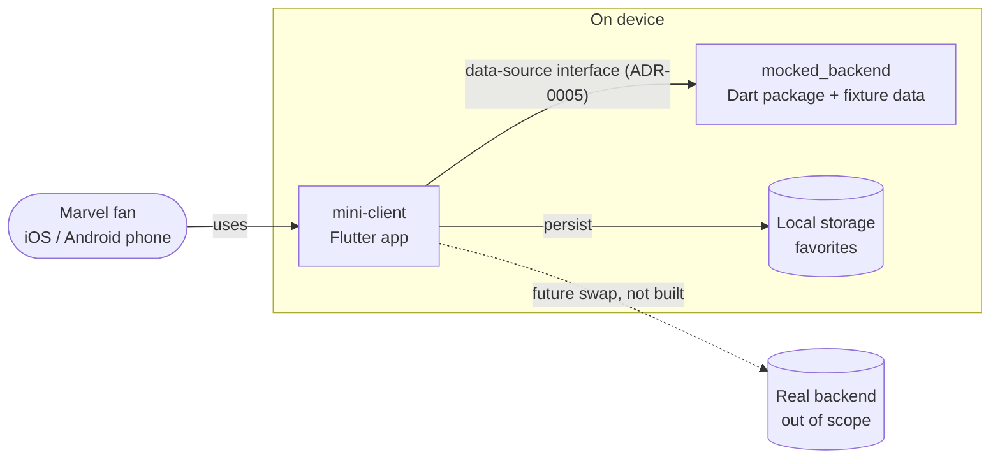
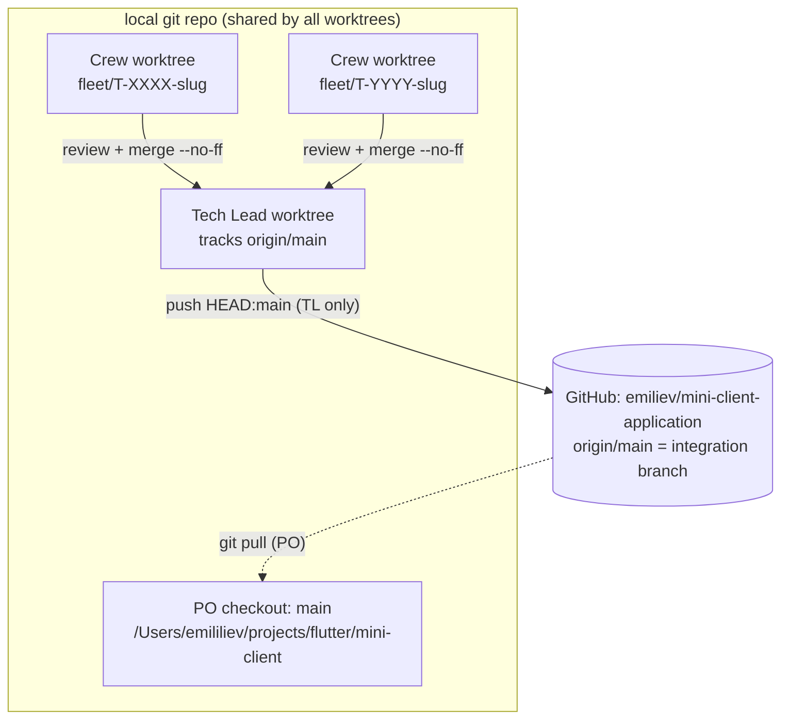

# Architecture Overview

- **Status:** Draft. No application code exists yet. Level 1 reflects confirmed direction (Q-001 to Q-003). Levels 2 and 3 wait for the PO's stack ([Q-006](../open-questions.md#q-006)) and [T-0004](../tasks/T-0004-architecture-decision.md).
- **Last updated:** 2026-11-22
- **Owner:** Tech Lead

This document follows the C4 model: context, then containers, then components. Each section links the ADRs that justify it. When the code changes the architecture, this file changes in the same commit.

## 1. System context (C4 level 1)

- There is no network backend. All data comes from `mocked_backend` ([ADR-0005](../adr/0005-mocked-backend-module.md)).
- The official Marvel API is gone ([F-0003](../findings/F-0003-marvel-api-unavailable.md)), so the mock's contract is our own design.

## 2. Containers (C4 level 2): TBD after Q-006 / T-0004
Will show: the app module, the `mocked_backend` package, local persistence, and how they're wired (workspace or monorepo layout).

## 3. Application structure (C4 level 3): TBD after Q-006 / T-0004
Will document:
- Layering (e.g. presentation / domain / data) and dependency rules
- State management
- Navigation / routing
- Dependency injection
- Data-source interface and `mocked_backend` transport (in-process vs HTTP-level)
- Persistence (favorites)
- Error handling & logging

## 4. Cross-cutting concerns
| Concern | Decision | ADR |
|---|---|---|
| Data source | In-repo `mocked_backend` behind a data-source interface | [ADR-0005](../adr/0005-mocked-backend-module.md) |
| Git integration | TL merges `--no-ff`, pushes `origin/main` | [ADR-0004](../adr/0004-git-integration-workflow.md) |
| SDK version & pinning | TBD in T-0003 | pending |
| Repo layout / workspace | TBD in T-0004 | pending |
| Architecture & layering | TBD in T-0004 | pending |
| State management | TBD in T-0004 | pending |
| Navigation | TBD in T-0004 | pending |
| Persistence | TBD in T-0004 | pending |
| Testing strategy | TBD ([P-001](../pending-work.md)) | pending |
| CI / quality gates | GitHub Actions, in T-0005 | pending |

## 5. Delivery topology (actual, current)

See [ADR-0004](../adr/0004-git-integration-workflow.md) and [fleet/protocol.md](../fleet/protocol.md).
