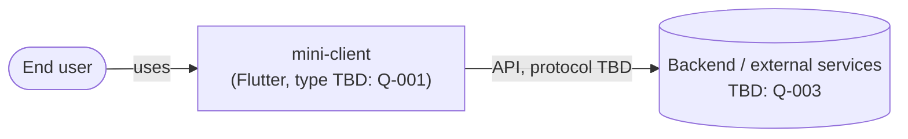
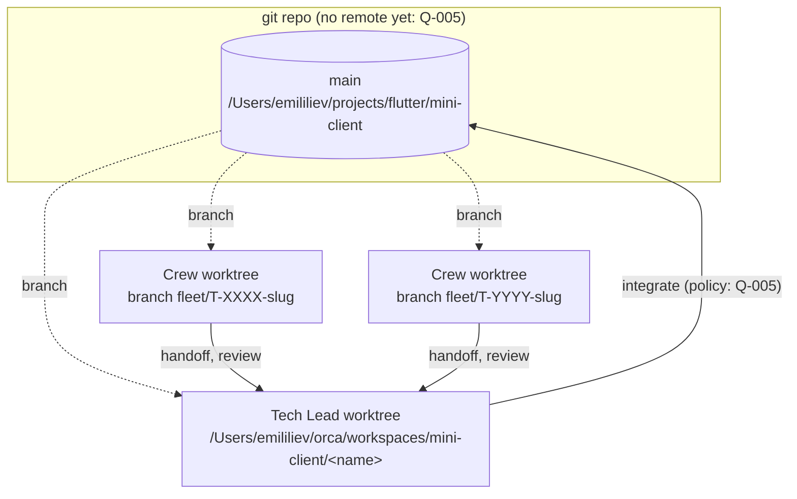

# Architecture Overview

- **Status:** Draft. No application code exists yet. Diagrams marked _Provisional_ are placeholders until [Q-001](../open-questions.md#q-001) and [Q-003](../open-questions.md#q-003) are answered and [T-0004](../tasks/T-0004-architecture-decision.md) lands.
- **Last updated:** 2026-11-22
- **Owner:** Tech Lead

This document follows the C4 model: context, then containers, then components. Each section links the ADRs that justify it. When the code changes the architecture, this file changes in the same commit.

## 1. System context (C4 level 1): Provisional

## 2. Containers (C4 level 2): TBD after T-0004
Will show the deployable or runnable units: app per platform, local storage, backend APIs, third-party services.

## 3. Application structure (C4 level 3): TBD after T-0004
Will document:
- Layering (e.g. presentation / domain / data) and dependency rules
- State management
- Navigation / routing
- Dependency injection
- Networking & API client
- Persistence / caching
- Error handling & logging

## 4. Cross-cutting concerns
| Concern | Decision | ADR |
|---|---|---|
| SDK version & pinning | TBD in T-0003 | pending |
| Architecture & layering | TBD in T-0004 | pending |
| State management | TBD in T-0004 | pending |
| Navigation | TBD | pending |
| Networking | TBD (after Q-003) | pending |
| Testing strategy | TBD ([P-001](../pending-work.md)) | pending |
| CI / quality gates | TBD in T-0005 | pending |

## 5. Delivery topology (actual, current)
How the code is worked on. This part is real today.

See [fleet/protocol.md](../fleet/protocol.md) for the full workflow.
