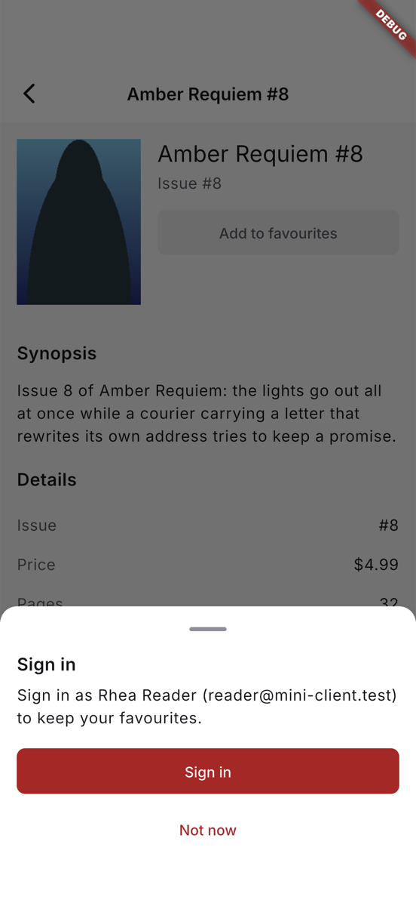

# T-0058 verification report (Verifier, Sonnet tier)

**Verdict: PASS** on `5f354be` (branch `fleet/T-0058-ds-overlays`). Verifier worktree detached at that SHA, Bazel output base `/tmp/mc-ob-T-0058-verifier`, simulator `mc-T-0058-verifier-1445` (deleted). Evidence: `documents/evidence/T-0058/verifier/`.

| AC | Result | How I checked |
|---|---|---|
| AC1 goldens | PASS | Looked at 14 goldens (sheet_keyboard light x2, dialog_long dark x2 (German), choice_sheet_long highContrast x2, toast_long light x2, dialog_three_actions_disabled, menu_open highContrastDark, menu_open_long dark x2, dialog_destructive, sheet_long dark x2, choice_sheet_selected dark, tooltip_shown highContrastDark x2, toast_action highContrast). 16 sets x 8 = 128 files, includes the new `sheet_keyboard` set. `git diff --name-status origin/main...5f354be` lists no golden outside `mc_ds_overlays`; the `mc_test_utils` `realShadows` default is `false` and restored in a `finally`, and `test //...` passes with every other package's goldens. No overflow in the 2x/3x tests. |
| AC2 behaviour | PASS | Own probe (`probe_verifier_test.dart.txt`, 18 tests, run with `flutter test`, removed from the tree). Confirm: true on confirm; false on cancel, barrier and system back. Choice sheet: value, null on swipe, barrier, back; check on the selected row. Disabled menu item ignored (menu stays open), enabled one reports. Toast: second replaces the first, the action fires once after two taps and closes it. Root vs nearest navigator inside a 300 pt nested navigator (root = full width and the nested navigator untouched; nearest = 300). **Review 1:** sheet with a `TextField` under a 300 pt inset: field and Save above the keyboard, tappable, typing works at 1x; at 2x and 3x no exception and `scrollUntilVisible` reaches Save. **Review 2:** `isDismissible: false` and `enableDrag: false`: handle tap leaves the sheet open and no node carries the dismiss label (so VoiceOver cannot activate it); dismissible sheet: semantic tap closes it. |
| AC3 semantics | PASS | In all 4 themes: the confirm title is one node (`bySemanticsLabel` finds 1) and names the route; `androidTapTarget`, `iOSTapTarget`, `labeledTapTarget` and `textContrast` guidelines pass; confirm and cancel buttons >= 44 pt; toast text sits under a live-region node, the toast action >= 44 pt. |
| AC4 migration, steps | PASS | `git diff origin/main...5f354be` touches no sign-in test (`sign_in_sheet_test` and all `app_core` tests unchanged and green; 50x green). Four steps have negative controls (`overlay_steps_test`, 7 AC4 tests). `T-0058-AC4_no_direct_overlays.sh`: PASS, positive control, 15 negative controls and the comment control. I planted `showAdaptiveDialog` in `characters_list/lib`: the check listed it; reverted, green again. |
| AC5 gates | PASS | `T-0058-AC5_gates.sh` (copy in `ac5-gates.md`): every gate PASS (test //..., lint, mc_arch_check, rules_fork check, format, l10n_check, provenance, closure, no-direct-overlay, layering). My own `test --lockfile_mode=error //...`: 181 of 181 pass. `T-0058-AC5_layering.sh` PASS with its 10 negative controls. Coverage, own parser over `coverage.dat` (`coverage.txt`): **231/232 = 99.6 %**, only `mc_sheet.dart` has one uncovered line. 50-run flake (`--runs_per_test=50 --nocache_test_results`) on `overlays_test`, `golden_test`, `overlay_steps_test`, `sign_in_sheet_test`: 4 of 4 PASSED, 0 failures (`flake-50.log`). e2e on my simulator (`e2e-summary.md`): `comics_journey`, `reading_list_journey`, `reading_list_deeplink` PASS. The sign-in sheet screenshot below shows `McSheet` with handle, title, body, Sign in and Not now. |

## Mutations (`mutations-verifier.sh`, `.log`)
13 of the engineer's (return values, root vs nearest, dismissible, bottom inset, keyboard, toast replacement and single action, handle flags, menu pick, a step, sign-in drag while busy) plus 10 of mine: **20 killed, 3 survived, 0 broken, 0 not applied.** The tree was clean after each.

Survivors (all in tests, no product defect, none blocks the PASS):
1. **V6 plain toast 4 s -> 2 s.** `overlays_test.dart` ~line 625 ("a toast without an action stays 4 s"): its first half advances 3500 ms in one `pump`, which fires the timer but not the exit animation (the same trap as F-0058 fact 19, fixed only for the action half). The plain duration's lower bound is not pinned (the action half and the relative `greaterThan` still hold). Suggest pumping 3 s, asserting present, then past 4 s.
2. **V7 handle `maybePop` -> `pop`.** No test taps the handle (or semantic-activates it) on a sheet with a `PopScope(canPop: false)` (the busy sign-in sheet). The code is right (`mc_sheet.dart`, `_DragHandle`), F-0058 fact 6 is true by reading, but nothing proves it. Suggest a test or a sign-in "busy then tap handle" case.
3. **V3 safe-area bottom kept under the keyboard.** Equivalent on a device (`MediaQuery.padding` already shrinks by the inset) and the test binding has no bottom padding; the engineer's "ignores the bottom inset" mutant is killed.

## Other observations (nits)
- `dialog_long` 2x: the golden surface cuts the last (destructive) button; the dialog scrolls, no overflow reported. Fine, but the golden does not show the whole dialog.
- `toast_action` baseline: the "Undo" label sits a few px below the message baseline (Wrap `center` alignment). Cosmetic.
- High-contrast disabled menu row ("Share") is dim grey on black; it is a disabled state (exempt from contrast), tell design if it should be stronger.

## Merge check
`git merge --no-commit --no-ff origin/main` (T-0059 charts, `mc_ds_tokens/colors.dart`, `pubspec.yaml`) merged without conflicts; `fvm dart pub get --offline` then `test --lockfile_mode=error //...`: **185 of 185 pass** (69 executed, the rest cached). `merge --abort` afterwards; no lockfile change.

## Integrity
New package, nothing deleted, skipped or weakened; no `// ignore:` or `skip:` in the new code; `T-0058-AC1..AC4` appear in 64 + 7 + 1 test names, AC5 is covered by the three `T-0058-AC5_*` scripts. Format check on the gated directories passes (never ran `dart format .`).
