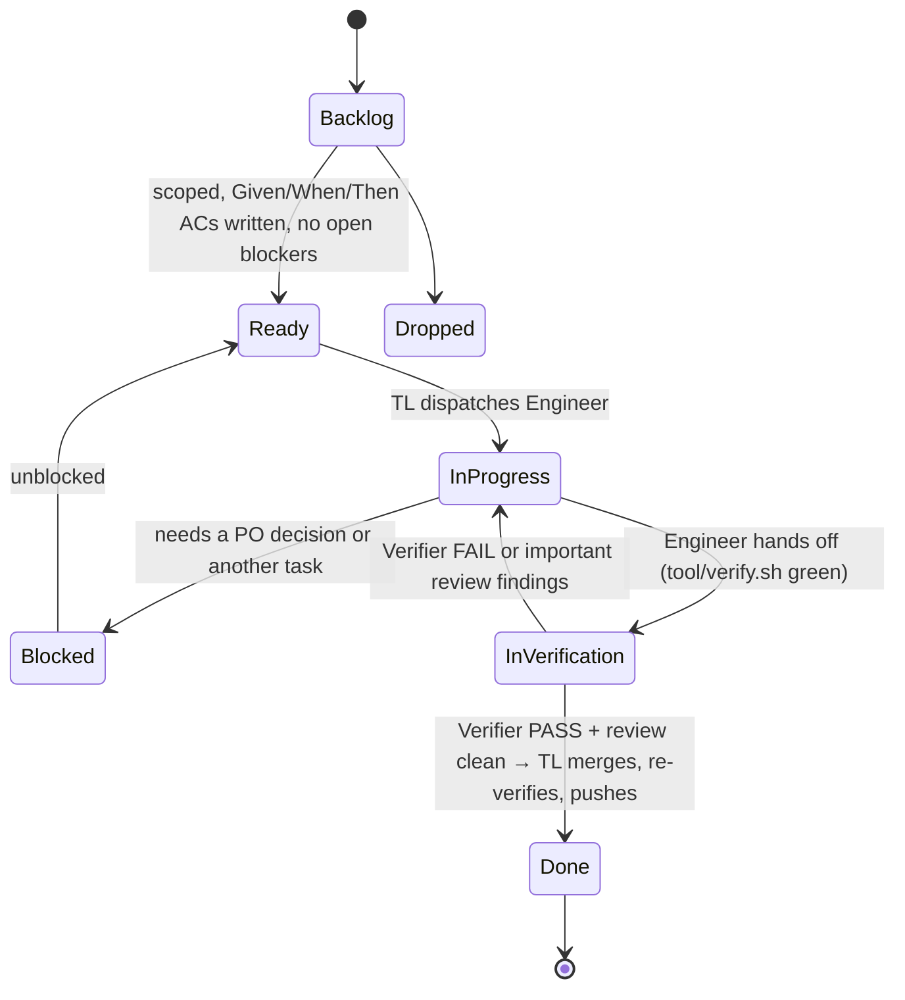
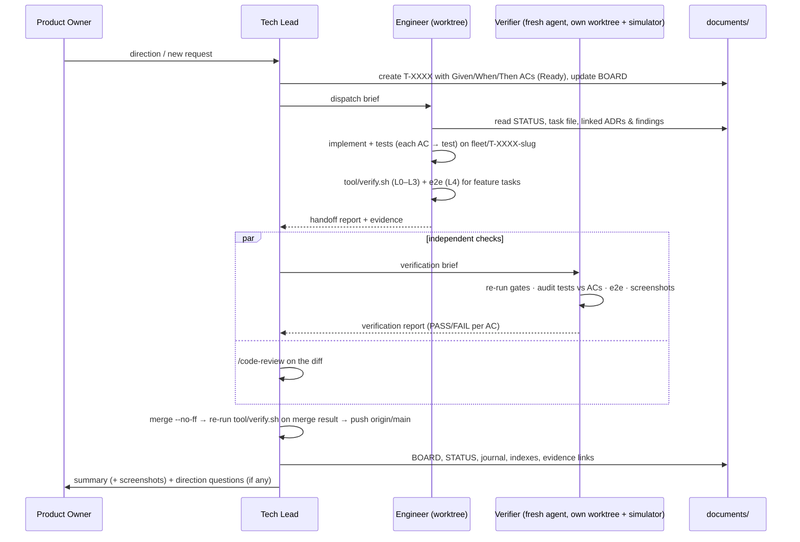

# Fleet Operating Protocol

How work flows through the fleet. Rationale: [ADR-0003](../adr/0003-fleet-operating-model.md) (roles), [ADR-0004](../adr/0004-git-integration-workflow.md) (integration), [ADR-0006](../adr/0006-verification-strategy.md) (verification).

## Task lifecycle



## Dispatch-to-integration flow



## Definition of Ready
- [ ] The task file has a goal, scope (in and out) and **Given / When / Then acceptance criteria with IDs** (`T-XXXX-ACn`).
- [ ] The verification plan maps each AC to a layer (L1 to L5) and a planned test or checkpoint.
- [ ] Dependencies and blocking questions are resolved, or have an agreed default.
- [ ] Relevant ADRs and findings are linked.
- [ ] Files or areas touched are listed, so the TL can check for parallel overlap.

## Definition of Done
- [ ] Every AC has a passing test whose name contains the AC ID, or a screenshot checkpoint for purely visual ACs.
- [ ] `tool/verify.sh` is green on the branch (format, analyze, tests, coverage ≥ 80 % for domain, data and `mocked_backend`). Before `tool/verify.sh` exists, the equivalent `fvm` commands.
- [ ] Feature tasks: the e2e journey passes on the iOS simulator.
- [ ] **Verifier report: PASS on every AC** (`documents/evidence/T-XXXX/verification-report.md`), from a fresh agent that isn't the implementer.
- [ ] `/code-review` has no unresolved important findings.
- [ ] No tests deleted, skipped or weakened, and no lint suppressions, unless approved by the TL in the task log.
- [ ] The TL re-ran `tool/verify.sh` on the merge result before pushing; CI is green on `main` once T-0005 is done.
- [ ] Task file Log and Outcome filled in, with evidence links. Decisions are ADRs, gotchas are findings, and leftover work goes to `pending-work.md`.
- [ ] Architecture overview updated if the structure changed. BOARD, STATUS and journal updated.

## Dispatch brief (Engineer)
```
Task: T-XXXX <title>. Read documents/tasks/T-XXXX-<slug>.md first.
Branch: fleet/T-XXXX-<slug> (create from origin/main).
Context to read: documents/STATUS.md, CLAUDE.md, ADR-0006, <linked ADRs/findings>.
Constraints: <files you may touch / must not touch>, <decisions already made>.
Do: <concrete deliverables>. For every AC, write a test whose name contains the AC ID.
Verify: run tool/verify.sh (and the e2e script for feature tasks) and paste the summary.
Don't: edit STATUS.md / BOARD.md / journal / indexes; push; ask the PO directly;
       delete, skip or weaken tests, or add lint suppressions, without saying so in the handoff.
Escalate: if blocked on a product decision, stop and say so in the handoff report.
Return: a handoff report in the format below.
```

## Verification brief (Verifier)
```
Verify T-XXXX <title> on branch fleet/T-XXXX-<slug> @ <sha>. You did NOT write this code.
Read: the task file (ACs + verification plan), ADR-0006, documents/templates/verification-report.md.
Work in your own worktree. Create your own simulator (mc-T-XXXX-verifier) and delete it when done.
1. Re-run every gate yourself; don't trust the handoff output.
2. For each AC: find the mapped test, read it, and judge whether it really asserts the AC. Run it.
3. Audit the diff for deleted, skipped or weakened tests, lint suppressions and golden updates.
4. Feature/UI tasks: run the e2e journey and capture screenshots at each checkpoint into
   documents/evidence/T-XXXX/ (sips -Z 1200). Look at every screenshot and describe what is visible.
5. Write documents/evidence/T-XXXX/verification-report.md and commit it on the task branch.
Don't fix the code. Report issues with repro steps. Verdict: PASS only if every AC passes.
```

## Handoff report (Engineer)
```
Task: T-XXXX. Status: Done | Partial | Blocked
Branch / commits: <branch>, <sha list>
What changed: <files / behaviour>
AC → test map: <T-XXXX-AC1 → test name, …>
Verification: <tool/verify.sh summary; e2e result; coverage %>
Test integrity: <tests deleted/skipped/weakened, suppressions, golden updates — or "none">
Decisions made: <ADR drafts created, or "none">
Findings: <F-XXXX created, or "none">
Follow-ups: <work discovered but not done>
Questions for PO: <only direction-level, or "none">
```

## Escalation boundary
| Goes to the Product Owner | Decided by the Tech Lead |
|---|---|
| What we build, for whom, priorities | Architecture, libraries, patterns |
| UX intent and product trade-offs | Code structure, testing and verification approach |
| Anything that costs money, involves a third-party account, or installs large software on the PO's machine | Tooling, lints, CI configuration |
| Publishing and store releases | Task breakdown and sequencing; merging and pushing to `origin` (delegated, Q-005) |

## Bazel output bases (all crew)
- Every agent that runs Bazel uses a **unique output base named for its task and role**: `tool/bazelw --output_base=/tmp/mc-ob-T-XXXX-<role> …` (or each worktree's default output base, which Bazel derives from the workspace path). Never use a generic name such as `/tmp/mc-verify`.
- _Lesson 2026-11-24:_ two Verifiers shared one output base, and one's `bazel shutdown` killed the other's server mid-run.

## Resuming crew agents (TL)
- A crew agent must **never run in the Tech Lead's worktree** (`/Users/emililiev/orca/workspaces/mini-client/tang`). When resuming an agent whose worktree was never created, tell it to create its own worktree first (`git worktree add <repo>/.claude/worktrees/<name> -b fleet/T-XXXX-… origin/main`) and `cd` there, **not** to `git switch` in its current directory.
- After every resume, the TL checks `git -C <TL worktree> branch --show-current` is still `continue-previous-work`.
- _Lesson 2026-11-23:_ the T-0020 Engineer, resumed after a usage-limit stop before its worktree existed, ran `git switch -c` in the TL worktree. Nothing was lost (the tree was clean); the TL switched back.

## Session hygiene (Tech Lead)
- **Session start:** read STATUS, the latest journal entry, BOARD and open questions.
- **Session end:** write or update `journal/YYYY-MM-DD.md`, refresh STATUS, and commit.
