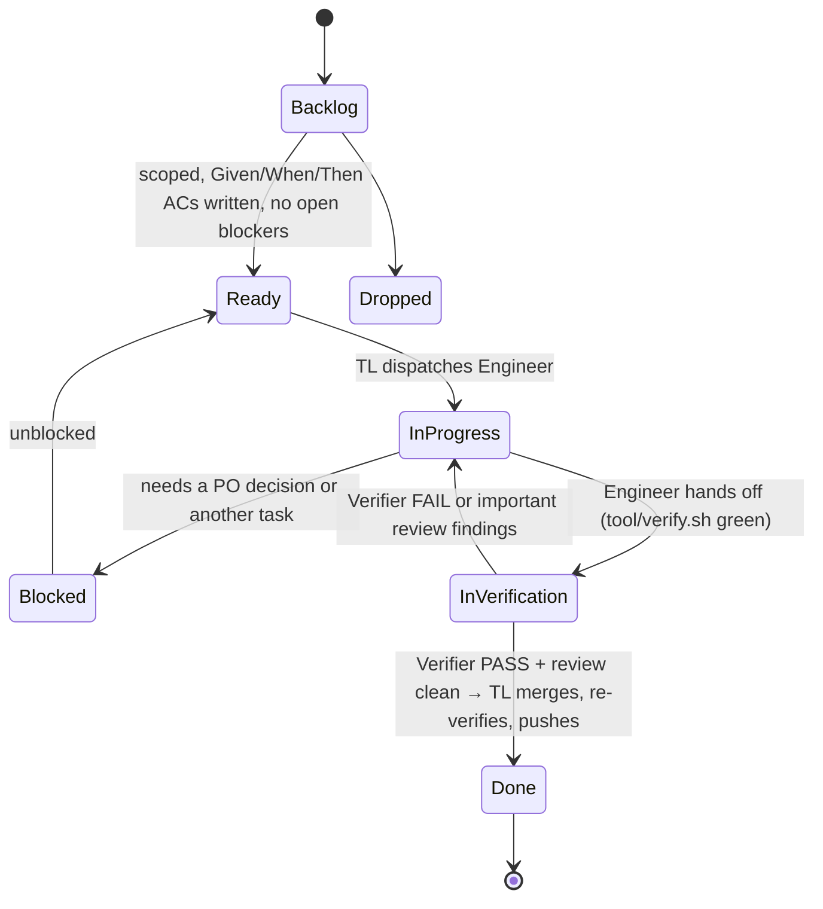
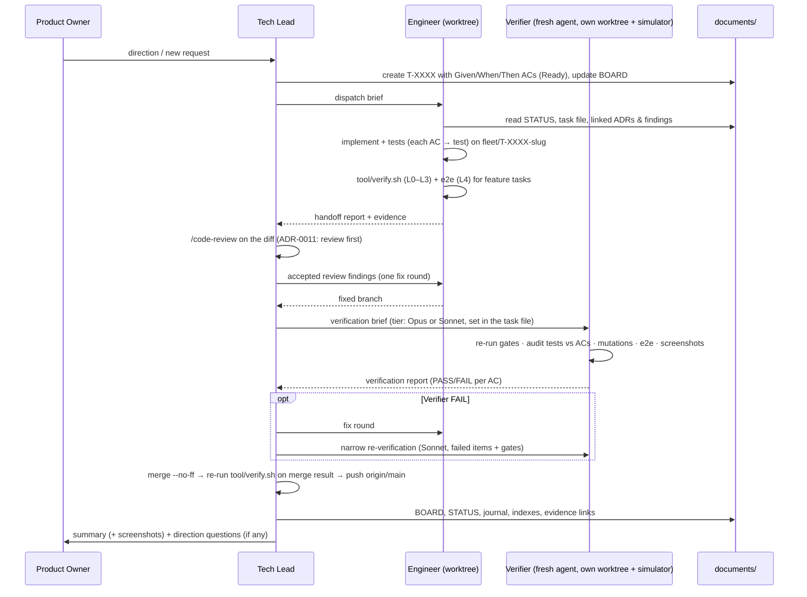

# Fleet Operating Protocol

How work flows through the fleet. Rationale: [ADR-0003](../adr/0003-fleet-operating-model.md) (roles), [ADR-0004](../adr/0004-git-integration-workflow.md) (integration), [ADR-0006](../adr/0006-verification-strategy.md) (verification).

## Task lifecycle



## Dispatch-to-integration flow



## Definition of Ready
- [ ] The task file has a goal, scope (in and out) and **Given / When / Then acceptance criteria with IDs** (`T-XXXX-ACn`).
- [ ] The verification plan maps each AC to a layer (L1 to L5) and a planned test or checkpoint.
- [ ] Dependencies and blocking questions are resolved, or have an agreed default.
- [ ] Relevant ADRs and findings are linked.
- [ ] Files or areas touched are listed, so the TL can check for parallel overlap.

## Definition of Done
- [ ] Every AC has a passing test whose name contains the AC ID, or a screenshot checkpoint for purely visual ACs.
- [ ] `tool/verify.sh` is green on the branch (format, analyze, tests, coverage ≥ 80 % for domain, data and `mocked_backend`). Before `tool/verify.sh` exists, the equivalent `fvm` commands.
- [ ] Feature tasks: the e2e journey passes on the iOS simulator.
- [ ] **Verifier report: PASS on every AC** (`documents/evidence/T-XXXX/verification-report.md`), from a fresh agent that isn't the implementer.
- [ ] `/code-review` has no unresolved important findings.
- [ ] No tests deleted, skipped or weakened, and no lint suppressions, unless approved by the TL in the task log.
- [ ] **Tests per ADR-0015:** features use BDD plus contract tests, with plain unit tests allowed for pure logic and **no goldens**. DS kits keep their goldens. About 15 targeted mutants on the risky logic, with no full sweeps.
- [ ] **Flake check:** every test target the task adds or changes that touches storage, timers, streams or races passes `test --runs_per_test=50 --nocache_test_results` with 0 failures, and the log is in the evidence. Tests never drop a future that writes to storage (`.ignore()`, `unawaited`): they await it before teardown deletes the directory (F-0050 §7).
- [ ] The TL re-ran `tool/verify.sh` on the merge result before pushing; CI is green on `main` once T-0005 is done.
- [ ] Task file Log and Outcome filled in, with evidence links. Decisions are ADRs, gotchas are findings, and leftover work goes to `pending-work.md`.
- [ ] Architecture overview updated if the structure changed. BOARD, STATUS and journal updated.

## Dispatch brief (Engineer)
```
Task: T-XXXX <title>. Read documents/tasks/T-XXXX-<slug>.md first.
Branch: fleet/T-XXXX-<slug> (create from origin/main).
Context to read: documents/STATUS.md, CLAUDE.md, ADR-0006, <linked ADRs/findings>.
Constraints: <files you may touch / must not touch>, <decisions already made>.
Do: <concrete deliverables>. For every AC, write a test whose name contains the AC ID.
Verify: run tool/verify.sh (and the e2e script for feature tasks) and paste the summary.
Don't: edit STATUS.md / BOARD.md / journal / indexes; push; ask the PO directly;
       delete, skip or weaken tests, or add lint suppressions, without saying so in the handoff.
Escalate: if blocked on a product decision, stop and say so in the handoff report.
Return: a handoff report in the format below.
```

## Verification brief (Verifier)
```
Verify T-XXXX <title> on branch fleet/T-XXXX-<slug> @ <sha>. You did NOT write this code.
Read: the task file (ACs + verification plan), ADR-0006, documents/templates/verification-report.md.
Work in your own worktree. Create your own simulator (mc-T-XXXX-verifier) and delete it when done.
1. Re-run every gate yourself; don't trust the handoff output.
2. For each AC: find the mapped test, read it, and judge whether it really asserts the AC. Run it.
   Grep for every test the Outcome cites. A cited test that doesn't exist is a FAIL.
3. Audit the diff for deleted, skipped or weakened tests, lint suppressions and golden updates.
4. Feature/UI tasks: run the e2e journey and capture screenshots at each checkpoint into
   documents/evidence/T-XXXX/ (sips -Z 1200). Look at every screenshot and describe what is visible.
5. Write documents/evidence/T-XXXX/verification-report.md and commit it on the task branch.
Don't fix the code. Report issues with repro steps. Verdict: PASS only if every AC passes.
```

## Handoff report (Engineer)
```
Task: T-XXXX. Status: Done | Partial | Blocked
Branch / commits: <branch>, <sha list>
What changed: <files / behaviour>
AC → test map: <T-XXXX-AC1 → test name, …>
Verification: <tool/verify.sh summary; e2e result; coverage %>
Test integrity: <tests deleted/skipped/weakened, suppressions, golden updates — or "none">
Decisions made: <ADR drafts created, or "none">
Findings: <F-XXXX created, or "none">
Follow-ups: <work discovered but not done>
Questions for PO: <only direction-level, or "none">
```
- **Every evidence row names something that exists at the handoff commit:** a test name, a file or a log. Before handing off, the Engineer greps for each cited test name at HEAD. _Lesson 2026-11-27:_ T-0056's Outcome cited category paging-error tests that had never been written. The Opus Verifier caught it, and it cost a FAIL round.

## Escalation boundary
| Goes to the Product Owner | Decided by the Tech Lead |
|---|---|
| What we build, for whom, priorities | Architecture, libraries, patterns |
| UX intent and product trade-offs | Code structure, testing and verification approach |
| Anything that costs money, involves a third-party account, or installs large software on the PO's machine | Tooling, lints, CI configuration |
| Publishing and store releases | Task breakdown and sequencing; merging and pushing to `origin` (delegated, Q-005) |

## Model tiers (ADR-0011)
- **Tech Lead:** Opus. `/code-review` (medium) runs on every task, **before** the Verifier.
- **Engineers:** Sonnet by default. Opus for rules and codegen patches, vendored third-party code, the first exemplar of each archetype, and any task the TL marks high risk.
- **Verifiers:** tier set in the task file.
  - **Opus:** exemplars, rules and codegen patches, vendored code, concurrency and security (auth, sessions, money), kits the bricks copy (`mc_feature_flow`, `McFlowBackButton`), and app navigation changes.
  - **Sonnet:** everything else. A Sonnet Verifier's scope is every AC, the gates, at most 10 targeted mutations, and e2e only when an AC needs it.
  - **ADR-0015 (2026-11-27) narrows every Verifier's scope:** per AC, read and run the cited test, re-run the gates, run the e2e for e2e ACs, probe only where an AC or review finding points at risk, and re-run at most 5 of the engineer's mutants. No own mutant sets, no own coverage parsers, no full re-derivation. The test-integrity diff and the "every cited test exists" check stay.
- **Re-verification after a FAIL:** Sonnet, on a narrow checklist (the failed items plus the gates). Use Opus only when the failure is itself in an Opus-tier area.
- **Haiku:** mechanical work only:
  - bulk generated modules verified by the generators' own checks;
  - lock re-resolution and merging `origin/main`;
  - re-running existing e2e scripts;
  - evidence and index chores.
  
  Haiku never verifies and never writes or changes behaviour tests.
- Every task file's header names its **Engineer model** and **Verifier tier**.

## Bazel output bases (all crew)
- Every agent that runs Bazel uses a **unique output base named for its task and role**: `tool/bazelw --output_base=/tmp/mc-ob-T-XXXX-<role> …` (or each worktree's default output base, which Bazel derives from the workspace path). Never use a generic name such as `/tmp/mc-verify`.
- _Lesson 2026-11-24:_ two Verifiers shared one output base, and one's `bazel shutdown` killed the other's server mid-run.

## Scratch files (all crew)
- The session scratchpad is shared between agents. Every agent works in **its own subfolder** named for its task and role (`<scratchpad>/T-XXXX-<role>/`), or under `/tmp/mc-<task>-<role>-*` via `mktemp -d`. Never write a generic name at the scratchpad root (`mut.sh`, `probe.dart`), and never run a script you didn't just write.
- Fixed log paths such as `/tmp/mc-mut.log` collide across agents too: include the task and role in the name.
- _Lesson 2026-11-26:_ the T-0035 Verifier overwrote the T-0033 Verifier's `mut.sh` at the scratchpad root. The T-0033 Verifier then ran it, and its restore step wrote into the T-0035 worktree. The file ended up byte-identical to HEAD, and T-0035 was already merged, so nothing was lost.

## Flaky tests (all crew)
- A test that fails once in N runs is a defect, not bad luck. Root-cause it, never retry it until it passes (CLAUDE.md).
- _Lesson 2026-11-27:_ T-0050 (`auth_pin_test`) and T-0052 (`session_fetch_test`) both deleted a temp directory while a session save was still running (`Directory not empty`). Single runs passed; the Opus Verifier's 100-run loop and the TL's merge gate caught them. Hence the DoD flake check.

## Resuming crew agents (TL)
- A crew agent must **never run in the Tech Lead's worktree** (`/Users/emililiev/orca/workspaces/mini-client/tang`). When resuming an agent whose worktree was never created, tell it to create its own worktree first (`git worktree add <repo>/.claude/worktrees/<name> -b fleet/T-XXXX-… origin/main`) and `cd` there, **not** to `git switch` in its current directory.
- After every resume, the TL checks `git -C <TL worktree> branch --show-current` is still `continue-previous-work`.
- _Lesson 2026-11-23:_ the T-0020 Engineer, resumed after a usage-limit stop before its worktree existed, ran `git switch -c` in the TL worktree. Nothing was lost (the tree was clean); the TL switched back.

## Session hygiene (Tech Lead)
- **Session start:** read STATUS, the latest journal entry, BOARD and open questions.
- **Session end:** write or update `journal/YYYY-MM-DD.md`, refresh STATUS, and commit.
