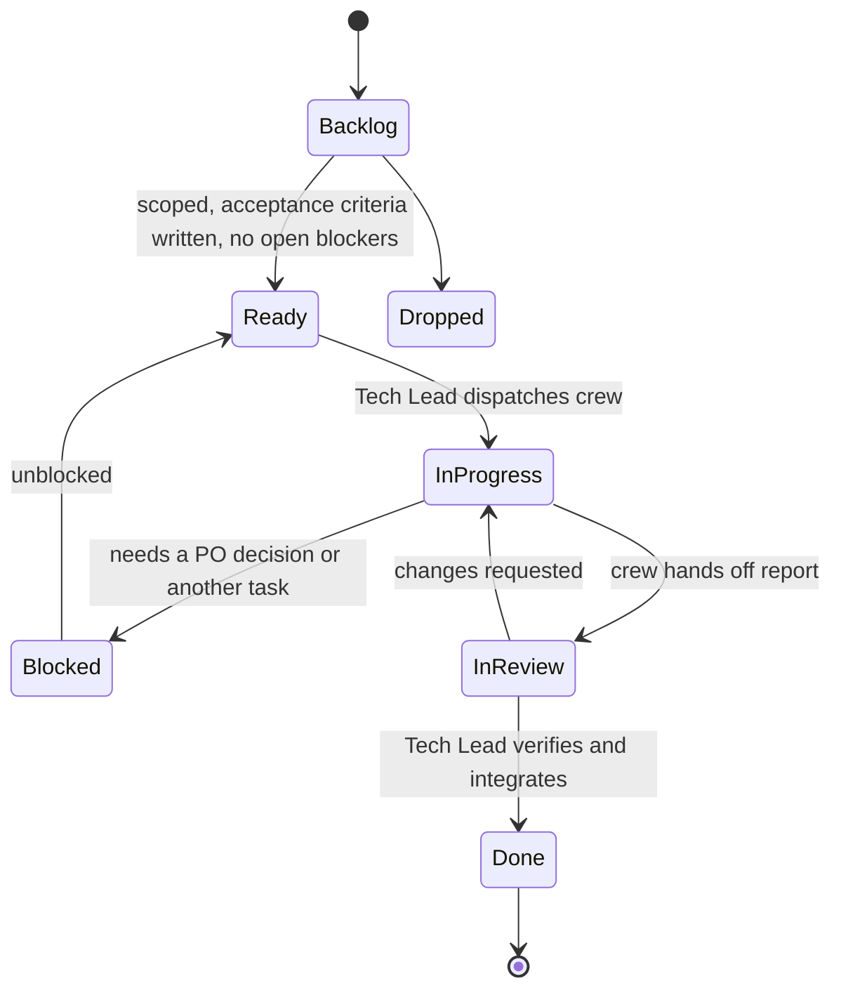

# Fleet Operating Protocol

How work flows through the fleet. Rationale: [ADR-0003](../adr/0003-fleet-operating-model.md).

## Task lifecycle



## Dispatch-to-integration flow

```mermaid
sequenceDiagram
    participant PO as Product Owner
    participant TL as Tech Lead
    participant C as Crew member (worktree)
    participant D as documents/
    PO->>TL: direction / new request
    TL->>D: create T-XXXX (Ready), update BOARD
    TL->>C: dispatch brief
    C->>D: read STATUS, task file, linked ADRs & findings
    C->>C: implement & verify on fleet/T-XXXX-slug
    C->>D: update own task file; add findings / ADR drafts
    C-->>TL: handoff report
    TL->>TL: review (/code-review), verify DoD
    TL->>D: update BOARD, STATUS, journal, indexes
    TL->>PO: summary + direction questions (if any)
```

## Definition of Ready
- [ ] Task file exists with a goal, scope (in and out) and testable acceptance criteria.
- [ ] Dependencies and blocking questions are resolved, or have an agreed default.
- [ ] Relevant ADRs and findings are linked.
- [ ] Files or areas touched are listed, so the TL can check for parallel overlap.

## Definition of Done
- [ ] All acceptance criteria met, with verification evidence in the task's Outcome section (commands run, results).
- [ ] `fvm flutter analyze` clean and `fvm flutter test` passing (once the Flutter project exists).
- [ ] Task file Log and Outcome filled in.
- [ ] Decisions recorded as ADRs; gotchas as findings; leftover work reported for `pending-work.md`.
- [ ] Architecture overview updated if the structure changed.
- [ ] Reviewed and integrated by the Tech Lead; BOARD, STATUS and journal updated.

## Dispatch brief
Every crew dispatch includes:
```
Task: T-XXXX <title>. Read documents/tasks/T-XXXX-<slug>.md first.
Branch: fleet/T-XXXX-<slug> (create from <base>).
Context to read: documents/STATUS.md, CLAUDE.md, <linked ADRs/findings>.
Constraints: <files you may touch / must not touch>, <decisions already made>.
Do: <concrete deliverables>.
Don't: edit STATUS.md / BOARD.md / journal / indexes; push; ask the PO directly.
Escalate: if blocked on a product decision, stop and say so in the handoff report.
Return: a handoff report in the format in documents/fleet/protocol.md.
```

## Handoff report
Every crew member ends with:
```
Task: T-XXXX. Status: Done | Partial | Blocked
Branch / commits: <branch>, <sha list>
What changed: <files / behaviour>
Verification: <commands run + results>
Decisions made: <ADR drafts created, or "none">
Findings: <F-XXXX created, or "none">
Follow-ups: <work discovered but not done>
Questions for PO: <only direction-level, or "none">
```

## Escalation boundary
| Goes to the Product Owner | Decided by the Tech Lead |
|---|---|
| What we build, for whom, priorities | Architecture, libraries, patterns |
| UX intent and product trade-offs | Code structure, testing approach |
| Anything that costs money or involves a third-party account | Tooling, lints, CI configuration |
| Outward-facing actions: push, publish, release | Task breakdown and sequencing |

## Session hygiene (Tech Lead)
- **Session start:** read STATUS, the latest journal entry, BOARD and open questions.
- **Session end:** write or update `journal/YYYY-MM-DD.md`, refresh STATUS, and commit.
