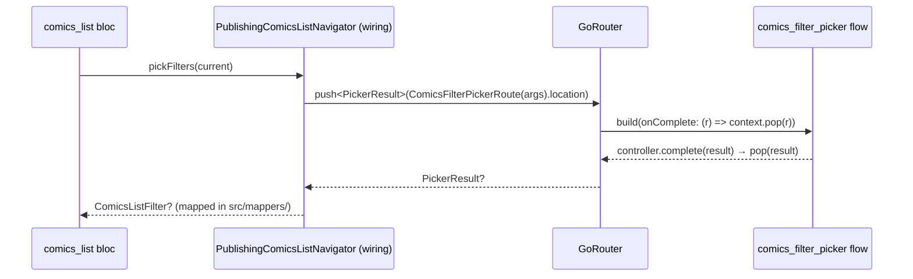
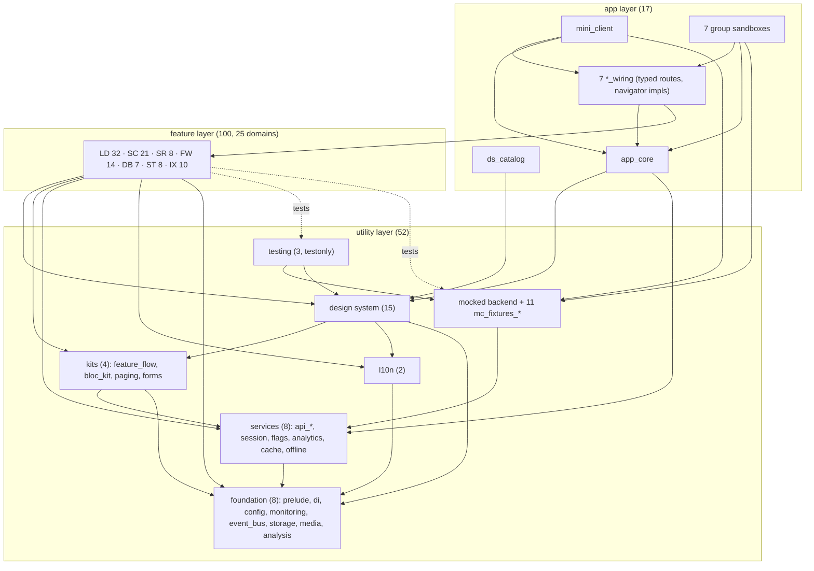

# 01: Architecture and module catalogue

| | |
|---|---|
| Task | T-0013, wave 2, Planner **P1** (architecture and module catalogue: *what* we build) |
| Date | 2026-11-23 |
| Inputs | Brief D1 to D12; `[tide-core]` = `research/tide-miniclient/architecture-core.md`; `[tide-nav]` = `research/tide-miniclient/app-navigation-testing.md`; `[rules_dart]`, `[rules_flutter]`; sibling plans P2 (`02-generation-and-scale.md`), P3 (`03-bazel-integration.md`), P5 (`05-testing-and-bdd.md`) |
| Status | Draft for TL assembly. Every number below comes from one catalogue script (kept by P1), so counts, LOC and graph metrics agree with one another. |

## Key decisions

- **169 Lego modules:** 52 utilities, 100 features in 25 domains, 8 app-layer libraries and 9 app targets. There are also 3 Dart tooling packages under `tool/`, which are not counted. This is inside D8's 130 to 170 band.
- **Hand-written budget: 633.8k LOC.** Features 470.6k, utilities 133.1k, app layer 30.1k. The 500k floor holds even if every module lands 21 % under its profile. Generated code is about 446k LOC and tests about 402k (D8 counting).
- **Seven feature archetypes:** list-detail `LD`, section/detail `SC`, search `SR`, form/wizard `FW`, dashboard `DB`, settings `ST` and interactive `IX`. Each has S / M / L size classes (×0.8, ×1.0, ×1.3). There are also seven utility archetypes (`UC UF UD UK UI UM UT`) and five app archetypes (`AL AW AM AS AC`). P2 builds generators from these.
- **Layout:** `utility/<pkg>` stays flat, as in Tide; features are grouped one level as `feature/<domain>/<domain>_<capability>`; the app layer is `app/mini_client`, `app/ds_catalog`, `app/sandbox/<group>_sandbox` and `app/wiring/{app_core,<group>_wiring}`; Dart tooling goes in `tool/`.
- **The app layer is split into 8 libraries**, so the app stays "glue" `[tide-nav §2.1]` without becoming one 20k LOC package that rebuilds on every edit:
  - `app_core` holds the boot page, the root DI list, `AppLocations` and the `McApp` shell;
  - 7 **wiring** packages, one per domain group, hold the `go_router_builder` typed routes and the navigator implementations;
  - `mini_client` composes all 7 wirings;
  - each sandbox composes one wiring.
- **Extra app targets: 7 group sandboxes plus a design-system catalogue.** No per-feature sandboxes (justified in §6.3).
- **Cross-feature navigation:**
  - Each feature defines `abstract interface class <X>Navigator` in `lib/src/navigator/` and exports it from its barrel.
  - The flow receives the navigator through its constructor, which is the feature's contract `[tide-nav §3.1]`, and registers it into the flow's DI scope.
  - The wiring implements the navigator over `GoRouter`.
  - Flows return results through `FeatureFlowController.complete(r)` and `onComplete`, which the route builder turns into `context.pop(r)`.
- **DI scopes are tree-scoped:**
  - Each `FeatureFlow` owns a child `GetIt` instance. It imports root services explicitly with `RootImport<T>`.
  - This replaces Tide's global scope stack, which breaks with `StatefulShellRoute` tabs `[tide-nav §3.2]`.
  - `GetIt.reset()` moves from production init to test setup.
- **Data (aligned with P2 KD11 and P5 KD2):**
  - `mc_mocked_backend` is the data-free engine: a Dio `HttpClientAdapter` with routing, latency, failure rules, scenarios and a traffic log.
  - Data and endpoints live in 10 domain packages, `utility/mc_fixtures_<domain>`, plus `mc_fixtures_media`, which holds the bundled placeholder art (D4d).
  - Features never depend on fixtures in `lib`, only in tests.
- **Stack shape:**
  - freezed unions are rendered with Dart 3 `switch` over public sealed subclasses, not `state.when`.
  - Repositories return `Result<T, ApiFailure>`.
  - Blocs extend the abstract base class `McBloc`. **Hot utilities contain no mixins**, because mixins keep their bodies in outlines `[rules_dart §5.2]`.
  - Features depend on the fine-grained `mc_ds_*` packages; only the app layer imports the `mc_design_system` umbrella.
- **One version set:**
  - a pub workspace at the repo root, one `pubspec.lock`, consumed by Bazel's `@pub_deps` hub (P3);
  - path dependencies between first-party packages, as in Tide;
  - every directly imported package is declared, because strict deps reject Tide's transitive imports `[tide-core §3.4]`.
- **l10n:**
  - ARB files live in `lib/src/l10n/<pkg>_<locale>.arb` in every feature and in `mc_l10n_core` and `app_core`.
  - Five locales: `en` is the template; `de`, `fr`, `es` and `ja` are generated pseudo-translations.
  - The flow installs its own delegate through `Localizations.override`, so the app never lists 100 delegates.
- **Generated code is never committed (D7).** BUILD files go at the package root (`<pkg>/BUILD.bazel`, owned by P3), because that root is `lib_root` `[rules_dart §7]`.

## Open conflicts for the TL

| # | Conflict | With | P1 position |
|---|---|---|---|
| C1 | **Codegen shims missing.** All 100 features use injectable, retrofit and bdd_widget_test (D3), and rules_dart ships no shim for any of them; consumers also can't reuse `builder_shim` `[rules_dart §6.3]`. Until P3 lands the shims, the catalogue can't build under Bazel. | D3, D7, P3 | P3's first deliverable, on our fork, and upstreamed (D12). Fallback: replace injectable with hand-written initializers in a *subset* of features, as an A/B cost probe. Never drop it globally, because that deviates from Tide. |
| C2 | **App layer is 8 libraries plus 9 apps**, where D1/D2 name a single `app/mini_client`. Features are also grouped as `feature/<domain>/`. Both change P2's paths and P3's visibility patterns. | D1, D2, P2, P3 | Keep both. Wirings reduce the rebuilt surface (a navigator edit rebuilds 1 of 7 wirings), give crew ownership per group (D11), and let sandboxes reuse routes. Visibility: features → `//app/wiring/<group>_wiring` only. |
| C3 | **Fixture packages hold domain handlers.** P2 KD11 and P5 describe `mc_fixtures_<domain>` as data (JSON plus a route manifest). Pagination, search, sorting and mutations (cart, favourites) need logic, which we place in the same package (`lib/src/handlers/`, pure Dart). | P2, P5 | Names aligned to `mc_fixtures_<domain>`. Each package holds JSON assets (P5 fixture sets), a route manifest **and** small handlers (mean 4.3k LOC). The engine stays data-free. |
| C4 | **The barrel exports more than the flow:** the flow(s), the navigator interface(s) and flow argument/result types. The articles say the flow should ideally be the only export `[tide-nav §3.1]`. P2 §2.3 says "flow(s) only"; P5 C6 agrees with P1. | Tide, P2 | Navigators must be visible to the app and to tests. P2's template should add the navigator export. |
| C5 | **Module count vs 1M.** P2 S3 needs about 190 modules for 1M. D8 says plan for 130 to 170. | P2, D8 | This catalogue is S2 (169 modules, 634k). The 1M path in §8 follows P2 S3: +20 features (to about 190 modules) plus about 20 % of features up one size class. TL to accept 190 at S3. |
| C6 | **Testing packages.** P5 has `mc_test_utils` (including mocks), `mc_test_steps` and `mc_e2e_utils`. P1 had a separate `mc_mocks`. | P5 | Aligned with P5: 3 testonly packages, and mocks live in `mc_test_utils`. Their LOC (13.6k) counts as **test** LOC. |
| C7 | **Feature unit tests.** P2 generates `test/unit/**` for blocs and repositories; Tide says to test only exported API `[tide-nav §4.7]`. | P2, P5 C1 | Agree with P5: features get BDD, contract, l10n and golden tests. The only exception is `test/unit/` for pure engines (IX scoring, FW validators) that the UI cannot enumerate. |
| C8 | **"Hand-written" (D8)** must mean committed, non-build-generated `.dart`, so mcgen-scaffolded code counts. Test-support libraries count as test LOC. | P2, P4 | The TL should state this once in the assembled plan. |
| C9 | **Per-flow child containers** change the article's `diContainer<T>()` UI call into `context.di<T>()`, and `TestContainer` into `McTestContainer` with root imports. | Tide, P5 | A justified deviation (D-17). P5's `McTestContainer` already composes the production root initializers, so it is compatible. |
| C10 | **No plugins in v1.** `mc_storage` uses `dart:io` under the app's temp/support directory, with no `path_provider`. P3 may want a deliberate native-plugin probe. | P3 | Add one plugin later as a probe module; it's not needed for the architecture. |
| C11 | **`flow_builder` 0.1 on Flutter 3.47.7** is unverified, and `go_router_builder` 4.5.0 is tested only against a pure-Dart stub `[rules_dart §6.2]`. We use it in 7 Flutter packages. | P3 | P1-04 includes a spike. Fallback: reimplement `mc_feature_flow` on the Navigator 2.0 Pages API (the article's bonus exercise) behind the same public API. |

---

## 1. Layers and folders

```
<repo>/
  pubspec.yaml                     # pub workspace root (IDE + single lock → @pub_deps)
  utility/mc_<name>/               # 52 packages, flat (Tide: utility/<pkg>)
  feature/<domain>/<domain>_<cap>/ # 100 packages in 25 domain folders
  app/
    wiring/app_core/               # app-layer library (no feature deps)
    wiring/<group>_wiring/         # 7 app-layer libraries: routes + navigator impls
    mini_client/                   # the iOS app (flutter create --platforms=ios)
    ds_catalog/                    # design-system gallery app
    sandbox/<group>_sandbox/       # 7 group sandbox apps
  tool/mc_arch_check/ tool/mc_loc/ tool/mcgen/ tool/bricks/   # tooling (not Lego modules)
```

**Dependency rules.** These are Tide's rules plus one row for the app-layer split. `mc_arch_check` enforces them in pub mode, and Bazel `visibility` enforces them in the build (P3).

| From → to | utility | feature | app-lib (`app_core`) | app-lib (`*_wiring`) | app |
|---|---|---|---|---|---|
| utility | yes | **no** | no | no | no |
| feature | yes | **never** `[tide-core §3.1]` | no | no | no |
| `app_core` | yes | no | — | no | no |
| `*_wiring` | yes | own group only | yes | **no** (cross-group navigation uses `AppLocations`) | no |
| app | yes | via wiring | yes | yes | no |

Testonly utilities (`mc_test_*`, `mc_e2e_utils`) and `mc_fixtures_*` are visible to `lib` code only in apps; features see them in tests.

## 2. Tide → mini-client mapping

| # | Element | Article says | Our equivalent | Dev. |
|---|---|---|---|---|
| 1 | Folders | `app/miniclient`, `feature/`, `utility/` `[tide-core §2.1]` | `app/…`, `feature/<domain>/…`, `utility/…`, plus `tool/` | D-02 |
| 2 | Dependency rule | util → util, feature → util, app → anything `[tide-core §3.1]` | Same, plus app-layer libraries (§1); enforced by `mc_arch_check` and visibility | D-03 |
| 3 | Package form | local pub packages, `publish_to: none`, path deps, drifting carets `[tide-core §2.3]` | Same path deps; pub workspace and one lock | D-04 |
| 4 | Encapsulation | `lib/src/` plus barrel only `[tide-core §2.4]` | Same; feature barrel = flow + navigator + arg/result types | D-05 |
| 5 | `tide_analysis` | 22 rules, generated-file excludes `[tide-core §4.1]` | `mc_analysis`: same rules + `strict-inference`; excludes add l10n outputs | D-06 |
| 6 | `tide_prelude` / `Result` | sealed `Result<S,F>` with `fold`…`fromPredicate` `[tide-core §4.2]` | `mc_prelude`: identical API, plus `Optional` (homework), `Result.guard`, message-preserving `fromAsync` | D-07 |
| 7 | `tide_di` | `TideDIInitializer`, `diContainer`, `initializeDIContainer` `[tide-core §4.3]` | `mc_di`: `McDIInitializer`, same functions, plus child containers and `RootImport<T>` | D-17 |
| 8 | Per-package DI boilerplate | `src/di/di_initializer.dart` + `@injectableInit`, scaffolded by mason `[tide-core §5.9]` | Identical file in every package with registrations | — |
| 9 | App DI list | ordered utility initializers; features self-initialise in flows `[tide-nav §2.4, §3.5]` | `app_core.rootInitializers()` (utilities + wirings); features through `FeatureFlow` | — |
| 10 | `api_client` | shared `Dio`, Marvel MD5 interceptor, `@Named` keys `[tide-core §4.4]` | `mc_api_client` (shared `Dio`, retry, `NetworkDiagnostics`) + `mc_api_auth` (bearer) | D-09 |
| 11 | `MarvelResponse<T>` | the only shared model `[tide-core §3.3]` | `ApiResponse<T>`, `ApiPage<T>`, `ApiImage` in `mc_api_client` | D-10 |
| 12 | `tide_monitoring` | Firebase Crashlytics, `log` `[tide-core §4.5]` | `mc_monitoring`: console/in-memory sinks; `log` + `trackEvent` + `recordError`; one `@preResolve` kept | D-11 |
| 13 | `tide_design_system` | theme + `Loading` + `Error` `[tide-core §4.6]` | 14 `mc_ds_*` packages + `mc_design_system` umbrella; namespaced `McErrorView`; spacing tokens | D-12 |
| 14 | Feature folders | `di/`, `domain/{api,model,repository}`, `navigator/`, `presentation/bloc/`, later `flow/` `[tide-core §5.2]` | Same, plus optional `domain/usecase/` and `l10n/` | D-13 |
| 15 | Models | freezed + `fromJson`, `@JsonKey(name:)` on every field `[tide-core §5.4]` | Same; DTO and domain model split in L-size features ("would need to split") | — |
| 16 | Retrofit API | `@injectable @RestApi`, `@factoryMethod` `[tide-core §5.5]` | Same | — |
| 17 | Repository | `Future<Result<T, Exception>>` via `fromAsync` `[tide-core §5.6]` | `Future<Result<T, ApiFailure>>` via `Result.guard` | D-14 |
| 18 | Bloc | `Bloc` (not Cubit), hand-written sealed events, freezed union state, load in constructor, `onTransition` logging `[tide-core §5.8]` | Same; `switch` instead of `when`; logging in the `McBloc` base class | D-15, D-16 |
| 19 | DI in UI | only `diContainer<Bloc>()` in `BlocProvider.create` `[tide-core §5.10]` | Same single call site: `context.di<Bloc>()` | D-17 |
| 20 | Feature entry | always a widget; later the flow alone `[tide-core §5.11]` | One or more `*Flow` widgets | — |
| 21 | `feature_flow` | `FeatureFlow<T>` over `flow_builder`; scope per flow; listed defects `[tide-nav §3.2]` | `mc_feature_flow`, hardened (§4.5) | D-18 |
| 22 | Flow state | plain freezed model, not one union case per screen `[tide-nav §3.3]` | Same | — |
| 23 | Navigation from bloc | `controller.update(...)` `[tide-nav §3.3]` | Same, internally; navigator calls for external targets | — |
| 24 | External navigation | go_router or auto_route; Tide production uses auto_route `[tide-nav §3.1]` | go_router + go_router_builder in `*_wiring` | D-19 |
| 25 | Navigator contract | "defined in the feature, implemented on the application level" `[tide-core §3.2]` | `lib/src/navigator/`, passed through the flow constructor, implemented in the wiring | D-20 |
| 26 | Boot page | `FutureBuilder` over `initDi()` `[tide-nav §2.5]` | `BootBloc`: error, timeout, retry (homework) | D-21 |
| 27 | Run configs | `.vscode/launch.json` dart-defines `[tide-nav §2.2]` | `--dart-define-from-file=config/<flavour>.json`; `bazel run` | D-22 |
| 28 | `test_utils` | interceptor, `MockMonitoring`, `TestContainer`, `initFlow` `[tide-nav §4.4]` | `mc_test_utils`, `mc_test_steps`, `mc_e2e_utils` (P5) | D-23 |
| 29 | Utility tests | solitary, AAA, `sut` `[tide-nav §4.3]` | Same | — |
| 30 | Feature tests | sociable BDD through the flow; `test/feature/step/` `[tide-nav §4.5]` | Same; Scenario titles carry AC IDs (ADR-0006) | — |
| 31 | Test policy | test only exported API; 90 % coverage; split slow packages `[tide-nav §4.7]` | Same (P5 owns the gates) | — |
| 32 | Images | `cached_network_image` `[tide-nav §4.7]` | Bundled art via `McImage` and a resolver | D-24 |
| 33 | mason | scaffolds DI initializers `[tide-core §5.9]` | `tool/bricks/` for every archetype, consumed by P2's mcgen | D-25 |
| 34 | l10n | not covered `[tide-core §5.11]` | gen-l10n per feature | D-26 |
| 35 | Generated files | unstated, implied in-tree `[tide-core §7.3]` | Not committed; Bazel outputs | D-27 |
| 36 | Data shared between features | not covered `[tide-core §10.6]` | Backend as source of truth + `mc_event_bus` invalidation | D-28 |
| 37 | Shared domain models | only the envelope `[tide-core §3.3]` | Same: models private per feature; duplication accepted | — |
| 38 | Running a feature standalone | not described `[tide-core §5.12]` | Group sandboxes + `initFlow` | D-29 |
| 39 | Platforms | `--platforms=android,ios` `[tide-core §2.1]` | `--platforms=ios` (Q-009) | D-01 |

### 2.1 Deviations

| ID | Deviation | Article says | We do | Justification |
|---|---|---|---|---|
| D-01 | iOS only | android + ios | `flutter create --platforms=ios` | Q-009; brief D6 |
| D-02 | Naming and folders | `tide_*`; unprefixed `api_client`, `feature_flow`, `test_utils`; flat `feature/` | `mc_*` for every utility; `feature/<domain>/`; `tool/` | D2. 100 features need domain patterns (`//feature/comics/...`) for profiling and ownership |
| D-03 | App-layer libraries | one app package | `app_core` + 7 `*_wiring` + 9 apps | Smaller rebuild on navigator edits; sandboxes reuse wiring; parallel crew ownership (D11). Open conflict C2 |
| D-04 | Versions | per-package carets, which drift (8.0.4 vs 8.0.5) | pub workspace, one lock, `@pub_deps` | One version per package is required by rules_dart `[rules_dart §14.2 R8]` |
| D-05 | Barrel | ideally the flow only | flow + navigator(s) + arg/result types | The app implements navigators and tests mock them. Conflict C4 |
| D-06 | Lints | 22 rules | + `strict-inference`; excludes include gen-l10n outputs | Stricter, as the homework suggests |
| D-07 | `Result` | `fromAsync` keeps only type and stack of an `Error` | message preserved; `guard(mapError)`; `Optional` | Fixes a defect `[tide-core §4.2]`; homework |
| D-08 | Strict deps | `get_it` imported transitively | every import declared | Bazel strict deps `[tide-core §3.4]` |
| D-09 | Auth | Marvel MD5 keys via dart-define | bearer token from `mc_session` against mock identity | No Marvel API (F-0003) |
| D-10 | Envelope | `MarvelResponse<T>` | `ApiResponse<T>`, `ApiPage<T>` | Our own contract (ADR-0005) |
| D-11 | Monitoring | Firebase | console + in-memory sinks | D4c; no native SDK under Bazel iOS |
| D-12 | Design system | one package, `Error` widget | 15 packages, `Mc*` names, tokens | `Error` shadows `dart:core`. Features import only the `mc_ds_*` they use, so an API change fans out narrowly; the umbrella is the barrel probe |
| D-13 | Folders | no use-case example | optional `domain/usecase/`; `lib/src/l10n/` | FW/DB orchestrate several repositories; l10n per D4b |
| D-14 | Errors | `Exception`; UI shows `e.toString()` | sealed `ApiFailure`, localised messages | Distinct UI states for injected failures (ADR-0005) |
| D-15 | Union rendering | `state.when(...)` | `switch` over public sealed cases | `when`/`map` changed in freezed ≥3; rules_dart pins freezed 4.0.2 `[rules_dart §6.2]` |
| D-16 | Bloc monitoring | `onTransition` override in each bloc | `abstract base class McBloc` in `mc_bloc_kit` | One place to log. Not a mixin, which would defeat the outline cutoff |
| D-17 | DI scope | global `GetIt` scope stack; reset in production init | child `GetIt` per flow + `RootImport<T>`; reset only in tests | Tabs (`IndexedStack`) shadow scopes `[tide-nav §3.2]`; test reset `[tide-nav §9.2]` |
| D-18 | `FeatureFlow` | defects: never builds without an initializer, swallows errors, unnamed pages, no results | fixed; plus `onComplete` and l10n delegates | `[tide-nav §3.2, §3.6]` |
| D-19 | External router | auto_route (production) | go_router + go_router_builder | D4a; curated Bazel builder to stress |
| D-20 | Navigator delivery | unspecified | flow constructor → flow scope; implemented in wiring, registered with injectable | Constructor = contract `[tide-nav §3.1]`; testable with mocktail |
| D-21 | Boot | no failure or timeout handling | `BootBloc` with error, timeout, retry | Homework `[tide-nav §7]` |
| D-22 | Run configs | `launch.json` | dart-define files + `bazel run` | Bazel is the source of truth (D7); homework suggests `--dart-define-from-file` |
| D-23 | Test utilities | one package, hidden mocks, path-only interceptor | 3 testonly packages + `McBackendHarness` | P5 TD-01 to TD-03 |
| D-24 | Images | network images | bundled placeholder art via `mc_fixtures_media` | D4d; deterministic e2e; R-005 |
| D-25 | mason | DI initializer only | bricks for every archetype | 100 uniform features; P2 KD2 |
| D-26 | l10n | none | gen-l10n ARB per package; flow-scoped delegates | D4b |
| D-27 | Generated files | in-tree | `bazel-out` only | D7 |
| D-28 | Cross-feature data | not covered | the backend owns state; `mc_event_bus` publishes `DataChanged(topic)` | Keeps features independent |
| D-29 | Standalone run | none | 7 group sandboxes + `ds_catalog` | §6.3 |

## 3. Package templates

### 3.1 Conventions (all packages)

- **pubspec:**
  - `name` = folder name, `version: 0.1.0`, `publish_to: none`, `resolution: workspace`;
  - `environment: {sdk: ^3.13.0, flutter: ^3.47.7}` (D6);
  - first-party packages as `path:` deps (`../../../utility/<pkg>` from a feature);
  - third-party packages with a caret; P3 pins the versions once.
  - Annotation packages must match rules_dart's generator pins: freezed 4.0.2, json_serializable 6.14.1, go_router_builder 4.5.0 `[rules_dart §6.2]`.
  - Generators sit in `dev_dependencies` **for IDE / pub mode only**; Bazel ignores them.
- **analysis:** `analysis_options.yaml` is one line: `include: package:mc_analysis/analysis_options.yaml`.
- **BUILD:** `<pkg>/BUILD.bazel` at the package root, a placeholder that P3/mcgen `buildgen` fills.
- **`.gitignore`:** `*.g.dart`, `*.freezed.dart`, `*.config.dart`, `lib/src/l10n/*_localizations*.dart`, `test/feature/*_test.dart` (pub-mode outputs).

### 3.2 (a) Utility package, e.g. `utility/mc_paging` (archetype `UK`)

```
utility/mc_paging/
  BUILD.bazel  pubspec.yaml  analysis_options.yaml
  lib/
    mc_paging.dart                  # barrel: the only public surface
    src/
      di/di_initializer.dart        # only if the package registers anything
      paged_state.dart              # @freezed
      paging_controller.dart        # helpers on McBloc (no mixins)
      query/debounced_query.dart  query/search_history.dart
  test/
    paged_state_test.dart           # solitary, AAA, `sut` [tide-nav §4.3]
    util/mocks.dart
```

```dart
// lib/mc_paging.dart
library;
export 'src/di/di_initializer.dart' show McPagingDIInitializer;
export 'src/paged_state.dart' show PagedState, PageRequest;
export 'src/query/debounced_query.dart' show DebouncedQuery;
```

### 3.3 (b) Feature package, e.g. `feature/characters/characters_list` (archetype `LD`)

```
feature/characters/characters_list/
  BUILD.bazel  pubspec.yaml  analysis_options.yaml  l10n.yaml   # l10n.yaml: IDE only (rules don't read it)
  lib/
    characters_list.dart                         # barrel
    src/
      di/di_initializer.dart                     # CharactersListDIInitializer (+ di_module.dart if needed)
      domain/
        api/characters_list_api.dart             # @RestApi
        model/character.dart                     # @freezed + fromJson (domain)
        model/character_dto.dart                 # wire DTO (L-size features)
        model/characters_query.dart
        repository/characters_list_repository.dart
        usecase/                                 # FW / DB archetypes only
      navigator/characters_list_navigator.dart   # outbound contract
      flow/characters_list_flow.dart
      flow/characters_list_flow_state.dart       # @freezed plain model
      presentation/
        bloc/characters_list_bloc.dart (+ _event.dart, _state.dart parts)
        page/characters_list_page.dart  page/character_preview_page.dart
        widget/character_tile.dart …             # 15 to 20 widgets in LD
      l10n/characters_list_en.arb (+ _de _fr _es _ja)   # gen-l10n input; output lands beside it
  test/
    feature/characters_list.feature  feature/characters_list_paging.feature
    feature/step/*.dart                          # hand-owned steps
    feature/util/characters_list_env.dart        # navigator mocks, fixture-set names (P5)
    contract/  golden/  unit/                    # unit/: pure engines only (C7)
```

The pubspec declares the 19 `B + LD+` utilities (§6.2) and, as dev dependencies, `mc_analysis`, `mc_test_utils`, `mc_test_steps` and `mc_fixtures_characters`.

```dart
// lib/characters_list.dart
library;
export 'src/flow/characters_list_flow.dart' show CharactersListFlow;
export 'src/navigator/characters_list_navigator.dart' show CharactersListNavigator;
```

```dart
// lib/src/di/di_initializer.dart (Tide boilerplate, verbatim shape)
import 'dart:async';
import 'package:characters_list/src/di/di_initializer.config.dart';
import 'package:get_it/get_it.dart';
import 'package:injectable/injectable.dart';
import 'package:mc_di/mc_di.dart';

class CharactersListDIInitializer extends McDIInitializer {
  const CharactersListDIInitializer() : super(_init);
}

@InjectableInit()
FutureOr<GetIt> _init(GetIt getIt, String? environment) =>
    getIt.init(environment: environment);
```

```dart
// lib/src/navigator/characters_list_navigator.dart
/// What characters_list needs from outside. Implemented in app/wiring/universe_wiring.
abstract interface class CharactersListNavigator {
  void openCharacter(String characterId);
  void openSearch();
  Future<bool> requestSignIn();
}
```

```dart
// lib/src/flow/characters_list_flow.dart
class CharactersListFlow extends StatelessWidget {
  const CharactersListFlow({required this.navigator, this.initialTeamId, super.key});
  final CharactersListNavigator navigator;
  final String? initialTeamId;

  @override
  Widget build(BuildContext context) => FeatureFlow<CharactersListFlowState, void>(
        name: 'characters_list',
        flowInitializer: const CharactersListDIInitializer(),
        imports: const [RootImport<Dio>(), RootImport<Monitoring>(), RootImport<Analytics>()],
        provide: (scope) => scope.registerSingleton<CharactersListNavigator>(navigator),
        localizationsDelegates: const [CharactersListLocalizations.delegate],
        state: CharactersListFlowState(teamId: initialTeamId),
        onGeneratePages: (state) => [
          const FlowPage(name: 'list', child: CharactersListPage()),
          if (state.previewId case final id?)
            FlowPage(name: 'preview', child: CharacterPreviewPage(characterId: id)),
        ],
      );
}
```

```dart
// lib/src/presentation/bloc/characters_list_bloc.dart
part 'characters_list_event.dart';   // hand-written sealed events [tide-core §5.8]
part 'characters_list_state.dart';   // freezed union, public cases: CharactersListLoading, …
part 'characters_list_bloc.freezed.dart';

@injectable
class CharactersListBloc extends McBloc<CharactersListEvent, CharactersListState> {
  CharactersListBloc(this._repository, this._flow, this._navigator, Monitoring monitoring)
      : super(const CharactersListState.loading(), monitoring: monitoring) {
    on<CharactersListEvent>((event, emit) => switch (event) {
          _Load() => _onLoad(emit),
          _Preview(:final id) => _flow.update((s) => s.copyWith(previewId: id)),
          _Open(:final id) => _navigator.openCharacter(id),
        });
    add(const CharactersListEvent.load());
  }
  final CharactersListRepository _repository;
  final FeatureFlowController<CharactersListFlowState, void> _flow;
  final CharactersListNavigator _navigator;
  // _onLoad: emit(state from (await _repository.fetchPage(q)).fold(success, failure))
}
```

```dart
// lib/src/domain/api/characters_list_api.dart + repository
@injectable
@RestApi()
abstract class CharactersListApi {
  @factoryMethod
  factory CharactersListApi(Dio dio) = _CharactersListApi;

  @GET('v1/characters')
  Future<ApiResponse<ApiPage<CharacterDto>>> getCharacters(
      {@Query('offset') int offset = 0, @Query('limit') int limit = 30, @Query('team') String? team});
}

@injectable
class CharactersListRepository {
  const CharactersListRepository(this._api);
  final CharactersListApi _api;
  Future<Result<PagedSlice<Character>, ApiFailure>> fetchPage(CharactersQuery q) => Result.guard(
      () async => (await _api.getCharacters(offset: q.offset, limit: q.limit, team: q.teamId)).data.toDomain(),
      ApiFailure.from);
}
```

```dart
// lib/src/presentation/page/characters_list_page.dart
class CharactersListPage extends StatelessWidget {
  const CharactersListPage({super.key});
  @override
  Widget build(BuildContext context) => BlocProvider(
        create: (context) => context.di<CharactersListBloc>(), // the only DI call in UI
        child: BlocBuilder<CharactersListBloc, CharactersListState>(
          builder: (context, state) => switch (state) {
            CharactersListLoading() => const McLoading(),
            CharactersListFailure(:final failure) => McErrorView(
                message: failure.message(context),
                onRetry: () => context.read<CharactersListBloc>().add(const CharactersListEvent.load())),
            CharactersListSuccess(:final page) => McPagedGrid(page: page, itemBuilder: CharacterTile.new),
          },
        ),
      );
}
```

**Fixtures:** none in the feature. Fixture sets such as `characters.paged_45` come from `utility/mc_fixtures_characters` (P5 §1.2). `test/feature/util/` holds only fixture-set names and navigator mocks.

**BDD:** one Scenario per AC, title `T-XXXX-ACn …`. `bdd_widget_test` generates `characters_list_test.dart` into `bazel-out`.

### 3.4 (c) The app layer

```
app/wiring/app_core/lib/src/{boot/, di/root_initializers.dart, locations/app_locations.dart,
                             shell/mc_app.dart, guards/auth_redirect.dart, l10n/app_core_en.arb, sandbox/stub_page.dart}
app/wiring/universe_wiring/lib/
  universe_wiring.dart            # exports: universeRoutes, UniverseWiringDIInitializer
  src/routes/characters_routes.dart  teams_routes.dart  locations_routes.dart   # one route tree per domain
  src/navigators/characters_list_navigator_impl.dart …                          # one file per feature navigator
  src/mappers/                    # map one feature's result type into another's
app/mini_client/
  ios/ (Runner, Info.plist: FlutterDeepLinkingEnabled, URL scheme `miniclient`)
  config/{dev,e2e,perf}.json      # --dart-define-from-file
  lib/main.dart  lib/src/router/app_router.dart  lib/src/router/shell_branches.dart
  test/  integration_test/
app/sandbox/universe_sandbox/lib/main.dart  # McApp(wirings: [universe], fallback: SandboxStubPage)
```

```dart
// app/wiring/app_core/lib/src/di/root_initializers.dart
List<McDIInitializer> rootInitializers({required List<McDIInitializer> wirings}) => [
      const ConfigDIInitializer(),
      const MonitoringDIInitializer(),
      const AnalyticsDIInitializer(),
      const StorageDIInitializer(),
      const SessionDIInitializer(),
      const ApiClientDIInitializer(),
      const ApiAuthDIInitializer(),
      const MockedBackendDIInitializer(),   // sets Dio.httpClientAdapter (D5)
      const FeatureFlagsDIInitializer(),
      const EventBusDIInitializer(),
      const L10nCoreDIInitializer(),
      ...wirings,                           // navigator implementations
    ];
```

## 4. Cross-feature navigation

### 4.1 Declaring outbound needs
- **One `<Feature>Navigator` per feature** that leaves itself. About 92 of the 100 features have one, with about 300 methods in total.
- **Methods are intents in the feature's own language** (`openCharacter(id)`, `pickFilters(current)`), never routes or paths.
- **Return types:** `void` for fire-and-forget, `Future<R?>` when the feature needs a result.
- **Parameters** are IDs, primitives or the feature's own value types.
- **Only blocs call navigators**, inside event handlers. Widgets dispatch events instead. So BDD tests assert "the app was asked to …" against a mocktail navigator (P5).
- **Internal vs external.** A screen of the same feature is flow state `[tide-nav §3.3]`. Another feature is a navigator call. Diagram: external navigation targets features, never screens `[tide-nav §8.1]`.

### 4.2 How the app wires routes
- **Typed routes.** Each wiring holds one route library per domain: `@TypedGoRoute` trees with nested entity paths (`/characters/:id/powers`), so deep links rebuild a sensible back stack. The tree must sit in one library, because generated mixins are part-private.
- **Route `build`** creates the flow with its navigator: `CharactersListFlow(navigator: diContainer<CharactersListNavigator>(), initialTeamId: team)`. This is app-layer code, so the global container is allowed.
- **Navigator implementations** are `@LazySingleton(as: CharactersListNavigator)` classes over `GoRouter`, registered by the wiring's injectable initializer.
  - Targets in the same group use typed locations (`CharacterDetailsRoute(id: id).location`).
  - Targets in other groups use `AppLocations.comic(id)` from `app_core`.
  - A test in each wiring asserts `AppLocations.x(...) == XRoute(...).location` for every route.
- **The shell** is `StatefulShellRoute.indexedStack` with 5 branches: Home (discovery), Browse (universe, publishing, chronicle roots), Store, Library and Profile. Entity details and modal flows use `parentNavigatorKey: rootKey`, so they cover the tabs and don't switch branch.
- **Guards** use one `redirect`. Signed-out access to `/me/**`, `/library/**` and `/store/checkout` goes to `/auth/sign-in?from=<uri>`. Unknown paths go to `app_core`'s not-found page.

### 4.3 Flow results



Features never share types, so the wiring maps one feature's result type into the other's.

### 4.4 Deep links
- **iOS:** `FlutterDeepLinkingEnabled = YES` and the custom scheme `miniclient://app/<path>`. E2E drives it with `xcrun simctl openurl booted miniclient://app/characters/1011334`.
- **Rule:** every entity route takes its ID as a path parameter, and its flow can start from the ID alone. `$extra` is only for non-linkable picker arguments.
- **Sub-screens:** flow constructor arguments seed the flow state (`/comics/:id/read?page=12` → `ComicsReaderFlow(comicId:, page:)`).

### 4.5 `mc_feature_flow` contract (hardened)
- **Type:** `FeatureFlow<S, R>` with `state`, `onGeneratePages → List<FlowPage>`, optional `flowInitializer`, `imports`, `provide`, `localizationsDelegates`, `onComplete`, `name`.
- **Defects fixed:**
  - it builds when there is no initializer;
  - an initializer failure shows `McErrorView` with Retry and calls `Monitoring.recordError`;
  - pages carry a name and a key (for analytics and restoration);
  - `complete(r)` exists.
- **DI scope:** each flow creates a child `GetIt.asNewInstance()`. Each `RootImport<T>` forwards `T` to the root. The scope is exposed through an `InheritedWidget`, so side-by-side tabs never shadow each other. Back navigation reverts flow state, as `flow_builder` does.

## 5. `mc_mocked_backend` design (D5, aligned with P2 KD11 and P5 KD2)

| Piece | Where | Shape |
|---|---|---|
| Adapter | `mc_mocked_backend` | `MockBackendAdapter implements HttpClientAdapter` turns `RequestOptions` into a `MockRequest`, runs the pipeline (route → scenario → failure rules → latency → handler) and returns `ResponseBody.fromString(json, status)`. Timeouts and offline throw `DioException.connectionTimeout` / `connectionError`, which is exactly what a real network gives `mc_api_errors` |
| Route table | engine | `MockRouter.get/post/put/delete('/v1/characters/:id', handler)`; registered by each `MockDomain` |
| Domain package | `mc_fixtures_<domain>` | `lib/src/domain.dart` (`CharactersMockDomain implements MockDomain`); `lib/src/handlers/` (paging, search, sort, mutations); `lib/src/data/` (seeded factories plus a small curated set); `fixtures/<set>/*.json` + `routes.json` (named fixture sets, library assets, P5); `test/contract/` (provider snapshots) |
| State | engine | In-memory store per backend instance: favourites, lists, cart, orders, reviews. `reset()`. Tests build a fresh backend per test |
| Determinism | engine | SplitMix64 with named forks (the same scheme as mcgen, P2 KD5). An entity is a pure function of `(seed, domain, index)`. Fixed clock at `2026-01-01T00:00Z`. Stable sort with an ID tie-break. Sorted JSON keys. `determinism_test` compares a digest of every response for seed 42 |
| Latency | `MockBackendConfig.latency` | `none` (tests), `realistic(base 120 ms, jitter 80 ms)` (dev), `slow(1.5 s)` and per-route overrides. Jitter is drawn from the seeded PRNG. Uses `Future.delayed`, so `fake_async` and `tester.pump(d)` work |
| Failures | `FailureRule` | Matcher: method + path pattern + optional query predicate. Kind: `timeout`, `offline`, `http(status)`, `not_found`, `unauthorized`, `malformed`, `empty`, `slow(d)`. Trigger: `always`, `times(n)` (`once`), `afterCalls(n)`, `probability(p)` (seeded). These are P5's failure vocabulary |
| Scenarios | per domain | Named bundles (`characters.empty`, `characters.server_error`) of overrides and failures. Selected by config, by a BDD step or from the dev menu |
| Control | `NetworkDiagnostics` (interface in `mc_api_client`) | `setLatency`, `failNext`, `useScenario`, `traffic` (ring buffer of 500 requests). The mock implements it. `developer_menu` and `developer_network_inspector` use it with no mock dependency |
| Wiring | app only | `MockedBackendDIInitializer` sets `dio.httpClientAdapter`. Config comes from `config/<flavour>.json` (`MC_BACKEND_SEED`, `_LATENCY`, `_SCENARIO`). Features see only `Dio` |
| Tests | P5 | `McTestContainer` composes the production root initializers with a zero-latency backend and the test's own fixture sets (`McBackendHarness`, strict on unmatched requests) |
| Images | `mc_fixtures_media` | About 120 original placeholder PNGs (2x/3x). `ApiImage(path: 'mock-asset://covers/017')` is resolved by `BundledImageResolver` through `McMediaScope`. Tests use a 1×1 memory image, except goldens |

The contract has about 180 endpoints across 10 domains. It is documented per domain in `mc_fixtures_<domain>/CONTRACT.md` (T-0007 owns the format).

## 6. Module catalogue

### 6.1 Archetypes (generator input for P2)

**Feature archetypes.** LOC are M-size values; S = ×0.8 and L = ×1.3.

| Arch | # | Pages (flow) | Blocs | freezed / json classes | Endpoints | Nav methods | ARB strings | `.feature` files / scenarios | lib files | Hand LOC | Test LOC | Gen LOC | Direct deps |
|---|---|---|---|---|---|---|---|---|---|---|---|---|---|
| LD list-detail | 32 | 3 | 3 | 14 / 8 | 4 | 3 | 60 | 3 / 12 | 48 | 5,200 | 3,000 | 4,600 | 19 |
| SC section/detail | 21 | 2 | 2 | 9 / 6 | 2 | 4–8 | 40 | 2 / 7 | 30 | 3,600 | 2,000 | 3,000 | 16 |
| SR search | 8 | 2 | 2 | 12 / 7 | 3 | 2 | 45 | 2 / 10 | 40 | 4,400 | 2,500 | 3,800 | 18 |
| FW form/wizard | 14 | 5 | 1 + 4 step | 16 / 6 | 3 | 2 + result | 80 | 3 / 14 | 50 | 5,200 | 3,200 | 5,300 | 18 |
| DB dashboard | 7 | 2 | 5 (one per section) | 16 / 10 | 5 | 6 | 55 | 2 / 10 | 52 | 5,600 | 2,800 | 4,900 | 19 |
| ST settings | 8 | 2 | 1–2 | 8 / 4 | 2 | 1 | 50 | 2 / 8 | 30 | 3,000 | 1,800 | 3,000 | 16 |
| IX interactive | 10 | 3 + 3 painters | 3 + pure-Dart engine | 14 / 8 | 3 | 2 | 45 | 2 / 10 | 50 | 6,000 | 3,200 | 4,200 | 17 |

Generated-LOC model: freezed about 180 per class; json about 35 per DTO; retrofit 35 per endpoint + 40; injectable about 100; gen-l10n `70 + 21 × strings` (5 locales); BDD about 15 per scenario. Scenarios total 1,041 (about 6.2k Gherkin lines).

**Utility and app archetypes**

| Arch | Kind | # | Profile |
|---|---|---|---|
| UC | config only | 1 | `mc_analysis`: YAML, 0 Dart |
| UF | foundation | 6 | pure Dart; injectable at most; 0.9–3.2k LOC; tests about 1.0× |
| UD | services | 9 | pure Dart; freezed / json / injectable / retrofit; 1.2–3.4k; tests about 0.9× |
| UK | presentation kit | 6 | Flutter or bloc; freezed; 1.5–3.6k; tests about 0.9× |
| UI | UI kit | 15 | Flutter widgets; no codegen (except `mc_ds_markup`); goldens; 1.5–4.5k; tests about 0.7× |
| UM | fixture domain / engine | 12 | pure Dart handlers + seeded data + JSON assets; json; 2.5–7.5k; tests about 0.6× |
| UT | test support | 3 | testonly; LOC counted as test |
| AL / AW | app_core / wiring | 1 / 7 | wiring = 300 + 120 LOC per feature; go_router_builder + injectable |
| AM / AS / AC | main app / sandbox / catalogue | 1 / 7 / 1 | thin `main.dart` compositions; the catalogue is about 6k |

### 6.2 Dependency sets used in the table

- **B (every feature, 11):** `mc_prelude, mc_di, mc_feature_flow, mc_monitoring, mc_api_client, mc_api_errors, mc_bloc_kit, mc_l10n_core, mc_ds_theme, mc_ds_layout, mc_ds_feedback`
- **LD+:** `mc_paging, mc_media, mc_formatters, mc_analytics, mc_ds_lists, mc_ds_cards, mc_ds_media, mc_ds_navigation`
- **SC+:** `mc_media, mc_formatters, mc_ds_cards, mc_ds_media, mc_ds_navigation`
- **SR+:** `mc_paging, mc_media, mc_analytics, mc_ds_inputs, mc_ds_lists, mc_ds_cards, mc_ds_media`
- **FW+:** `mc_forms, mc_analytics, mc_ds_forms, mc_ds_inputs, mc_ds_buttons, mc_ds_overlays, mc_ds_navigation`
- **DB+:** `mc_media, mc_formatters, mc_analytics, mc_feature_flags, mc_ds_cards, mc_ds_charts, mc_ds_lists, mc_ds_media`
- **ST+:** `mc_storage, mc_feature_flags, mc_ds_inputs, mc_ds_navigation, mc_ds_overlays`
- **IX+:** `mc_media, mc_analytics, mc_ds_charts, mc_ds_buttons, mc_ds_overlays, mc_ds_media`
- **Test deps (every feature):** `mc_test_utils, mc_test_steps, mc_fixtures_<domain>`
- **Root set (17, used by apps):** `mc_di, mc_config, mc_monitoring, mc_analytics, mc_api_client, mc_api_auth, mc_cache, mc_offline, mc_session, mc_feature_flags, mc_event_bus, mc_storage, mc_media, mc_l10n_core, mc_design_system, mc_mocked_backend, mc_fixtures_media`

**Generators:** F = freezed, J = json_serializable, I = injectable, R = retrofit, G = go_router_builder, L = gen-l10n, B = bdd_widget_test. **Archetype column:** archetype/size.

**Domain groups:**

| Group | Domains | Features |
|---|---|---|
| universe | characters, teams, locations | 16 |
| publishing | comics, series, stories, creators | 22 |
| chronicle | events, timelines, news, trivia | 11 |
| account | auth, onboarding, profile, settings, developer | 19 |
| library | library, offline, insights | 8 |
| commerce | store, community | 13 |
| discovery | discovery, notifications, help, system | 11 |

### 6.3 Extra app targets: decision
- **Group sandboxes (7) plus `ds_catalog`. No per-feature sandboxes.**
  - Each `flutter_ios_app` builds and bundles a complete app, and AOT is whole-program `[rules_flutter §16.2 H-AOT-1, H-ITEST]`, so 100 per-feature apps would multiply the cost of `bazel build //...` for no architectural gain.
  - Per-feature standalone runs already exist as `initFlow` host tests.
  - Seven sandboxes give the realistic multi-app scenarios P4 needs:
    - a shared utility and feature cache across apps;
    - two concurrent AOT builds on 16 GB;
    - "build the sandbox after the app" cache-hit checks.
  - They also prove that features need nothing outside their group, because out-of-group navigation lands on `SandboxStubPage`.
- **Tagging:** all app targets are `manual` `[rules_flutter §2.2]`.
- **Synthetic scale-up:** mcgen may emit per-feature sandboxes only in S4 synthetic workspaces (a P2 knob).

### 6.4 Catalogue (169 modules + 3 tooling packages)

| id | path | layer | purpose | depends on (modules) | generators | arch | hand LOC | test LOC |
|---|---|---|---|---|---|---|---|---|
| U01 | `utility/mc_analysis` | utility/foundation | Shared lints (Tide's 22 rules + strict-inference); generated-file excludes | — | — | UC | 0 | 0 |
| U02 | `utility/mc_prelude` | utility/foundation | `Result<S,F>` (Tide API), `Optional`, `Unit`, typed-ID extension types, `Clock`, async/collection extensions | — | — | UF | 3.2k | 3.4k |
| U03 | `utility/mc_di` | utility/foundation | `DIContainer`, `McDIInitializer`, root `initializeDIContainer`, per-flow child containers, `RootImport<T>`, test reset | — | — | UF | 1.1k | 1.3k |
| U04 | `utility/mc_config` | utility/foundation | `AppConfig` from `--dart-define-from-file` (env, backend mode, latency), build info | mc_prelude, mc_di | I | UF | 1.2k | 0.9k |
| U05 | `utility/mc_monitoring` | utility/foundation | `Monitoring` (`log`, `trackEvent`, `recordError`, `setKey`); console + in-memory sinks; Flutter error hooks via one `@preResolve` | mc_prelude, mc_di, mc_config | I | UF | 1.9k | 1.6k |
| U06 | `utility/mc_analytics` | utility/services | Screen/event tracking facade, consent gate, in-memory sink, app-lifecycle sessions | mc_prelude, mc_di, mc_config, mc_monitoring | F J I | UF | 2.2k | 1.8k |
| U07 | `utility/mc_event_bus` | utility/foundation | Typed in-process topics; `DataChanged(topic)` invalidation between features | mc_prelude, mc_di | I | UF | 0.9k | 0.9k |
| U08 | `utility/mc_session` | utility/services | `SessionReader` / `SessionWriter`, token store, auth-state stream | mc_prelude, mc_di, mc_event_bus, mc_storage | F J I | UD | 1.8k | 1.6k |
| U09 | `utility/mc_feature_flags` | utility/services | Flag registry, evaluation, local overrides, experiment buckets, remote fetch | mc_prelude, mc_di, mc_config, mc_storage, mc_api_client, mc_api_errors | F J I R | UD | 2.6k | 2.0k |
| U10 | `utility/mc_feature_flow` | utility/kit | Hardened `FeatureFlow<S,R>` / `FeatureFlowController` over flow_builder: scoped DI, named pages, results, l10n delegates | mc_prelude, mc_di, mc_monitoring | — | UK | 2.4k | 2.6k |
| U11 | `utility/mc_storage` | utility/foundation | Key-value + document store abstraction; in-memory and `dart:io` file implementations | mc_prelude, mc_di, mc_config | I | UD | 2.0k | 1.8k |
| U12 | `utility/mc_cache` | utility/services | HTTP response cache interceptor, memory LRU, TTL, stale-while-offline | mc_prelude, mc_di, mc_storage, mc_api_client | F J I | UD | 2.8k | 2.4k |
| U13 | `utility/mc_offline` | utility/services | Connectivity model, offline mutation queue, replay on reconnect | mc_prelude, mc_di, mc_storage, mc_cache, mc_event_bus, mc_api_client | F J I | UD | 3.0k | 2.6k |
| U14 | `utility/mc_media` | utility/foundation | `ApiImage` ref, `McImageResolver` interface, `McMediaScope` inherited widget | mc_prelude | F J | UD | 1.2k | 0.9k |
| U15 | `utility/mc_api_errors` | utility/services | Sealed `ApiFailure` (freezed), Dio-error mapping, l10n message keys | mc_prelude | F | UD | 1.3k | 1.2k |
| U16 | `utility/mc_api_client` | utility/services | Shared `Dio`, base URL, `ApiResponse<T>` / `ApiPage<T>` envelope, logging, retry/backoff, `NetworkDiagnostics` port | mc_prelude, mc_di, mc_config, mc_monitoring, mc_api_errors | F J I | UD | 3.4k | 3.0k |
| U17 | `utility/mc_api_auth` | utility/services | Bearer-token interceptor, 401 refresh, forced sign-out | mc_prelude, mc_di, mc_api_client, mc_session | I | UD | 1.4k | 1.4k |
| U18 | `utility/mc_bloc_kit` | utility/kit | `McBloc` abstract base class (monitoring in `onTransition`), event transformers, `BlocObserver` | mc_prelude, mc_monitoring | — | UK | 1.8k | 1.5k |
| U19 | `utility/mc_paging` | utility/kit | `PagedState<T>`, paging bloc helpers, debounced query + search history + facets | mc_prelude, mc_bloc_kit, mc_api_errors, mc_storage | F J | UK | 3.6k | 3.0k |
| U20 | `utility/mc_forms` | utility/kit | Field/form state, validators, wizard step controller | mc_prelude, mc_bloc_kit | F | UK | 3.2k | 2.8k |
| U21 | `utility/mc_l10n_core` | utility/l10n | Common-strings ARB, `LocaleController`, supported locales, flow delegate helper | mc_prelude, mc_di | L I | UK | 1.5k | 1.0k |
| U22 | `utility/mc_formatters` | utility/l10n | Dates, numbers, `Money`, relative time, plural helpers (intl) | mc_prelude, mc_l10n_core | F | UK | 2.4k | 2.2k |
| U23 | `utility/mc_ds_tokens` | utility/ds | Colour, spacing, radius, elevation, type-scale and motion tokens | — | — | UI | 1.5k | 0.6k |
| U24 | `utility/mc_ds_theme` | utility/ds | Light/dark/high-contrast `ThemeData`, theme extensions, `ThemeModeController`, bundled font families | mc_ds_tokens | — | UI | 2.1k | 1.4k |
| U25 | `utility/mc_ds_layout` | utility/ds | Gaps, insets, breakpoints, adaptive grid/list, a11y + reduced-motion helpers | mc_ds_tokens | — | UI | 2.5k | 1.8k |
| U26 | `utility/mc_ds_buttons` | utility/ds | Button family, icon buttons, toggles | mc_ds_theme, mc_ds_layout | — | UI | 2.2k | 1.6k |
| U27 | `utility/mc_ds_feedback` | utility/ds | `McLoading`, `McErrorView` (retry), `McEmptyView`, skeletons, toasts, banners | mc_ds_theme, mc_ds_layout, mc_ds_buttons, mc_l10n_core | — | UI | 2.2k | 1.6k |
| U28 | `utility/mc_ds_inputs` | utility/ds | Text, search, stepper, chips, segmented, slider, pickers | mc_ds_theme, mc_ds_layout, mc_ds_buttons | — | UI | 3.5k | 2.4k |
| U29 | `utility/mc_ds_media` | utility/ds | `McImage` (resolver-based), avatar, cover, gallery, carousel, zoom | mc_ds_theme, mc_ds_feedback, mc_media | — | UI | 2.6k | 1.8k |
| U30 | `utility/mc_ds_cards` | utility/ds | Entity card, media tile, stat card, list tiles | mc_ds_theme, mc_ds_layout, mc_ds_buttons, mc_ds_media | — | UI | 3.0k | 2.0k |
| U31 | `utility/mc_ds_lists` | utility/ds | Paged list/grid bound to `PagedState`, section headers, slivers, refresh | mc_ds_theme, mc_ds_layout, mc_ds_feedback, mc_paging | — | UI | 2.8k | 2.0k |
| U32 | `utility/mc_ds_navigation` | utility/ds | App bars, tab bar, bottom bar, breadcrumbs, back affordances | mc_ds_theme, mc_ds_layout, mc_ds_buttons | — | UI | 2.6k | 1.7k |
| U33 | `utility/mc_ds_overlays` | utility/ds | Dialogs, bottom sheets, menus, tooltips | mc_ds_theme, mc_ds_layout, mc_ds_buttons | — | UI | 2.4k | 1.6k |
| U34 | `utility/mc_ds_charts` | utility/ds | Bar, radar, line, donut and timeline `CustomPainter`s | mc_ds_theme, mc_ds_layout | — | UI | 4.5k | 2.8k |
| U35 | `utility/mc_ds_forms` | utility/ds | Form scaffold, wizard stepper, field groups bound to `mc_forms` | mc_ds_inputs, mc_ds_buttons, mc_ds_layout, mc_forms | — | UI | 2.4k | 1.8k |
| U36 | `utility/mc_ds_markup` | utility/ds | Lightweight markup parser + renderer for news, help and legal text | mc_prelude, mc_ds_theme, mc_ds_layout | F | UI | 3.5k | 2.5k |
| U37 | `utility/mc_design_system` | utility/ds | Umbrella barrel re-exporting every `mc_ds_*` (app layer only; barrel probe) | all 14 `mc_ds_*` | — | UI | 0.0k | 0 |
| U38 | `utility/mc_mocked_backend` | utility/mock | Dio `HttpClientAdapter`, route table, latency/failure knobs, scenarios, seeded universe, in-memory store, traffic log | mc_prelude, mc_di, mc_config, mc_api_client | J I | UM | 6.0k | 4.5k |
| U39 | `utility/mc_fixtures_media` | utility/mock | Bundled placeholder art (original, ~120 PNGs at 2x/3x) + `BundledImageResolver` | mc_media | — | UM | 0.4k | 0.3k |
| U40 | `utility/mc_fixtures_characters` | utility/mock | Characters, teams, locations, powers endpoints + scenarios | mc_mocked_backend | J | UM | 5.5k | 3.2k |
| U41 | `utility/mc_fixtures_comics` | utility/mock | Comics, series, stories, creators, variants, release calendar | mc_mocked_backend | J | UM | 7.5k | 4.4k |
| U42 | `utility/mc_fixtures_events` | utility/mock | Events, chronology, crossovers, timelines | mc_mocked_backend | J | UM | 3.5k | 2.1k |
| U43 | `utility/mc_fixtures_identity` | utility/mock | Auth, onboarding, profile, preferences sync, avatars | mc_mocked_backend | J | UM | 4.0k | 2.4k |
| U44 | `utility/mc_fixtures_library` | utility/mock | Favourites, reading lists, collections, history, downloads | mc_mocked_backend | J | UM | 4.0k | 2.4k |
| U45 | `utility/mc_fixtures_commerce` | utility/mock | Catalogue, cart, checkout, orders, promotions, mock payments, reviews | mc_mocked_backend | J | UM | 5.0k | 3.0k |
| U46 | `utility/mc_fixtures_community` | utility/mock | Comments, polls, leaderboard | mc_mocked_backend | J | UM | 3.5k | 2.1k |
| U47 | `utility/mc_fixtures_editorial` | utility/mock | News, trivia, glossary, help centre, contact tickets | mc_mocked_backend | J | UM | 4.0k | 2.4k |
| U48 | `utility/mc_fixtures_discovery` | utility/mock | Global search index, recommendations, trending, home/explore (reads other mock domains) | mc_mocked_backend, mc_fixtures_characters, mc_fixtures_comics, mc_fixtures_events | J | UM | 3.5k | 2.1k |
| U49 | `utility/mc_fixtures_platform` | utility/mock | Feature flags, remote config, notifications inbox, system status, insights | mc_mocked_backend | J | UM | 3.5k | 2.1k |
| U50 | `utility/mc_test_utils` | utility/testing | `McTestContainer`, mocks + no-op factories for every utility interface, `McBackendHarness`, `initFlow` (theme, l10n, `TargetPlatform.iOS`), golden harness with real fonts, matchers | mc_prelude, mc_di, mc_feature_flow, mc_api_client, mc_mocked_backend, mc_ds_theme, mc_l10n_core, mc_media | — | UT | 0 | 7.6k |
| U51 | `utility/mc_test_steps` | utility/testing | Shared Gherkin steps: backend scenario, sign-in, tap/see, recorded navigator calls | mc_test_utils, mc_mocked_backend | — | UT | 0 | 3.8k |
| U52 | `utility/mc_e2e_utils` | utility/testing | Simulator journey helpers, screenshot checkpoints (ADR-0006 L4/L5), deep-link driver | mc_test_utils, mc_mocked_backend | — | UT | 0 | 2.2k |
| F001 | `feature/characters/characters_list` | feature | Paged grid/list of characters; team/alignment filters, sort, preview sheet | B + LD+ | F J I R L B | LD/L | 6.8k | 3.9k |
| F002 | `feature/characters/characters_details` | feature | Character profile: header, bio, stats, favourite toggle, links out | B + SC+, mc_event_bus, mc_session | F J I R L B | SC/L | 4.7k | 2.6k |
| F003 | `feature/characters/characters_search` | feature | Name-prefix search with facets and history | B + SR+ | F J I R L B | SR/M | 4.4k | 2.5k |
| F004 | `feature/characters/characters_powers` | feature | Powers and abilities breakdown with stat bars | B + SC+, mc_ds_charts | F J I R L B | SC/M | 3.6k | 2.0k |
| F005 | `feature/characters/characters_appearances` | feature | A character's comics/series/events appearances (refs only) | B + LD+ | F J I R L B | LD/M | 5.2k | 3.0k |
| F006 | `feature/characters/characters_relationships` | feature | Allies/enemies graph with pan and zoom | B + IX+ | F J I R L B | IX/M | 6.0k | 3.2k |
| F007 | `feature/characters/characters_gallery` | feature | Image gallery with zoom and swipe | B + IX+ | F J I R L B | IX/S | 4.8k | 2.6k |
| F008 | `feature/characters/characters_compare` | feature | Power comparison: pick two characters, radar chart, verdict | B + IX+ | F J I R L B | IX/L | 7.8k | 4.2k |
| F009 | `feature/characters/characters_timeline` | feature | Key moments of one character in chronological order | B + SC+, mc_ds_charts | F J I R L B | SC/M | 3.6k | 2.0k |
| F010 | `feature/comics/comics_list` | feature | Paged comics catalogue; format/year filters via picker result | B + LD+ | F J I R L B | LD/L | 6.8k | 3.9k |
| F011 | `feature/comics/comics_details` | feature | Comic details: cover, synopsis, price, favourite, add to list | B + SC+, mc_event_bus, mc_session | F J I R L B | SC/L | 4.7k | 2.6k |
| F012 | `feature/comics/comics_search` | feature | Comic title search with facets | B + SR+ | F J I R L B | SR/M | 4.4k | 2.5k |
| F013 | `feature/comics/comics_reader` | feature | Page reader (placeholder pages): swipe, zoom, progress sync, offline | B + IX+, mc_offline | F J I R L B | IX/L | 7.8k | 4.2k |
| F014 | `feature/comics/comics_credits` | feature | Creators credited on a comic, by role | B + SC+ | F J I R L B | SC/S | 2.9k | 1.6k |
| F015 | `feature/comics/comics_variants` | feature | Variant covers carousel | B + SC+ | F J I R L B | SC/S | 2.9k | 1.6k |
| F016 | `feature/comics/comics_release_calendar` | feature | Weekly release calendar | B + LD+ | F J I R L B | LD/M | 5.2k | 3.0k |
| F017 | `feature/comics/comics_cast` | feature | Characters appearing in a comic | B + SC+ | F J I R L B | SC/S | 2.9k | 1.6k |
| F018 | `feature/comics/comics_filter_picker` | feature | Multi-step filter picker; completes with a filter result | B + FW+ | F J I R L B | FW/M | 5.2k | 3.2k |
| F019 | `feature/series/series_list` | feature | Series catalogue | B + LD+ | F J I R L B | LD/M | 5.2k | 3.0k |
| F020 | `feature/series/series_details` | feature | Series overview and status | B + SC+ | F J I R L B | SC/M | 3.6k | 2.0k |
| F021 | `feature/series/series_search` | feature | Series search | B + SR+ | F J I R L B | SR/S | 3.5k | 2.0k |
| F022 | `feature/series/series_issues` | feature | Issues of a series in order | B + LD+ | F J I R L B | LD/M | 5.2k | 3.0k |
| F023 | `feature/series/series_progress` | feature | Per-series reading progress dashboard | B + DB+, mc_session | F J I R L B | DB/M | 5.6k | 2.8k |
| F024 | `feature/events/events_list` | feature | Crossover events catalogue | B + LD+ | F J I R L B | LD/M | 5.2k | 3.0k |
| F025 | `feature/events/events_details` | feature | Event overview, start/end, tie-ins | B + SC+ | F J I R L B | SC/M | 3.6k | 2.0k |
| F026 | `feature/events/events_search` | feature | Event search | B + SR+ | F J I R L B | SR/S | 3.5k | 2.0k |
| F027 | `feature/events/events_chronology` | feature | Events in publication order with era filters | B + LD+ | F J I R L B | LD/M | 5.2k | 3.0k |
| F028 | `feature/events/events_participants` | feature | Characters and teams taking part in an event | B + SC+ | F J I R L B | SC/S | 2.9k | 1.6k |
| F029 | `feature/events/events_crossover_map` | feature | Interactive map of crossover links between events | B + IX+ | F J I R L B | IX/M | 6.0k | 3.2k |
| F030 | `feature/creators/creators_list` | feature | Creators directory | B + LD+ | F J I R L B | LD/M | 5.2k | 3.0k |
| F031 | `feature/creators/creators_details` | feature | Creator profile and roles | B + SC+ | F J I R L B | SC/M | 3.6k | 2.0k |
| F032 | `feature/creators/creators_search` | feature | Creator search | B + SR+ | F J I R L B | SR/S | 3.5k | 2.0k |
| F033 | `feature/creators/creators_bibliography` | feature | A creator's works by role and year | B + LD+ | F J I R L B | LD/M | 5.2k | 3.0k |
| F034 | `feature/stories/stories_list` | feature | Stories catalogue | B + LD+ | F J I R L B | LD/M | 5.2k | 3.0k |
| F035 | `feature/stories/stories_details` | feature | Story summary and appearances | B + SC+ | F J I R L B | SC/S | 2.9k | 1.6k |
| F036 | `feature/stories/stories_search` | feature | Story search | B + SR+ | F J I R L B | SR/S | 3.5k | 2.0k |
| F037 | `feature/stories/stories_arcs` | feature | Story arcs grouped across comics | B + LD+ | F J I R L B | LD/M | 5.2k | 3.0k |
| F038 | `feature/teams/teams_list` | feature | Teams directory | B + LD+ | F J I R L B | LD/M | 5.2k | 3.0k |
| F039 | `feature/teams/teams_details` | feature | Team overview, base, history | B + SC+ | F J I R L B | SC/M | 3.6k | 2.0k |
| F040 | `feature/teams/teams_roster` | feature | Current and past members | B + SC+ | F J I R L B | SC/S | 2.9k | 1.6k |
| F041 | `feature/teams/teams_builder` | feature | Build-your-team wizard with roster rules and power budget | B + FW+, mc_ds_charts | F J I R L B | FW/L | 6.8k | 4.2k |
| F042 | `feature/locations/locations_list` | feature | Locations directory | B + LD+ | F J I R L B | LD/S | 4.2k | 2.4k |
| F043 | `feature/locations/locations_details` | feature | Location overview and residents | B + SC+ | F J I R L B | SC/S | 2.9k | 1.6k |
| F044 | `feature/locations/locations_map` | feature | Stylised custom-painted universe map (no map plugin) | B + IX+ | F J I R L B | IX/M | 6.0k | 3.2k |
| F045 | `feature/auth/auth_sign_in` | feature | Mock sign-in; completes with a session result | B + FW+, mc_session | F J I R L B | FW/M | 5.2k | 3.2k |
| F046 | `feature/auth/auth_sign_up` | feature | Multi-step sign-up with validation | B + FW+, mc_session | F J I R L B | FW/M | 5.2k | 3.2k |
| F047 | `feature/auth/auth_password_reset` | feature | Request code, verify, set new password | B + FW+ | F J I R L B | FW/S | 4.2k | 2.6k |
| F048 | `feature/auth/auth_reauth` | feature | Session-expired re-authentication sheet | B + FW+, mc_session | F J I R L B | FW/S | 4.2k | 2.6k |
| F049 | `feature/onboarding/onboarding_welcome` | feature | Intro carousel, consent and notification opt-in | B + FW+, mc_storage | F J I R L B | FW/M | 5.2k | 3.2k |
| F050 | `feature/onboarding/onboarding_preferences` | feature | Pick favourite characters/genres to seed recommendations | B + FW+, mc_session, mc_paging | F J I R L B | FW/M | 5.2k | 3.2k |
| F051 | `feature/profile/profile_overview` | feature | Profile dashboard: stats, badges, recent activity | B + DB+, mc_session | F J I R L B | DB/M | 5.6k | 2.8k |
| F052 | `feature/profile/profile_edit` | feature | Edit name, bio, handle | B + FW+, mc_session | F J I R L B | FW/M | 5.2k | 3.2k |
| F053 | `feature/profile/profile_avatar_picker` | feature | Choose an avatar from bundled art; completes with a choice | B + SC+ | F J I R L B | SC/S | 2.9k | 1.6k |
| F054 | `feature/profile/profile_achievements` | feature | Badges and achievements | B + LD+, mc_session | F J I R L B | LD/S | 4.2k | 2.4k |
| F055 | `feature/settings/settings_home` | feature | Settings index | B + ST+, mc_session | F J I R L B | ST/M | 3.0k | 1.8k |
| F056 | `feature/settings/settings_appearance` | feature | Theme mode, density | B + ST+ | F J I R L B | ST/S | 2.4k | 1.4k |
| F057 | `feature/settings/settings_accessibility` | feature | Text scale, reduce motion, high contrast | B + ST+ | F J I R L B | ST/M | 3.0k | 1.8k |
| F058 | `feature/settings/settings_notifications` | feature | Notification categories and quiet hours | B + ST+ | F J I R L B | ST/M | 3.0k | 1.8k |
| F059 | `feature/settings/settings_language` | feature | Locale switch (exercises every feature's ARB set) | B + ST+, mc_formatters | F J I R L B | ST/S | 2.4k | 1.4k |
| F060 | `feature/settings/settings_privacy` | feature | Analytics consent, data export/delete requests | B + ST+, mc_analytics | F J I R L B | ST/M | 3.0k | 1.8k |
| F061 | `feature/developer/developer_menu` | feature | Dev menu: backend latency/failure knobs via `NetworkDiagnostics` | B + ST+, mc_config | F I L B | ST/M | 3.0k | 1.8k |
| F062 | `feature/developer/developer_feature_flags` | feature | Inspect and override feature flags | B + ST+, mc_config | F I L B | ST/M | 3.0k | 1.8k |
| F063 | `feature/developer/developer_network_inspector` | feature | Live request log from `NetworkDiagnostics` | B + LD+, mc_config | F I L B | LD/M | 5.2k | 3.0k |
| F064 | `feature/library/library_favourites` | feature | Favourites across entity types | B + LD+, mc_session, mc_event_bus | F J I R L B | LD/M | 5.2k | 3.0k |
| F065 | `feature/library/library_reading_lists` | feature | User reading lists | B + LD+, mc_session, mc_event_bus | F J I R L B | LD/M | 5.2k | 3.0k |
| F066 | `feature/library/library_reading_list_editor` | feature | Create/edit a list, reorder items | B + FW+, mc_session, mc_event_bus | F J I R L B | FW/M | 5.2k | 3.2k |
| F067 | `feature/library/library_collections` | feature | Owned-comics collection with offline availability | B + LD+, mc_session, mc_offline | F J I R L B | LD/M | 5.2k | 3.0k |
| F068 | `feature/library/library_collection_stats` | feature | Collection value, completion and era charts | B + DB+, mc_session | F J I R L B | DB/M | 5.6k | 2.8k |
| F069 | `feature/library/library_history` | feature | Recently viewed | B + LD+, mc_session | F J I R L B | LD/S | 4.2k | 2.4k |
| F070 | `feature/discovery/discovery_home` | feature | Home dashboard: hero, continue reading, picks, news strip | B + DB+, mc_session, mc_event_bus | F J I R L B | DB/L | 7.3k | 3.6k |
| F071 | `feature/discovery/discovery_explore` | feature | Browse by domain and category | B + DB+ | F J I R L B | DB/M | 5.6k | 2.8k |
| F072 | `feature/discovery/discovery_trending` | feature | Trending now | B + LD+ | F J I R L B | LD/S | 4.2k | 2.4k |
| F073 | `feature/discovery/discovery_recommendations` | feature | Recommendations feed with feedback | B + LD+, mc_session | F J I R L B | LD/M | 5.2k | 3.0k |
| F074 | `feature/discovery/discovery_search` | feature | Universal search across all domains | B + SR+ | F J I R L B | SR/L | 5.7k | 3.2k |
| F075 | `feature/notifications/notifications_inbox` | feature | In-app notifications inbox | B + LD+, mc_session, mc_event_bus | F J I R L B | LD/M | 5.2k | 3.0k |
| F076 | `feature/notifications/notifications_details` | feature | Notification details and deep-link action | B + SC+ | F J I R L B | SC/S | 2.9k | 1.6k |
| F077 | `feature/store/store_home` | feature | Store front: banners, deals, categories | B + DB+ | F J I R L B | DB/M | 5.6k | 2.8k |
| F078 | `feature/store/store_catalog` | feature | Product catalogue with filters | B + LD+ | F J I R L B | LD/L | 6.8k | 3.9k |
| F079 | `feature/store/store_product_details` | feature | Product page, variants, add to cart | B + SC+, mc_session, mc_event_bus | F J I R L B | SC/M | 3.6k | 2.0k |
| F080 | `feature/store/store_cart` | feature | Cart editing, promo codes, totals | B + FW+, mc_session, mc_formatters, mc_event_bus | F J I R L B | FW/M | 5.2k | 3.2k |
| F081 | `feature/store/store_checkout` | feature | Address, shipping, mock payment, review, confirm; completes with order id | B + FW+, mc_session, mc_formatters | F J I R L B | FW/L | 6.8k | 4.2k |
| F082 | `feature/store/store_orders` | feature | Order history | B + LD+, mc_session | F J I R L B | LD/M | 5.2k | 3.0k |
| F083 | `feature/store/store_order_details` | feature | Order status timeline and items | B + SC+, mc_session | F J I R L B | SC/M | 3.6k | 2.0k |
| F084 | `feature/store/store_promotions` | feature | Active promotions | B + LD+ | F J I R L B | LD/S | 4.2k | 2.4k |
| F085 | `feature/community/community_reviews` | feature | Reviews for an entity with sort and helpful votes | B + LD+ | F J I R L B | LD/M | 5.2k | 3.0k |
| F086 | `feature/community/community_review_compose` | feature | Write a review: rating, text, spoiler flag | B + FW+, mc_session | F J I R L B | FW/M | 5.2k | 3.2k |
| F087 | `feature/community/community_comments` | feature | Threaded comments | B + LD+, mc_session | F J I R L B | LD/M | 5.2k | 3.0k |
| F088 | `feature/community/community_polls` | feature | Weekly polls with animated results | B + IX+, mc_session | F J I R L B | IX/M | 6.0k | 3.2k |
| F089 | `feature/community/community_leaderboard` | feature | Trivia and activity leaderboard | B + LD+ | F J I R L B | LD/S | 4.2k | 2.4k |
| F090 | `feature/news/news_feed` | feature | Editorial news feed | B + LD+ | F J I R L B | LD/M | 5.2k | 3.0k |
| F091 | `feature/news/news_article` | feature | Article reader (markup rendering) | B + SC+, mc_ds_markup | F J I R L B | SC/M | 3.6k | 2.0k |
| F092 | `feature/trivia/trivia_quiz` | feature | Timed multi-round quiz engine | B + IX+, mc_session | F J I R L B | IX/L | 7.8k | 4.2k |
| F093 | `feature/trivia/trivia_daily` | feature | Daily challenge with streaks | B + IX+, mc_session | F J I R L B | IX/M | 6.0k | 3.2k |
| F094 | `feature/timelines/timelines_explorer` | feature | Zoomable universe timeline | B + IX+, mc_ds_inputs | F J I R L B | IX/L | 7.8k | 4.2k |
| F095 | `feature/offline/offline_downloads` | feature | Downloaded comics; storage usage and cleanup | B + LD+, mc_offline, mc_cache | F J I R L B | LD/M | 5.2k | 3.0k |
| F096 | `feature/insights/insights_reading_stats` | feature | Personal reading analytics dashboard | B + DB+, mc_session | F J I R L B | DB/M | 5.6k | 2.8k |
| F097 | `feature/help/help_center` | feature | FAQ search and articles | B + SR+, mc_ds_markup | F J I R L B | SR/M | 4.4k | 2.5k |
| F098 | `feature/help/help_contact` | feature | Support ticket form | B + FW+, mc_session | F J I R L B | FW/S | 4.2k | 2.6k |
| F099 | `feature/help/help_glossary` | feature | Marvel glossary A to Z | B + LD+, mc_ds_markup | F J I R L B | LD/S | 4.2k | 2.4k |
| F100 | `feature/system/system_status` | feature | Maintenance / forced-update / degraded-service screens | B + SC+, mc_feature_flags | F J I R L B | SC/S | 2.9k | 1.6k |
| A01 | `app/wiring/app_core` | app-lib | Shared app-layer code: typed `AppLocations`, boot page/bloc (error, timeout, retry), root DI list, `McApp` shell, guards, sandbox stubs | mc_prelude, mc_di, mc_config, mc_monitoring, mc_analytics, mc_api_client, mc_api_auth, mc_session, mc_feature_flags, mc_l10n_core, mc_media, mc_design_system, mc_event_bus | I L | AL | 4.4k | 3.0k |
| A02 | `app/wiring/universe_wiring` | app-lib | Typed go_router routes, navigator implementations and result mappers for the universe group (16 features) | 16 group features, app_core, mc_di, mc_prelude | G I | AW | 2.2k | 1.7k |
| A03 | `app/wiring/publishing_wiring` | app-lib | Typed go_router routes, navigator implementations and result mappers for the publishing group (22 features) | 22 group features, app_core, mc_di, mc_prelude | G I | AW | 2.9k | 2.2k |
| A04 | `app/wiring/chronicle_wiring` | app-lib | Typed go_router routes, navigator implementations and result mappers for the chronicle group (11 features) | 11 group features, app_core, mc_di, mc_prelude | G I | AW | 1.6k | 1.3k |
| A05 | `app/wiring/account_wiring` | app-lib | Typed go_router routes, navigator implementations and result mappers for the account group (19 features) | 19 group features, app_core, mc_di, mc_prelude | G I | AW | 2.6k | 1.9k |
| A06 | `app/wiring/library_wiring` | app-lib | Typed go_router routes, navigator implementations and result mappers for the library group (8 features) | 8 group features, app_core, mc_di, mc_prelude | G I | AW | 1.3k | 1.0k |
| A07 | `app/wiring/commerce_wiring` | app-lib | Typed go_router routes, navigator implementations and result mappers for the commerce group (13 features) | 13 group features, app_core, mc_di, mc_prelude | G I | AW | 1.9k | 1.4k |
| A08 | `app/wiring/discovery_wiring` | app-lib | Typed go_router routes, navigator implementations and result mappers for the discovery group (11 features) | 11 group features, app_core, mc_di, mc_prelude | G I | AW | 1.6k | 1.3k |
| A09 | `app/mini_client` | app | The Marvel app: composes all 7 wirings, `StatefulShellRoute` tabs, auth redirect, deep links, flavours | 7 `*_wiring`, app_core, 17 root utilities, 10 `mc_fixtures_*` | G I L | AM | 2.0k | 7.5k |
| A10 | `app/ds_catalog` | app | Design-system gallery: every component x theme x text scale; golden source | mc_design_system, mc_ds_markup, mc_fixtures_media, mc_media, mc_l10n_core, mc_ds_theme | — | AC | 6.0k | 2.5k |
| A11 | `app/sandbox/universe_sandbox` | app | Runs the universe group standalone; out-of-group navigation lands on a stub page | universe_wiring, app_core, 17 root utilities, 1 domain mock(s) | — | AS | 0.5k | 0.2k |
| A12 | `app/sandbox/publishing_sandbox` | app | Runs the publishing group standalone; out-of-group navigation lands on a stub page | publishing_wiring, app_core, 17 root utilities, 1 domain mock(s) | — | AS | 0.6k | 0.2k |
| A13 | `app/sandbox/chronicle_sandbox` | app | Runs the chronicle group standalone; out-of-group navigation lands on a stub page | chronicle_wiring, app_core, 17 root utilities, 2 domain mock(s) | — | AS | 0.5k | 0.2k |
| A14 | `app/sandbox/account_sandbox` | app | Runs the account group standalone; out-of-group navigation lands on a stub page | account_wiring, app_core, 17 root utilities, 2 domain mock(s) | — | AS | 0.6k | 0.2k |
| A15 | `app/sandbox/library_sandbox` | app | Runs the library group standalone; out-of-group navigation lands on a stub page | library_wiring, app_core, 17 root utilities, 2 domain mock(s) | — | AS | 0.4k | 0.2k |
| A16 | `app/sandbox/commerce_sandbox` | app | Runs the commerce group standalone; out-of-group navigation lands on a stub page | commerce_wiring, app_core, 17 root utilities, 2 domain mock(s) | — | AS | 0.5k | 0.2k |
| A17 | `app/sandbox/discovery_sandbox` | app | Runs the discovery group standalone; out-of-group navigation lands on a stub page | discovery_wiring, app_core, 17 root utilities, 6 domain mock(s) | — | AS | 0.5k | 0.2k |
| T01 | `tool/mc_arch_check` | tooling | Dependency-rule and barrel-only import checker (CLI + Bazel test) | — | — | TL | 1.5k | 1.2k |
| T02 | `tool/mc_loc` | tooling | D8 LOC counter: non-blank, non-comment, generated files excluded | — | — | TL | 0.9k | 0.8k |
| T03 | `tool/mc_workspace_gen` | tooling | Archetype generator and 5M/10M synthetic workspaces (owned by P2) | — | — | TL | 0 | 0 |

**Counts by layer:** utility 52 (foundation 8, services 8, kit 4, l10n 2, design system 15, fixtures/mock 12, testing 3), feature 100, app-lib 8, app 9. **Total: 169.**

## 7. Dependency graph shape



The groups are acyclic: foundation ← services ← kits ← design system, with l10n between foundation and design system.

| Metric (runtime `lib` graph) | Value |
|---|---|
| Modules / runtime edges / test-only edges | 169 / 2,298 / 333 |
| **Longest chain** | **9 edges, 10 modules:** `mini_client → universe_wiring → app_core → mc_design_system → mc_ds_cards → mc_ds_media → mc_ds_feedback → mc_ds_buttons → mc_ds_theme → mc_ds_tokens` |
| Longest chain from a feature | 6 edges: `characters_list → mc_ds_lists → mc_paging → mc_bloc_kit → mc_monitoring → mc_config → mc_prelude` (8 from `mini_client`) |
| Utility depth levels 0…6 | 4, 7, 7, 9, 7, 14, 4 modules |
| **Max direct fan-in** | `mc_di` 131, `mc_prelude` 130, `mc_api_client` 115, `mc_monitoring` 113, `mc_l10n_core` 113, `mc_ds_theme` 113, `mc_ds_layout` 111 |
| **Max transitive fan-in** | `mc_prelude` 158, `mc_di` 154, `mc_config` 147, `mc_monitoring` 144, `mc_api_errors` 139, `mc_api_client` 134, `mc_ds_tokens` 134 |
| Test fan-in | `mc_test_utils` 117, `mc_test_steps` 108, `mc_fixtures_comics` 22 |
| **Avg deps per feature** | 18.3 direct (min 16, max 21), 22.1 transitive, plus 3 test deps |
| `mini_client` closure | 156 of 169 modules |

**Core edit targets for incremental-build tests** (P2 E-edits and P4 flows). Each row gives the expected rebuild scope.

| # | Edit | Target file | Expected scope |
|---|---|---|---|
| 1 | Body edit, hottest leaf | `utility/mc_prelude/lib/src/result.dart` (`fold` body) | 1 `DartKernel` + relinks (outline unchanged) |
| 2 | API edit, hottest leaf | same file: add a method | 158 dependents recompile |
| 3 | `const` value edit | `utility/mc_ds_tokens/lib/src/spacing.dart` | consts live in the outline, so 134 dependents (an API edit in disguise) |
| 4 | Base-class body | `utility/mc_bloc_kit/lib/src/mc_bloc.dart` | cut off (base class, not mixin). P4's mixin probe flips it to `mixin class` on a branch |
| 5 | Envelope field add | `utility/mc_api_client/lib/src/model/api_page.dart` | freezed/json in 1 package plus a retrofit-codegen cascade in about 115 packages |
| 6 | Feature model field | `feature/characters/characters_list/lib/src/domain/model/character.dart` | freezed + json for 1 file, 1 kernel, `universe_wiring` + app relink |
| 7 | ARB string | `characters_list/lib/src/l10n/characters_list_en.arb` | gen-l10n for 1 package only |
| 8 | Navigator method | `feature/characters/characters_details/lib/src/navigator/*` | feature + `universe_wiring` + `mini_client` + `universe_sandbox` |
| 9 | Wiring-only | `app/wiring/universe_wiring/lib/src/routes/characters_routes.dart` | 1 wiring + 2 apps |
| 10 | App-only | `app/mini_client/lib/src/router/shell_branches.dart` | `mini_client` only (`app_edit`) |
| 11 | Fixture edit | `utility/mc_fixtures_characters/fixtures/…` | 16 feature test targets + apps; 0 lib kernels (P2 E12) |
| 12 | Gherkin edit | `characters_list/test/feature/characters_list.feature` | 1 BDD codegen + 1 test |
| 13 | injectable aggregate | add an `@injectable` class in `comics_list` | 1 aggregate codegen + 1 kernel |
| 14 | Umbrella barrel | `utility/mc_design_system/lib/mc_design_system.dart` | `app_core` → all wirings → apps; no feature (barrel probe) |

## 8. LOC budget

| Layer | Modules | Hand-written | Test | Generated |
|---|---|---|---|---|
| Features | 100 | **470.6k** | 266.8k | 408.1k |
| Utilities | 52 | **133.1k** | 110.1k (incl. 13.6k testonly libraries) | 28.0k |
| App-layer libraries | 8 | **18.5k** | 13.8k | 8.7k |
| Apps | 9 | **11.6k** | 11.4k | 0.9k |
| **Total** | **169** | **633.8k** | **402.1k** | **445.7k** |
| Tooling (`tool/`, not counted) | 3 | 2.4k | 2.0k | — |

**Per archetype, hand / test / generated:**

| Group | Archetypes |
|---|---|
| Features | LD 164.2k / 94.5k / 143.7k · FW 73.0k / 45.0k / 74.1k · SC 70.8k / 39.2k / 58.8k · IX 66.0k / 35.4k / 46.4k · DB 40.9k / 20.4k / 35.8k · SR 32.9k / 18.7k / 28.3k · ST 22.8k / 13.6k / 21.0k |
| Utilities | UM 50.4k · UI 37.8k · UD 19.5k · UK 14.9k · UF 10.5k |
| App | AW 14.1k · AC 6.0k · AL 4.4k · AS 3.6k · AM 2.0k |

**Floor and margin.** The 500k floor holds if delivery averages ≥ 79 % of profile.

**Test ratio.** P5 C1 expects about 0.3 for features, which would put feature test LOC near 140k. Our 267k assumes richer spec-driven Scenario Outlines. The TL sets the target; it doesn't change the hand-written budget.

**Path to 1M (aligned with P2 S3).**

| Step | Change | Hand LOC |
|---|---|---|
| S2 (this catalogue) | 169 modules | 634k |
| + size shift | 20 % of features (20) up one size class (M→L, L→XL ×1.8) | +60k |
| + 20 features | second-wave domains: merch, podcasts, events tickets, AR-free collectibles, clubs, creator studio (LD/SC/FW mix, ~5.5k each), into existing groups | +110k |
| + utilities ×1.25, fixtures ×1.5 | richer kits; fixture domains for the new features | +58k |
| + archetype depth ×1.25 on all features | more sections, models and rules per feature | +140k |
| **S3** | **about 190 modules** | **about 1.0M** |

Generated LOC scales at about 0.7× hand-written, and tests at 0.4 to 0.6×. 5M/10M come from P2's S4 re-synthesis.

## 9. Tasks

Every task owns the listed paths exclusively (D11). AC IDs are renumbered to `T-` IDs at assembly, and each AC needs a test whose name carries its ID (ADR-0006). The exemplars are spread over the 7 groups, so all seven run in parallel without touching the same wiring.

| ID | Task | Owns | Depends | Acceptance criteria |
|---|---|---|---|---|
| P1-01 | Workspace skeleton + architecture guard | root `pubspec.yaml`, `utility/mc_analysis`, `tool/mc_arch_check`, `tool/mc_loc` | — | **AC1** Given a feature importing another feature's barrel, when `fvm dart run mc_arch_check` runs, then it exits 1 naming the `feature → feature` edge. **AC2** Given `package:x/src/…` imported from another package, then it fails with "barrel-only". **AC3** Given a fixture tree with `*.g.dart`, l10n and BDD outputs, when `mc_loc` runs, then hand, generated and test LOC match the fixture's expected counts (D8). **AC4** Given a file violating each of the 22 Tide rules, when analysed with `mc_analysis`, then each rule reports. |
| P1-02 | `mc_prelude`, `mc_di` | those two packages | P1-01 | **AC1** Given every `Result` member from the article, then each has a passing unit test. **AC2** Given `fromAsync` over a thrown `Error`, then the failure keeps its message. **AC3** Given two initializers, when `initializeDIContainer` runs, then they run in order and `diContainer<T>()` resolves both. **AC4** Given a child container with `RootImport<Foo>`, then `Foo` resolves to the root singleton and child-only types are invisible at the root. **AC5** Given `resetDIContainer()` in test setUp, then the second test sees nothing from the first; production init never resets. |
| P1-03 | `mc_config`, `mc_monitoring`, `mc_event_bus`, `mc_storage`, `mc_media` | those packages | P1-02 | **AC1** Given `config/e2e.json` with latency 0, then `AppConfig.backend.latency == Duration.zero`. **AC2** Given an in-memory sink, when `log`, `trackEvent` and `recordError` are called, then the sink holds the entries in order. **AC3** Given two subscribers to `favourites`, when `DataChanged('favourites')` is published, then each receives it once. **AC4** Given a file store, when a value is written and a new store opens the same directory, then the value reads back. |
| P1-04 | `mc_feature_flow` (+ `flow_builder` 3.47.7 spike) | `utility/mc_feature_flow` | P1-02, P1-03 | **AC1** Given no `flowInitializer`, when pumped, then the first page renders. **AC2** Given a throwing initializer, then an error view with Retry shows and `recordError` is called; Retry re-runs it. **AC3** Given `complete(r)`, then `onComplete` receives `r` exactly once. **AC4** Given two instances of one flow in an `IndexedStack`, then each resolves its own controller. **AC5** Given a pushed page, when back is triggered, then the flow state reverts and the page has its declared `name`. |
| P1-05 | Services | `mc_api_errors`, `mc_api_client`, `mc_api_auth`, `mc_session`, `mc_analytics`, `mc_feature_flags`, `mc_cache`, `mc_offline` | P1-03 | **AC1** Given each Dio failure (timeout, offline, 401, 404, 500, malformed), then it maps to the matching `ApiFailure`. **AC2** Given a signed-in session, then requests carry the bearer token; given a 401, then one refresh is attempted, then sign-out. **AC3** Given GET 503 with retry 2, then 3 attempts; POST is never retried. **AC4** Given analytics consent off, then nothing reaches the sink. **AC5** Given offline, when a mutation is queued, then it replays once on reconnect. |
| P1-06 | `mc_mocked_backend` engine | `utility/mc_mocked_backend` | P1-05 | **AC1** Given seed 42, when one request sequence runs on two backends, then the responses are byte-identical. **AC2** Given latency `none` under `fake_async`, then requests complete without advancing time; given `realistic`, then the delay equals the seeded value. **AC3** Given `FailureRule(GET /v1/x, timeout, once)`, then call 1 throws `connectionTimeout` and call 2 succeeds. **AC4** Given an unregistered route, then the response is 404 with a body naming the path. **AC5** Given traffic logging, then `NetworkDiagnostics.traffic` emits method, path, status and duration. |
| P1-07 | `mc_fixtures_characters`, `mc_fixtures_media` | those packages + `CONTRACT.md` | P1-06 | **AC1** Given `GET /v1/characters?offset=30&limit=30`, then page 2 of 1,500 comes back in stable order. **AC2** Given `nameStartsWith=spi`, then every name starts with "spi" (case-insensitive). **AC3** Given the provider contract snapshots, then the responses match them. **AC4** Given any `ApiImage` in a response, when resolved, then the bundled asset exists. |
| P1-08 | Fixture domains A | `mc_fixtures_comics`, `_events`, `_identity` | P1-06 | Per package: **AC1** determinism (as P1-06 AC1); **AC2** every endpoint has `default`, `empty` and `server_error` sets; **AC3** contract snapshots match; **AC4** mutations (sign-in, preferences) persist until `reset()`. |
| P1-09 | Fixture domains B | `mc_fixtures_library`, `_commerce`, `_community` | P1-06 | As P1-08, plus **AC5** a cart total equals the sum of line items after promotions, for 20 seeded carts. |
| P1-10 | Fixture domains C | `mc_fixtures_editorial`, `_discovery`, `_platform` | P1-07, P1-08 | As P1-08, plus **AC5** a global search for a curated name returns hits from characters, comics and events, ranked deterministically. |
| P1-11 | DS foundation | `mc_ds_tokens`, `mc_ds_theme` (+ fonts), `mc_ds_layout`, `mc_ds_buttons`, `mc_ds_feedback` | P1-01 | **AC1** Given each component × light/dark/high-contrast × text scale 1.0/2.0, then the goldens match with real fonts (F-0004). **AC2** Given `McErrorView(onRetry)`, when Retry is tapped, then the callback fires once and a semantics label exists. **AC3** Given widths 375 and 1024, then the adaptive grid shows 2 and 4 columns. |
| P1-12 | DS components + `ds_catalog` | remaining `mc_ds_*`, `mc_design_system`, `app/ds_catalog` | P1-11, P1-14 | **AC1** Goldens for every component (as P1-11 AC1). **AC2** Given `McPagedGrid` scrolled to 80 %, then the next page is requested once. **AC3** Given `McImage`, then a placeholder shows, then the resolved image. **AC4** Given the catalogue app on simulator `mc-P1-12-e2e`, then the screenshot of each category page is in evidence. |
| P1-13 | l10n | `mc_l10n_core`, `mc_formatters` | P1-02 | **AC1** Given locale `de`, then the common strings resolve in German. **AC2** Given `Money(1999, EUR)` in `de`, then it formats as `19,99 €`. **AC3** Given a package ARB set missing a locale, when the l10n check runs, then it fails naming the locale. |
| P1-14 | Presentation kits | `mc_bloc_kit`, `mc_paging`, `mc_forms` | P1-03, P1-05 | **AC1** Given an `McBloc` emitting a failure state, then `Monitoring.log` is called from `onTransition`, not from the handler. **AC2** Given `PagedState` at its end, when `loadMore` is called, then no request is made. **AC3** Given a debounced query, when typing 5 characters in 200 ms, then 1 search fires. **AC4** Given wizard validators, then errors are reported per step. |
| P1-15 | Testing utilities (with P5) | `mc_test_utils`, `mc_test_steps`, `mc_e2e_utils` | P1-04, P1-06, P1-11 | P5's ACs for TD-01 to TD-04, plus **AC1** Given `initFlow`, then the theme is `McTheme`, the platform is iOS and the flow's delegates are installed. |
| P1-16 | App layer skeleton | `app/wiring/app_core`, 7 empty `*_wiring` skeletons, `app/mini_client` | P1-05, P1-06, P1-12, P1-13 | **AC1** Given a failing root initializer, then boot shows an error, and Retry succeeds on the second attempt. **AC2** Given boot taking > 10 s, then the timeout state shows. **AC3** Given `simctl openurl … miniclient://app/<placeholder>` on `mc-P1-16-e2e`, then that route shows (screenshot). **AC4** Given signed-out access to a guarded path, then the app redirects to sign-in with `from`. |
| P1-17 | Exemplar **LD** `characters_list` | feature + `universe_wiring` contents + `universe_sandbox` | P1-04, P1-07, P1-12, P1-14, P1-15, P1-16 | **EX-AC1** happy path: Given `characters.default`, when I open the list, then I see 30 characters. **EX-AC2** failure: Given `server_error`, then an error with Retry shows; Retry recovers. **EX-AC3** outbound: when I tap a character, then `openCharacter(id)` is called (feature test), and the wiring test pushes the `CharacterDetailsRoute` location. **EX-AC4** Given locale `de`, then the title comes from the German ARB. **EX-AC5** the sandbox launches on the simulator showing the list (screenshot). **EX-AC6** when I scroll to the end, then page 2 loads. |
| P1-18 | Exemplar **SC** `comics_details` | feature + `publishing_wiring` + `publishing_sandbox` | as P1-17, with P1-08 | EX-AC1–5, plus **AC6** Given signed out, when I tap favourite, then `requestSignIn()` is awaited; on `true` the favourite is saved and `DataChanged('favourites')` is published. |
| P1-19 | Exemplar **SR** `discovery_search` | feature + `discovery_wiring` + `discovery_sandbox` | as P1-17, with P1-10 | EX-AC1–5, plus **AC6** Given typing "spi", then 1 debounced request fires, results are grouped by domain, and the query is saved in history. |
| P1-20 | Exemplar **FW** `library_reading_list_editor` | feature + `library_wiring` + `library_sandbox` | as P1-17, with P1-09 | EX-AC1–5, plus **AC6** Given an invalid step, then Next is disabled and the error is shown; when submitted, then the flow completes with the new list ID, which the wiring returns to the caller. |
| P1-21 | Exemplar **DB** `store_home` | feature + `commerce_wiring` + `commerce_sandbox` | as P1-17, with P1-09 | EX-AC1–5, plus **AC6** Given the deals endpoint failing, then only that section shows an error and the other sections render. |
| P1-22 | Exemplar **ST** `settings_appearance` | feature + `account_wiring` + `account_sandbox` | as P1-17, with P1-08 | EX-AC1–5, plus **AC6** when dark mode is chosen, then the whole app re-themes and the choice survives a restart (fixture identity sync). |
| P1-23 | Exemplar **IX** `trivia_quiz` | feature + `chronicle_wiring` + `chronicle_sandbox` | as P1-17, with P1-10 | EX-AC1–5, plus **AC6** Given seed 42, then a 10-question round scores deterministically; `test/unit/` covers the pure scoring engine (C7 exception). |
| P1-24 | Mason bricks from the exemplars | `tool/bricks/**` | P1-17 to P1-23 | **AC1** Given `mason make mc_feature_<arch>` with an exemplar's variables, then the output equals the exemplar's fixed-shape files (P2 KD1 golden). **AC2** Given a new name, then the generated package passes `mc_arch_check`, analysis and its template BDD test. |
