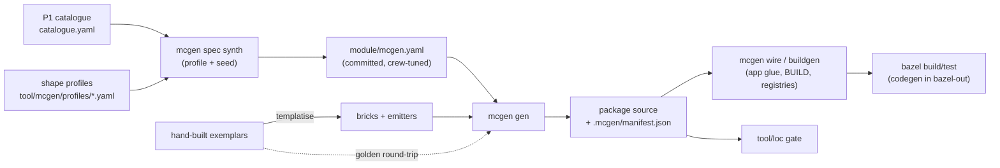
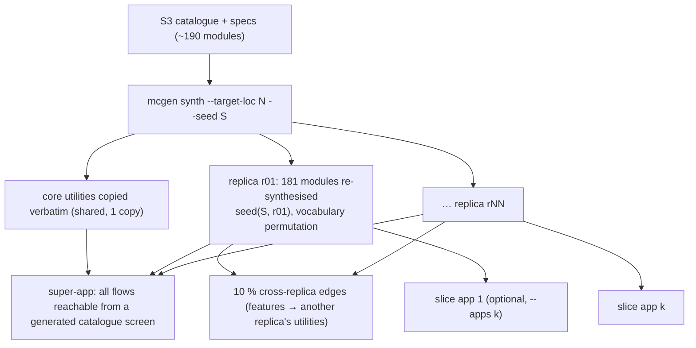
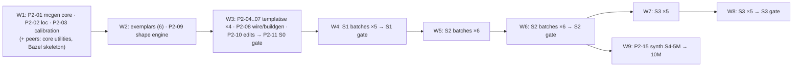

# 02: Generation and scale (how 500k to 1M realistic LOC get written and grown)

| Field | Value |
|---|---|
| Task | T-0013, wave 2 (planning), Planner **P2** |
| Author | Planner P2 (crew), 2026-11-22 |
| Status | Draft for TL assembly |
| Binding input | [`00-planning-brief.md`](00-planning-brief.md) (D1 to D12) |
| Research cited | `[tide-core §n]` = `research/tide-miniclient/architecture-core.md`; `[tide-nav §n]` = `research/tide-miniclient/app-navigation-testing.md`; `[rules_dart §n]`, `[rules_flutter §n]` = `research/bazel-rules/ai_rules_{dart,flutter}.md` |
| Peers | P1 (module catalogue: *what* exists), P3 (Bazel integration), P4 (profiling), P5 (testing/BDD), P6 (roadmap). Module names here are placeholders until P1's catalogue lands. |

---

## Key decisions

- **KD1. Exemplar-first, generator-second.** One reference module per archetype is hand-built, verified against the Tide articles and green under both `fvm flutter` and Bazel. The generator is then derived from the exemplars, and **each exemplar is the generator's golden test**: `mcgen gen` on the exemplar's spec must reproduce the exemplar byte for byte, apart from its keep regions.
- **KD2. `tool/mcgen` is a Dart CLI with two stages.** `spec synth` turns a P1 catalogue entry, an archetype *shape profile* and a seed into a committed per-module `mcgen.yaml`. `gen` renders that spec into a complete package. Mason bricks render the fixed-shape files (Tide already uses mason for these, `[tide-core §5.9]`). Typed Dart emitters render the variable-shape code (models, widget trees, rules and tests).
- **KD3. Scaffolded source is committed; build-time codegen output is not.** mcgen output is ordinary first-party source for S0 to S3: reviewed, diffed and edited like any other source. Build-time outputs from freezed, json, retrofit, injectable, l10n and BDD stay in `bazel-out`, as D7 requires. S4 workspaces are generated out of tree and never committed.
- **KD4. Regeneration never clobbers human work.** Each module has an ownership mode (`managed`, `mixed` or `ejected`) and may contain keep regions. A hash manifest at `.mcgen/manifest.json` lets mcgen refuse to overwrite any file whose content has drifted from what it last wrote.
- **KD5. Determinism by construction.** mcgen uses its own PRNG (SplitMix64) with *named forked streams* and a per-module seed. It sorts by code unit, writes LF line endings, embeds no timestamps or absolute paths, and runs `dart format` from the pinned SDK. Two runs on two machines in two checkout paths produce the same bytes.
- **KD6. Realism is specified, measured and gated.** Shape profiles state distributions for file size, fan-out, field counts, widget depth, bloc states, l10n keys, mixins and import cycles. P2-03 calibrates them against open-source Flutter apps. Realism gates (percentile bands, a near-duplicate rate and a mixin quota) run in CI.
- **KD7. `tool/loc` implements D8 with a lexer, not a regex.** It splits first-party LOC into `hand` and `scaffold`, and reports `test`, `generated` and `tooling` separately. It writes JSON and Markdown, and it is the CI gate for each rung.
- **KD8. The scale ladder:** S0 has 15 packages and about 35k LOC; S1 50 and 150k; **S2 is 01's catalogue: 169 and about 634k**; S3 about 190 and 1.0M. S4 is about 915 packages at 5M and about 1,820 at 10M. S4 is a **re-seeded synthesis** of the S3 catalogue (R replicas with fresh shapes and names), not a copy, and it still builds as an iOS app.
- **KD9. Edit corpus.** `tool/edits` holds 14 required edits and 3 control edits. Each is deterministic and byte-reversible, and declares its **expected rebuilt set as bounds** over the dependency graph, broken down by mnemonic and configuration. It also requires that the incremental build equal a clean build. P4 uses this as its oracle.
- **KD10. Parallelism.** A batch is one *domain group* of 6 to 10 modules plus that domain's fixture package. Shared glue (the app router, the DI list, pub workspace members, BUILD files and the `analysis_config` list) is **regenerated**, never merged by hand, by `mcgen wire` / `buildgen` at integration time. That is about 34 crew tasks in 6 waves to reach S2, and about 44 in 8 waves to reach S3.
- **KD11. Fixtures live in per-domain `mc_fixtures_<domain>` data utilities**, not inside `mc_mocked_backend`. The mocked backend stays a data-free engine (D5), so one fixture edit fans out to one domain's tests instead of all of them.
- **KD12. Templates use the generator versions the rules pin** (freezed 4.0.2 and json_serializable 6.14.1, `[rules_dart §6.2]`). freezed 4 only adds the `sealed` modifier: states keep Tide's private cases and are consumed with `state.when` `[tide-core §5.8]`, which freezed_annotation 3.1.0 restored (R16, 01 D-15). If P3-01 AC6 shows the stock shim doesn't emit `when`, the templates fall back to `switch` over public cases.

## Open conflicts for the TL

| # | Conflict | With | P2 proposal | Decision needed |
|---|---|---|---|---|
| C1 | **D8 says "≥ 500k first-party *hand-written* LOC".** Read literally, scaffolded source wouldn't count, and 500k typed lines means roughly 250 to 400 agent tasks. | Brief D8, PO | The D8 *metric* counts committed first-party source minus build-time generated files. Scaffolded source is real committed code that the compiler, analyzer and Bazel treat exactly like typed code. `tool/loc` still reports `hand` and `scaffold` separately, with a **hand share target of ≥ 5 %**, so nobody is misled. | TL to confirm with the PO (Q-006 follow-up) |
| C2 | **S3 (1M) doesn't fit 130 to 170 modules** at a realistic average of 4 to 5k LOC per module. | P1 catalogue, D8 | S3 adds about 40 modules (to about 190) **and** moves about 20 % of features up a size class (L/XL at 6 to 18k). The alternative is about 150 modules averaging 6.7k, which makes typical features unrealistically large. | P1 + TL |
| C3 | **Fixture ownership.** If all fixtures live in `mc_mocked_backend`, every fixture edit re-runs every BDD test (an asset fan-out we would only be measuring in our own design), and every batch collides on one package. | P1, P5, ADR-0005 | Use per-domain `utility/mc_fixtures_<domain>` data utilities (assets plus a route manifest). `mc_mocked_backend` holds only the engine. Feature tests dev-depend on their own domain's fixtures; the app depends on all of them. | P1/P5 |
| C4 | **BUILD file generation.** Gazelle doesn't fit `lib/src/**` and splits packages `[rules_dart §7, R3]`, and it has no `flutter_*` kinds `[rules_flutter §16.1]`. P3 may propose its own generator. | P3 | Use one tool: `mcgen buildgen` emits every `BUILD.bazel`, hand-written packages included, from pubspec plus resolved imports. **P3 owns the macros** (`//tool/bazel:defs.bzl`); mcgen only calls them. | P3 + TL |
| C5 | **Test-target granularity.** One `flutter_test` per test file, with each test's linked kernel (`DartKernelLink`) at an estimated 5 to 15 MB, gives about 2.3k links at S2 and about 80k at S4-10M. That last figure is hundreds of GB in `bazel-out` and the disk cache (H-TESTLINK). | P3, P5 | mcgen emits per-file tests (realistic) plus a `tests: per_file \| per_package` knob. The P3 macro aggregates at build time. S4 defaults to `per_package`. | P3/P5 |
| C6 | **freezed 4 syntax** (KD12) departs from the articles' freezed 2 code. | Conformance verifiers (T-0013-AC4) | **Resolved (R16):** only the `sealed` modifier differs; private cases and `state.when` stay (01 D-15). | — |
| C7 | **Adding a module may churn `pubspec.lock`.** If first-party packages are path entries in the lock `[rules_flutter §4.1]`, adding one re-evaluates the `flutter.pub` extension and may re-fetch spokes. | P3 | P3 should keep first-party packages out of the lock (as plain `flutter_library` targets) or prove that a lock change re-fetches nothing. Edit E14 asserts "no existing spoke re-fetched". | P3 |
| C8 | **Generated tests and self-confirmation** `[tide-nav §4.5]`, ADR-0006 §3. | P5 | Tests assert **examples written in the spec** (requirements), never values computed by the generator's own logic. The spec's endpoint shapes and `examples:` act as the external API spec: DTOs never feed fixtures or contract schemas [testing › Testing Data]. Verifiers also hand-audit a 10 % file sample per batch. | Accepted |

---

## 1. Strategy: exemplar-first, then generate

### 1.1 Why agents shouldn't hand-write 600k lines

1. **Cost.** At roughly 2 to 4k reviewed lines per crew task, 600k lines is 150 to 300 Engineer tasks, plus an equal number of fresh Verifier sessions under ADR-0006. The generator path needs about 34 tasks to reach S2 (§7.4).
2. **Conformance doesn't survive manual repetition.** The Tide articles drift within a single tutorial: `retrofit_generator` 8.0.4 vs 8.0.5, `mavel_` typos, and `log` vs `trackEvent` `[tide-core §10.4]`. Conformance should be verified once, in the exemplar, and inherited by every module.
3. **A benchmark needs knobs.** P4 needs to turn shapes up and down: mixins per KLOC, fan-out, import cycles and size classes. It also needs to rebuild the exact same tree from a seed for upstream reproductions (D12). Hand-written code can't be re-dialled, and S4's 5 to 10M lines are impossible by hand.
4. **Verifiability.** Generated code is verified through generator tests (goldens, determinism, an analyze fuzz) plus sampled audits. Hand-written code would need line-by-line Verifier audits.
5. **Evolution becomes a test in its own right.** A stack bump (say, freezed 4 to 5) is a template change plus regeneration. That is a realistic mass-change edit, not a 600k-line migration.

### 1.2 Where hand-written work still adds value

| Work | Why it stays hand-written | Ownership |
|---|---|---|
| **Core utilities:** `mc_analysis`, `mc_prelude`, `mc_di`, `mc_monitoring`, `mc_api_client`, `mc_feature_flow`, `mc_design_system` (core), `mc_mocked_backend`, `mc_test_utils` | Fan-in hot spots. Their body and API edits are the most consequential incremental cases (E03, E04, E05). They're bespoke, with fixed `FeatureFlow` defects `[tide-nav §3.2]` and the `Result` API `[tide-core §4.2]` | `ejected` |
| **Exemplars** (§5, S0) | They *are* the templates' source of truth | `ejected`, golden for mcgen |
| **App glue patterns:** boot, root DI composition, `go_router` typed routes, the navigator implementation pattern | The shapes are designed by hand; `mcgen wire` then repeats them per feature | wire-owned files plus a hand-owned core |
| **Keep-region business logic** inside generated features | Irregular, domain-specific code that templates can't express | keep regions (counted as `hand`) |
| **Irregularity quota** per batch (§7.2) | Real repos have god files, custom painters and odd utilities | `mixed` (owned files) |
| **Specs** (`mcgen.yaml`) | Domain modelling is creative work; synthesised specs are a starting point | committed YAML |

### 1.3 Pipeline



---

## 2. Generator design (`tool/mcgen`)

### 2.1 Layout and commands

```
tool/mcgen/
  bin/mcgen.dart
  lib/src/core/        # rng, spec model + JSON schema, symbol table, import resolver, writer, manifest
  lib/src/shape/       # profile sampling, size classes, vocabularies, realism metrics
  lib/src/emit/<archetype>/   # typed emitters for variable-shape code
  bricks/<brick>/      # mason bricks: pubspec, barrel, analysis_options, di, flow, navigator, BUILD
  profiles/<archetype>.yaml   # distributions (§3.2)
  vocab/*.txt          # synthetic domain nouns and names (no Marvel trademarks, R-005)
  test/                # goldens (exemplar round-trip), determinism, analyze fuzz
```

mcgen runs with `fvm dart run tool/mcgen` and also as a `dart_binary` (`//tool/mcgen`). Its pub dependencies (`mason`, `analyzer`, `dart_style`, `yaml`, `image`) go in an **isolated** hub, so its `analyzer` doesn't collide with the app's single-version pub resolution or with rules_dart's `ext_pub_deps` `[rules_dart §4, §6.3]`.

| Command | Effect | Writes |
|---|---|---|
| `mcgen spec synth <module>… [--resynth]` | Catalogue entry, profile and seed become a full spec | `<module>/mcgen.yaml` |
| `mcgen spec lint [--all]` | Schema plus semantic checks: D1 layering, name collisions, scenario-ID format, examples present for every rule | — |
| `mcgen gen <module>… [--check]` | Renders the package. `--check` is a dry run that exits 1 on any diff | module directory, manifest |
| `mcgen wire [--check]` | Shared app glue and registries (§2.8) | wire-owned files only |
| `mcgen buildgen [--check]` | `BUILD.bazel` for **every** package, from pubspec plus resolved imports | `**/BUILD.bazel` |
| `mcgen check` | Drift: hand edits in managed files, stale manifests, keep-region damage | — |
| `mcgen owners --verify <task>` | Fails if `git diff --name-only origin/main` touches paths outside the task's batch | — |
| `mcgen new <archetype> <name>` | Spec synthesis plus gen plus wire (used by edit E14) | new module |
| `mcgen synth --target-loc N --seed S --out DIR [--apps k] [--tests full\|lean\|none]` | S4 workspace (§5.2) | `DIR` (out of tree) |
| `mcgen stats [--rung Sx]` | Shape metrics against profile bands | JSON |

### 2.2 Domain spec (input)

There is one YAML file per module, at `<tier>/<module>/mcgen.yaml`. It is validated against `tool/mcgen/schema/mcgen-1.json`. An abridged list-detail example:

```yaml
schema: mcgen/1
module: characters_list          # D2 naming
tier: feature
archetype: list_detail
size_class: M                    # S | M | L | XL (§3.1)
ownership: mixed                 # managed | mixed | ejected
seed_salt: 0                     # bump to re-roll unconstrained choices only
deps: [mc_prelude, mc_di, mc_api_client, mc_monitoring, mc_feature_flow, mc_bloc_kit, mc_ds_cards, mc_formatters]   # never mc_design_system (spec lint)
entities:
  - name: Character
    fields:
      - {name: id, type: CharacterId}                  # extension type
      - {name: name, type: String}
      - {name: aliases, type: List<String>, default: []}
      - {name: thumbnail, type: Thumbnail}            # nested model
      - {name: alignment, type: Alignment, unknown: neutral}
      - {name: firstAppearance, type: DateTime?}
  - {name: Alignment, enum: [hero, villain, neutral]}
  - {name: Affiliation, union: [team(TeamRef), solo(), unknown()], union_key: kind}
endpoints:
  - {id: list, method: GET, path: v1/characters, query: [offset, limit, nameStartsWith], returns: Page<Character>}
  - {id: detail, method: GET, path: 'v1/characters/{id}', returns: Character}
rules:
  - id: badge
    kind: classifier
    input: Character
    cases: [{when: "comicsCount >= 1000", then: legend}, {when: "comicsCount >= 100", then: veteran}]
    default: rookie
    examples: [{comicsCount: 1200, expect: legend}, {comicsCount: 5, expect: rookie}]
blocs:
  - name: CharactersList
    states: [initial, loading, loaded, loadingMore, empty, error]
    events: [load, loadMore, refresh, search(query), open(Character)]
    transformers: {search: debounce_300ms}
flow: {state: [{name: previewId, type: CharacterId?}], pages: [CharactersListPage, CharacterPreviewPage]}
screens:
  - {name: CharactersListPage, layout: sliver_grid, depth: 9, widgets: 7}
  - {name: CharacterPreviewPage, layout: scroll_sections, depth: 11, widgets: 9}
navigator: {name: CharactersListNavigator, outbound: [openCharacter(CharacterId), openComic(ComicId), requestSignIn() -> bool]}
l10n: {locales: [en, de, fr, es, ja], keys: 64, placeholders: 9, plurals: 4, selects: 1}   # en template; others pseudo (01)
mixins: [{name: TileMotion, on: State}]
bdd:                             # 05 §3 vocabulary; data setup before the flow opens (TD-05)
  - feature: browse_characters
    background: "Given the backend serves {'characters.paged_45'}"
    scenarios:
      - {id: MC-characters_list-01, title: "The first page is listed in name order", steps: ["When I open the characters list", "Then I see {'Hero 01'}"]}
      - {id: MC-characters_list-02, title: "A failed first page offers a retry", steps: ["Given the backend fails {'GET /v1/characters'} once with {'server_error'}", "When I open the characters list", "Then I see the error state"]}
    outlines:                    # rule examples run through the flow (R6), one row per example
      - {id: MC-characters_list-03, rule: badge, title: "A character's badge follows its comic count"}
keep: [rules.badge.body]         # hand-owned region(s)
```

The spec is the contract. Models, fixtures and tests all derive from it, and **test expectations come only from `examples:`** (C8). BDD steps come from `mc_test_steps` (05 §3.2), extended per module where needed. Placeholder art is never per feature: it comes from `mc_fixtures_media` (01 D-24).

### 2.3 Output per feature module

Folders follow Tide `[tide-core §5.2, §5.3]` and `[tide-nav §3.3]`. `domain/usecase` and `domain/rules` are recorded *extensions*: Tide names use cases but gives them no folder `[tide-core §5.7]`.

| Output | Content | Main variation source |
|---|---|---|
| `pubspec.yaml`, `analysis_options.yaml`, `BUILD.bazel` | brick; deps computed from symbol use (strict deps `[rules_dart §4]`) | `deps` |
| `lib/<module>.dart` | barrel (R4): the flow(s), navigator(s) and flow arg/result types, as `package:` exports with `show`, no `library;` directive | `flow`, `navigator` |
| `lib/src/di/di_initializer.dart` (+ `di_module.dart`) | Tide's boilerplate `[tide-core §5.9]` | — |
| `lib/src/di/flow_scope.dart` | generated root imports (R17, 01 §4.5); written by `mcgen wire` | injectable constructors |
| `lib/src/domain/model/*.dart` | freezed + json models, enums, unions, extension types, DTO→domain mappers | `entities` |
| `lib/src/domain/api/<m>_api.dart` | `@RestApi` + `@injectable` interface `[tide-core §5.5]` | `endpoints` |
| `lib/src/domain/repository/*.dart` | `Result` repositories, typed failures, pagination and caching `[tide-core §5.6]` | `endpoints`, `rules` |
| `lib/src/domain/{usecase,rules}/*.dart` | use cases; rule implementations (classifier, comparator, validator, calculator, state machine) | `rules` |
| `lib/src/presentation/bloc/*.dart` | Bloc with hand-style sealed events and a freezed `sealed` state with private cases, as parts; failure cases `@Implements<McFailureState>()`; monitoring in `McBloc.onTransition` `[tide-core §5.8]` | `blocs` |
| `lib/src/presentation/{page,widget}/*.dart` | pages: `XPage` = `BlocProvider(create: (c) => c.di<XBloc>())`, the only DI call in the UI (R17); `_XPageContent` maps states with `state.when` `[tide-core §5.10]`; widget trees | `screens` |
| `lib/src/flow/*.dart` | freezed flow state + `FeatureFlow` widget `[tide-nav §3.3]` | `flow` |
| `lib/src/navigator/*.dart` | outbound navigator contract, implemented in the app `[tide-nav §3.4]` | `navigator` |
| `lib/src/l10n/<m>_<locale>.arb` | ARB per locale (D4b, 01 §3.3); `@@locale` matches the file name `[rules_flutter §6]` | `l10n` |
| `test/feature/*.feature`, `test/feature/step/*.dart` | Gherkin in 05 §3's vocabulary (data before open), plus thin per-feature steps over `mc_test_steps` (`owned` after first write, as bdd_widget_test stubs are `[tide-nav §4.6]`). Rule `examples:` become Scenario Outline rows (R6) | `bdd`, `rules` |
| `test/contract/*_test.dart`, `test/golden/*.feature` | mapper round-trips and DTO parsing over every fixture variant (05 TD-11); key-screen goldens. **No `test/unit/`** in features (R6) | `endpoints`, `screens` |
| `utility/mc_fixtures_<domain>/fixtures/<m>/*.json` + `routes.json` | page 1/2, empty, error fixtures per endpoint (C3) | `endpoints`, seed |
| `.mcgen/manifest.json` | generator version, spec hash, seed, per-file hash, ownership | — |

Utility archetypes (foundation, UI-kit, data) have their own inventories, derived from their exemplars in the same way.

### 2.4 Templates: mason bricks plus typed emitters

- **Bricks** (`bricks/mc_pubspec`, `mc_barrel`, `mc_di`, `mc_flow`, `mc_navigator`, `mc_build`, `mc_l10n`) cover the fixed-shape files. mcgen drives them through `package:mason` (`MasonGenerator.fromBrick`) with fully precomputed variables, so the templates stay logic-less. Humans can run them directly with `mason make mc_feature` (D3 "mason for scaffolding").
- **Emitters** cover recursive or variable structure, such as widget trees of depth *d*, rule bodies, unions and test tables. Mustache can't express these cleanly. Emitters build a small typed IR (declarations, expressions, widget nodes). Each emitted declaration registers in a **symbol table**, and each reference records its owning file. The **import resolver** then writes exactly the imports in use, as `package:` imports `[tide-core §2.4]`, sorted for `directives_ordering`. The same use-graph produces the pubspec and BUILD `deps`.
- **Templatising an exemplar** (P2-04 to P2-07): copy the exemplar, replace its concrete names and shapes with IR or brick variables, write the exemplar's spec, and require the round-trip golden (KD1) to pass.

### 2.5 Determinism and idempotence

- **Seed:** `module_seed = SplitMix64(fnv1a64("$globalSeed/$module/$seedSalt"))`, with `globalSeed` set in `tool/mcgen/mcgen.yaml`. Every draw goes through a *named forked stream*, e.g. `rng.fork('entities').fork('Character')`. Adding a knob or template therefore never reshuffles unrelated choices. Dart's `Random` isn't used, because its sequence isn't guaranteed across SDK versions.
- **Byte stability:** keys and lists are sorted by code unit (not locale); output is LF only; no timestamps, hostnames or absolute paths; PNGs come from a fixed encoder with no metadata chunks; `dart format` comes from the FVM-pinned SDK (3.47.7, D6), so the output agrees with Bazel's `dart_format` aspect `[rules_dart §13]`.
- **Idempotence:** `mcgen gen X` run twice gives an empty `git diff`. `mcgen gen --check` is the CI form.
- **Golden tests:** generating each archetype's exemplar spec in two temporary directories under different absolute paths gives an identical tree hash, which also equals the exemplar.

### 2.6 Regenerating without clobbering hand edits

| Mode | mcgen writes | Hand edits allowed | Use |
|---|---|---|---|
| `managed` | every file listed in the manifest | **only inside keep regions** | most generated modules |
| `mixed` | managed files; `owned:` files written once, never again | owned files plus keep regions | customised modules (default) |
| `ejected` | nothing (`buildgen` still checks its BUILD file) | everything | exemplars, core utilities |

- **Keep regions** take the form `// mcgen:keep <id>` … `// mcgen:end <id>`, and are allowed only *inside* bodies (methods, build methods, rule bodies), never around declarations, so signatures stay under spec control. The content is preserved verbatim; the region's default body is emitted only when the region is new.
- **Clobber guard:** before writing, mcgen compares each file's current hash with the manifest hash, ignoring keep-region contents. On a mismatch it stops and reports the drifted files. The remedies are to move the edit into a keep region or the spec, add the file to `owned:`, or pass `--force` (logged in the task).
- **Header:** each managed file starts with `// Scaffolded by mcgen from mcgen.yaml; edit the spec or a keep region.`. It's a comment, so it doesn't count toward D8.

### 2.7 How generated code passes analyze, format and tests

| Gate | How the generator guarantees it | Verified by |
|---|---|---|
| Format | every file goes through the pinned `dart format` | `dart_format` aspect; `mcgen gen --check` |
| Analyze (`mc_analysis` = Tide's 22 rules plus strict casts and raw types `[tide-core §4.1]`) | explicit return types, package imports and `package:` barrel exports, no `library;` directive (`unnecessary_library_directive`), const-context tracking (no `unnecessary_const`), no `new`, typed JSON maps. **mcgen never emits `// ignore`** | `bazel test` with the `dart_analyze` aspect, where any diagnostic fails `[rules_flutter §8]`; generator CI runs a **fuzz analyze** of 50 synthesised specs per archetype with zero issues |
| Strict deps / layering | deps come from the use-graph; feature→feature edges are refused in `spec lint` (D1) | `DartImportCheck` `[rules_dart §5.1]` |
| Codegen inputs | freezed states stay `part of` the bloc file, as in Tide; parts are listed so P3's macros stage them `[tide-core §7.2]` | Bazel build |
| Tests | rule `examples` run as Scenario Outlines through the flow; mapper round-trips (`fromJson(toJson(x)) == x`) live in `test/contract/`; **no bloc or repository unit tests and no internal mocks** (R6) `[tide-nav §4.7]`; BDD runs sociably through `mc_mocked_backend` in process at zero latency `[tide-nav §10]`, with an injected fixed clock | `bazel test //<module>/...`, plus `fvm flutter test` on sampled modules (the IDE/baseline path, D7) |

### 2.8 Shared glue: `mcgen wire` and `buildgen`

These files are **wire-owned**. Batches never edit them by hand; they are regenerated from the full set of specs:

- in each `app/wiring/<group>_wiring/` (R5, 01 §3.4): `lib/src/routes/<domain>_routes.dart` (typed `go_router_builder` routes, D4a), `route_targets.dart` and `route_targets_impl.dart` (flow construction, R15), the navigator-implementation skeletons `lib/src/navigators/<feature>_navigator_impl.dart` (`owned` after first write, since they hold mapping logic) and `test/flow_scopes_test.dart` (01 §4.5)
- `app/wiring/app_core/lib/src/locations/app_locations.dart` (cross-group typed locations) and the wiring list in `app/mini_client` and each sandbox
- each feature's `lib/src/di/flow_scope.dart` (generated root imports, R17)
- the app's `pubspec.yaml` deps, the root `pubspec.yaml` workspace members, the root `BUILD.bazel` `dart_analysis_config` list `[rules_dart §13]`, and all `BUILD.bazel` files (`buildgen`)

A merge conflict in a wire-owned file is **resolved by regenerating it** (`mcgen wire && mcgen buildgen`), never by hand.

---

## 3. Realism and variation

The goal is compile behaviour that looks like an enterprise repo: heavy-tailed file sizes, uneven fan-in, a few god files, cycles inside packages, and a mix of language features. Near-identical stamped modules would make every action cost the same and hide the tails, which is exactly where rules regressions show up.

### 3.1 Size classes

| Class | Feature lib LOC | Share at S2 | Share at S3 | Typical content |
|---|---|---|---|---|
| S | 1.5–2.5k | 25 % | 20 % | 2–3 entities, 2 screens, 1 bloc |
| M | 3–5k | 47 % | 40 % | 4–7 entities, 3–5 screens, 2–3 blocs |
| L | 6–9k | 22 % | 28 % | 8–12 entities, 6–9 screens, 3–5 blocs |
| XL | 10–18k | 6 % | 12 % | 15+ entities, 10+ screens, wizard plus dashboard sections |

### 3.2 Target distributions (assumptions, to be calibrated by P2-03)

These are **assumptions**, not measurements. I've seen no published shape data for enterprise Flutter apps. P2-03 measures 2–3 large open-source Flutter apps with `tool/loc --histograms` (candidates: AppFlowy's `frontend/appflowy_flutter`, Immich's `mobile/`, Invoice Ninja's admin portal), records the result as a finding, and moves the bands. Until then:

| Metric (first-party lib code) | p50 | p90 | p99 | max | Notes |
|---|---|---|---|---|---|
| LOC per file | 65 | 220 | 600 | 1,500 | log-normal; ≥ 1 "god file" (800–1,500) per L/XL feature |
| Files per feature (lib) | 55 | 120 | 200 | — | |
| Imports per file (all) | 9 | 18 | 30 | — | |
| First-party deps per feature | 9 | 14 | 18 | — | the 6 core utilities always, plus 2–8 by archetype |
| Transitive first-party packages per feature | 18 | 26 | 32 | — | drives `DartKernel` input size (H-INPUTS `[rules_dart §14.3]`) |
| Utility DAG depth (L0→L7) | — | — | — | 8 | longest app→leaf chain is 9–10 |
| Fields per entity | 9 | 22 | 35 | 40 | |
| freezed classes per feature | 10 | 25 | 45 | — | models, states, flow state |
| States per bloc | 4 | 7 | 9 | — | events 2–12; 1–5 blocs per feature |
| Widget-tree depth per build method | 7 | 12 | 16 | — | 3–12 private widgets per page |
| Cyclomatic complexity per function | 2 | 6 | 14 | — | rule and validator bodies sit in the tail |
| l10n keys per feature | 60 | 160 | 250 | — | 15 % placeholders, 5 % plurals, 2 % selects |
| Doc/comment lines : code lines | 0.2 | 0.35 | — | — | affects scan time, not LOC |
| Test LOC : source LOC (per module) | features 0.25, utilities 0.8 | features 0.35 | — | — | 05 §4 owns the test budget; feature floor 0.2 |

### 3.3 Entity shapes

- **Field types:** String 35 %, int 12 %, double 6 %, bool 10 %, DateTime 8 %, enum 8 %, nested model 8 %, `List<…>` 8 %, `Map<String, …>` 2 %, extension-type IDs 3 %. 30 % are nullable, 15 % have `@Default`, and every field carries an explicit `@JsonKey(name:)` `[tide-core §5.4]`.
- **Structure:** 40 % of entities nest (depth up to 3); 10 % are **sealed unions** with 2–5 variants and a `unionKey`; every list endpoint returns the generic `Page<T>` envelope from `mc_api_client` (`genericArgumentFactories`, `[tide-core §4.4]`); 1–4 enhanced enums per feature, with `unknownEnumValue`.

### 3.4 Widgets, rules, blocs and l10n

- **Widgets:** 70 % stateless, 25 % stateful (controllers, `SingleTickerProviderStateMixin`), 5 % `CustomPainter` (in dashboards). Layout is chosen by archetype: slivers (list), `Form` with validators and step indicators (wizard), `LayoutBuilder` responsive grids and charts (dashboard).
- **Business rules** come from six kinds: classifier, comparator (multi-key sort), validator (single- and cross-field), calculator (aggregates, rounding), filter/grouper, and step state machine (wizard guards). Bodies contain real branching: `switch` on enums and sealed types, loops and collection pipelines.
- **Blocs** use `Bloc` (not Cubit) with event transformers (debounce, droppable), `emit.forEach` over repository streams in 20 % of features, and monitoring in `onTransition` only `[tide-core §5.8]`.
- **l10n:** every feature has 01's five locales: `en` (template) plus pseudo-translated `de`, `fr`, `es` and `ja`. Locale count multiplies `flutter_gen_l10n` output.

### 3.5 Import-graph realism

- **Barrels (D1, R4):** feature barrels export 1–3 flows plus their navigators and arg/result types. Foundation barrels export 5–40 files; UI-kit barrels 30–150 (`mc_design_system` is the widest, and the target of E06). 30 % of features also have internal folder barrels (`src/presentation/widget/widget.dart`).
- **Inside a package:** files import siblings directly through `package:<self>/src/…` `[tide-core §2.4]`. **25 % of feature packages contain one intra-package import cycle (SCC) of 3–8 files** (page ↔ widget ↔ helper), because rules_dart compiles one kernel per import SCC `[rules_dart §5.1]`. Without SCCs we'd never exercise that path.
- **Remember that `lib/src` is not private to the compiler.** Every library in the package is in its outline, so any signature change in `src` reaches the package's direct dependents (for a feature, that's the app). The edit oracle encodes this (E07, E08, E10).

### 3.6 Mixins (controlled, because they defeat outline cutoff `[rules_dart §5.2]`)

| Kind | Quota at S2 | Examples | Why |
|---|---|---|---|
| Hot authored mixins in `mc_ds_*` UI-kit utilities (never in the cutoff-critical kits of 01 key decisions) | **15**, each imported by ≥ 30 packages | `McPressableMixin`, `McFormFieldStateMixin`, `McAnimatedVisibilityMixin` | E05 targets the hottest one |
| Local feature mixins | 0–2 per feature (form features 1–3), about 150 in total | `TileMotion`, `StepValidation` | about 1 per 3.5 KLOC |
| `mixin class` | 10 % of the above | — | language-feature mix |
| Generated freezed mixins (`_$X`) | unavoidable, about 1 per freezed class | — | `tool/loc` reports the count; they inflate outline size |

There's also a profile knob, `mixins.per_kloc` (0, 0.3 or 1.0), so P4 can A/B the cutoff loss at S4. Every first-party package stays at language version ≥ 3.0: a pre-3.0 library makes *every* class mixin-capable and silently loses cutoff `[rules_dart §5.2]`.

### 3.7 Language-feature mix

Sealed classes and `switch` expressions (everywhere), records (10 % of functions), extension methods (1–5 per feature), extension types (IDs), generics with bounds (repositories, `Page<T>`), `async*` streams, `late` fields, and `const` constructors throughout. Everything stays within the D6 SDK's Dart 3.13.

### 3.8 Realism gates (`mcgen stats`, run per rung)

1. Every §3.2 metric is inside a p50 ±25 % / p90 ±35 % band.
2. **Near-duplicate rate:** MinHash/Jaccard over identifier-normalised token 5-shingles, comparing files of the same role across modules. Fewer than 2 % of pairs may exceed 0.9.
3. Mixin quota (§3.6) and SCC quota (§3.5) are met.
4. No single module holds more than 4 % of source LOC.
5. Hand share is ≥ 5 % (C1).
6. **Reachability** (Tide's "delete what exported entry points can't reach" [testing › Testing Best Practices]): mcgen emits a `src` declaration only if the spec ties it to a screen, flow or rule that a generated scenario exercises; per batch, every scaffolded file has ≥ 1 covered line, and the coverage gate's uncovered-line list goes into the Verifier's report.

---

## 4. LOC accounting (`tool/loc`)

### 4.1 The D8 rule, exactly

A line counts iff (a) it is in a first-party `.dart` file under `app/`, `feature/` or `utility/`; (b) **at least one non-comment token** of the file covers it; and (c) the line contains a non-whitespace character. Each file is tokenised with `package:analyzer`'s scanner (`parseString(throwIfDiagnostics: false)`, walking `token.next` and skipping `precedingComments`). Every line from the start to the end of each token is marked, so multi-line strings count, and nested `/* /* */ */` comments, `//` inside strings and `///` are all handled correctly. `cloc` gets the first two wrong for Dart. P2-02 cross-checks against `cloc` on a corpus and records the differences in a finding.

**Excluded as `generated`:** `*.g.dart`, `*.freezed.dart`, `*.config.dart`, `*.gr.dart`, generated l10n (the `flutter_gen_l10n` outputs, identified from the Bazel outputs or the configured `output_localization_file` names), and BDD-generated `_test.dart` (a sibling `.feature` with the same stem, or a Bazel BDD output).

**Classification:**

| Bucket | Definition | In the D8 total? |
|---|---|---|
| `source.hand` | ejected or unmanaged files; owned files that differ from their first-write hash; lines inside keep regions | **yes** |
| `source.scaffold` | managed or owned files still matching their manifest hash (minus keep-region lines) | **yes** (C1) |
| `test` | `test/`, `integration_test/`, `test_driver/`, plus `testonly` packages (`mc_test_utils`), split into the same hand/scaffold pair | reported separately |
| `generated` | scanned from `bazel-bin` (`--generated-root`), or the build_runner baseline tree | reported separately, by generator |
| `tooling` | `tool/**` (mcgen, loc, edits) | reported separately |

A **committed generated file** (a generated suffix inside the git tree) is an error under `--strict`, which enforces D7. The one exception is a file listed in `tool/build_runner_overlay/fallback.yaml` while a generator runs on the R28 fallback; it counts as `generated`, never as source.

### 4.2 Breakdowns and output

Counts are broken down per module, per tier (app, feature, utility), per **archetype** (from the spec or catalogue) and per **intra-module layer**: `di`, `domain/model`, `domain/api`, `domain/repository`, `domain/usecase`, `domain/rules`, `presentation/bloc`, `presentation/page`, `presentation/widget`, `flow`, `navigator`, `l10n`, `other`. Non-Dart counts are reported alongside: ARB keys, `.feature` scenarios, fixture files and assets. These are gen-l10n, BDD and asset-bundle inputs.

```json
{ "schema": "mc-loc/1", "commit": "<sha>", "rule": "D8",
  "totals": { "source": {"hand": 0, "scaffold": 0}, "test": {"hand": 0, "scaffold": 0},
              "generated": {"freezed": 0, "json": 0, "retrofit": 0, "injectable": 0, "l10n": 0, "bdd": 0, "go_router": 0},
              "tooling": 0, "packages": 0, "files": {"lib": 0, "test": 0, "other": 0} },
  "by_archetype": { "list_detail": {} }, "modules": [ { "name": "", "path": "", "tier": "", "archetype": "", "layers": {} } ],
  "histograms": { "file_loc": [], "imports_per_file": [], "pkg_fan_out": [], "pkg_fan_in": [] },
  "mixins": { "authored": 0, "generated": 0 }, "gates": { "rung": "S2", "pass": true, "failures": [] } }
```

The output is deterministic (sorted keys, no wall-clock fields except an optional `--stamp`). The Markdown report contains the totals, a per-archetype table, the top-20 modules, histograms and gate results. `tool/loc diff a.json b.json` prints rung-to-rung growth. Target speed: 1M LOC in < 30 s and 10M in < 5 min (one isolate per core).

### 4.3 CI gate (`tool/loc --gate <rung>`, thresholds in `tool/loc/gates.yaml`)

| Rung | Packages ≥ | `source` (D8) ≥ | Test ratio ≥ | Other |
|---|---|---|---|---|
| S0 | 15 | 30k | 0.45 | 0 committed generated files outside the R28 manifest; every archetype has an exemplar |
| S1 | 50 | 140k | 0.35 | §3.8 gates 1–4, 6 |
| **S2** | **100** (planned 169) | **500k** (planned 634k) | 0.35 | §3.8 gates 1–6 |
| S3 | 180 | 950k | 0.35 | §3.8 gates 1–6 |
| S4 | — | target ±5 % | per `--tests` | reachability check (§5.2) |

The gate runs as an `sh_test` named for its rung AC, e.g. `//tool/gates:T_XXXX_AC1_loc_gate_S2`, so ADR-0006's "test name contains the AC ID" holds.

---

## 5. Scale ladder

### 5.1 Rungs

| Rung | Packages | `source` LOC (D8) | Test LOC | Generated LOC (est. ~1.1×) | Committed files | Bazel targets (est.)¹ | Clean actions, `test //...` (est.) | Content |
|---|---|---|---|---|---|---|---|---|
| **S0** | 15 | ~35k | ~18k | ~35k | ~850 | ~350 | ~1.5k | 8 core utilities, 3 utility exemplars, 3 feature exemplars, the app |
| **S1** | 50 | ~150k | ~60k | ~165k | ~3.9k | ~1.8k | ~7k | S0 + 26 features + 9 utilities (5 batches) |
| **S2** | 169 | **~634k** (≥ 500k) | ~250k (05 §4) | ~446k (01 §8) | ~14k | ~6.3k | ~25k | 01's catalogue: 100 features in 7 archetypes, 52 utilities, 8 app-layer libraries, 9 apps |
| **S3** | ~190 | **~1.0M** | ~380k | ~1.1M | ~19k | ~9.4k | ~38k | +30 features, +10 utilities, about 20 % of features up one size class (C2) |
| **S4-5M** | ~915 | ~5.0M | ~2.0M full / ~0.6M lean | ~5.5M | ~95k | ~46k full / ~18k lean | ~185k | R = 5 re-seeded replicas of S3's 181 non-core modules, plus the core, plus 1 super-app (+k slice apps) |
| **S4-10M** | ~1,820 | ~10M | ~3.9M / ~1.2M | ~11M | ~190k | ~92k / ~40k | ~370k | R = 10 |

¹ Assumes P3's macros make about 1 target per annotated file chain and 1 per test file (`full`). `lean` means one test target per package and kind. P3-owned; to be re-estimated once P3 publishes its macros. The 15 S0 packages are:
- the 8 hand-written core utilities: `mc_prelude`, `mc_di`, `mc_monitoring`, `mc_api_client`, `mc_feature_flow`, `mc_design_system`, `mc_mocked_backend` and `mc_test_utils`;
- the utility exemplars `mc_formatters` (foundation), `mc_ds_cards` (UI-kit) and `mc_fixtures_characters` (data);
- the feature exemplars `characters_list` (list-detail, F1+F3), `team_builder` (form/wizard) and `home_dashboard` (dashboard);
- `app/mini_client`.

`mc_analysis` (lints only, no Dart) is also present but isn't counted. All names are placeholders until P1's catalogue lands.

### 5.2 How S4 multiplies and stays a buildable iOS app



1. **Re-synthesis, not copying.** Each replica re-runs `spec synth` on every non-core S3 module with seed `(S, rNN)` and a permuted domain vocabulary, so names, entity shapes, screen counts and rules all differ. Byte copies would give unrealistically uniform costs. Packages are named `<noun>_<capability>` from about 60 nouns × 25 capabilities, with `_rNN` as a fallback, so exported flow names never collide in the app.
2. **Utilities scale too.** Each replica gets its own non-core utilities (`mc_<name>_rNN`). The hand-written core stays single, which reproduces the realistic super-hot fan-in on `mc_prelude`, `mc_di` and `mc_design_system`.
3. **Reachability.** Every flow is routed from a generated catalogue screen, so AOT's tree-shaking keeps the whole program, as upstream's `gen_monorepo.py` v2 does `[rules_flutter §10.1]`. Otherwise AOT RAM numbers would be fiction (H-AOT-1).
4. **Buildable.** The same `MODULE.bazel` pins and `.bazelrc` as the main repo. AC: `--config=sim` simulator app builds and launches to the catalogue screen on a fresh simulator; `-c opt --ios_multi_cpus=arm64` builds the App.framework AOT dylib (no signing needed `[rules_flutter §5.2]`).
5. **Out of tree:** `~/mc-synth/s4-<size>/`, reproducible from (commit, seed, target) and recorded in `SYNTH.json`. Expect about 0.6 GB of source at 10M and tens of GB of `bazel-out`, and use `--tests lean` (C5). Generation time target: < 30 min for 10M on the M4 Pro.
6. **Variants for P4:** `--apps k` (concurrent AOT memory, H-AOT-1), `--tests none|lean|full`, and `mixins.per_kloc` (§3.6). Upstream's own scale bench hit a JVM OOM at 5,000 libraries `[rules_dart §10.2]`, so the 10M rung is expected to find limits.

---

## 6. Edit corpus (`tool/edits`)

### 6.1 Mechanics

- **One YAML per edit** (`tool/edits/corpus/E01-leaf-body.yaml`): a `selector`, a `transform`, `expected` sets per config, and `probes`.
- **Selectors are deterministic graph queries**, resolved per rung by `tool/edits resolve --rung S2 > edits.resolved.json`:
  - `largest_leaf_feature`: the feature with the most LOC that only the app depends on; ties break by name
  - `hottest_utility`: the utility with the largest reverse closure R
  - `hottest_mixin`: the authored mixin with the most importing packages
- **Transforms are AST edits** (`package:analyzer`), followed by `dart format`. Edits look like real developer changes: body edits rewrite a **log-message string literal** in a bloc's `onTransition` or a utility's error path, which every module has by Tide convention `[tide-core §5.8]` and which no test asserts. There are no planted "edit hooks". Every edit leaves all tests green (checked in P2-10).
- **Reversible:** `apply` stores the pre-image hash and `revert` restores it, so `revert(apply(x)) == x` byte for byte. `tool/edits verify-reversible --all` is a CI test.
- **CLI:** `list | resolve | apply <id> | revert <id> | expected <id> --config test|sim|device --json`. `expected` expands the graph functions with `bazel query` (`rdeps`, `kind(test, …)`).

### 6.2 Notation

- **Graph:** `T` is the edited package; `F` a leaf feature; `U` the hottest utility; `A` the app; `D1(X)` the direct dependents; `R(X)` the reverse transitive closure; `t(X)` the test targets in packages X.
- **Mnemonics:**
  - rules_dart `[rules_dart §5.1]`: `K` = `DartKernel`, `L` = `DartKernelLink`, `Az` = `DartAnalyze`, `Cg` = `DartCodegen`, `Ag` = `DartAggregateCodegen`
  - Bazel: `TR` = test run (`TestRunner`)
  - rules_flutter `[rules_flutter §5.1]`: `FKC` = `FlutterKernelCompile`, `AOT` = `FlutterAotMacho` + `FlutterIOSRetagDylib`, `AB` = `FlutterAssetBundle`, `CA` = `FlutterIOSCopyAssets` / `FlutterIOSDebugAssets`
  - rules_apple: `Pkg` = bundling (`ProcessAndSign`)
  - `L10n` = the `flutter_gen_l10n` action (mnemonic to be confirmed by `aquery` in P2-10)
- **Bounds:** `[lo, hi]` gives the acceptable range of re-executed actions. Fewer than `lo` suggests stale outputs (a correctness bug); more than `hi` is over-rebuild (an efficiency bug).
- **Configs:**
  - `test` = `bazel test //...` with the analyze aspect
  - `sim` = `-c dbg` simulator app on the modular path (no defines or flavors `[rules_flutter §16.1]`), which adds `K` per changed module, the app link, `CA` and `Pkg`
  - `device` = AOT App.framework, where **any** Dart edit costs `FKC + AOT + Pkg` because AOT is whole-program `[rules_flutter §10.3]`

### 6.3 The edits and their expected rebuilt sets

| ID | Edit | Target | Expected in `test` | `sim` / `device` beyond the common rule | Probes |
|---|---|---|---|---|---|
| E01 | Leaf body | log string in `F`'s bloc | `K{F}`, `Az{F}`, `L`+`TR` t(F) | sim: `K{F}` + link | H-CUTOFF |
| E02 | Leaf API | add an optional named parameter (with default) to `F`'s exported flow constructor | `K{F,A}`, `Az{F,A}`, `TR` t(F)∪t(A) | sim: `K{F,A}` | outline change, one hop |
| E03 | Core-utility body | message string in `mc_prelude` `Result.fromAsync` | `K{U}`, `Az{U}`; `L`+`TR` t(R(U)) ≈ every test (the cutoff saves compile, not test runs) | sim: `K{U}` | H-CUTOFF, H-TESTLINK |
| E04 | Core-utility API | add `Result.tap(…)` | `K` ∈ [{U}∪D1(U), {U}∪R(U)], same for `Az`; `TR` t(R(U)) | sim: same `K` bounds | API fan-out, `unused_inputs_list` |
| E05 | Mixin body | body of the hottest mixin (e.g. `McPressableMixin`) | **expected cutoff defeat:** E04's bounds. Fewer than `lo` → check clean-equivalence first | sim: same | H-MIXIN |
| E06 | Barrel export change | export an existing unexported `src` file from `mc_design_system` | `K` ∈ [{T}∪D1(T), {T}∪R(T)], same for `Az`; `TR` t(R(T)) | sim: same | H-BARREL |
| E07 | freezed field add | nullable field + `@JsonKey` on an `F` entity | `Cg` freezed×1, json×1, combine×1; `Ag` injectable ≤ 1 (output identical); `K{F,A}` (src is in the outline, §3.5); `TR` t(F)∪t(A) | sim: `K{F,A}` | H-CODEGEN-COST, codegen cutoff |
| E08 | Retrofit endpoint add | new `@GET` method on `F`'s API | `Cg` retrofit×1 + combine×1; `Ag` ≤ 1; `K{F,A}`; `TR` t(F)∪t(A) | sim: `K{F,A}` | retrofit shim |
| E09 | l10n string change | `en` value of an existing key in `F` | `L10n`×1, `K{F}` only (a getter body), `TR` t(F) | sim: `K{F}` | cutoff through codegen |
| E10 | ARB key add | new key in `F` (all locales) | `L10n`×1, `K{F,A}`, `TR` t(F)∪t(A) | sim: `K{F,A}` | gen-l10n API change |
| E11 | Asset change | one pixel of a placeholder PNG in `mc_fixtures_media` (features have no assets, D-24) | `AB` for the golden and app targets that bundle it; **`K` = 0** | sim/device: `AB`+`CA`+`Pkg` only, **no `FKC`/`AOT`** | asset precision |
| E12 | Fixture JSON change | one value in `mc_fixtures_<d>` | `AB`+`TR` for t(features in d); **`K` = 0** | sim/device: `AB`+`CA`+`Pkg` | asset fan-out (C3) |
| E13 | BDD scenario add | scenario in `F`'s `.feature` reusing existing steps | `Cg` bdd×1, `K`×1 (that test entry), `L`×1, `TR`×1 | none | BDD shim granularity |
| E14 | New module add | `mcgen new list_detail <name>` + wire | all of `X`'s codegen; `K{X,A}`, `Az{X,A}`, `TR` t(X)∪t(A); **no existing pub spoke re-fetched**, every other action a cache hit | sim: `K{X,A}` | C7, analysis phase |
| E15 | *Control:* comment-only | add a 3-line comment at the top of a `U` file (shifts offsets) | `K{U}` only, no dependents. If dependents recompile, offsets leak into outlines (upstream issue) | sim: `K{U}` | outline stability |
| E16 | *Control:* revert | revert any edit, then rebuild | **0 executed actions** (all action-cache or disk-cache hits) | same | cache accuracy |
| E17 | *Control:* language-version pin | `// @dart=2.19` on one `U` file | E04-like bounds (every class there becomes mixin-capable) | same | `[rules_dart §5.2]` trap |

The **common rule for `device`** is that every edit touching Dart adds `FKC`×1 + `AOT`×1 + `Pkg`×1. Asset- and fixture-only edits (E11, E12) and E13 must add **no** `FKC`/`AOT`.

### 6.4 How P4 uses it

For each edit, rung and config, P4:

1. builds a baseline;
2. runs `apply`;
3. builds with `--execution_log_json_file` and groups the executed spawns by (mnemonic, package);
4. checks them against the resolved bounds;
5. checks **clean-equivalence**: the digests of the app kernel or dylib and the test results must equal a clean build of the edited tree in a fresh output base;
6. runs `revert`, and expects E16's zero-action result.

A violation becomes an upstream draft under `documents/upstream/` (D12), with `mcgen synth` seed and size as the minimal reproduction.

---

## 7. Parallel execution by crew agents

### 7.1 Ownership and batches (D11)

- **A batch is one domain group** of 6–10 modules (e.g. `comics_*`), plus its `utility/mc_fixtures_<domain>/` and any domain-specific new utilities. A batch task owns exactly those directories and nothing else. It never touches `app/`, `tool/`, root files, wire-owned files or other modules, and `mcgen owners --verify T-XXXX` enforces that.
- **Tooling tasks** own disjoint subtrees: `tool/mcgen/lib/src/core/` (P2-01), `…/shape/` (P2-09), `…/emit/<archetype>/` and `bricks/` per archetype (P2-04 to P2-07), `tool/loc/` (P2-02) and `tool/edits/` (P2-10).
- **Integration (TL):** after `git merge --no-ff fleet/T-XXXX-…` (ADR-0004), the TL runs `mcgen wire && mcgen buildgen`, commits the result as `T-XXXX: wire`, then runs the gates. Conflicts in wire-owned files are resolved by regeneration, as §2.8 describes.
- **Machine limits:** at most 5 Bazel-running worktrees at once. Each runs with `startup --host_jvm_args=-Xmx3g` and its own output base, and all share one read-write `--disk_cache`, so core utilities compile once rather than five times (48 GB / 14 cores, D9).

### 7.2 Batch workflow (Engineer)

1. `mcgen spec synth` for the batch's modules. Then refine the specs: real domain names, rules with examples, flows and navigator edges, and BDD scenarios.
2. `mcgen gen`, then customise: keep-region logic (≥ 5 % hand share) and **at least 3 items from the irregularity menu**:
   - a god widget
   - a `CustomPainter`
   - a stream-cached repository
   - a cross-field validator
   - a `compute()` isolate parse
   - an extension-type-heavy value model
   - a deeply generic helper
3. Run `mcgen check`, `mcgen owners --verify`, `tool/loc --modules <batch> --gate batch`, `bazel test //feature/<domain>_...  //utility/mc_fixtures_<domain>/...`, and `fvm flutter test` on 2 sampled modules (dual-path baseline).
4. Wire locally, then run `bazel build --config=sim //app/mini_client:mini_client_ios` and the batch's e2e smoke journey on simulator `mc-T-XXXX-engineer`. Delete the simulator afterwards (ADR-0006 §6).

### 7.3 Per-batch verification (ADR-0006, fresh Verifier)

The Verifier works in its own worktree and:

- re-runs every gate from §7.2;
- runs `mcgen gen --check` (no drift; the specs are reproducible);
- confirms that every spec scenario exists as a passing BDD test, and that no `skip:` or `// ignore` was added;
- hand-audits a 10 % sample of files for realism and Tide conformance;
- runs the **e2e smoke** on its own simulator `mc-T-XXXX-verifier`: the app opens each new flow from the catalogue screen, and three sampled screens are screenshotted (≤ 1200 px);
- writes `documents/evidence/T-XXXX/verification-report.md` with `loc.json` / `loc.md` attached.

Batch ACs are implemented as `//tool/gates:T_XXXX_ACn_*` `sh_test` targets.

### 7.4 Waves and estimates



| Milestone | Crew tasks (cumulative) | Waves | Agent sessions (Engineer + Verifier) |
|---|---|---|---|
| S0 | ~17 (tooling 10 + exemplars 6 + S0 gate) | 3 | ~34 |
| S1 | ~22 (+5 batches) | 4 | ~44 |
| **S2** | **~34** (+12 batches) | **6** | ~68 |
| **S3** | **~44** (+10 batches) | **8** | ~88 |
| S4 | ~46 (+2 synth) | +1 (parallel with W7) | ~92 |

The exemplar and core-utility tasks overlap with P1, P3 and P5's plans. The TL should dedupe them at assembly.

---

## 8. Tasks

Every task follows ADR-0006: each AC gets a test or gate whose name contains the AC ID, there is a fresh Verifier, and evidence goes in `documents/evidence/`. Owned paths are listed so the TL can check for overlap.

| Task | Owns | AC | Given / When / Then |
|---|---|---|---|
| **P2-01** mcgen core | `tool/mcgen/{bin,lib/src/core,schema,test}` | AC1 | Given the S0 exemplar specs, when `mcgen gen` runs twice in two directories with different absolute paths, then both trees are byte-identical and the second run reports no writes. |
| | | AC2 | Given a spec that adds a field, when it's regenerated, then only files using that entity change. A named-stream test proves unrelated draws are unchanged. |
| | | AC3 | Given a managed file edited outside keep regions, when `mcgen gen` runs, then it exits non-zero, names the file and writes nothing. |
| | | AC4 | Given an edited keep region, when it's regenerated, then the region content survives verbatim. |
| | | AC5 | Given an invalid spec (feature→feature dep, `mc_design_system` in a feature's `deps`, missing rule `examples`, a duplicate name), when `mcgen spec lint` runs, then each error is reported with its YAML path. |
| **P2-02** `tool/loc` | `tool/loc/` | AC1 | Given a fixture corpus with known answers (nested block comments, `//` inside strings, multi-line strings, blank lines inside strings, `///`), when it's counted, then every file matches its expected count exactly. |
| | | AC2 | Given generated-suffix files and BDD outputs, when counted with `--generated-root`, then they appear only under `generated.<builder>`. |
| | | AC3 | Given a committed `*.freezed.dart`, when `--strict` runs, then it fails. |
| | | AC4 | Given a managed file with a keep region, then the keep-region lines count as `hand` and the rest as `scaffold`. |
| | | AC5 | Given `gates.yaml` and a tree below the S2 threshold, when `--gate S2` runs, then it exits 1 and the Markdown report lists the failures. |
| | | AC6 | Given 1M LOC, then the run takes < 30 s on the M4 Pro. |
| **P2-03** shape calibration | new finding; `tool/mcgen/profiles/` | AC1 | Given 2–3 open-source Flutter apps cloned read-only, when `tool/loc --histograms` runs, then a finding records their §3.2 metrics. |
| | | AC2 | Given the finding, then the `profiles/*.yaml` bands are updated (or deviations justified) in the same commit. |
| **P2-04 to P2-07** templatise list-detail; form/wizard; dashboard; the three utility archetypes | `tool/mcgen/{emit/<archetype>,bricks/<archetype>*}` | AC1 | Given the archetype's exemplar and its spec, when `mcgen gen` runs, then the output equals the exemplar except keep-region contents (golden round-trip). |
| | | AC2 | Given 50 synthesised specs of the archetype, when they're generated and analyzed under Bazel, then there are zero diagnostics and zero `// ignore`. |
| | | AC3 | Given a generated module, when `bazel test //<module>/...` and `fvm flutter test` run, then both pass. |
| | | AC4 | Given every brick and emitter output, when analysed with `mc_analysis`, then there are zero diagnostics (template-lint golden, incl. `unnecessary_library_directive`), and the output has no `test/unit/`, no `diContainer` call and no internal mock (R6, R17). |
| **P2-08** `mcgen wire` + `buildgen` | `tool/mcgen/lib/src/{wire,buildgen}` | AC1 | Given the S0 specs, when wire and buildgen run, then the app builds with `--config=sim` and every flow is reachable from the catalogue screen. |
| | | AC2 | Given two branches that each add modules, when they're merged and wire re-runs, then the result equals wiring the union of specs from scratch. |
| | | AC3 | Given hand-written packages, when `buildgen` runs, then their BUILD deps match their imports (`DartImportCheck` passes). |
| | | AC4 | Given a feature where a hand edit adds a constructor dependency on a root service, when `mcgen check` runs, then it fails naming the stale `flow_scope.dart`; after `mcgen wire`, the wiring's `flow_scopes_test` passes. |
| **P2-09** shape engine + realism gates | `tool/mcgen/lib/src/shape/` | AC1 | Given a profile, when 1,000 modules are sampled, then each §3.2 metric falls inside its band. |
| | | AC2 | Given S1, when `mcgen stats` runs, then the near-duplicate rate is < 2 % and the mixin and SCC quotas are met. |
| | | AC3 | Given a spec declaring a widget no scenario reaches, when `mcgen gen` runs, then it refuses to emit it (gate 6); given a batch, then the uncovered-line list is in the verification report. |
| **P2-10** edit corpus | `tool/edits/` | AC1 | Given S0, when every edit is applied and reverted, then the tree is byte-identical and all tests pass after `apply`. |
| | | AC2 | Given `resolve --rung S0`, then the selectors pick the same targets on two runs. |
| | | AC3 | Given E01, E04, E11 and E16 on S0, when `aquery` and the execution log are inspected, then the real mnemonic names are recorded and each edit's measured set is reported against its bounds (pass/fail goes to P4). |
| **P2-11** S0 rung | gate only (exemplars are built in peer tasks) | AC1 | Given the 15 S0 packages, when `bazel test //...` (analyze + format) and `fvm flutter test` run per package, then both are green. |
| | | AC2 | Given the Tide conformance checklist, when a fresh Verifier audits the exemplars, then every deviation is fixed or recorded. |
| | | AC3 | Given `tool/loc --gate S0`, then it passes. |
| | | AC4 | Given the sim app, when the e2e smoke runs on `mc-T-XXXX-verifier`, then all 3 feature flows open and are screenshotted. |
| **P2-12** S1 batch (×5, one per domain group) | `feature/<domain>_*`, `utility/mc_fixtures_<domain>` | AC1 | Given the batch specs, when `mcgen gen --check` runs, then there is no diff. |
| | | AC2 | Given `mcgen owners --verify`, then no out-of-scope path is touched. |
| | | AC3 | Given the batch's modules, when `bazel test` runs over the batch, then everything passes. |
| | | AC4 | Given the batch, then hand share is ≥ 5 % and at least 3 irregularity items are present. |
| | | AC5 | Given the wired app, when the e2e smoke runs, then every new flow opens. |
| | | Gate | After all 5 batches, `tool/loc --gate S1` passes on `main`. |
| **P2-13** S2 batch (×12) + S2 gate | as P2-12 | AC1–5 | Same ACs as P2-12, per batch. |
| | | Gate AC | Given `main` after W6, when `tool/loc --gate S2` and `mcgen stats --rung S2` run, then source ≥ 500k, packages ≥ 100 and the realism gates pass. |
| | | Gate AC | Given E01 to E16 resolved at S2, then the corpus applies and reverts cleanly and the bounds file is handed to P4. |
| **P2-14** S3 (×10: deepening plus new modules) + S3 gate | as P2-12 | AC1–5 | Same ACs as P2-12, per batch. |
| | | Gate AC | Given `main` after W8, then `tool/loc --gate S3` passes (≥ 950k), with no module above 4 % of source. |
| **P2-15** `mcgen synth` S4 | `tool/mcgen/lib/src/synth/`; output out of tree | AC1 | Given seed S and target 5M, when `synth` runs twice, then both workspaces are byte-identical, `tool/loc` reports 5M ±5 %, and generation takes < 15 min. |
| | | AC2 | Given S4-5M, when `bazel build --config=sim` runs on the super-app and it's launched on a fresh simulator, then the catalogue screen renders. When `-c opt --ios_multi_cpus=arm64` builds the App.framework, then it succeeds or produces an upstream draft with peak RSS. |
| | | AC3 | Given 10M, then AC1 holds with < 30 min, and `--tests lean` gives one test target per package and kind. |
