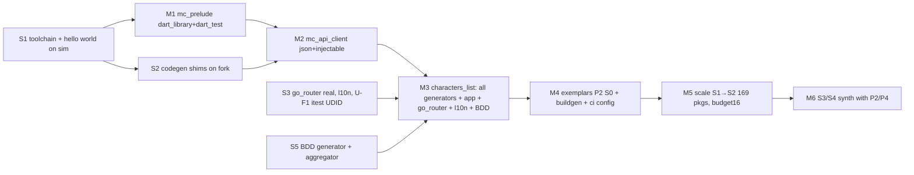

# Plan 03: Bazel integration (P3, T-0013 wave 2)

_Planner P3, 2026-11-23. Binding inputs: [00-planning-brief](00-planning-brief.md) (D6, D7, D12). Aligned with [02-generation-and-scale](02-generation-and-scale.md) (P2) and [05-testing-and-bdd](05-testing-and-bdd.md) (P5)._

**Sources.** Citations like `[rules_dart §6.3]` and `[rules_flutter §8]` point to the research docs. A `src:` citation means I read the file myself in the pinned checkouts (rules_dart `e7163aa` = v0.28.3; rules_flutter `876e263` = v0.30.2). Versions marked `pub.dev` were read from the pub.dev API on 2026-11-22. **(unverified)** marks a point that needs a spike; every such point is listed in §9.

---

## Key decisions

- **KD1. Pins.** `ai_rules_dart` is pinned to `e7163aab8f9171f54693cd1b99feb7d3cee9602d` (the v0.28.3 tag commit, and the commit rules_flutter itself builds against, `src: ai_rules_flutter/MODULE.bazel`). `ai_rules_flutter` is pinned to `876e263d65ca3eb33e4b05f9b0dc55affc5b3887` (v0.30.2). Flutter is **3.47.7**. Bazel is **9.3.0**, run through **bazelisk** (§1.3). Apple rules use the exact versions upstream tests: rules_apple **5.2.0**, rules_swift **4.1.2**, apple_support **2.9.1** (`src: e2e/ios_example/MODULE.bazel`).
- **KD2. Forks use a patch queue.** The committed form is `git_override(commit = <upstream pin>, patches = [...])`, with the patches in `third_party/rules_patches/<repo>/NNNN-<slug>.patch`. Development happens in a local fork checkout wired in by `--override_module` from a git-ignored `.bazelrc.user`. Each patch is exactly one upstream PR draft in `documents/upstream/` (D12).
- **KD3. One pub workspace and one lock.** The root `pubspec.yaml` lists every first-party package under `workspace:`. The root `pubspec.lock` holds third-party packages only, so first-party packages never enter it (this answers P2 C7). The lock feeds a single `flutter.pub` hub named **`@pub_deps`**. **No code generator, and no `build_runner`, appears in our lock.**
- **KD4. Codegen annotations move in lockstep with the generators rules_dart pins.** We use `freezed_annotation 3.1.0` (an exact pin, because freezed 4.0.2 pins it exactly) and `json_annotation 4.12.0` (json_serializable 6.14.1 accepts only `>=4.12.0 <4.13.0`). We use `go_router 17.5.0` (go_router_builder 4.5.0 is tested against `^17.3.0`), `injectable 3.0.0` and `retrofit 4.10.0`. A CI check fails on drift (§2).
- **KD5. BUILD files come from `mcgen buildgen` (P2 C4) and call P3's macros in `//tool/bazel:defs.bzl`.** Each package gets one library target with `glob(lib/**)` minus generated suffixes: a `flutter_library` if the package imports Flutter, otherwise a `dart_library`. Codegen is wired file by file through `dart_codegen` and never through the curated `*_library` wrapper macros, because each wrapper creates its own `dart_library` and so splits the package, which turns analyzer summaries off for dependents `[rules_dart §5.3, §7]`.
- **KD6. Codegen purity rule (CPR, R15).** A library that any generator reads must not import Flutter, directly or through a dependency. Bloc files import `package:bloc`, not `flutter_bloc`; the bloc-facing utilities (`mc_bloc_kit` with `FeatureFlowController`, `mc_monitoring`, `mc_api_errors`) are pure Dart (01 key decisions). The rules disable analyzer summaries for codegen whenever `sky_engine` is in the closure (`src: dart/private/dart_codegen.bzl:124-133`), so CPR keeps summaries on for about 95 % of codegen actions. The only exceptions are the wirings' go_router route files, and those import no feature packages (§4.5). Summaries also switch off when a dependency package is **split** (V3-18), so `buildgen --check` enforces one non-private library per `package_name` and never lets a `_stage*` target into another target's deps.
- **KD7. Unsupported generators get fork shims under `//dart/ext/<gen>` in rules_dart.** That is the only place `//dart/ext:builder_shim` is visible (`src: dart/ext/BUILD.bazel`). retrofit gets a SharedPart shim. injectable gets a two-stage design: a per-file `.injectable.json` stage, then an aggregate `.config.dart` stage, built on a **vendored injectable_generator 3.1.3 without `lean_builder`** (§4.2). bdd_widget_test gets a parser-based generator that never writes outside its declared outputs. l10n uses the stock `flutter_gen_l10n`.
- **KD8. Every app target is `manual`, `flutter_application` included.** Otherwise `bazel build //...` AOT-compiles every app `[rules_flutter §16.1]`. Simulator coverage under `bazel test //...` comes from `flutter_ios_simulator_build_test`.
- **KD9. No dart-defines and no flavors in the default debug app (R13).** Runtime configuration comes from the bundled `app_config.json` asset that `--//tool/bazel/config:env` selects (01 §3.4), or from test code. Any define or flavor pushes the debug build onto the whole-program path, with its 1.75 GiB warm worker `[rules_flutter §5.1, §14.7]`.
- **KD10. `flutter_integration_test(platform = "ios")` is always `manual` until our fork patch U-F1 lands.** The launcher picks "an available iPhone on the newest runtime, one already Booted" (`src: flutter/private/tools/ios_simulator_boot.dart`), and that would touch the shared simulators, which CLAUDE.md forbids. With U-F1, the T-0012 runner passes its private UDID in through `--test_env`.
- **KD11. The IDE gets generated code from Bazel, not `build_runner`.** `tool/ide_sync` builds `//:all_codegen` and copies only changed outputs next to their sources. Those copies are git-ignored and listed in a manifest. The same copies make the `fvm flutter` baselines possible (§7.3).
- **KD12. Config names.** `profile` means **Bazel instrumentation** (trace profile, compact execution log, memory profile) for P4. Flutter's profile mode is `device-profile`.

## Open conflicts for the TL

| # | Conflict | With | P3 proposal |
|---|---|---|---|
| X1 | D7 says patches "live on our forks". We can't create GitHub forks yet (no `gh` login, F-0002), so the committed form is a patch queue inside our repo. | Brief D7/D12 | Keep the patch queue. Once the PO enables GitHub, push the fork branches and optionally switch `git_override.remote` to the fork at a commit, with no patches. Nothing else changes. |
| X2 | P5 §5.2 writes `@deps//:...` and gives BDD tests a dependency on `bdd_widget_test`. | P5 | The hub is **`@pub_deps`**, because the brief says so and it is the default label in rules_dart's ext macros. **No runtime dependency on `bdd_widget_test`:** its `package:build` dependency pulls `analyzer` into every BDD test closure **(unverified, S5)**. Built-in steps live in `mc_test_steps`. |
| X3 | **injectable_generator 3.1.x can't join rules_dart's ext lock as-is.** It depends on `lean_builder ^1.2.2`, which requires `_fe_analyzer_shared <106`, while the ext lock's `analyzer 14.5.0` needs `^109` (pub.dev). Every older injectable_generator caps analyzer at `<10`. | D3, D7 | Vendor injectable_generator 3.1.3 into our rules_dart fork without `lib/lean_builder/`; `builder.dart` imports only `build` and `source_gen` (read on GitHub). File issues upstream with injectable and lean_builder. Fallback: an in-house injectable-compatible generator. |
| X4 | **bdd_widget_test 3.1.0 needs `build ^5`, while the ext lock has build 4.0.11.** Its Builder also writes step and hook files directly to disk, which isn't hermetic. | P5 C4 | Use **3.0.5** (the newest release on `build ^4`). The generator reuses its parser (`FeatureFile`), not its Builder, which matches P5's "preferred" option. |
| X5 | Test granularity. P5 KD6 aggregates per package and kind; P2 C5 offers a knob. | P2, P5 | Agree: aggregated is the default and per-file is a switch in the macros. **Risk:** aggregation drops `flutter test`'s isolate per file. `mc_test_utils` needs a global-reset `setUp` hook, and P5 must own it. |
| X6 | Route files that import every feature would make one go_router codegen action analyze the whole app from source, because the closure contains Flutter and so summaries are off. | P1 (app routing) | Route files import only an abstract `RouteTargets` interface. The implementation, which imports the features, sits in an unannotated file (§4.5). |
| X7 | FVM's global SDK on this Mac is now **3.47.8** (Dart 3.13.7, installed 2026-11-22 18:34). That is not a rules_flutter stock pin. | D6 | `.fvmrc` pins **3.47.7**, and you install it with `fvm install 3.47.7`. Moving to 3.47.8 would need `flutter.version(...)` with about 58 checksums. Not worth it. |
| X8 | Device builds need an Apple Developer team and a provisioning profile. | PO | New PO question. Until it's answered, device builds are deferred and the `//device` package stays git-ignored. |
| X9 | Codegen and kernel actions probably run **twice**: once for host tests and once for the iOS-transitioned app configuration. The output paths differ and nothing uses path mapping (`src:` grep finds no `supports-path-mapping`). **(unverified, S1)** | P4, P5 KD7 | Measure it as H-CFGDUP. The fix belongs upstream (U-D8). Until then, keep tests and app builds in separate invocations (P5 KD7). |

---

## 1. Workspace layout

```
MODULE.bazel  MODULE.bazel.lock  REPO.bazel  .bazelversion  .bazelrc  .bazelrc.user(ignored)
BUILD.bazel                 # dart_analysis_config, //:all_codegen
pubspec.yaml  pubspec.lock  # pub workspace root (name: mini_client_workspace)
.fvmrc                      # {"flutter": "3.47.7"}
tool/bazelw                 # bazelisk wrapper (all agents call this)
tool/bazel/defs.bzl         # P3 macros (mc_package, mc_codegen, mc_*_tests, mc_ios_app)
tool/bazel/visibility/BUILD.bazel
third_party/rules_patches/{ai_rules_dart,ai_rules_flutter}/NNNN-*.patch
tool/build_runner_overlay/  # R28 fallback overlay (outside the pub workspace; §7.3)
utility/<mc_x>/  feature/<domain>/<domain>_<cap>/  app/wiring/{app_core,<group>_wiring}/  app/mini_client/  app/ds_catalog/  app/sandbox/<group>_sandbox/
```

### 1.1 `MODULE.bazel`

```starlark
module(name = "mini_client")

bazel_dep(name = "ai_rules_dart", version = "0.28.3", repo_name = "rules_dart")
bazel_dep(name = "ai_rules_flutter", version = "0.30.2", repo_name = "rules_flutter")
bazel_dep(name = "rules_apple", version = "5.2.0")
bazel_dep(name = "rules_swift", version = "4.1.2")
bazel_dep(name = "apple_support", version = "2.9.1")
bazel_dep(name = "rules_cc", version = "0.2.26")
bazel_dep(name = "platforms", version = "1.1.0")
bazel_dep(name = "bazel_skylib", version = "1.9.2")

git_override(
    module_name = "ai_rules_dart",
    remote = "https://github.com/Mivr/ai_rules_dart.git",
    commit = "e7163aab8f9171f54693cd1b99feb7d3cee9602d",   # v0.28.3
    patches = [
        # "//third_party/rules_patches/ai_rules_dart:0001-ext-retrofit-shim.patch",
        # "//third_party/rules_patches/ai_rules_dart:0002-ext-injectable-two-stage.patch",
        # "//third_party/rules_patches/ai_rules_dart:0003-ext-bdd-generator.patch",
    ],
    patch_strip = 1,
)
git_override(
    module_name = "ai_rules_flutter",
    remote = "https://github.com/Mivr/ai_rules_flutter.git",
    commit = "876e263d65ca3eb33e4b05f9b0dc55affc5b3887",   # v0.30.2
    patches = [
        # "//third_party/rules_patches/ai_rules_flutter:0001-ios-itest-simulator-udid.patch",
    ],
    patch_strip = 1,
)

flutter = use_extension("@rules_flutter//flutter:extensions.bzl", "flutter")
flutter.toolchain(flutter_version = "3.47.7")
flutter.pub(name = "pub_deps", lock = "//:pubspec.lock")   # no plugins → no Podfile/SwiftPM inputs
use_repo(flutter, "pub_deps", "flutter_ios_engine", "flutter_toolchains")
register_toolchains("@flutter_toolchains//:all")
```

- **Toolchain.** No `dart.toolchain` tag is needed. Flutter's bundled Dart becomes the rules_dart toolchain, so the workspace downloads one Dart SDK (`src: ai_rules_flutter/README.md` §toolchain). S1 records the exact Dart version (expected 3.13.6, by analogy with 3.47.8 shipping 3.13.7) **(unverified)**. Any 3.13.x satisfies outline stripping (kernel format 138) and analyzer summaries (3.13 to 3.14) `[rules_dart §5.2, §5.3]`.
- **Dependency floors.** rules_flutter brings rules_go, llvm and rules_android/rules_kotlin as non-dev dependencies. They join the module graph but are fetched lazily, and we never build Android (Q-009).
- **Lockfile.** We **commit `MODULE.bazel.lock`.** Without it, every clean build re-evaluates the extensions `[rules_flutter §10.3]`. Day to day it runs in `--lockfile_mode=update`; `ci` uses `error`. A bump of either rule set must refresh the lock in the same commit.
- **Patch development.** Run `tool/rules_fork.sh {checkout|export}`. It clones each upstream into `~/src/mc-forks/<repo>` on branch `mc/patches` (the pin plus one commit per patch) and runs `git format-patch <pin>..mc/patches` into `third_party/rules_patches/`. While developing, `.bazelrc.user` holds `common --override_module=ai_rules_dart=/Users/<you>/src/mc-forks/ai_rules_dart`. rc files don't expand `$HOME`, so `rules_fork.sh checkout` writes the absolute path itself.
- **Patch labels.** `third_party/rules_patches/<repo>/BUILD.bazel` holds `exports_files(glob(["*.patch"]))`. Bazel's patcher can't apply binary hunks, so `rules_fork.sh export` refuses a patch that contains one.

### 1.2 `REPO.bazel`

```starlark
ignore_directories(["**/.dart_tool", "**/ios/Pods", "**/ios/.symlinks", "**/ios/Flutter/ephemeral", "app/**/build"])
```

This keeps `fvm flutter` baseline debris out of `//...`. **(unverified)** I believe `ignore_directories` with globs exists in Bazel 8+; if it doesn't, list the directories in `.bazelignore`.

### 1.3 `.bazelversion` and bazelisk

`.bazelversion` is `9.3.0`, matching both rule sets. Homebrew's `bazel` is 9.2.0. That satisfies `>=9.0.0`, but mixed versions churn `MODULE.bazel.lock`. **Adopt bazelisk.** It is already installed (`/opt/homebrew/opt/bazelisk/bin/bazelisk`, 1.29.0) but not linked, because it conflicts with the `bazel` formula. We don't change the machine: `tool/bazelw` runs `exec /opt/homebrew/opt/bazelisk/bin/bazelisk "$@"`, and fails with a clear message if bazelisk is missing. Agents and scripts always call `tool/bazelw`. `--budget16` adds the startup flags (§1.4).

### 1.4 `.bazelrc`

```bazelrc
# Required by rules_flutter [rules_flutter §15.2]
common --java_runtime_version=remotejdk_25
common --tool_java_language_version=25
common --tool_java_runtime_version=remotejdk_25
# rules_dart consumer preset (copied from dart/consumer.bazelrc @ e7163aa)
common --reuse_sandbox_directories
common --nobuild_runfile_links
common --experimental_shrink_worker_pool
# Hygiene / caching
common --lockfile_mode=update
build  --incompatible_strict_action_env
common --disk_cache=~/.cache/mc-bazel/disk          # shared across fleet worktrees (P5 C9 accepted)
common --repository_cache=~/.cache/mc-bazel/repo
# Analysis + format under test [rules_dart §13]
test --aspects=@rules_dart//dart:analyze.bzl%dart_analyze
test --output_groups=+dart_analyze,+dart_format
common --@rules_dart//dart:analysis_config=//:analysis_config
test --flaky_test_attempts=1 --test_output=errors   # ADR-0006 §4; P5 owns the test:* configs
test --local_test_jobs=8

build:sim     -c dbg --ios_multi_cpus=sim_arm64
build:device  -c opt --ios_multi_cpus=arm64
build:device-profile --config=device --@rules_flutter//flutter:profile
build:lint    --aspects=@rules_dart//dart:analyze.bzl%dart_analyze --output_groups=+dart_analyze,+dart_format
build:ci      --lockfile_mode=error --worker_sandboxing --keep_going --color=no --curses=no
build:cold    --disk_cache=                         # empty value disables it; nightly: --config=ci --config=cold
test:app      --build_tests_only --test_tag_filters=app   # sim build tests, own invocation (R14, H-TEST-2)
# budget16: the single definition is 04 §7.2 (arm T, P4 owns the values); this block must match it byte for byte
build:budget16 --local_resources=memory=9000 --local_resources=cpu=14 --jobs=14
build:budget16 --worker_max_instances=DartKernel=2              # singleplex Flutter .flutter.kmod workers
build:budget16 --worker_max_multiplex_instances=DartKernel=4    # rules_dart multiplex kernel workers
build:budget16 --worker_max_instances=DartCodegen=1 --worker_max_instances=DartSqlCodegen=1
build:budget16 --worker_max_instances=DartAggregateCodegen=1 --worker_max_instances=DartAnalyzerSummary=2
build:budget16 --worker_max_instances=DartAnalyze=2 --worker_max_instances=DartKernelLink=1
build:budget16 --worker_max_instances=FlutterKernelCompile=1
build:budget16 --experimental_total_worker_memory_limit_mb=3072  # † P4-01 confirms the spelling
test:budget16  --local_test_jobs=4
build:budget16_8c --config=budget16 --local_resources=cpu=8 --jobs=8
test:budget16_8c  --local_test_jobs=3
build:profile --generate_json_trace_profile --profile=/tmp/mc-bazel-profile.json.gz
build:profile --execution_log_compact_file=/tmp/mc-exec.log.zst --memory_profile=/tmp/mc-mem.txt
build:profile --noexecution_log_sort --heap_dump_on_oom
build:remote-cache --remote_cache=grpc://127.0.0.1:9092 --remote_upload_local_results
build:remote-cache --remote_local_fallback
try-import %workspace%/.bazelrc.user
```

Notes on these configs:

- `startup` options can't take a config. `tool/bazelw --budget16` therefore injects `--host_jvm_args=-Xmx3g` itself (proposal; P4 calibrates it). It also prints the RSS sampling command. P4 owns how a 16 GB machine is actually simulated (D9).
- `remote-cache` points at a local `bazel-remote` for the cross-clone cache-hit tests (P4). It no longer sets `incremental_kernel=false`: that flag only affects whole-program `-c dbg` compiles, which KD9 avoids. Non-shareable dills come from `dev_incremental_serialization` (tagged `no-remote-cache`), which X-23 examines.
- **budget16 pools are per worker key** (mnemonic + executable), so `DartCodegen=1` still allows one worker per shim binary (about 6). P4's sampler classes workers by mnemonic plus executable.
- **(unverified, S1):** that `~` expands in `--disk_cache` (Bazel's path converter should do it; `$HOME` is never expanded), and the exact flag spellings in Bazel 9.3.

---

## 2. Third-party dependencies

- **Pub workspace.** The root `pubspec.yaml` has `name: mini_client_workspace`, `publish_to: none`, `environment: sdk: ^3.13.0`, and an explicit `workspace:` list of every package (written by `mcgen wire`). Every member sets `resolution: workspace`. Run `fvm flutter pub get` at the root. That writes the one `pubspec.lock` and one `.dart_tool/package_config.json`, which the IDE needs. S1 checks that `tool/bazelw run @rules_flutter//flutter:pub -- get` produces a byte-identical lock **(unverified)**.
- **The lock holds third-party packages only.** `flutter.pub` handles hosted (by sha256) and sdk packages and skips git ones `[rules_flutter §4.1]`, so: **no git dependencies.** Adding a first-party package changes no lock entry (P2 C7, edit E14).
- **Hub.** The hub is `@pub_deps//:<pkg>`, including `@pub_deps//:flutter`, `:flutter_test`, `:flutter_localizations` and `:integration_test`.
- **One-version policy.** This is structural: one resolution and one hub. The rules_dart generator hub `@ext_pub_deps` is `isolated = True` (`src: MODULE.bazel`), so generator dependencies never meet ours.
- **Member checks.** `flutter.pub` reads a workspace-root lock but lacks rules_dart's member checks, so `buildgen --check` replicates them: every member sets `resolution: workspace`, and no member name clashes with a locked package (V3-13).
- **Lockstep check.** `//tool/bazel:ext_lockstep_test` compares our lock with the fork's `dart/ext/pubspec.lock` for {`freezed_annotation`, `json_annotation`, `injectable`, `retrofit`, `get_it`, `dio`} and fails if they differ. SDK-pinned packages (`meta`, `collection`) are exempt.
- **No native plugins in M1 to M4.** No package in the stack below has native iOS code, so H-PODS is moot. Any plugin needs a P3 review first: SwiftPM mode, sha pins and an overlay budget `[rules_flutter §4.2]`.

| Package | Version | Why |
|---|---|---|
| freezed_annotation | **3.1.0** | freezed 4.0.2 pins it exactly (pub.dev) |
| json_annotation | **4.12.0** | json_serializable 6.14.1 accepts `>=4.12.0 <4.13.0` |
| injectable | **3.0.0** | injectable_generator 3.1.3 requires `^3.0.0` |
| get_it | **8.3.0** | matches the ext lock; injectable allows `>=8.3.0 <10` |
| retrofit | **4.10.0** | retrofit_generator 10.3.3 requires `^4.10.0` |
| dio | **5.11.1** | latest; retrofit needs `^5.9.0` |
| go_router | **17.5.0** | go_router_builder 4.5.0 tests against `^17.3.0`; 18.x is untested |
| flutter_bloc / bloc | **9.1.1** / 9.x | the bloc files import `package:bloc` (CPR) |
| intl | whatever Flutter 3.47.7 pins | `flutter_localizations` pins it exactly |
| mocktail, flow_builder, test | latest compatible versions, recorded in the lock | no codegen coupling |

**Additions to the fork's ext lock:** `retrofit_generator 10.3.3` (analyzer `<15`, build `<6`, source_gen `^4`: compatible), `bdd_widget_test 3.0.5`, and `injectable 3.0.0`, plus the vendored generator's existing dependencies (code_builder, dart_style, recase and glob are already in the lock). Regenerate the lock with the pinned Dart.

---

## 3. BUILD file strategy

Gazelle reads one directory at a time, gets `lib_root` wrong under `lib/src/**`, splits packages and has no Flutter rule kinds `[rules_dart §7; rules_flutter §16.1]`. So `mcgen buildgen` (P2 C4) writes every `BUILD.bazel` from three inputs: the pubspec, the resolved imports, and an **annotation scan**. The scan is a regex over `@freezed`, `@JsonSerializable`, `fromJson` factories, `@RestApi`, `@injectable`/`@lazySingleton`/`@singleton`/`@module`, `@InjectableInit` and `@TypedGoRoute`. `buildgen --check` runs in `tool/verify.sh`, so a hand edit to Dart that adds an annotation fails until BUILD files are regenerated.

### 3.1 Conventions

| Item | Rule |
|---|---|
| Library kind | `flutter_library` if the pubspec depends on `flutter`; otherwise `dart_library`. Pure-Dart utilities (mc_prelude, mc_di, mc_api_client, mc_mocked_backend, mc_fixtures_*) test with `dart_test`, which is cheaper than `flutter_tester` and keeps summaries on. |
| Target name | Same as the package (`//feature/characters_list` → `:characters_list`), with `package_name` equal to the pubspec `name` and `language_version = "3.13"`. |
| Sources | `glob(["lib/**/*.dart"], exclude = GENERATED_GLOBS)` plus the generated targets. The exclusion keeps `ide_sync` copies out, and rules_dart refuses collisions anyway `[ext.md "Dual-build coexistence"]`. **R28 exception:** a file listed in `tool/build_runner_overlay/fallback.yaml` is added to `srcs` explicitly and its `dart_codegen` target is omitted (§7.3). |
| Private targets | Start with `_` and are `//visibility:private`; `_stage*` never appears in another target's deps (KD6). Tokens are the path relative to `lib/src` with `/` and `.` replaced by `_`: `_domain_model_character_freezed`, `_..._json`, `_..._g`, `_..._inj`, `_di_config`, `_l10n`, `_stage`. |
| Deps | Exactly the packages imported. `DartImportCheck` (strict deps, on by default) enforces this `[rules_dart §2.3]`, so mcgen adds `get_it` and the rest directly (the Tide transitive imports become direct). The BUILD deps and the pubspec deps come from one model, and `buildgen --check` diffs them. |
| Analysis | Each package has `dart_analysis_options(name = "analysis_options", src = "analysis_options.yaml", deps = ["//utility/mc_analysis:analysis_options"])`. The root `dart_analysis_config` lists them all (written by `mcgen wire`). The `implementation_imports` lint blocks `package:x/src/` imports across packages. |
| IDE hook | `filegroup(name = "codegen_outputs")` per package; root `//:all_codegen` aggregates them. |

### 3.2 Layer enforcement

`//tool/bazel/visibility/BUILD.bazel` defines `package_group`s `app_layer` (`//app/...`), `feature_layer` and `utility_layer`, plus `all_layers`.

- **Utility** library: `visibility = ["//tool/bazel/visibility:all_layers"]`. `mc_test_utils`, `mc_test_steps` and `mc_e2e_utils` are also `testonly`. `mc_mocked_backend` is visible to `app_layer` and to `//utility/mc_test_utils`.
- **Feature** library: `visibility = ["//tool/bazel/visibility:app_layer"]`. **feature → feature and utility → feature therefore fail at analysis.** Tests in the same BUILD file can always see it.
- **App:** `//app/wiring/...`, `//app/mini_client`, `//app/ds_catalog` and the sandboxes `//app/sandbox/<group>_sandbox` (01) sit in the app layer. A feature is visible only to its own group's wiring (01 §1).
- **Defence in depth:**
  - `DartImportCheck` (strict deps);
  - the `implementation_imports` lint (barrel-only access);
  - `tool/check_layers.sh` in `verify.sh`, which runs `bazel query 'deps(//utility/...) intersect //feature/...'` and `deps(//feature/X) intersect (//feature/... - //feature/X/...)` per feature, and expects both to be empty.

The macros set visibility from `layer =`, so a BUILD file never spells it out.

### 3.3 Example: pure-Dart utility with codegen (`utility/mc_api_client`)

```starlark
load("//tool/bazel:defs.bzl", "mc_package", "mc_codegen", "mc_package_tests")

mc_codegen(
    name = "codegen",
    package_name = "mc_api_client",
    stage_deps = ["//utility/mc_prelude", "//utility/mc_di", "@pub_deps//:dio",
                  "@pub_deps//:json_annotation", "@pub_deps//:injectable", "@pub_deps//:get_it"],
    json = ["lib/src/model/api_response.dart"],
    injectable = ["lib/src/di/dio_module.dart", "lib/src/api/api_headers_interceptor.dart"],
    injectable_init = "lib/src/di/di_initializer.dart",
)

mc_package(
    name = "mc_api_client",
    kind = "dart",                 # dart_library
    layer = "utility",
    codegen = ":codegen",          # adds the generated targets to srcs
    deps = ["//utility/mc_prelude", "//utility/mc_di", "@pub_deps//:dio",
            "@pub_deps//:json_annotation", "@pub_deps//:injectable", "@pub_deps//:get_it"],
)

mc_package_tests(lib = ":mc_api_client", kind = "dart",
                 deps = ["@pub_deps//:test", "@pub_deps//:mocktail"])   # → :unit_test (dart_test)
```

### 3.4 Example: feature (`feature/characters/characters_list`), with its expansion

```starlark
load("//tool/bazel:defs.bzl", "mc_codegen", "mc_package", "mc_bdd_tests", "mc_package_tests")

_PURE = ["//utility/mc_prelude", "//utility/mc_di", "//utility/mc_api_client", "//utility/mc_bloc_kit",
         "//utility/mc_monitoring", "//utility/mc_api_errors",
         "@pub_deps//:bloc", "@pub_deps//:dio", "@pub_deps//:retrofit", "@pub_deps//:freezed_annotation",
         "@pub_deps//:json_annotation", "@pub_deps//:injectable", "@pub_deps//:get_it"]

mc_codegen(
    name = "codegen",
    package_name = "characters_list",
    stage_deps = _PURE,                               # CPR: staging closure has no Flutter
    freezed = ["lib/src/domain/model/character.dart", "lib/src/domain/model/characters_page.dart",
               "lib/src/presentation/bloc/characters_list_bloc.dart",   # state is a `part of` the bloc
               "lib/src/flow/characters_list_flow_state.dart"],
    json = ["lib/src/domain/model/character.dart", "lib/src/domain/model/characters_page.dart"],
    retrofit = ["lib/src/domain/api/characters_api.dart"],
    injectable = ["lib/src/domain/api/characters_api.dart", "lib/src/domain/repository/characters_repository.dart",
                  "lib/src/presentation/bloc/characters_list_bloc.dart"],
    injectable_init = "lib/src/di/di_initializer.dart",
    l10n = struct(arbs = glob(["lib/src/l10n/*.arb"]), template = "lib/src/l10n/characters_list_en.arb",
                  output_file = "characters_list_l10n.dart", output_class = "CharactersListL10n"),
    staging = "package",                              # "file" = per-file DAG (§4.7)
)

mc_package(
    name = "characters_list",
    kind = "flutter",
    layer = "feature",
    codegen = ":codegen",
    deps = _PURE + ["//utility/mc_ds_theme", "//utility/mc_feature_flow", "@pub_deps//:flutter",   # + the other mc_ds_* it uses; never the umbrella
                    "@pub_deps//:flutter_bloc", "@pub_deps//:flutter_localizations", "@pub_deps//:intl"],
)

mc_bdd_tests(                                         # P5 §5.2 contract
    name = "bdd_test",
    lib = ":characters_list",
    features = glob(["test/feature/*.feature"]),
    steps = glob(["test/feature/step/*.dart", "test/feature/util/*.dart"]),
    fixtures = ["//utility/mc_fixtures_characters:assets"],
)
mc_package_tests(lib = ":characters_list", kinds = ["contract", "l10n", "golden"])
```

`mc_codegen` expands to the following rules (rule name, then what it produces):

```text
dart_library  _stage        srcs = hand-written Flutter-free lib files; deps = stage_deps; tags no-dart-analyze
dart_codegen  _domain_model_character_freezed   shim freezed → character.freezed.dart; deps [_stage]
dart_library  _stage_frz    srcs = _stage srcs + all *_freezed outputs; tags no-dart-analyze
dart_codegen  _domain_model_character_json      shim json_serializable → .json_serializable.g.part; deps [_stage_frz]
dart_codegen  _domain_api_characters_api_retro  shim retrofit (fork) → .retrofit.g.part; deps [_stage_frz]
dart_codegen  _<tok>_g      combining_shim, parts = [json?, retrofit?] → <file>.g.dart
dart_codegen  _<tok>_inj    shim injectable_json (fork) → <file>.injectable.json; deps [_stage]
dart_aggregate_codegen _di_config  srcs [di_initializer.dart], asset_deps [*.injectable.json],
                              deps [@pub_deps//:injectable, @pub_deps//:get_it, //utility/mc_di] only, never _stage
                              shim injectable_config (fork) → lib/src/di/di_initializer.config.dart
flutter_gen_l10n _l10n      → lib/src/l10n/characters_list_l10n*.dart
filegroup     codegen_outputs (all of the above outputs)
```

This is the freezed → json cascade that rules_dart's own exemplar uses (`src: e2e/ext_exemplar/cascade_two_stage/BUILD.bazel`). The `_stage_frz` step is needed because nested freezed types declare `toJson` only inside their `.freezed.dart` mixin. Without that file, json_serializable and retrofit can't serialize them **(unverified, S2)**.

### 3.5 Example: wiring and app (`app/wiring/universe_wiring`, `app/mini_client`)

Routes live in the wirings (R5, 01 §3.4), not in the app.

```starlark
# app/wiring/universe_wiring/BUILD.bazel
mc_codegen(name = "codegen", package_name = "universe_wiring",
           stage_kind = "flutter",                    # CPR exception: routes need go_router/Flutter
           stage_srcs = glob(["lib/src/routes/*_routes.dart"]) + ["lib/src/routes/route_targets.dart"],
           stage_deps = ["@pub_deps//:flutter", "@pub_deps//:go_router"],   # no feature package (R15)
           go_router = glob(["lib/src/routes/*_routes.dart"]),
           injectable = glob(["lib/src/navigators/*_impl.dart"]), injectable_init = "lib/src/di/di_initializer.dart")
mc_package(name = "universe_wiring", kind = "flutter", layer = "app", codegen = ":codegen",
           deps = UNIVERSE_FEATURES + ["//app/wiring/app_core", "//utility/mc_di", "//utility/mc_prelude",
                  "@pub_deps//:flutter", "@pub_deps//:go_router", "@pub_deps//:get_it", "@pub_deps//:injectable"])
mc_package_tests(lib = ":universe_wiring", kinds = ["unit"])   # routes, navigator impls, mappers, flow_scopes_test
```

```starlark
# app/mini_client/BUILD.bazel
load("//tool/bazel:defs.bzl", "mc_package", "mc_ios_app", "mc_package_tests", "ALL_WIRINGS", "ROOT_UTILITIES")
load("@rules_flutter//flutter:defs.bzl", "flutter_application", "flutter_integration_test")
load("@rules_flutter//flutter:ios.bzl", "IOS_MINIMUM_OS_VERSION")

copy_file(name = "app_config", out = "assets/app_config.json",    # R13: one asset, chosen by --//tool/bazel/config:env
          src = select({"//tool/bazel/config:dev": "config/dev.json", "//tool/bazel/config:e2e": "config/e2e.json",
                        "//tool/bazel/config:perf": "config/perf.json"}))

mc_package(name = "mini_client_lib", package_name = "mini_client", kind = "flutter", layer = "app",
           assets = [":app_config"],
           deps = ALL_WIRINGS + ROOT_UTILITIES + ["@pub_deps//:flutter", "@pub_deps//:go_router",
                  "@pub_deps//:flutter_localizations", "@rules_flutter//flutter:material_icons"])

flutter_application(name = "mini_client", package_name = "mini_client", main = "lib/main.dart",
                    min_os_version = IOS_MINIMUM_OS_VERSION, tags = ["manual"],
                    deps = [":mini_client_lib", "@pub_deps//:flutter", "@rules_flutter//flutter:material_icons"])

mc_ios_app(name = "mini_client_ios", application = ":mini_client",
           bundle_id = "com.emiliev.miniclient",      # Q-004 spelling pending; one constant in defs.bzl
           app_name = "Marvel")                       # → flutter_ios_app (manual) + :mini_client_sim_build_test (tag app, macOS only)

flutter_integration_test(name = "e2e_journeys", platform = "ios", package_name = "mini_client",
    main = "integration_test/journeys_test.dart", srcs = glob(["integration_test/**/*.dart"]),
    deps = [":mini_client_lib", "//utility/mc_e2e_utils", "@pub_deps//:flutter_test", "@pub_deps//:integration_test"],
    ios_bundle_id = "com.emiliev.miniclient.e2e", size = "enormous",
    tags = ["manual", "e2e", "exclusive"])            # manual until U-F1 (KD10)
mc_package_tests(lib = ":mini_client_lib", kinds = ["unit", "app_journeys"])
```

`ALL_WIRINGS`, `ROOT_UTILITIES` and the per-group feature lists are written by `mcgen wire` into `tool/bazel/catalog.bzl`. **(unverified, S1):** that a `flutter_application` whose `main` belongs to the `:mini_client_lib` target, with the same `package_name`, works without splitting the package. If it doesn't, the app keeps `lib/main.dart` in the application's own `srcs`.

---

## 4. Code generation under Bazel

**Shared mechanics** `[rules_dart §6.1]`:

- Each file runs as one `dart_codegen` action through a singleplex `DartCodegen` worker. Every shim binary has its own pool, and each request creates a fresh `AnalysisContextCollection`.
- Configuration comes from the `config` JSON; `build.yaml` is never read.
- A declared output the builder doesn't emit is written empty (`src: builder_shim.dart _routeDeclaredOutputs`).
- Same-package siblings in `deps` are staged automatically.

### 4.1 freezed and json_serializable (curated)

- Shim labels: `@rules_dart//dart/ext/freezed:shim` → `.freezed.dart`, and `@rules_dart//dart/ext/json_serializable:shim` → `.json_serializable.g.part`, then `_shared/combining_shim:bin` → `.g.dart`.
- Versions are pinned by rules_dart (freezed 4.0.2, json_serializable 6.14.1). Templates add only the `sealed` modifier and keep private cases with `state.when` (R16); P3-01 AC6 checks that the stock shim emits `when`/`map`.
- json also runs on freezed classes with `fromJson`, after the freezed stage (§3.4).
- Default options: `config = '{"explicit_to_json": true}'` for json, so nested models round-trip.

### 4.2 injectable (aggregate builder; not supported upstream)

**Fork patch 0002, `dart/ext/injectable/`:**

1. Vendor injectable_generator 3.1.3 (MIT) into `third_party/injectable_generator/` with `lib/lean_builder/` removed. Add a `dart_library(package_name = "injectable_generator")` over the `ext_pub_deps` packages plus `injectable 3.0.0` (X3).
2. Two shims:
   - `shim_json` = `shimMain(args, injectableBuilder)`, a LibraryBuilder that writes `<file>.injectable.json`. When the generator returns `null` (an annotation only in a comment, a `@module` with no public members), the shim writes `[]` rather than an empty file, which the config stage's `jsonDecode` would reject (V3-17);
   - `shim_config` = `shimMain(args, injectableConfigBuilder)`, which writes `.config.dart` (and `.module.dart` only for micro-packages, which we don't use). It skips empty shards, and it **fails** instead of writing an empty `.config.dart` when its `srcs` hold an `@InjectableInit` (the shim would otherwise write the declared output empty, `builder_shim.dart:985-1024`).
3. A macro `injectable_package(name, srcs, init, ...)` in the fork, plus our `mc_codegen` wiring:
   - per-file shard actions with deps `[_stage]` (hand-written only, so freezed edits don't invalidate them);
   - one `dart_aggregate_codegen(srcs = [init], asset_deps = shards, deps = ["@pub_deps//:injectable", "@pub_deps//:get_it", "//utility/mc_di"], outputs = ["lib/src/di/di_initializer.config.dart"])`. Its deps are **only** what `di_initializer.dart` imports. `dart_aggregate_codegen` auto-stages same-package siblings from `deps` and has no summary aspect (`dart_aggregate_codegen.bzl:267-273`), so `_stage` there would make every hand-written file an input and break the cutoff below. Without `injectable` in deps, `@InjectableInit` wouldn't resolve.

The config generator discovers shards with `buildStep.findAssets(Glob("lib/**.injectable.json"))`, based on the default `generateForDir`, and parses each with `DependencyConfig.fromJson` (read on GitHub). The shim implements `findAssets` over staged `asset_deps` (`src: builder_shim.dart:1261`; `dart_aggregate_codegen.bzl` `asset_deps`).

**Early cutoff, measured as H-DI-CUTOFF.** A body edit leaves its shard byte-identical, and the aggregate's inputs are only the init file, the shards and those three deps, so the aggregate action is a cache hit and the `.config.dart` and its dependents don't change.

**Upstream:**
- U-D2: "ext: injectable two-stage support". The PR text proposes that injectable split `lean_builder` into its own package or widen the `_fe_analyzer_shared` bound.
- An issue to lean_builder to widen `_fe_analyzer_shared` to `<112`.

### 4.3 retrofit (SharedPart; not supported upstream)

**Fork patch 0001, `dart/ext/retrofit/`:**

- `shim.dart` = `shimMain(args, <retrofit_generator's builder factory>)`. The factory name comes from its `build.yaml` **(unverified, S2)**.
- A `retrofit_library` macro built on `shared_part_library` writes `.retrofit.g.part`. Our wiring combines it with any json part into one `.g.dart`.
- Codegen deps are `[_stage_frz]`, because the generator emits `fromJson`/`toJson` calls for model types. It also needs `ApiResponse<T>` from `//utility/mc_api_client`, which comes through summaries.
- The per-file `@injectable` + `@factoryMethod` on a redirecting factory to `_CharactersApi` must still resolve in the injectable shard without the `.g.dart` present **(unverified, S2)**.
- Upstream: U-D1, with an e2e exemplar.

### 4.4 bdd_widget_test (`.feature` → `_test.dart`; not supported upstream)

The stock Builder writes step and hook files through `fs`, outside its declared outputs. It also reads `bdd_options.yaml` and `pubspec.yaml` from disk (read on GitHub). Under an unsandboxed worker, those writes could land in the source tree through execroot symlinks. **We don't run the Builder.**

**Fork patch 0003, `dart/ext/bdd/`:**

- `generator.dart` uses `package:bdd_widget_test`'s `FeatureFile`/`GeneratorOptions` (3.0.5, pinned exactly, because `FeatureFile` is a `lib/src` implementation import) on an in-memory filesystem pre-filled with the staged step basenames and `mc_test_steps`' `step_index.json`.
- `shimMain` runs only `package:build` Builders, so the generator is wrapped as a `Builder` with `buildExtensions = {'.feature': ['_test.dart']}` and run through `shimMain`/`worker_entry.dart`. The output stem differs from the input's, so routing falls back to a basename match, which works. Each request still builds an `AnalysisContextCollection`; X-10 measures that overhead (H-CODEGEN-COST).
- It is driven by `dart_sqlcodegen(src = "<x>.feature", output_suffixes = ["_test.dart"])`, since the input extension is arbitrary.
- It adds P5's requirements:
  - `testMethodName: mcTestWidgets`;
  - every scenario tag passed as `tags:` (`mcTestWidgets` moves `T-…`/`MC-…` into the name, 05 KD4);
  - Gherkin data tables emitted against `mc_test_steps`' own `DataTable`, never `package:bdd_widget_test/data_table.dart`;
  - a hard error naming every missing or shadowed step;
  - formatted output.
- **No undeclared writes:** a step stub that would be generated becomes a build error.

`bazel run //tool/bdd:scaffold -- //feature/x` is the non-hermetic stub writer. It writes under `BUILD_WORKSPACE_DIRECTORY` (P5 §5.2).

`mc_bdd_tests` then builds the aggregator `bdd_all_test.dart` (a small genrule run by mcgen's template) and a `flutter_test`. **(unverified, S5):**
- whether a generated `main` in `bazel-bin` can import source-tree step files by relative path (the multi-root `org-dartlang-app` scheme suggests yes, `[rules_flutter §9]`);
- whether generated files need excluding from the `dart_analyze` and `dart_format` aspects.

Upstream: U-D3.

### 4.5 go_router_builder (curated; tested only against a stub)

- Shim label: `@rules_dart//dart/ext/go_router:shim`, writing `.go_router.g.part` and then the combined `.g.dart`.
- The upstream exemplar uses a pure-Dart go_router stub `[rules_dart §6.2]`. We use real go_router 17.5.0, so the closure contains Flutter and **summaries are off** for this action.
- **Untested anywhere upstream (V3-01):** no e2e in either repo runs a `dart/ext` shim over a closure containing `sky_engine`; `dart:ui` then resolves through `_embedder.yaml` from source inside `StagingBoundedResourceProvider`. This is a **Phase A spike, P3-01 AC7**, on one `@TypedGoRoute` file in `spike/hello`. **Pre-decided fallback:** go_router_builder joins the R28 build_runner fallback (§7.3).
- Containment (X6, R15): each wiring's `lib/src/routes/<domain>_routes.dart` holds the `@TypedGoRoute` classes, and their `build()` returns `RouteTargets.of(context).charactersList(...)`. `RouteTargets` is an abstract class in `route_targets.dart`; its implementation (`route_targets_impl.dart`) imports the feature barrels and has no annotations. The codegen closure is therefore Flutter + go_router + the route files, whatever the number of features, and a feature edit never reruns route codegen.
- Splitting routes into several files (one per domain, each with its own `$appRoutes` under an import prefix) is allowed if one action gets slow.
- Upstream: U-D9 (an exemplar against the real `go_router`).

### 4.6 gen-l10n (`flutter_gen_l10n`, per package)

- One target per package that has ARBs: `arbs`, `template_arb_file`, `output_localization_file = "<pkg>_l10n.dart"`, `output_class = "<Pkg>L10n"`, `nullable_getter = False`.
- Outputs land next to the ARBs and go into `srcs`. `l10n.yaml` is ignored `[rules_flutter §6]`, so mcgen also writes a matching `l10n.yaml` for the fvm baseline.
- Each package depends on `flutter_localizations` and `intl`.
- The pseudo-locale (P5 C10) is filtered in the app.

### 4.7 Cost controls

| Risk | Mechanism |
|---|---|
| Summaries off with Flutter in the closure (`dart_codegen.bzl:124-133`) | CPR (KD6). Only the app's route files pay the cost. U-D5 (fork, then upstream): give builder shims the embedder SDK summary the analyze aspect already builds. |
| Fresh analyzer per request | Summaries keep every request small. P4 experiment: a context cache keyed by package_config digest. It needs care because of the `rootPackageName` hazard (`docs/ext.md`), so it isn't planned. |
| Singleplex workers, one pool per shim (about 8 pools × `--worker_max_instances`) | `budget16`: `DartCodegen=2`, plus shrink. Fork experiment U-D6: one **multi-builder shim** dispatched by `generator_args=["--builder=<x>"]`, so there is one pool. |
| Coarse staging reruns every json/retrofit action in a package on any freezed edit | `staging = "file"`: per-file staging libraries that follow intra-package imports, built from mcgen's import graph. Default `package` for M1 to M3; P4 A/B-tests it with P2's edit corpus (KD9). U-D7: report `unused_inputs_list` from the resolver's read set. |
| Duplication across configurations (X9) | Measure it. U-D8 path mapping. |

Estimate **(inferred)**: about 45 codegen actions per feature and about 6k at S2. With summaries on (about 0.3 s per warm request `[rules_dart §6.1]`), that is about 30 CPU minutes on a clean build.

---

## 5. App assembly for iOS

- **Simulator:** `tool/bazelw build --config=sim //app/mini_client:mini_client_ios`. That is JIT kernel, unsigned (`apple.skip_codesign_simulator_bundles`), with the debug engine fetched lazily `[rules_flutter §5]`. Run it with the dev tool (§7.2), or install it on a private simulator with T-0012.
- **Device AOT:** `--config=device //app/mini_client:mini_client_device`, a `flutter_ios_app` with `provisioning_profile = "//device:profile"`. `//device` is git-ignored and holds a `local_provisioning_profile`. **Blocked on X8.** `gen_snapshot` writes a Mach-O dylib directly `[rules_flutter §5.1]`. AOT peak RSS is P4's H-AOT-1.
- **Runner:** keep `app/mini_client/ios/` from `fvm flutter create --platforms=ios --org com.emiliev` as generated, including `Runner.xcodeproj`, so the fvm baseline works. rules_flutter reads only `ios/Runner/` (Swift sources, `Info.plist`, `Assets.xcassets`). `families = ["iphone"]` and `minimum_os_version = "15.0"`.
- **Navigation:** go_router in the app (§4.5). `mc_feature_flow` stays inside features (D3/D4a).
- **Assets:**
  - Library assets are listed explicitly (`glob(["assets/**"])`) and keyed `packages/<pkg>/…`. Code uses `Image.asset(path, package: 'mc_mocked_backend')`, or the fixture package (P2 KD11).
  - Pubspec `flutter: assets:` isn't read by Bazel, but mcgen writes it anyway for fvm.
- **Fonts:** `mc_design_system` declares `flutter_font_family` targets (OFL fonts, P5 KD9) in `fonts` and uses `fontFamily: 'Inter', package: 'mc_design_system'`. The app adds `@rules_flutter//flutter:material_icons`.
- **Manual tagging:** both `flutter_application` and `flutter_ios_app` are `manual` (KD8). `:mini_client_sim_build_test` (`flutter_ios_simulator_build_test(targets = [...], tags = ["app"], target_compatible_with = ["@platforms//os:macos"])`) builds the simulator app. It transitions to `-c dbg` (`debug_build.bzl:5-17`), so it runs in its **own invocation** (`--config=app`) and B3 / `test:fast` / `test:all` exclude the `app` tag; otherwise one `bazel test` would build the closure in two configurations (H-CFGDUP). Linux CI skips it as incompatible.
- **Sandbox apps (01 §6.3):** 7 group sandboxes, each at `//app/sandbox/<group>_sandbox` with `flutter_application` + `flutter_ios_app` (manual) + its own `sim_build_test` + an mcgen-written `ios/Runner/` template (6 small files) + bundle id `com.emiliev.miniclient.sandbox.<group>`. Each depends on one wiring, `app_core`, the root utilities and its domain mocks. Cost: one app build each, on demand only.

---

## 6. Tests under Bazel

- **Granularity:** aggregated per package and kind, as P5 KD6 sets out (`:unit_test`, `:bdd_test`, `:golden_test`, `:contract_test`, `:l10n_test`; about 520 targets at S2). The macros expose `granularity = "file"` for H-TEST-1. The aggregator is a generated entry that imports each test file with a prefix and calls its `main` inside a `group`. ADR-0006 test names survive, and `--test_filter` regexes work `[rules_flutter §8]`.
- **BDD:** §4.4 and P5 §5.2. `flutter_prebuilt_test` re-runs an existing kernel for the chaos canaries without recompiling.
- **Goldens:**
  - They live in `data` and are updated with `tool/bazelw run //pkg:golden_test -- --update-goldens`.
  - They are macOS-only (`target_compatible_with`).
  - **rules_flutter doesn't honour `flutter_test_config.dart`** (`src:` grep finds no reference), so golden tests call `mc_test_utils.loadMcFonts()` and set `TargetPlatform.iOS` in `setUpAll`.
  - Upstream: U-F3, "honour `flutter_test_config.dart`".
- **iOS integration tests:** each `flutter_integration_test` builds a full app (H-ITEST), so we have **one** aggregated journey target (P5 KD10). The flow:
  1. T-0012 `tool/e2e_ios.sh` creates the `mc-<task>-<role>-<pid>` simulator.
  2. It runs `--runner-cmd 'tool/bazelw test --config=sim --test_env=RULES_FLUTTER_IOS_SIMULATOR_UDID={udid} //app/mini_client:e2e_journeys'`.
  3. It collects evidence.

  Two fork patches support this:
  - **U-F1** honours the UDID and refuses to pick a device when the variable is set without a valid value;
  - **U-F2** copies in-test screenshots (written by `mc_e2e_utils` under the app's `tmp/mc_screens/`) into `$TEST_UNDECLARED_OUTPUTS_DIR` before `simctl uninstall`. It also writes `--test_env=MC_E2E_FILTER` into the app container's `tmp/mc_e2e_filter` between install and launch, since `Platform.environment` is empty on iOS (05 §6.2).

  Until both land, e2e runs only through T-0012's fvm path on Bazel-synced sources (§7.3).
- **Parallelism:** `--local_test_jobs=8` by default, 4 under `budget16` and 3 under `budget16_8c` (P5 KD8). `flutter_tester` RSS is unmeasured upstream `[rules_flutter §10.3]`, so P4 calibrates.
- **Coverage:** `bazel coverage --config=covgate` with `--combined_report=lcov --instrumentation_filter='^//(utility|feature|app)[/:]'`. LCOV is scoped to the test's own package `[rules_flutter §8]`. `tool/coverage_gate` strips generated files and gates each utility, feature and app-layer library at 90 % (R7, P5 KD5). `// coverage:ignore` isn't honoured in `dart_test` `[rules_dart §8]`.

---

## 7. Developer workflow and IDE

### 7.1 IDE: `tool/ide_sync`

```
tool/ide_sync [--watch] [--link] [--dest <tree>] [<package>...]
```

Steps:

1. Run `tool/bazelw build //:all_codegen` (or one package's `:codegen_outputs`).
2. Read the file list from `tool/bazelw cquery --output=files`.
3. Copy each file to `<pkg>/<rel>` **only if its bytes differ**, which avoids IDE re-analysis storms.
4. Delete files listed in the previous `.dart_tool/mc_ide_sync.manifest` that are no longer produced.

The flags:

- `--link` makes symlinks instead of copies (an A/B option).
- `--watch` re-runs on source changes, using `fswatch` if present and polling every 2 s otherwise.

Guards:

- `.gitignore` covers `**/*.g.dart`, `**/*.freezed.dart`, `**/*.config.dart`, `**/*.injectable.json`, `**/lib/src/l10n/*_l10n*.dart`, `**/test/feature/*_test.dart` and `app/*/assets/app_config.json` (written by `--env` in pub mode).
- BUILD globs exclude the same suffixes.
- `ide_sync` never writes a path listed in the R28 fallback manifest (§7.3); Bazel doesn't produce those anyway, because their codegen targets are omitted.
- The `ci` config runs on a clean clone with `--worker_sandboxing`, and `check_dual_build_collisions` is skipped locally on purpose.

**The IDE itself:**

- `.vscode/settings.json` sets `"dart.flutterSdkPath": ".fvm/flutter_sdk"` (3.47.7).
- The analysis server reads the workspace root's `package_config.json`.
- The analysis server's RAM (likely 2 to 4 GB at S2) counts toward P4's 16 GB budget.

No `build_runner` path exists for the IDE.

### 7.2 Hot reload

`tool/bazelw run @rules_flutter//tools/dev_tool:flutter_bazel -- run -t //app/mini_client:mini_client_ios -d ios-simulator:<udid>`.

- The dev tool keeps its own resident `frontend_server`.
- Reload runs `bazel build` for codegen apps `[rules_flutter §11]`. Run `tool/ide_sync --watch` alongside it so the IDE stays current.
- Agents must pass a private UDID **with its kind**: the dev tool refuses a bare UDID (`run_command.dart:80-87`).

### 7.3 `fvm flutter` baselines

`tool/baseline/fvm.sh <sha>`:

1. `git worktree add /tmp/mc-baseline-<sha>`.
2. `tool/ide_sync --dest <worktree>` (Bazel-generated sources).
3. `fvm flutter pub get`.
4. Timed runs, under `/usr/bin/time -l`:
   - `fvm flutter build ios --simulator --debug`, clean and after each edit in the P2 corpus;
   - `fvm flutter build ios --release --no-codesign`;
   - `fvm flutter test` per package.

This compares the Flutter tool's compile and bundle against Bazel's on identical sources, and keeps `build/` and `.symlinks` out of the Bazel tree.

**The build_runner overlay (`tool/build_runner_overlay/`)** serves both P4's `build_runner` baseline (P4-14 AC3) and the **R28 fallback**. It keeps R10 intact: no generator and no `build_runner` ever enter the root workspace or its lock.
- **Where.** A pubspec named `mc_build_runner_overlay` with its own committed `pubspec.lock`, **not** a member of the root workspace (no `resolution: workspace`; Bazel never reads it). It pins `build_runner` and stock generators (freezed 4.0.2, json_serializable 6.14.1, retrofit_generator 10.3.3, injectable_generator 3.1.3 with lean_builder, bdd_widget_test 3.0.5, go_router_builder 4.5.0); pub resolves analyzer to about 14.0, which `lean_builder` accepts (pub.dev: analyzer 14.0.0 requires `_fe_analyzer_shared ^104`).
- **How.** `tool/build_runner_overlay/run.sh [--check] <generator> [<pkg>...]` materialises a scratch tree under `.dart_tool/mc_overlay/` (git-ignored): each package's sources plus a pubspec with the overlay's dev dependencies and `dependency_overrides` path deps back to the real first-party packages. It writes a `build.yaml` with `generate_for` from buildgen's annotation scan, runs `dart run build_runner build --delete-conflicting-outputs` there, and copies back **only** that generator's outputs. A BDD run never copies step stubs back unless `--scaffold` is passed, and fails naming any stub it would need.
- **Fallback manifest.** `tool/build_runner_overlay/fallback.yaml` lists the active fallback generators and every committed output path. Empty by default. From it:
  - the root `.gitignore` gets a managed block of negations (`!feature/…/characters_list_api.g.dart`), written by `run.sh`;
  - `buildgen` adds each listed file to `srcs` explicitly and omits its `dart_codegen` target;
  - `buildgen --check` fails if a listed file also has a Bazel-generated part of the same name (json + retrofit in one file can't both own `x.g.dart`). Tide's layout (models and API in separate files) satisfies this; mcgen keeps it so;
  - `check_dual_build_collisions` in `--config=ci` takes the manifest as its allowlist. If the pinned checker has no allowlist parameter, our patch adds one (shipped with U-D4). Every unlisted collision still fails;
  - `tool/loc --strict` counts listed files as `generated` (02 §4.1), and `mc_analysis` keeps excluding them;
  - CI runs `run.sh --check` per active generator, which regenerates in the overlay and requires `git diff --exit-code` on the listed files.
- **Not "dual-build mode".** Upstream's dual-build mode tolerates stale generated files; it doesn't consume committed ones. We consume them explicitly through `srcs`.
- **Exit.** When the shim lands (Phase F), the generator leaves the manifest, its outputs are deleted, and buildgen restores the `dart_codegen` targets in the same commit.

---

## 8. Migration path



**Earliest spikes:**
- **S1** answers H-SDK: the Dart version, outline stripping without the fallback diagnostic, summaries in range, Xcode 26.2 with rules_apple 5.2.0, FVM 3.47.7, lock equality, and H-CFGDUP.
- **S2** settles the codegen shims and whether their version sets resolve.
- **S3** covers the full app shell, l10n and the iOS integration-test UDID patch. The first go_router shim run over a Flutter closure moves into **S1** (P3-01 AC7, V3-01).
- **S5** covers BDD.
- **Pods/plugins:** none needed (§2). The only native piece is `integration_test`'s iOS plugin, and S3 checks it.

---

## 9. Risk register

| # | Risk | Likelihood / impact | Mitigation |
|---|---|---|---|
| R1 | Codegen shims break on rules bumps (daily releases, breaking 0.x) | H/H | Pin commits; patch queue; bump only behind P4's bench and the S2 suite; upstream U-D1 to U-D3 to retire patches. |
| R2 | injectable_generator vendoring drifts, or the generator relies on lean_builder at runtime | M/H | S2 proves the build_runner path's output equals ours on the exemplar; issues filed upstream; fallback is an in-house generator (X3). |
| R3 | Codegen cost: Flutter summaries off, fresh analyzer, 8 singleplex pools exhausting RAM | H/H | CPR, `budget16` caps, multi-builder shim, U-D5 and U-D7. P4 measures H-CODEGEN-COST and H-MEM. |
| R4 | Analysis or format aspects fail on generated files, which Tide excludes | M/M | S2/S5. Rely on the `exclude:` in mc_analysis; otherwise a fork patch adds an aspect exclusion for codegen outputs. |
| R5 | `flutter_integration_test` uses shared simulators | H (certain) / H | Keep it `manual`; ship U-F1 first; `tool/sim_cleanup.sh` handles orphans. |
| R6 | Duplicate builds across configurations (X9) | M/H | Measure; separate invocations; U-D8. |
| R7 | Aggregated tests leak global state (GetIt, statics) | M/M | Reset hook in `mc_test_utils`; per-file switch; red-twin canary (P5). |
| R8 | Any define or flavor drops the debug build off the modular path | M/H | KD9; a `buildgen --check` rule refuses `defines` and `flavor` on dev apps. |
| R9 | Generated BDD tests drag `analyzer` into test closures | M/M | X2: no `bdd_widget_test` runtime dependency; S5 checks closures with `bazel cquery 'deps(...)'`. |
| R10 | IDE copies go stale or are mistaken for sources | M/L | Manifest, git-ignore, glob excludes; the CI clean-clone run. |
| R11 | Bazel version skew (Homebrew 9.2 vs 9.3) churns the lock | M/M | `tool/bazelw` + `.bazelversion`; `ci` uses `lockfile_mode=error`. |
| R12 | Unverified flags or behaviour (`~` in paths, `ignore_directories`, worker memory flags, main owned by a library, retrofit factory name) | M/L | Each is a checkbox in S1 to S3. `-d` is settled: `ios-simulator:<udid>`. |
| R13 | A codegen shim misses its Phase A timebox | M/H | R28: that generator moves to the overlay with committed outputs (§7.3); traceability and gates unchanged. |

---

## 10. Tasks

| ID | Task | Files | Acceptance criteria (Given / When / Then) |
|---|---|---|---|
| **P3-01** | S1: toolchain bring-up | `MODULE.bazel`, `.bazelrc`, `.bazelversion`, `REPO.bazel`, `tool/bazelw`, `.fvmrc`, `spike/hello/` | **AC1** Given a clean clone, when `tool/bazelw build --config=sim //spike/hello:hello_ios` runs, then it succeeds on Bazel 9.3.0 and the app launches on an `mc-*` simulator (screenshot in evidence). **AC2** Given the same, when `bazel test //spike/hello:widget_test` runs, then it passes with the analyze aspect on. **AC3** Then the evidence records the bundled Dart version, a `.koutline` that is byte-identical after a body edit, and no stripper-fallback diagnostic (H-SDK). **AC4** Given the sim build and a host test in one server, then the execution log counts any duplicate `DartKernel` or `DartCodegen` actions across configurations (H-CFGDUP). **AC5** `fvm flutter --version` reports 3.47.7 in the repo. **AC6** Given a freezed union with private cases in `spike/hello`, when built with the stock freezed shim, then the `.freezed.dart` contains `when`/`maybeWhen`/`map` and a widget calling `state.when` compiles (R16; otherwise the `switch` fallback is recorded). **AC7** Given one `@TypedGoRoute` file over real go_router 17.5.0 in a Flutter closure, when built with the stock go_router shim, then `.g.dart` compiles and equals `build_runner`'s output from the overlay (V3-01); if not, the spike records the failure and go_router_builder joins the R28 fallback. **AC8** Given `--config=lint`, `--config=ci --config=cold` and `--config=budget16`, when each parses, then Bazel reports no unknown option or config. |
| **P3-02** | Fork tooling and patch queue | `tool/rules_fork.sh`, `third_party/rules_patches/` | **AC1** Given a fork branch with N commits, when `export` runs, then N patches appear and `git_override(patches=…)` builds the same targets as `--override_module`. **AC2** Given a patch that doesn't apply, then the build fails, naming the patch. **AC3** Given a patch containing a binary hunk, when `export` runs, then it refuses, naming the file; `checkout` writes an absolute path into `.bazelrc.user`. |
| **P3-03** | S2: retrofit shim (patch 0001) | fork `dart/ext/retrofit/`, ext lock | **AC1** Given an `@RestApi` file that uses a freezed+json model and `ApiResponse<T>`, when it is built, then its `.g.dart` equals `build_runner`'s output from the B2 overlay. **AC2** Given a body edit in the API file, then only that file's retrofit, combine and kernel actions rerun. |
| **P3-04** | S2: injectable two-stage (patch 0002) | fork `dart/ext/injectable/`, vendored generator | **AC1** Given 5 annotated files and an `@InjectableInit` file, when they are built, then `.config.dart` equals `build_runner`'s output. **AC2** Given a body edit that doesn't change DI, then the aggregate action is a cache hit (H-DI-CUTOFF). **AC3** The ext lock resolves with analyzer 14.5.0 and doesn't include `lean_builder`. **AC4** Given a file the annotation scan marks injectable that yields no dependencies, then its shard is `[]` and the config stage succeeds; given an `@InjectableInit` file whose generation yields nothing, then the build fails instead of writing an empty `.config.dart`. `aquery` shows `_di_config`'s inputs are only the init file, the shards, `injectable`, `get_it` and `mc_di`. |
| **P3-05** | S5: BDD generator (patch 0003) + `mc_bdd_tests` | fork `dart/ext/bdd/`, `tool/bazel/defs.bzl`, `tool/bdd/scaffold` | **AC1** Given a feature file tagged `@T-0001-AC1`, when `:bdd_test` runs, then the JUnit case name contains `T-0001-AC1`. **AC2** Given a missing step, then the build fails naming it and no file is written outside `bazel-out`. **AC3** Given `scaffold`, then a stub appears in `test/feature/step/`. **AC4** `cquery deps(:bdd_test)` contains no `analyzer`, and a feature with a Gherkin data table compiles against `mc_test_steps`' `DataTable`. **AC5** Given stock `bdd_widget_test` 3.0.5 in the overlay with `testMethodName: mcTestWidgets`, when it generates a tagged feature, then each scenario's tags reach `mcTestWidgets` as `tags:` and the JUnit name carries the AC ID; this decides that the R28 BDD fallback stays traceable (V2-07). |
| **P3-06** | Macro library | `tool/bazel/defs.bzl`, `visibility/`, `catalog.bzl` | **AC1** Given a feature that depends on another feature, then analysis fails with a visibility error. **AC2** Given a utility that depends on a feature, then the same. **AC3** Given `staging = "file"` vs `"package"`, then both build the exemplar to byte-identical outputs. **AC4** `granularity = "file"` and `"package"` both produce the same JUnit case set. |
| **P3-07** | S3: go_router (real package) + l10n + app shell | `app/mini_client/`, `app/wiring/universe_wiring/` | **AC1** Given a wiring's `characters_routes.dart` with 3 typed routes (building on P3-01 AC7), when built, then its `.g.dart` matches `build_runner`'s output and the app navigates on the simulator. **AC2** Given a feature body edit, then no `DartCodegen` action reruns for routes. **AC3** Given 2 locales, then `flutter_gen_l10n` output equals `fvm flutter gen-l10n`'s. **AC4** Given `--//tool/bazel/config:env=e2e`, then the app bundle's `app_config.json` is `config/e2e.json` and no `DartKernel` action reruns compared with `dev`. |
| **P3-08** | U-F1/U-F2 iOS integration-test patches + T-0012 runner command | fork `flutter/private/tools/flutter_integration_test_ios.dart` | **AC1** Given `RULES_FLUTTER_IOS_SIMULATOR_UDID=<mc sim>`, when the e2e target runs, then no other simulator changes state (`simctl list` diff). **AC2** Given an invalid UDID, then it fails without booting anything. **AC3** In-test screenshots arrive in `outputs.zip`. **AC4** Given `RULES_FLUTTER_IOS_SIMULATOR_UDID` naming an iPhone SE on iOS 18.2 (not the newest runtime), then the test runs on that device. **AC5** Given `--test_env=MC_E2E_FILTER=characters_list`, then `tmp/mc_e2e_filter` exists in the app container before launch and only that journey runs. |
| **P3-09** | M1 to M3 bring-up: mc_prelude, mc_api_client, characters_list, full app on simulator | packages + BUILD | **AC1** Given M3, when `tool/bazelw test --config=all //...`, `tool/bazelw test --config=app //app/...` and `build --config=sim //app/mini_client:mini_client_ios` run, then all pass and the app shows the list (screenshot). **AC2** `bazel build //...` performs no `FlutterAotMacho` action. **AC3** Given `aquery` over every `DartCodegen` action except the route files, then each carries `--summary` inputs, and `buildgen --check` rejects a second non-private library with the same `package_name` (V3-18). |
| **P3-10** | `tool/ide_sync` | `tool/ide_sync/` | **AC1** Given a fresh clone, when it runs, then `fvm flutter analyze` at the root reports 0 errors. **AC2** Given a second run with no changes, then no file's mtime changes. **AC3** Given a deleted annotation, then the stale output is removed. |
| **P3-11** | fvm baseline script | `tool/baseline/fvm.sh` | **AC1** Given a sha, when it runs, then it writes JSON with wall time and peak RSS for the simulator debug, release no-codesign and test runs, and leaves the main tree untouched (`git status` clean). |
| **P3-12** | Lockstep and layering checks | `tool/bazel:ext_lockstep_test`, `tool/check_layers.sh` | **AC1** Given `json_annotation 4.13.0` in our lock, then `ext_lockstep_test` fails, naming both versions. **AC2** Given an injected feature → feature edge, then `check_layers.sh` exits non-zero. **AC3** Given a workspace member without `resolution: workspace`, or named like a locked package, then `buildgen --check` fails naming it. **AC4** Given a fallback-manifest file that also has a Bazel-generated part of the same name, then `buildgen --check` fails. |
| **P3-13** | Upstream drafts | `documents/upstream/U-D1..D9, U-F1..F3/` | **AC1** Each draft carries a minimal e2e-style repro workspace, Bazel/Dart versions, the patch, and a Conventional-Commit title with a `Changelog:` line `[rules_dart §11]`. |

**Upstream candidates (D12).** P3 drafts the feature PRs; P4 owns the performance write-ups.

rules_dart:
- U-D1 retrofit
- U-D2 injectable
- U-D3 bdd
- U-D4 public `builder_shim`
- U-D5 embedder summaries for codegen
- U-D6 multi-builder shim
- U-D7 codegen `unused_inputs_list`
- U-D8 path mapping
- U-D9 go_router exemplar against the real package

rules_flutter:
- U-F1 simulator UDID
- U-F2 screenshots to undeclared outputs
- U-F3 `flutter_test_config.dart`
