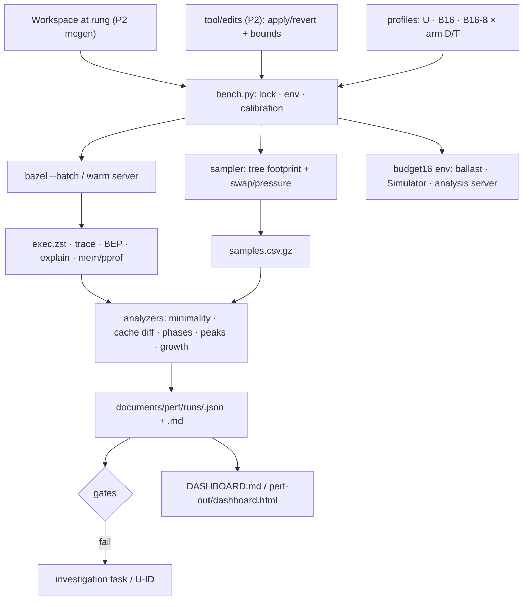
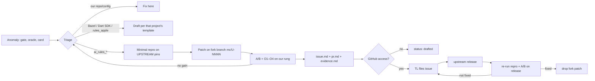
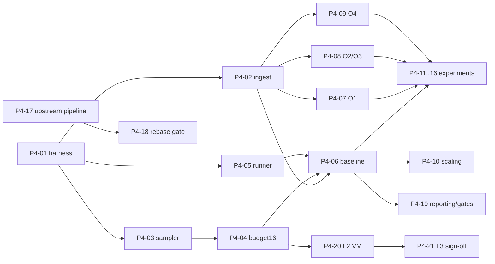

# 04 — Profiling, optimisation and upstream-reporting programme

_Planner P4 · T-0013 wave 2 · 2026-11-23 · Status: draft for TL assembly_

**Inputs.** Brief D1-D12; `[rules_dart §5, §9-§11, §14]`; `[rules_flutter §5, §9, §10, §13, §16]`; upstream `docs/perf-ios-bench.md` `[ios-bench §<heading>]` and `tools/perf/` (read only, nothing run); `[tide-app §2.2, §4.5]`; sibling plans `[P2 §x]` (02-generation-and-scale), `[P5]` (05-testing-and-bdd), P1 (01, 169 modules, 9 apps including sandboxes) and P3 (03: pins, `.bazelrc` configs including `budget16`, codegen shims).

**Legend.** † marks a flag or tool behaviour that P4-01's flag inventory must confirm against the pinned Bazel and SDK before anything relies on it.

---

## 1. Key decisions

- **KD-1. Measure first, and correctness before speed.** No optimisation lands in our `.bazelrc`, on our forks or upstream unless two things hold on the same commit: all four oracles (§8) pass, and an interleaved A/B (§6.2) shows the gain.
- **KD-2. The budget metric is Σ`phys_footprint` over the process tree.** This is what jetsam and Activity Monitor count. ΣRSS is recorded next to it, because upstream's `peak_rss.py` sums RSS from `ps` `[rules_flutter §10.1]`. RSS double-counts the shared pages that every worker maps from the same SDK snapshot.
- **KD-3. We write our own harness and use upstream's vocabulary.** `tool/perf/` is Python 3.9 stdlib, run as `python3 -I`. It reimplements upstream's ideas rather than running their code:
  - flows, and same-machine ABBA A/B with a paired geometric mean
  - growth exponents with a ceiling
  - the warm-up rule (the null build must execute 0 actions)
  - warm-server CPU accounting

  Flow ids follow theirs (`ios-debug-body`, `ios-release-clean`, `dart-app-api`), so an upstream report compares like with like.
- **KD-4. Perf runs get exclusive windows.** Every timed or memory run holds a machine-wide lock and watches for contamination: a foreign Bazel server, a Simulator, or any process using more than one core. A contaminated run is discarded, never averaged.
- **KD-5. budget16 = adaptive wired ballast + emulated 16 GB defaults + a real resident load** (the Simulator and a Dart analysis server). There are three fidelity levels (§7.4):
  - L1: ballast, nightly
  - L2: a 16 GiB / 8 vCPU macOS VM, weekly (needs PO approval)
  - L3: a real 16 GB Mac, for sign-off (PO decision)
- **KD-6. Gates come in two classes.**
  - *Deterministic gates* (action sets, cache hits, byte identity, action counts) are hard gates at S0 inside `tool/verify.sh`.
  - *Statistical gates* (time and memory) run nightly on this Mac under the lock.

  A failed gate opens an investigation; it is never re-run until green (ADR-0006). No perf work runs on hosted runners: upstream saw 1.3-1.7× noise between runners `[ios-bench §Same-runner A/B]`.
- **KD-7. Execution logs use `--execution_log_compact_file`.** Bazel's own `execlog` converter, built once from the pinned Bazel source tag, turns them into a JSON stream. JSON logs (with `--noexecution_log_sort`) are allowed at S0-S1 only: upstream's server ran out of memory sorting a JSON log at 5k libraries `[rules_dart §10.2]`.
- **KD-8. Hygiene for incremental runs.**
  - The disk cache is off.
  - The warm-up null build must execute 0 actions.
  - Each repeat applies a **distinct variant** of the edit, so earlier repeats can't produce action-cache hits (C-3).
  - P2's reversible `apply` / `revert` and its E16 control (revert gives 0 actions) are used exactly as `[P2 §6.4]` specifies.
- **KD-9. Storage.** Summaries (Markdown plus JSON, at most 200 KB per run) are committed under `documents/perf/`. Raw data goes in a git-ignored `perf-out/` and a local archive, with each archive's SHA-256 recorded in the summary. **No Git LFS:** it isn't installed, raw logs at S4 run to gigabytes, and the remote is HTTPS with keychain auth.
- **KD-10. Rungs are P2's ladder** `[P2 KD8, §5.1]`: S0, S1, S2, S3, S4-5M and S4-10M.
- **KD-11. The device-AOT bench target is the inner App.framework rule** built with `-c opt --ios_multi_cpus=arm64`, the same shape as upstream's `device_release`, so no signing is needed `[ios-bench §What it measures]`.
- **KD-12. Ranking for the 16 GB goal, top 5:**
  1. X-04: split TFA from the front end
  2. X-02: memory-aware AOT scheduling
  3. X-08: worker pool sizing
  4. X-09: codegen worker-pool multiplication
  5. X-07: duplicate compilers in a dev session
- **KD-13. Upstream drafts** live in `documents/upstream/U-NNNN-<slug>/`, each with a self-contained `e2e/`-style reproduction pinned to the **upstream** tag, plus A/B numbers. The TL owns the tracking table. Nothing is filed until GitHub access exists (D12), and personal paths are scrubbed first.
- **KD-14. Release AOT at 5-10M LOC is a question we measure, not a promise** (C-2).

## 2. Open conflicts for the TL

| # | Conflict | With | P4 proposal |
|---|---|---|---|
| C-1 | Perf numbers need an idle Mac, but D11 runs crew in parallel worktrees on this same machine. Their builds and simulators corrupt both timings and memory peaks. | TL, all crew | A perf lock (`/tmp/mc-perf.lock`) plus a nightly window (e.g. 01:00-07:00) and a weekend window with no crew dispatched. The S0 count gates are noise-free and can run at any time. |
| C-2 | "5-10M LOC runs easily on 16 GB" may be infeasible for **release AOT**. TFA and `gen_snapshot` are each one whole-program process whose peak grows with program size, and no scheduling can shrink a single process. | PO goal | Split the goal. The dev loop (sim debug, tests, analysis) must pass budget16 strictly at every rung. Release AOT must pass strictly up to S3, and is measured and reported at S4 (X-01, X-03, X-04). If one process exceeds 8 GiB, escalate to the Dart SDK. **Proposed PO question.** |
| C-3 | P2's corpus is byte-reversible `[P2 §6.1]`. Repeating apply → build → revert → apply re-creates bytes the action cache or disk cache has already seen, so later repeats get cheaper. | P2 | Ask P2 for `tool/edits apply <id> --variant k`, where k changes the edited literal deterministically. Until then: disk cache off, repeat 1 is the measured value, and repeats 2..n are reported separately and flagged. P2's bounds and clean-equivalence check are adopted as-is. |
| C-4 | P2 §6.4 step 3 says `--execution_log_json_file`. | P2 | Use the compact log plus the converter at every rung (KD-7). JSON only at S0-S1. |
| C-5 | Tide's debug run configuration uses `--dart-define` `[tide-app §2.2]`. Any define or flavor moves a debug app off the modular path onto the whole-program worker, about 1.75 GiB resident `[rules_flutter §10.3, §16.1]`. P2's `sim` config already assumes no defines `[P2 §6.2]`. | P1, P3 | Sim-debug apps use **no** `--dart-define`: the mocked backend needs no keys (D5), so any configuration comes from a Bazel-selected Dart config library. Record this as a deviation. X-06 measures the cost if defines stay. |
| C-6 | P1's 9 apps (including sandboxes) are all reached by `bazel build //...`. In fastbuild every `flutter_application` is AOT `[rules_flutter §16.1]`, so up to 9 TFA and `gen_snapshot` chains can stack. | P1, P3 | Sandbox and secondary apps are tagged `manual` or built with `--config=sim`. X-02 adds memory-aware scheduling in any case. P2's `--apps k` is the test knob. |
| C-7 | Test granularity: one `flutter_test` per file (P5, the rules' model) against per-package aggregation (`[P2 C5]` defaults S4 to `per_package`). | P2, P3, P5 | Support both. X-16 decides the S2 default with data, and S4 uses `per_package` until then. |
| C-8 | `.bazelrc` ownership. P3 defines `--config=budget16`; P4 produces its values. | P3 | P3 owns the file and its structure. P4 experiments propose value changes through a task, citing A/B evidence. The `T` arm (§3.3) is `--config=budget16`. |
| C-9 | Bazel version: this Mac has Homebrew 9.2.0 and an installed but unlinked bazelisk, while upstream pins 9.3.0. Numbers are comparable only within one Bazel version. | P3 | **Resolved (R18):** `.bazelversion` 9.3.0 through `tool/bazelw` over the unlinked bazelisk; P4-01 refuses to run on a mismatch. |
| C-10 | `flutter_integration_test(platform="ios")` boots a simulator the rules choose, and CLAUDE.md forbids touching shared simulators. | P3, P5 | B3i stays out of the matrix until the device can be pinned to `mc-<task>-<role>`. |
| C-11 | `documents/perf/DASHBOARD.md` and `documents/upstream/README.md` are indexes, which CLAUDE.md gives to the TL. | TL | Crew write only per-run and per-U-ID files. The TL regenerates the dashboard (one command) and updates the tracking table at merge. |

**Proposed PO questions:** (a) the goal split in C-2; (b) an L3 machine, either a real 16 GB Mac or a cloud Mac; (c) approval to install a VM tool for L2, and to create a second macOS user for the cache oracle's variant.

## 3. Scope and vocabulary

### 3.1 Rungs (P2's ladder)

| Rung | Packages | `source` LOC (D8) | Role in this programme |
|---|---|---|---|
| S0 | 15 | ~35k | quick gates, harness bring-up |
| S1 | 50 | ~150k | growth point |
| **S2** | 169 | ~634k | nightly reference |
| S3 | ~190 | ~1.0M | weekly; the strict limit for release AOT (C-2) |
| S4-5M | ~915 | ~5M | RAM study (out of tree, `mcgen synth`) |
| S4-10M | ~1,820 | ~10M | RAM study, milestone |

P2 guarantees S4 reachability, meaning every flow is routed from a catalogue screen `[P2 §5.2]`. Without that, AOT tree-shaking would make the AOT memory numbers fiction. X-01 adds one "tall" S4 variant (fewer, larger modules at the same LOC) to separate program-size effects from graph-size effects.

### 3.2 Build kinds

| ID | Build | Command |
|---|---|---|
| B1 | sim-debug app | `bazel build --config=sim //app/mini_client:mini_client_ios` |
| B2 | device AOT | `bazel build --config=device //app/mini_client:__mini_client_ios_app_framework` (KD-11; the label is private to the macro, so P4-01 AC5 asserts it at every pin bump) |
| B3 | host tests | `bazel test --build_tests_only --test_tag_filters=-ios_integration,-app //...` (analyze aspect on, P2's `test` config). The `app` sim build tests transition to `-c dbg`, so they run separately (`--config=app`) unless a cell measures H-CFGDUP on purpose |
| B3i | simulator integration | weekly, once C-10 is resolved |
| B4 | lint | `bazel build --config=lint //...` (`dart_analyze` + format output groups `[rules_dart §13]`; the config is defined in 03 §1.4) |
| B5 | dev session | `flutter_bazel run -t //app/mini_client:mini_client_ios -d ios-simulator:<udid>`, where the harness first resolves `mc-<task>-perf` to its UDID (a bare name or UDID is refused); then hot reloads per edit |

### 3.3 Resource profiles and flag arms

| Profile | Machine |
|---|---|
| U | Unconstrained: 48 GB, 14 cores (10 performance + 4 efficiency) |
| B16 | 16 GiB effective (§7), 14 cores |
| B16-8 | B16 plus 8-core emulation |

Each profile runs two **arms**:

- **D** is what Bazel and the tools default to on such a machine: the workspace `.bazelrc` plus machine emulation.
- **T** adds `--config=budget16` (C-8).

The goal is for T to pass everywhere, and, through upstream fixes, for D to pass as well.

## 4. KPIs and targets

The absolute targets are **provisional until the P4-06 baseline**, when the TL ratifies them. Gates are defined in §11.4.

| ID | KPI | Definition | Target at S2 | Target at S4-10M | Gate |
|---|---|---|---|---|---|
| K1.1 | Clean wall time, B1 | `bazel --batch`, fresh output base, repository cache warm, no disk cache, committed lockfile, profile U | ≤ 8 min | ≤ 60 min | G5 |
| K1.2 | Clean wall time, B2 | same | ≤ 10 min | ≤ 75 min | G5 |
| K1.3 | Clean wall time, B3 / B4 | same, over `//...` | ≤ 12 / ≤ 8 min | ≤ 90 / ≤ 60 min | G5 |
| K1.4 | Clean CPU | user+sys for the whole tree, from `wait4` rusage of the `--batch` process tree | baseline; growth exponent ≤ 1.10 | same | G5 |
| K1.5 | Clean slowdown with 8 cores | B16-8 ÷ U wall time | ≤ 1.8× | ≤ 2.0× | report only |
| K2.1 | Null build, warm server | wall time; actions executed | ≤ 1.0 s; 0 | ≤ 3 s; 0 | G1 |
| K2.2 | Null build after `bazel shutdown` | analysis from scratch, action cache on disk | ≤ 30 s; 0 actions | ≤ 4 min; 0 | G5 |
| K3.1 | Incremental wall time, B1, per edit | client wall time, warm server, U | see §5.1 | local edits ≤ 1.5× S2 | G5 |
| K3.2 | Incremental wall time, B2 (E01) | whole-program AOT | ≤ 3 min (≤ 90 s after X-04) | report | G5 |
| K3.3 | Incremental, B3 / B4 on one package (E01) | | ≤ 15 s / ≤ 5 s | ≤ 1.5× S2 | G5 |
| K3.4 | Hot reload, B5 (E01) | dev-tool reload latency | ≤ 1.0 s | ≤ 2.0 s | G5 |
| K4 | Rebuilt-set accuracy | §4.1; P2's bounds | recall 1.00; spurious reruns 0; precision ≥ 0.95, and 1.00 for E01/E03/E09/E11/E12/E15 | same | G2 |
| K5 | Cache hits across clones | O1, over cacheable spawns | ≥ 99.5 %, 100 % after the allowlist; 0 false hits | same | G3 |
| K6 | Output determinism | O4, first-party outputs with signatures stripped | 100 % identical | 100 % | G3 |
| K7 | Peak tree footprint per phase | Σ`phys_footprint` of the Bazel tree (ΣRSS alongside) | B16: dev loop ≤ 6.0 GiB, whole repo ≤ 8.0 GiB | same caps | G6 |
| K8 | Peak per mnemonic | §4.2 | | | G6 |
| K9 | Analysis phase | wall time after a server restart; `used-heap-size-after-gc`; Starlark CPU | ≤ 30 s; ≤ 1.5 GiB | ≤ 4 min; ≤ 3.0 GiB | G5 / G6 |
| K10 | Growth exponents | §4.3; log-log least-squares fit over S0-S4, against LOC and against package count, with R² | §4.3 | | G7 |
| K11 | Disk | output base (B1-B4); disk cache with GC; repository cache; growth per E01 | ≤ 15 GiB; ≤ 30 GiB; ≤ 6 GiB; ≤ 50 MiB | ≤ 80 GiB in total | G6 |

### 4.1 Definitions

- **Rebuilt set.**
  - **O** is the set of spawns an incremental build executed, excluding cache hits. Each spawn is keyed by `(mnemonic, label, primary output with the config segment stripped)`.
  - **E** is P2's resolved expected set, expanded with `bazel query`.
  - **Precision** = |O∩E| / |O|. **Recall** = |O∩E| / |E|. Where P2 gives `[lo, hi]` bounds, `hi` defines E for precision and `lo` defines it for recall.
- **Classes for O∖E**, decided by comparing each spawn's input digests with the previous build's log:
  - **spurious:** no input changed, so the action key is unstable
  - **cascade-from-nondeterminism:** an upstream output changed bytes although nothing it depends on changed
  - **cutoff miss:** the outline changed on a body edit (a mixin, an SDK fallback, or offsets, the case P2's E15 control detects)
  - **spec gap:** P2 fixes the bound
- **E∖O** is either a spec error or a stale output; O3 (§8) decides which.
- **Phases.**
  - *Analysis* runs until the first action.
  - *Execution* is divided into windows labelled by the active mnemonic families (codegen, kernel, AOT, bundle, test), taken from the trace profile.
  - *Peak attribution* lists the processes and actions active at the tree's peak.

### 4.2 Per-mnemonic peaks (one process unless Σ is stated)

| Class | Process | S2 | S4-10M |
|---|---|---|---|
| `DartKernel` child | `kernel_worker` (about 400 MB upstream `[rules_dart §10.3]`) | ≤ 0.6 GiB | ≤ 0.6 GiB (locality) |
| `DartKernel` tree | `kernel_module` and its children, arm T | ≤ 2.5 GiB | ≤ 2.5 GiB |
| TFA | `FlutterKernelCompile`, AOT path (`frontend_server`) | ≤ 3 GiB | ≤ 8 GiB (stretch: 6 with X-04) |
| Debug whole-program | `incr_fkc_worker` (1.75 GiB at hello-world size `[rules_flutter §10.2]`) | ≤ 2.5 GiB, or avoided (C-5) | ≤ 6 GiB, or avoided |
| `gen_snapshot` | `FlutterAotMacho` | ≤ 3 GiB | ≤ 8 GiB |
| Codegen | `DartCodegen` / `DartAggregateCodegen`, per worker; Σ over all pools | ≤ 1 GiB; Σ ≤ 2 GiB | same |
| Analyzer | `DartAnalyzerSummary` / `DartAnalyze`, per worker; Σ | ≤ 1.5 GiB; Σ ≤ 3 GiB | same |
| `flutter_tester` | under `TestRunner`; Σ concurrent | ≤ 0.6 GiB; Σ ≤ 3 GiB | same |
| Bazel server | JVM footprint | ≤ 4 GiB | ≤ 5 GiB |
| Dev tool | resident `frontend_server` (B5) | ≤ 2.5 GiB | report |

### 4.3 Growth exponents

Our gate is 1.3. Upstream's ceiling is 1.5, and upstream reports peak RSS without gating it `[rules_dart §10.1]`.

| Metric | Target | Metric | Target |
|---|---|---|---|
| action count | ≤ 1.05 | analysis wall time and heap | ≤ 1.10 |
| Σ spawn inputs (clean) | ≤ 1.25 (upstream measured 1.23) | clean CPU | ≤ 1.10 |
| p95 inputs per action | ≤ 0.5 | TFA and `gen_snapshot` peak | ≤ 1.00 |
| largest command line (bytes) | ≤ 0.5 | incremental E01 / E03 wall time | ≤ 0.20 |
| null build | ≤ 0.5 | | |

## 5. Scenario matrix

### 5.1 Edits × builds

The edits are P2's corpus `[P2 §6.3]`. The expected sets live there; the summaries below are for orientation.

| Edit | Change | B1 | B2 | B3 | B4 | B5 | Expected (summary) | K3.1 target at S2 |
|---|---|---|---|---|---|---|---|---|
| E01 | Leaf body | ● | ● | ● | ● | ● | `K{F}` + link | ≤ 4 s |
| E02 | Leaf API | ● | ○ | ● | ● | ○ | `K{F,A}` | ≤ 6 s |
| E03 | Core body | ● | ● | ● | ● | ● | `K{U}`; B3 reruns `TR` t(R(U)) | ≤ 6 s |
| E04 | Core API | ● | ● | ● | ● | — | `K` ∈ [U∪D1, U∪R] | ≤ 60 s |
| E05 | Mixin body | ● | — | ● | ● | — | cutoff defeated, so E04's bounds | ≤ 60 s |
| E06 | Barrel export | ● | — | ● | ● | — | importers of the barrel | ≤ 60 s |
| E07 | freezed field | ● | ● | ● | ● | ○ | `Cg`×3 + `K{F,A}` | ≤ 12 s |
| E08 | Retrofit endpoint | ● | — | ● | ● | — | `Cg`×2 + `Ag` ≤ 1 + `K{F,A}` | ≤ 12 s |
| E09 | l10n string | ● | ● | ● | — | ● | `L10n` + `K{F}` | ≤ 5 s |
| E10 | ARB key | ● | — | ● | ● | — | `L10n` + `K{F,A}` | ≤ 12 s |
| E11 | Asset | ● | ● | ● | — | ● | no `K`, no `FKC` / `AOT` | ≤ 4 s |
| E12 | Fixture JSON | ● | — | ● | — | ○ | `AB` + one domain's tests | ≤ 4 s |
| E13 | BDD scenario | — | — | ● | ● | — | `Cg` bdd + one test | ≤ 15 s (including the run) |
| E14 | New module | ● | ● | ● | ● | — | `K{X,A}`, no pub spokes re-fetched | ≤ 30 s |
| E15-E17 | Controls (comment, revert, language-version pin) | ● | — | ● | — | — | E16 executes 0 actions | report |

● = nightly, ○ = weekly, — = not applicable.

**States:**

| State | Definition |
|---|---|
| C | clean (as K1.1) |
| C0 | first ever: empty repository cache (monthly, report only) |
| CC | clean with the disk cache primed by another clone (O1) |
| N | null build |
| NR | null build after a server restart |
| E01-E17 | warm incremental, edits cumulative within a series, one server per series |

### 5.2 Cadence

| Tier | Trigger | Rungs | Cells | Profiles × arms | Repeats | Budget |
|---|---|---|---|---|---|---|
| Q quick | build-affecting merge (`verify.sh`) | S0 | B1, B3, B4 × N, E01, E03, E04, E07, E09, E13, E16 | U × T | 1, counts only | ≤ 15 min |
| N nightly | perf window | S2 (S0 until S2 exists) | B1-B4 × C, N, NR, ●-edits; O1-O4 | U × T; B16 × {D, T} for B1 (E01-E04, E07), B2 C and B3 C | C ×3, edits ×5 (B2 edits ×3) | ≤ 6 h |
| W weekly | weekend | S2, S3 | adds B5, ○-edits, B3i | U, B16, B16-8 × {D, T} | as nightly | ≤ 12 h |
| M milestone | rules pin bump, phase gate | S0-S4-10M | B1, B2, B4 × C, N, NR, E01, E03, E04, E07; `--apps k` | U, B16 × T (+ L2 / L3) | C ×2 at S4 | 1-2 days |
| X experiment | per card | card | card | ABBA | ≥ 4 pairs for edits, ≥ 2 for clean | per card |

## 6. Measurement protocol

### 6.1 Run hygiene and noise control

- **Exclusive lock (C-1).** Before starting, the load average must be below 2 and no foreign `bazel` or `launchd_sim` process may exist. If one appears mid-run, the run is marked contaminated.
- **Power and background activity.**
  - On AC power with Low Power Mode off (`pmset -g`), under `caffeinate -dimsu`.
  - The output root and workspaces are excluded from Spotlight and Time Machine.
  - The thermal state (`pmset -g therm`) is recorded before and after; any CPU speed limit flags the run.
  - A 60 s idle cool-down separates clean runs.
- **Bazel isolation.**
  - `bazel --nohome_rc --nosystem_rc --bazelrc=tool/perf/profiles/<profile>.bazelrc`, with the workspace rc kept.
  - A dedicated `--output_user_root=~/mc-perf/obase/<rung>/<profile>/<arm>`.
  - A shared, pre-warmed `--repository_cache` and the committed `MODULE.bazel.lock` (without it every clean build re-evaluates extensions `[rules_flutter §10.3]`).
  - `--disk_cache=` empty, except in cache scenarios.
- **Clean runs** use `bazel --batch` in a fresh output base. CPU comes from `wait4` rusage, which includes reaped descendants `[ios-bench §SOL mode]`.
- **Warm runs.** A clean build, then a null build that must execute 0 actions (otherwise the series fails), then one unmeasured warm-up edit of the kind, then the measured edits. CPU is the growth of the server tree (own time, reaped children and live descendants) read with `proc_pid_rusage`, as upstream's `warm_server.py` does. Per-spawn CPU in the exec log may be missing on macOS, and missing is never read as zero.
- **Calibration** (2 min at the start of every run): an S0 null build, a fixed `dart compile kernel` and a fixed `gen_snapshot` of a pinned dill. Drift above 5 % from this Mac's reference flags `machine_drift`, and the run is excluded from gates.
- **Order.** Cells run in a fixed order within a tier, and A/B arms interleave ABBA in separate output bases. An A/B is **inconclusive** when the flows a flag can't touch move by more than ±5 % (geometric mean), following upstream's rule `[ios-bench §Same-runner A/B]`.

### 6.2 Repeats and statistics

| Measurement | Repeats | Statistic |
|---|---|---|
| Clean, S0-S2 | 3 | median, min-max |
| Clean, S3 | 2 | median |
| Clean, S4 | 1 + 1 confirmation | both reported |
| Incremental, per edit | 5 (B2: 3) | median, IQR |
| A/B | ≥ 4 ABBA pairs (clean ≥ 2) | geometric mean of paired ratios, min, max, n |
| Noise floor (P4-06) | 10 × the same cell | coefficient of variation; gate threshold = max(5 %, 3 × CV) |

### 6.3 Instruments

| Instrument | Captures | Feeds |
|---|---|---|
| `--profile=trace.json.gz --noslim_profile --experimental_profile_include_target_label`† `--experimental_collect_worker_data_in_profiler`†; `bazel analyze-profile` | phases, critical path, action intervals, worker memory | K1-K3, K7 windows, K9 |
| `--memory_profile=mem.txt` (`--memory_profile_stable_heap_parameters`); `bazel info used-heap-size-after-gc peak-heap-size server_pid` | server heap | K9, X-11 |
| `--starlark_cpu_profile=starlark.pprof.gz` on `build --nobuild` | Starlark CPU by function | K9, X-12 |
| `bazel dump --rules`, `bazel dump --skyframe=summary` | targets, aspects, actions and retained bytes per rule class | K9, K10, X-12 |
| `--execution_log_compact_file=exec.zst` + converter | spawns: input digests, outputs, cache hit, runner, wall time | K4, K5, K10, O1, O2 |
| `--explain=explain.log --verbose_explanations` | why each action re-ran | O2 root cause |
| `--build_event_json_file=bep.json` | BuildMetrics: actions per mnemonic, timing, artifact sizes, worker and worker-pool metrics | cross-check of K1-K3, K10, X-08 |
| `bazel aquery --output=jsonproto` (`streamed_jsonproto`† at S4) and Bazel's `aquery_differ` | static inputs and argv bytes per action; arm and patch diffs | K10, X-12, X-13, patch validation |
| `/usr/bin/time -l` | per-process max RSS, peak footprint† and instructions retired, from replaying logged spawns in the execroot `[ios-bench §What it measures]` | K8 |
| Tree sampler (§6.4) | footprint and RSS timeline per class and phase | K7, K8, budget16 |
| `vm_stat`, `sysctl vm.swapusage`, `kern.memorystatus_vm_pressure_level` (1 s) | swap, compressor, pressure | budget16 |
| `--worker_extra_flag=DartKernel=--phase-timing-log=<p>` | kernel request phases `[rules_dart §10.1]` | X-08, X-13 |
| `--verbose_gc` passed to `gen_snapshot` / `dartaotruntime` (A/B arms only) | GC behaviour under heap caps | X-03 |
| `footprint -p`, `vmmap --summary`, `sample` | deep dives into one process | anomalies |
| `du -sk` of the output base and caches | disk | K11 |

### 6.4 The macOS process-tree sampler (`tool/perf/sampler.py`)

- **Groups.** `bazel` is the server pid (`bazel info server_pid`, or the client tree for `--batch`) plus its descendants and the client. `load.sim` is the processes under our device's `launchd_sim`. `load.ide` is the analysis server's tree. `system` is the system-wide counters.
- **Every 250 ms:** one `ps -axo pid=,ppid=,rss=` call builds the tree (cheaper than upstream's one-`ps`-per-pid approach). Then `proc_pid_rusage(RUSAGE_INFO_V4)` via ctypes reads `ri_phys_footprint`, `ri_lifetime_max_phys_footprint` and the CPU times for each pid in a group. Mach time is converted with `mach_timebase_info`. The command line is read once per new pid.
- **Classes** come from argv patterns in `tool/perf/classes.json`: bazel-server, `kernel_module`, `kernel_worker`, TFA, `incr_fkc`, `gen_snapshot`, `analyzer_summary`, `codegen:<shim>`, `flutter_tester`, native (`swift-frontend`, `clang`, `ld`), wrapper (`sandbox-exec`, `process-wrapper`) and other. The class table is versioned with `bench_version`.
- **Outputs:** `samples.csv.gz`, and `peaks.json` with per-class, per-group and per-phase peaks, the tree peak, and peak attribution (samples joined with the trace's action intervals).
- **Blind spot.** A process that lives less than 0.5 s may be missed. The `time -l` replay covers it, and the report flags any class whose processes all lived under 0.5 s.

### 6.5 Data flow



### 6.6 Storage and comparability

- **Run id:** `<UTC yyyymmddThhmm>-<rung>-<tier>-<sha7>`.
- **Raw data** goes to `perf-out/<run-id>/`, which is git-ignored: `env.json`, and per cell `exec.zst`, `trace.json.gz`, `bep.json.gz`, `explain.log.gz`, `samples.csv.gz`, `mem.txt`, `starlark.pprof.gz` and `time-l/`.
- **Archive:** `~/mc-perf-archive/<run-id>.tar.gz`, with its SHA-256 recorded in the summary. Baselines are kept forever; other runs for 30 days, or the last 10 per series.
- **Committed:** `documents/perf/runs/<run-id>.{json,md}`, `documents/perf/baselines.json`, `documents/perf/README.md` (TL) and the generated `DASHBOARD.md` (TL).
- **Series key:** `(bench_version, machine_id, rung, build, state, edit, profile, arm)`. Comparisons are made only within one key.
- **`bench_version`** bumps whenever the harness, the class table, the corpus or the generator changes what is measured. This follows upstream's bench v1 to v3 `[ios-bench §Same-runner A/B]`.
- **Re-baseline** on a Bazel, Xcode, macOS, Flutter or rules pin change. The commits before and after the change run as an A/B pair, so the step can be attributed.

## 7. Simulating a 16 GB laptop on a 48 GB Mac

### 7.1 What can and can't be simulated

| Dimension | L1 ballast | Flags | L2 VM | L3 real |
|---|---|---|---|---|
| RAM available to all processes | ✔ wired, incompressible ballast (`mmap`, random fill, `mlock`; this Mac allows 37.9 GiB of user-wired memory, `vm.user_wire_limit`) | — | ✔ | ✔ |
| Swap and compressor under pressure | ✔ (the remaining 16 GiB is under real pressure) | — | ✔ | ✔ |
| Pressure and jetsam thresholds | ✘ derived from 48 GB, so they fire **early** (pessimistic) | — | ✔ | ✔ |
| JVM default heap (¼ of RAM: 12 GiB here, 4 GiB there) | ✘ | ✔ `--host_jvm_args=-Xmx4g` | ✔ | ✔ |
| Bazel `HOST_RAM` / `HOST_CPUS` | ✘ | ✔ `--local_resources=memory=10977,cpu=…` | ✔ | ✔ |
| JVM thread pools | ✘ | ✔ `-XX:ActiveProcessorCount=8`, `--loading_phase_threads=8` | ✔ | ✔ |
| Bazel scheduling width | — | ✔ `--jobs=8 --local_test_jobs=4` | ✔ | ✔ |
| Tool parallelism sized from CPU count (`kernel_module` starts up to CPU-count children `[rules_dart §5.1]`; the Dart `Platform.numberOfProcessors`) | ✘ | ✘ until X-08 adds a knob | ✔ | ✔ |
| Performance/efficiency core mix, clocks, fanless throttling | ✘ (`taskpolicy -b` gives an efficiency-core-only extreme) | ✘ | partial | ✔ |
| SSD speed and size | ✘ | ✘ | ✘ | ✔ |
| Simulator on unified memory | ✔ real Simulator | — | ✔ (to verify) | ✔ |

**Adaptive ballast:** `ballast = available_now − (16 GiB − OS_desktop_baseline)`, where *available* = (free + inactive + speculative + purgeable pages) × 16 KiB. `OS_desktop_baseline` defaults to 4.5 GiB until L3 measures it. Every run therefore starts with about 11.5 GiB available for the Simulator, the IDE and Bazel, whatever else the host happens to be running. The ballast is wired before the resident load starts, and released on any exit.

### 7.2 Profile flags

| Setting | U | B16, arm D | B16, arm T (`--config=budget16`, P3; the initial values X-08, X-11 and X-15 refine) | B16-8 adds |
|---|---|---|---|---|
| Ballast | none | adaptive | adaptive | — |
| `--host_jvm_args` | default | `-Xmx4g` | `-Xmx3g` | `-XX:ActiveProcessorCount=8` |
| `--local_resources` | default | `memory=10977` | `memory=9000`, `cpu=14` | `cpu=8` |
| `--jobs` / `--local_test_jobs` | auto | auto | auto / 4 | 8 / 4 |
| Worker caps | default | default | multiplex `DartKernel=4` (rules_dart kernels); singleplex `DartKernel=2` (Flutter `.flutter.kmod`, `flutter_kernel_module.bzl:409-414`), `DartCodegen=1`, `DartSqlCodegen=1` (BDD), `DartAggregateCodegen=1`, `DartAnalyzerSummary=2`, `DartAnalyze=2`, `DartKernelLink=1`, `FlutterKernelCompile=1`. Pools are per worker key (mnemonic + executable), so each shim binary gets its own | — |
| Pool shrinking | workspace rc | workspace rc (`--experimental_shrink_worker_pool`) | + `--experimental_total_worker_memory_limit_mb=3072`† | — |
| `--loading_phase_threads` | auto | auto | auto | 8 |

### 7.3 The budget16 pass criterion

**Environment E16(r)** for rung r:

1. Set the ballast as in §7.1.
2. Start the resident load and let it settle before the measured command:
   - **Simulator:** a fresh `mc-<task>-perfload` device on the iOS 26.2 runtime, created per CLAUDE.md and deleted afterwards. It runs rung r's B1 app on its first screen. It is skipped for B2 and for whole-repo B3/B4 runs, where the developer has closed it.
   - **IDE:** `dart language-server` from the pinned SDK (D6), opened on the workspace in P3's IDE mode, and settled (`$/analyzerStatus` reports it is not analysing). At S4 it opens one feature package plus the app (a "slice"); no 16 GB laptop analyses 10M lines at once.

**PASS** means all of the following hold during the measured command:

1. **No swap growth.** The rise in `vm.swapusage` "used" is ≤ 128 MiB, and swapouts rise by ≤ 8,192 pages. The target is 0.
2. **The Bazel tree stays within its cap.** The peak Σ`phys_footprint` of the Bazel tree (client, server, workers, actions and tests) is:
   - ≤ **6.0 GiB** for dev-loop cells: B1 incremental, B3 or B4 on one package, B5
   - ≤ **8.0 GiB** for whole-repo cells: B1 and B2 clean, B2 incremental, B3 and B4 over `//...`
3. **Nothing is killed.** No `OutOfMemoryError`, no worker crash in `java.log`, no memorystatus kill in the unified log, and the Simulator app and the analysis server are still alive afterwards.
4. **No thrashing.** The median wall time is ≤ 1.20× that of the same command and arm under profile U.
5. **Pressure (gated at L2 and L3 only).** The pressure level is never critical, and is at "warn" for ≤ 5 % of samples. At L1 this is recorded only, because the thresholds are skewed (§7.1).

**This table is the single definition of `--config=budget16`** (V3-05). 03 §1.4 carries the identical `.bazelrc` block, and `//tool/perf:budget16_rc_test` fails if the two differ.

**Where the caps come from:** 16 GiB − 4.5 GiB (OS and desktop) − 2.0 GiB (Simulator with the app at S2) − 2.5 GiB (analysis server at S2) − 1.0 GiB (file-cache headroom) = **6.0 GiB**. Whole-repo cells close the Simulator, which gives **8.0 GiB**. The resident load is measured on every run. If the load alone leaves less than the cap, the cell is reported as *environment-bound* instead of passing or failing.

### 7.4 Fidelity ladder and sign-off

| Level | What | Cadence | Needs |
|---|---|---|---|
| L1 | Ballast on this Mac | nightly / weekly | nothing new |
| L2 | macOS guest with 16 GiB and 8 vCPUs (Virtualization.framework through Tart or UTM; licence to check), with Xcode and the pinned toolchain | weekly B16-8 runs, and calibration of L1 | PO/TL approval and about 100 GB of disk; Simulator support in the guest to be confirmed |
| L3 | A real 16 GB Apple-silicon Mac (e.g. a MacBook Air), or a cloud Mac (AWS `mac2.metal`: M1, 8 cores, 16 GiB, billed per 24 h host minimum) | milestone sign-off at S2, S3, S4-5M and S4-10M; also measures `OS_desktop_baseline` | PO decision |

The claim "runs easily on a 16 GB laptop" is **signed off on L3 only**. L1 and L2 are for iteration.

## 8. Correctness oracles

**O1. Cache accuracy across clones and paths.**

- **Setup.** Clone A lives at `~/mc-perf/clones/a`. Clone B lives at `/private/tmp/mc-perf/b/with/a/longer/path`, which differs in both path and length. B also uses a different `--output_user_root`, `TMPDIR`, `TZ` and `LANG`. Both use the same commit and share a fresh `--disk_cache=$C`.
- **Run.** A builds B1-B4 clean, then B does the same.
- **False misses.** Every cacheable spawn in B must be a hit. The only exceptions are spawns tagged `no-cache` or `no-remote-cache`, each listed in an allowlist with a reason (for example, `dev_incremental_serialization` dills `[rules_flutter §9]`). For each miss, the diff tool pairs the spawn with A's twin (same mnemonic, label and output path). It then follows the first differing input back to the spawn that produced it, until it reaches a root cause: a path leaking into argv or env, a non-deterministic producer (identical inputs, different output bytes), or a tool that depends on the host. It reports root causes, not symptoms.
- **False hits.** B's outputs must be byte-identical to those of a third clean build, C, made without any cache. Any difference is a poisoned cache: severity S1.
- **Weekly variants:** a second macOS user, for `$HOME` and `$USER` leaks (needs approval), and the L2 VM as a second machine, for CPU-feature leaks such as the app-JIT test-runner snapshot `[rules_dart §9]`.

**O2. Incremental minimality.** This comes free from every incremental measurement: E (P2's bounds) against O (the log), classified as in §4.1, with `--explain` giving the reasons. P2's E15 control (offsets leaking into outlines) and E16 (revert gives 0 actions) are hard checks.

**O3. Incremental equals clean.** P2 requires this per edit `[P2 KD9]`. After each series, every first-party output of the incremental build must be byte-identical to a clean build of the same tree in a fresh output base.

There is also a chaos variant, run 10 times at S0. A build starts; after T seconds a file in the module being compiled is edited; then the tree is rebuilt and compared with a clean build. This targets upstream's "poisoned staged-source tree" race `[rules_flutter §9]`, and is run once with and once without `--guard_against_concurrent_changes`†.

**O4. Determinism and hermeticity hunt.** Each axis below is toggled against a reference, and all first-party outputs are compared. Signatures are removed first (`codesign --remove-signature` on copies, `_CodeSignature/` excluded). Anything else excluded needs a listed reason.

| Axis | Reference → perturbed | Catches |
|---|---|---|
| Clone path and length; `--output_user_root`; `TMPDIR` | A → B | absolute paths, fixed-length path tricks |
| `TZ` / `LANG` / `umask` | UTC, C, 022 → Pacific/Kiritimati, de_DE.UTF-8, 077 | timestamps, locale-dependent sorting, file modes |
| Parallelism | `--jobs=14` → `--jobs=1` | output order that depends on scheduling |
| Strategy | workers → `--strategy=DartKernel=sandboxed`; singleplex versus multiplex; `--worker_sandboxing` | worker state leaking into outputs |
| Time | day 1 → day 2 | embedded dates |
| Core class | default → `taskpolicy -b` | outputs that depend on CPU features |
| User (weekly, with approval) | user 1 → user 2 | `$HOME`, `$USER` |

**Strict hermeticity run:** `--spawn_strategy=sandboxed --worker_sandboxing --nosandbox_default_allow_network`. Any action that fails under it has an undeclared input, which is logged as a hermeticity finding.

## 9. Optimisation backlog

### 9.1 Ranking for the 16 GB goal

**X-01 is a prerequisite**, not ranked: it establishes the single-process floor. Order of impact: X-04, X-02, X-08, X-09, X-07, X-15, X-11, X-03, X-10, X-06, X-12, X-05, X-17, X-16, X-13, X-14, X-18, X-19, X-20, X-21, X-22, X-23.

Execution order differs from impact. The cheap flag-only cards run first (X-08 caps, X-09 caps, X-15, X-11, X-03), then the small rules patch (X-02), then the large patches (X-04, X-10, X-12).

### 9.2 Experiment cards

| ID | Source | Hypothesis | Measurement | Candidate fix (where) | Validation |
|---|---|---|---|---|---|
| X-01 | H-AOT-1 | TFA and `gen_snapshot` peaks grow roughly linearly with reachable LOC; at S4-10M each may exceed 8 GiB (upstream has never measured this `[rules_flutter §10.3]`) | B2 clean, S0-S4-10M plus the tall variant; class peaks from the sampler plus `time -l` replay; exponent fit | none; feeds X-02 to X-04 and C-2 | n/a |
| X-02 | capping and serialising AOT | Several AOT chains in one build (P1's 9 apps, `--apps k`, flavors) overlap and stack their peaks. Bazel can't prevent it because every action declares the default 250 MB. | AOT intervals in the trace; tree peak with 1 versus k AOT targets | rules_flutter: a `resource_set` on the AOT kernel and on `FlutterAotMacho` whose memory estimate scales with input count, plus a build setting to override it; ours: `--local_resources=memory` in arm T | no overlap under arm T; tree peak ≤ single-AOT peak + 10 %; outputs identical; wall-time cost recorded |
| X-03 | H-AOT-2, `gen_snapshot` heap flags | Heap caps lower the peak without changing output bytes, as long as garbage dominates rather than live data | arms via `extra_gen_snapshot_options`: `--old_gen_heap_size` at 50, 70 and 90 % of the observed peak, `--new_gen_semi_max_size`, `--marker_tasks=1`, `--dontneed_on_sweep`† (check with `gen_snapshot --help --verbose`). The TFA side needs `vm_flags`, today reachable only through `utils.bzl` `[rules_flutter §10.3]` | rules_flutter: expose `vm_flags` on `flutter_application`; document safe caps | App.framework SHA-256 identical to control; peak lower; wall time ≤ +15 %; the out-of-memory cliff recorded |
| X-04 | splitting TFA | The AOT TFA process holds both the front end's source structures and TFA. Compiling product-mode modules separately, linking them, then running TFA from the linked dill (rules_dart's `link_modules` path `[rules_dart §5.1]`) lowers the TFA peak and makes AOT incremental up to TFA. | prototype on the fork behind `//flutter:aot_link_modules`; B2 C, E01 and E03 at S2 and S4 | rules_flutter: port `link_modules` (`gen_kernel --from-dill --aot`), with icon tree-shaking over the linked dill | app e2e journey passes (T-0012 runner); snapshot size within ±1 %; deterministic; TFA peak −25 % or better; B2 E01 −30 % or better |
| X-05 | H-JIT-3, modular versus whole-program debug | Modular clean builds are more than 2× slower at S2 and above, while edits are 0.4-0.9×; modular peak was +17 % in upstream's commit `715b883` | B1 C and E01-E04 with `debug_modular_app` true and false | per-rung default; numbers sent upstream | Pareto table |
| X-06 | C-5, defines | One `--dart-define` moves debug onto `incr_fkc_worker` | B1 and B5, with and without one define | ours: a config library; rules_flutter: carry defines in module keys so the app stays modular | footprint and edit times lower; outputs identical |
| X-07 | H-JIT-1, duplicate compilers | In `flutter_bazel run`, the dev tool's resident `frontend_server` and Bazel's warm workers both hold the program | B5 session: 10 reloads per edit kind; per-class footprint | rules_flutter dev tool: build with `incremental_kernel=false` and shrink or quit Bazel workers during a session, or share one compiler | session footprint −1 GiB or better at S2; reload latency within ±10 % |
| X-08 | H-MEM, H-JIT-2, worker pool sizing and shrinking | Default caps (4 per worker key, multiplex 8, `kernel_module` children = CPU count × ~400 MB) exceed 6 GiB at S2, while lower caps cost little wall time | sweeps: `DartKernel` multiplex 2/4/8, children (needs the knob), `DartAnalyzerSummary` 1/2/4, `FlutterKernelCompile` 1, `--experimental_shrink_worker_pool`, `--experimental_total_worker_memory_limit_mb`†, `--worker_quit_after_build` (CI); BEP worker-pool metrics | ours: `--config=budget16`; rules_dart: size the children pool from a flag instead of `Platform.numberOfProcessors` (`kernel_module.dart:252-255`) | Pareto front (peak against wall time) at S2 and S4-5M; adopt the knee; budget16 PASS |
| X-09 | codegen worker pools multiply | Each builder shim is its own worker key, so N builders (freezed, json, retrofit, injectable, go_router, bdd) × `--worker_max_instances` singleplex workers can all be resident at once | S2 clean: concurrent codegen workers and their Σ footprint | ours: a cap of 1 plus a total limit; rules_dart: one multi-builder shim (one pool), or multiplexing once `rootPackageName` is per request `[rules_dart §5.1]` | Σ codegen ≤ 2 GiB; codegen wall time ≤ +20 %; outputs identical |
| X-10 | H-CODEGEN-COST / FANOUT | Summaries are off whenever `sky_engine` is in a dependency closure `[rules_dart §6.1]`, so each annotated file in a Flutter package resolves the framework from source: more than 1 s and hundreds of MB per request | time and peak per request, per builder, in Flutter versus pure-Dart packages, summaries on and off; fan-out at 100, 1k and 5k annotated files | rules_dart: an embedder-SDK summary for shims (`dart_codegen.bzl:124-133`); reuse analysis contexts keyed by closure digest | CPU and per-request peak lower; outputs byte-identical |
| X-11 | Bazel JVM heap | Analysis heap at S4-10M exceeds the 4 GiB default, and G1 thrashes before running out of memory | the minimum `-Xmx` per rung with wall time ≤ 1.05× that at 12g; `--skyframe_high_water_mark_threshold`†; `--discard_analysis_cache` (B2 and CI only) | ours: an rc value per rung; feeds X-12 | no `OutOfMemoryError`; recommended `-Xmx` per rung |
| X-12 | H-ANALYSIS, depset flattening | `to_list()` in `dart_kernel.bzl:1142-1190,1311-1388` and `dart_codegen.bzl:111,124-191` makes analysis super-linear | `--starlark_cpu_profile`, `bazel dump --rules`, heap, S0-S4 | rules_dart / rules_flutter: lazy `Args.add_all(map_each=…)`, no flattening per node | action graph identical before and after (aquery golden diff); analysis exponent ≤ 1.10 |
| X-13 | H-INPUTS | Σ inputs grows about n^1.23 because each action takes its transitive `.koutline` closure. That drives sandbox set-up on macOS, exec-log size and server memory. | inputs per action against depth; sandboxed versus unsandboxed | rules_dart: bundle outlines per layer as tree artifacts while keeping the `unused_inputs_list` cutoff | exponent ≤ 1.15; K4 unchanged |
| X-14 | multiplex sandboxing | Sandboxed workers cost more than 15 % of wall time on macOS at S2 | `--worker_sandboxing` and `--experimental_worker_multiplex_sandboxing` arms; sandbox time from the profile | policy: sandboxed in oracles and CI, unsandboxed for local development | the cost recorded and a decision made |
| X-15 | H-TEST-1, `flutter_tester` concurrency | The default `--local_test_jobs` (= cores) × tester footprint exceeds the cap | B3 at 2, 4, 8 and 14 jobs; peak per tester | ours: `--local_test_jobs`; rules_flutter: a test resource (`--local_extra_resources`† plus tags) | budget16 PASS at the lowest wall time |
| X-16 | H-TEST-1, H-TESTLINK, test linking and aggregation | One target per test file multiplies links, tester start-ups and kernel disk use (`[P2 C5]` estimates ~80k links at S4-10M) | per file versus per package versus `flutter_prebuilt_test`, at S2 and S4-5M; `du`; test precision | P3 macro knob (C-7); rules_flutter: reuse a shared base dill | CPU, disk and peak lower; the precision cost stated |
| X-17 | H-TEST-2, double compile | Libraries reached by both the app and a test in one debug build compile twice | `DartKernel` count per library in a combined B1+B3 build | rules: share module outputs across aspects when the configuration matches | fewer spawns; outputs identical |
| X-18 | H-SDK, H-CUTOFF, H-MIXIN; outline and summary coverage | On Flutter 3.47.7 (D6), every first-party library gets a stripped outline and a summary, except mixin libraries and split packages | per library: `.koutline` smaller than `.kmod`, no stripper fallback; summary present; P2's E05, E15 and E17 | ours: a lint against public mixins in hot utilities (P1); rules_dart: report coverage as a build output | 100 % coverage minus the listed exceptions; E01 and E03 precision 1.00 |
| X-19 | H-BARREL | Barrels (required by D1) widen the used inputs of every importer | E02, E04 and E06 on a barrel-free synthetic variant (`mcgen synth` option, C-3) | rules_dart: track used inputs through re-exports per file | the cost reported; an upstream issue if over 2× |
| X-20 | H-ITEST | Each `flutter_integration_test` builds its own app and runs `exclusive` | app builds for 10 targets | rules_flutter: several entry points in one app; the simulator as an extra resource instead of `exclusive` | app builds drop from 10 to 1 |
| X-21 | host tools | rules_swift worker and abseil exec-configuration builds are a large share of clean CPU `[rules_flutter §10.3]` | attribution of exec-config spawns | `--host_compilation_mode`†; disk cache across output bases | lower clean CPU |
| X-22 | disk | Output base, disk cache and test kernels grow faster than LOC | `du` per rung; growth per edit; `--experimental_disk_cache_gc_max_size`† | ours: a GC policy; upstream, if test kernels duplicate the base dill | K11 met |
| X-23 | H-CACHE | The app-JIT runner snapshot and the incremental-worker route miss across machines `[rules_dart §9, rules_flutter §9]` | O1 with L2 as the second machine | ours: `test_runner_snapshot=false` and `dev_incremental_serialization=false` for shared caches (the source attributes non-identical dills to the latter, not to `incremental_kernel`) | hit rate ≥ 99.5 % |

H-GAZELLE and H-PODS are functional questions owned by P3, and are not in this backlog.

## 10. Upstream workflow



**Stages.**

1. **Triage.** Classify by repo and by severity:
   - S1: correctness (wrong output, false cache hit, stale incremental)
   - S2: budget16 failure or out-of-memory
   - S3: a perf regression, or an opportunity above 20 %
   - S4: documentation or ergonomics

   Security issues go to upstream's private advisory channel `[rules_dart §11]`.
2. **Reproduce.** Prefer a shape their own bench can build: `gen_monorepo.py` or `//perf:generate` flags. Their PR code never runs on their machines and accepted ideas are re-implemented, so a repro they can rebuild themselves is the most actionable `[rules_flutter §13]`. Otherwise, a self-contained workspace in their `e2e/` layout (`MODULE.bazel` pinned to the upstream tag, `BUILD.bazel`, `lib/`, an `e2e.yaml` with schema `mivr-e2e-spec/1`, `run.sh`), small enough to read in full. Our `mcgen synth` seed and size are attached as a secondary reproduction `[P2 §6.4]`.
3. **Patch** on the fork branch `mc/U-NNNN` (P3 owns the fork mechanics).
4. **Validate** with an ABBA A/B on the rung where the problem shows, all oracles green, and, for patches to the analysis phase, an unchanged aquery action graph.
5. **Draft** the issue and PR in `documents/upstream/U-NNNN-<slug>/`.
6. **File.** Once access exists the TL files. A PR is sent only if upstream wants code.

**Folder layout:**

```
documents/upstream/
  README.md            # tracking table (TL-owned)
  TEMPLATE-issue.md
  U-0001-<slug>/
    issue.md           # data only, no imperative text aimed at their agents
    pr.md              # commit message(s) + PR body per their AGENTS.md
    evidence.md        # A/B numbers, oracle verdicts, scrubbed excerpts
    repro/             # self-contained, upstream-pinned workspace + run.sh
    patch/             # git format-patch series from the fork branch
```

**Issue template:**

```markdown
<!-- U-NNNN · repo: Mivr/ai_rules_flutter · kind: perf|bug|feature · severity: S1–S4 -->
## Summary
One paragraph of facts: what happens, where, how large.
## Versions
ai_rules_dart vX (`sha`), ai_rules_flutter vY (`sha`), Bazel 9.x.y, Flutter 3.47.7 / Dart 3.13.x,
Xcode 26.2, macOS 26.x, Apple M4 Pro (14 cores, 48 GB)
## Reproduction
Bench shape (`gen_monorepo.py generate --packages N --target-loc L --seed S`) or the attached
e2e-style workspace; exact command, e.g. `bazel build -c dbg --ios_multi_cpus=sim_arm64 //app:app_ios`.
## Expected and actual
| Flow | Metric | Expected | Actual |   (e.g. ios-debug-body · DartKernel spawns · 1 · 37)
## Evidence
Exec-log excerpt (the spawn and its changed inputs), profile excerpt, peak_rss_mb and phys_footprint.
## Analysis
Root cause with file:line at the tag above.
## Proposed change
The user-visible effect in one line (as a Changelog trailer would say it) and the approach. A patch exists for reference.
## Validation
Same-machine ABBA A/B: n pairs, geomean ratio, min/max; control flows within ±5 %; reproducibility and cache checks.
```

**PR draft conventions** `[rules_dart §11, rules_flutter §13]`:

- A Conventional Commits subject (`perf(ios): …`, `fix(kernel): …`), with `!` for breaking changes.
- A trailer paragraph with `Changelog: <one line, present tense, ≤ 100 characters, user-facing thing in backticks, no internals>`, or `Changelog: skip`.
- Clean under buildifier and yamlfmt.
- No `Co-authored-by` from us: they add it when they re-implement.

`tool/perf/upstream.py lint` replicates these rules; we don't run their checker. Projects outside Mivr use their own templates.

**Tracking table** (`documents/upstream/README.md`), one row per issue:

| Column | Content |
|---|---|
| U-ID, Title | identity |
| Repo, Kind, Severity | triage result |
| Found by | the KPI, oracle or card |
| Status | see lifecycle below |
| Fork patch | branch or commit |
| Gain | A/B result |
| Drafted, Filed | dates; filed URL |
| Fixed in | upstream tag |
| Patch dropped | date |

**Lifecycle:** `triaged → repro → patched → validated → drafted → filed → acknowledged → fixed-upstream → verified → closed`. An issue upstream declines becomes `wontfix → carried`.

**Keeping forks rebased on daily releases:**

- **Daily `upstream-watch`.** A read-only fetch of tags and their Changelog trailers; no upstream code is run. It flags tags that mention our U-ID symptoms or touch our hot files.
- **Weekly rebase window.**
  1. `git rebase --onto <new-tag>` of our patch stack (one patch per U-ID, at most 10 patches).
  2. S0 oracles.
  3. An S2 A/B against the current pin.
  4. Bump only if no gate regresses.

  The two rule sets move as a pair, because rules_flutter enforces a minimum rules_dart version `[rules_flutter §1]`.
- **Upstream re-implements rather than merges.** "Fixed upstream" therefore means our repro and A/B pass on their release; only then is our patch dropped.
- **Breaking (`!`) releases** become a dedicated P3 migration task. Patches left unfiled for more than 4 weeks are escalated to the TL.

## 11. Reporting and regression gates

### 11.1 Per-run report (`documents/perf/runs/<id>.md`, generated)

```markdown
# Perf run 20261201T0100-S2-nightly-ab12cd3
Series: bench v1 · m4pro-48 · S2 · profiles U, B16 · arms D/T
Env: repo ab12cd3 · rules_dart <sha> (= v0.28.3 + U-0003) · rules_flutter <sha> · Bazel 9.3.0 ·
Flutter 3.47.7 · Xcode 26.2 · macOS 26.x · AC · thermal nominal · calibration +1.2 %
## Verdict — gates: 1 regression (K3.1 E07 +18 %) · budget16 T: 11/12 PASS · O1 ✔ O2 ✔ O3 ✔ O4 ✔
## KPIs          KPI · value · target · baseline · Δ · status
## Scenarios     cells with wall / CPU / peak
## Memory        per-phase and per-class peaks; peak attribution
## Minimality    per edit: |E| |O| precision recall spurious; worst offenders
## Cache & determinism
## Anomalies     → U-IDs / findings
```

### 11.2 JSON schema `mc-perf-run/1`

Top-level keys: `run_id`, `bench_version`, `env`, `calibration`, `cells[]`, `oracles{O1..O4}`, `growth{metric: {exponent, r2, points[]}}`, `gates[]`. Each cell carries:

- `build`, `state`, `edit`, `profile`, `arm`
- `repeats[]`, plus `median` with `wall_s`, `cpu_s`, `tree_footprint_peak_mib`, `tree_rss_peak_mib`, `phases` and `classes`
- `spread`
- `actions_by_mnemonic{executed, cache_hit}`
- `minimality`
- `budget16{criteria[], verdict}`

### 11.3 Dashboard

`tool/perf/report.py dashboard` regenerates `documents/perf/DASHBOARD.md` deterministically (TL-owned). It contains trend tables for the last 14 points of each series, plus Mermaid `xychart-beta` lines for six headline series:

- S2 E01 wall time
- S2 clean wall time
- S2 budget16 peak
- S4 TFA peak
- cache hit rate
- precision

A self-contained `perf-out/dashboard.html` (inline SVG, no network) gives a local view.

### 11.4 Gates

| Gate | Where / when | Rule | Class |
|---|---|---|---|
| G1 | `verify.sh`, on build-affecting changes (BUILD, `.bzl`, `MODULE`, `.bazelrc`, pins) | null build executes 0 actions | hard |
| G2 | same, at S0 | recall 1.00, spurious 0, precision ≥ baseline; E15 and E16 controls | hard |
| G3 | nightly at S0, weekly at S2 | K5, K6 | hard |
| G4 | `verify.sh` at S0 | actions per mnemonic and Σ inputs ≤ baseline + 2 %, unless the commit carries a `Perf-Baseline: <reason>` trailer | hard, with an explicit override |
| G5 | nightly at S2 | median > baseline × (1 + max(5 %, 3 × CV)) **and** an absolute rise > 0.3 s (incremental) or > 10 s (clean) | soft: opens a task |
| G6 | nightly at S2 under B16 | peak > baseline + 10 % (and > 100 MiB), or a budget16 verdict flips to FAIL | soft; a flip is hard |
| G7 | milestone | any exponent > 1.3 | blocks sign-off |
| G8 | weekly pin bump | G1-G7 on the new pin against the old one, as an A/B | blocks the bump |

The quick gates (G1, G2, G4) run as `tool/perf/gate_quick.sh`, which `tool/verify.sh` calls (to coordinate with T-0005). They must finish in ≤ 15 min. Baselines change only through an explicit rebaseline commit, with a reason and TL approval.

## 12. Tasks

**ADR-0006 mapping:** every AC maps to a harness test whose name carries the ID (e.g. `test_P4_03_AC1_tree_peak`), renumbered to T-IDs at assembly. External dependencies: P3 (an S0 workspace that builds, the `budget16` config, forks), P2 (rungs, `tool/edits`, `mcgen synth`), T-0012 (simulator runner) and T-0005 (`verify.sh`).



| Task | AC | Given | When | Then |
|---|---|---|---|---|
| **P4-01** Harness, profiles, flag inventory (`tool/perf/{bench,env,lock}.py`, `profiles/`, `.gitignore`) | AC1 | the pinned Bazel | `bench.py flags` runs | every flag in `profiles/` and §6.3 is reported available or missing, and a missing flag fails the run by name |
| | AC2 | another run holds the lock, or a foreign Bazel server or Simulator exists | a timed run starts | it refuses; if an intruder appears mid-run, the run is marked contaminated |
| | AC3 | any run | it completes | `env.json` holds the repo and fork SHAs, the Bazel, Flutter, Dart, Xcode and macOS versions, the machine id, power, thermal state, profile, arm, rung and `bench_version`; a mismatch with `.bazelversion` refuses the run |
| | AC4 | calibration drifting more than 5 % | the run summarises | it is flagged `machine_drift` and excluded from gates |
| | AC5 | a pin bump | `bench.py flags` runs | every B1-B5 label (including the macro-private `__mini_client_ios_app_framework`) resolves with `bazel query`, and the `budget16` block in `.bazelrc` equals §7.2 |
| **P4-02** Ingestion (exec log, BEP, profile, aquery) | AC1 | an S0 compact log and its BEP | both are ingested | executed and cache-hit counts per mnemonic agree with BEP `action_summary` |
| | AC2 | two logs of one build with one file edited between them | they are diffed | spawns pair 1:1, and exactly those whose input digests changed are reported |
| | AC3 | an S4-10M-sized log | it is ingested | it streams with ≤ 1 GiB RSS and no sorting |
| | AC4 | a trace profile | it is parsed | phase totals match `bazel analyze-profile` within 1 % |
| **P4-03** macOS tree sampler | AC1 | 3 children each touching 512 MiB of random bytes | they are sampled | the tree's peak footprint is 1.5 GiB + baseline ± 10 %, with ΣRSS reported alongside |
| | AC2 | an S0 Bazel build | it is sampled | ≤ 5 % of peak bytes fall in class `other`; workers are classed by mnemonic **plus executable** (one row per shim pool); per-phase and per-class peaks and peak attribution are written |
| | AC3 | 200 pids | they are sampled at 250 ms | overhead is ≤ 2 % of one core; swap, swapouts and pressure series are written at 1 s |
| **P4-04** budget16 environment and evaluator | AC1 | this Mac | `ballast up --target-available 11.5G` runs | available memory is 11.5 ± 0.25 GiB, the wired delta ≈ the ballast, and the compressor size changes by ≤ 5 % |
| | AC2 | the ballast is up | the resident load starts and the run then ends, normally or on error | `mc-<task>-perfload` ran the app and the analysis server reported idle; afterwards the ballast is released and the simulator deleted (`simctl list`, `vm_stat`) |
| | AC3 | a seeded failure (an extra 6 GiB allocation) | it is evaluated | the verdict shows FAIL on criterion 1 or 2, listing each criterion with value and threshold; criterion 5 is gated only at L2 and L3 |
| **P4-05** Scenario runner and A/B | AC1 | S0 and P2's corpus | the quick tier runs | the warm-up null build executes 0 actions (or the series fails), edits apply and revert via `tool/edits`, and per-repeat wall time, CPU, memory and logs are stored |
| | AC2 | `--ab` with arm T | it runs | arms interleave ABBA in separate output bases; the summary gives geomean, min, max and n, and marks the result inconclusive when control flows move by more than ±5 % |
| | AC3 | a clean cell | it runs | it uses `--batch`, a fresh output base, a warm repository cache, no disk cache and the committed lockfile; CPU comes from `wait4` |
| | AC4 | an aborted run | the runner exits | no server, worker, simulator or ballast remains |
| **P4-06** Baseline and noise floor | AC1 | S0 | one cell runs 10 times | the CV per KPI is recorded and gate thresholds are set to max(5 %, 3 × CV) |
| | AC2 | the nightly matrix at S0 (S2 later) | it completes | `baselines.json` has an entry per series key, and the TL-ratified targets replace §4's provisional ones |
| **P4-07** O1 cache accuracy | AC1 | clones A and B at different paths, sharing a disk cache | B builds clean | the hit rate is reported and each miss has a root-cause record (category, first differing input, producer) |
| | AC2 | a fixture genrule that writes `$PWD` into a consumed output | O1 runs | exactly that genrule is reported as the root cause |
| | AC3 | B's outputs and a clean build C with no cache | they are compared | any byte difference fails as a false hit |
| **P4-08** O2 minimality and O3 incremental = clean | AC1 | P2's resolved bounds | each edit runs | precision, recall and the O∖E classes are reported per edit; E15 and E16 are checked |
| | AC2 | a fixture action whose argv contains a volatile value | it re-runs | it is classified spurious |
| | AC3 | the final state of each series, and the chaos variant ×10 at S0 | each is built clean in a fresh output base | incremental outputs equal clean outputs, or the difference is reported as S1 |
| **P4-09** O4 determinism hunt | AC1 | the perturbation matrix | it runs at S0 | each axis reports identical or different per output, listing the differing files (Mach-O differences via `otool -l`) |
| | AC2 | the strict hermetic run | it runs | every failing action is logged as a hermeticity finding; every non-identical output gets a finding or an allowlist entry with a reason |
| **P4-10** Scaling study | AC1 | S0-S3 (S4 at milestones) | the milestone tier runs | exponents and R² for each §4.3 metric are fitted against LOC and package count; any value above 1.3 fails |
| | AC2 | analysis-only runs | they complete | the top 20 Starlark functions, `bazel dump --rules` per rule class and the heap are reported per rung; tall and wide S4 AOT peaks are compared |
| **P4-11** AOT memory (X-01 to X-04) | AC1 | S2 and S4 | B2 clean runs | TFA and `gen_snapshot` peaks and wall times are reported per rung, with a fitted exponent |
| | AC2 | `--apps 2` under arm T with the X-02 patch | it builds | AOT intervals never overlap, and the tree peak is ≤ the single-AOT peak + 10 % |
| | AC3 | the X-03 heap arms | they run | App.framework bytes equal the control, and a peak/wall trade-off table is recorded |
| | AC4 | the X-04 prototype on the fork | it runs | the app e2e journey passes, the output is deterministic, and TFA peak and B2 E01 time are compared with the control |
| **P4-12** JIT and dev loop (X-05 to X-07) | AC1 | S2 | modular and whole-program arms run for B1 C and E01-E04 | a Pareto table is recorded with the chosen default |
| | AC2 | a B5 session with the Simulator running | a 10-reload script runs | per-class footprint identifies the resident compilers, and the X-07 arm's change is recorded |
| **P4-13** Workers, scheduling, JVM (X-08, X-11, X-14) | AC1 | S2 and S4-5M | the cap sweeps run | a Pareto table is produced, and the chosen knee is proposed for `--config=budget16` (C-8) |
| | AC2 | each rung | the `-Xmx` sweep runs | the minimum `-Xmx` with wall time ≤ 1.05× and no `OutOfMemoryError` is recorded; the sandboxing cost is recorded |
| **P4-14** Codegen (X-09, X-10) | AC1 | S2 clean | it runs | concurrent codegen pools and their Σ footprint are reported, along with time and peak per builder per request in Flutter and pure-Dart packages, summaries on and off |
| | AC2 | a capped arm | it runs | Σ codegen ≤ 2 GiB with outputs identical |
| | AC3 | the S0 and S2 trees | `tool/build_runner_overlay/run.sh` (03 §7.3) and Bazel codegen each run clean and after E07, E08 and E13 | wall time, CPU, peak footprint and rerun counts are compared in a finding and feed the R28 report and upstream issues |
| **P4-15** Tests (X-15 to X-17, X-20) | AC1 | the B3 `--local_test_jobs` sweep | it runs under budget16 | the lowest-wall-time setting that passes is recorded |
| | AC2 | per-file and per-package modes at S2 | both run | CPU, disk, peak and test precision are compared; the double-compile count is recorded |
| **P4-16** Graph, analysis, disk (X-12, X-13, X-18, X-19, X-21 to X-23) | AC1 | a fork patch to analysis | it is measured | the aquery action graph is identical before and after, and the analysis exponent drops |
| | AC2 | S2 | the coverage check runs | 100 % of first-party libraries have a stripped outline and a summary, apart from listed exceptions, and `aquery` shows `--summary` inputs on every `DartCodegen` action except the route files (V3-18) |
| | AC3 | each rung | disk is measured | output base, cache growth per edit and GC behaviour are reported against K11 |
| **P4-17** Upstream pipeline | AC1 | an anomaly | `upstream.py new U-NNNN` runs | the folder skeleton is created from the template |
| | AC2 | `repro/run.sh` | it runs in a temporary directory | it shows the symptom against upstream pins and passes against the fork patch |
| | AC3 | `documents/upstream/` | the scrubber runs | it fails on any `/Users/<name>`, hostname, email or token pattern; `upstream.py lint` checks the subject and Changelog trailer rules |
| **P4-18** Rebase routine and upgrade gate | AC1 | a new upstream tag | the weekly window runs | the stack rebases (or conflicts are listed per U-ID), S0 oracles pass and an S2 A/B passes G1-G7 before a bump is proposed to the TL |
| | AC2 | a release that mentions one of our symptoms | the repro is re-run | if it's fixed, the patch is dropped and the row moves to `fixed-upstream` |
| **P4-19** Reporting and gates | AC1 | run JSONs | `report.py` runs twice | the run Markdown and `DASHBOARD.md` come out byte-identical both times; `dashboard.html` loads with no network |
| | AC2 | a fixture with +20 % on one KPI | the nightly gate runs | it fails, naming the KPI, series, baseline and threshold |
| | AC3 | a change to BUILD, `.bzl`, `MODULE` or `.bazelrc` | `verify.sh` runs | G1, G2 and G4 run at S0 in ≤ 15 min |
| **P4-20** L2 VM (after approval) | AC1 | a 16 GiB / 8 vCPU macOS guest | S2 B1 E01-E04 and B2 C run | the verdicts and peaks are compared with L1; any verdict flip, or a peak difference above 10 %, becomes a finding; Simulator support is documented |
| **P4-21** L3 sign-off (after the PO decides) | AC1 | a real 16 GB Mac | idle after login, with Terminal and an editor open | `OS_desktop_baseline` is measured and replaces 4.5 GiB |
| | AC2 | the S2 and S4 suites under B16-T | they run | the budget16 verdicts are stored as sign-off evidence in `documents/evidence/T-XXXX/` |
