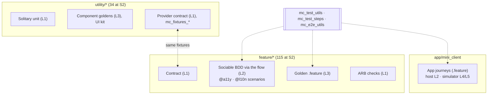
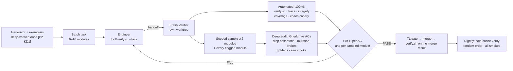

# 05: Testing and BDD strategy (Tide-style sociable BDD, verified at 150-module scale under Bazel)

| | |
|---|---|
| Task | T-0013, planning wave 2. Planner P5 (PL-5) |
| Date | 2026-11-22 |
| Binding input | [`00-planning-brief.md`](00-planning-brief.md) (D1 to D12) |
| Peers | PL-1 (module catalogue), PL-2 ([`02-generation-and-scale.md`](02-generation-and-scale.md)), PL-3 (Bazel integration and codegen macros), PL-4 (profiling, `budget16`), PL-6 (roadmap) |
| Status | Plan input for TL assembly. Nothing here is decided until the TL accepts it. |

**Citation keys.**
- `[testing › X]`: the original Tide testing article, section X.
- `[tide-test §n]`: `research/tide-miniclient/app-navigation-testing.md`.
- `[tide-core §n]`: `research/tide-miniclient/architecture-core.md`.
- `[rules_dart §n]`, `[rules_flutter §n]`: the two `research/bazel-rules/` documents.
- `[P2 §n]`: PL-2's plan.
- `ADR-0006 §n`, `F-0004 #n` (gotcha number).

---

## Key decisions

- **KD1. Tide's two tiers are kept** [testing › Solitary Unit Tests; › Sociable Feature Tests]:
  - Utilities get solitary unit tests (`test` + `mocktail`, AAA, `sut`).
  - Features get sociable BDD widget tests that enter **only through the flow** and double only external dependencies and the backend.
  - **Features have no solitary unit tests.**
- **KD2. The backend is doubled at the transport layer.** `McBackendHarness` drives `mc_mocked_backend`'s Dio `HttpClientAdapter` (D5): the same transport the app and e2e use, with fixture sets from PL-2's `mc_fixtures_<domain>` packages [P2 C3]. There are no interceptor stubs and no inline JSON.
- **KD3. Tide's `test_utils` becomes three testonly utilities:**
  - `mc_test_utils`: harness, container, `initFlow`, mocks, golden and a11y helpers
  - `mc_test_steps`: the shared Gherkin step library
  - `mc_e2e_utils`: simulator checkpoints and the app driver
- **KD4. AC traceability is tag-based.**
  - Scenarios carry `@T-XXXX-ACn`, which is canonical. mcgen-generated scenarios also carry `@MC-<module>-NN` [P2 §2.2].
  - The BDD generator appends the tags to each generated test name (`… [T-0123-AC1]`). That satisfies ADR-0006 §1 and makes `--test_filter='T-0123-AC1'` work.
  - `tool/trace_acs` joins task ACs → tags → JUnit results automatically.
- **KD5. Coverage follows Tide:** aim for 100 %, **fail below 90 % per package** [testing › Testing Best Practices].
  - It is measured on hand-written `lib/` code, with generated code excluded.
  - The app package is gated by journeys instead of a percentage.
- **KD6. Bazel granularity: one aggregated test target per package and kind.**
  - The kinds are `:unit_test`, `:bdd_test`, `:golden_test`, `:contract_test` and `:l10n_test`, which gives about 520 targets at 150 modules.
  - Per-file targets remain a switch for the H-TEST-1 experiment [P2 C5].
  - `flutter_prebuilt_test` is used only to re-run an already-built kernel under a different environment (chaos canary, random order).
- **KD7. Configurations stay separate.** Tests run in the default configuration; only e2e builds use `--config=sim` (`-c dbg`). The two are never mixed in one invocation (H-TEST-2).
- **KD8. Test parallelism and retries.**
  - `--local_test_jobs=4` under `budget16` (3 on the 8-core variant).
  - `--flaky_test_attempts=1` everywhere (ADR-0006 §4).
  - Both are calibrated by P5-16.
- **KD9. Goldens.**
  - Plain `matchesGoldenFile` with `mc_test_utils` helpers.
  - Bundled OFL fonts are loaded and the platform is set to iOS.
  - Sizes are iPhone 17 Pro (402×874) and iPhone SE (375×667) at DPR 1.
  - Golden targets are macOS-only (`target_compatible_with`).
  - Key screens only: about 1,150 images at 150 modules.
- **KD10. E2E combines Bazel and T-0012.**
  - Bazel builds **one** aggregated journey app per run, not one per journey (counters H-ITEST).
  - `tool/e2e_ios.sh` (T-0012) owns the simulator, the run and the evidence.
  - App-level journeys are Gherkin that runs on the host (L2, every build) and on the simulator (L4/L5).
- **KD11. `tool/verify.sh` becomes a thin Bazel wrapper:** lint → tests under coverage → goldens → coverage gate → AC traceability → test integrity. The TL's post-merge check and CI run the same script.
- **KD12. Verification at scale.**
  - Machine checks run on 100 % of modules.
  - A fresh Verifier per batch deep-audits a commit-seeded sample (≥ 2 modules per batch, plus every flagged module) with mutation probes.
  - Golden updates are always reviewed as before/after/diff.
  - The generator itself is verified deeply once [P2 KD1].
- **KD13. Behaviour first** [testing › intro; tide-test §9.4]. The TL writes ACs as Given/When/Then, and Engineers turn them into scenarios **before** implementing.

## Open conflicts for the TL

| # | Conflict | With | Proposal |
|---|---|---|---|
| **C1** | PL-2 generates feature `test/unit/**` (repository and bloc tests with mocktail, rule-example tests, mapper round-trips) and targets a **0.55** test:source ratio [P2 §2.3, §3.2]. Tide forbids mocking internal classes in features and says to test only exported classes [testing › Feature Testing bonus 4; › Testing Best Practices]. A feature exports only its flow. | PL-2, Tide | Features get **BDD + contract + l10n only**.<br>• Spec `rules.examples` become **Scenario Outline `Examples:`** driven through the flow (still spec-sourced, so P2 C8 holds).<br>• Mapper round-trips move into `:contract_test` (TD-11).<br>• Expected ratios: features about 0.3 (PL-2's floor), utilities about 0.7, about 0.4 overall: **about 230k test LOC at S2**, not 330k.<br>• If more test volume is wanted for the stress test, add spec-driven scenarios, not tests of internals. |
| **C2** | ADR-0006 §2 gates at ≥ 80 % for domain, data and mock code, and gates UI on per-state widget tests. Tide gates at 90 % per package. | ADR-0006 | Amend ADR-0006 to 90 % per package over all hand-written `lib/` code: UI included, since sociable tests reach it. Generated code excluded. Per-state scenarios stay a required checklist. The app is exempt from the percentage. |
| **C3** | T-0005 (`fvm flutter test --coverage`) and T-0010/T-0012 (default runner `fvm flutter drive`) are pub paths. Under D7 generated code isn't committed, so a pub build of the real app doesn't compile without `build_runner`. | T-0005, T-0010, T-0012, D7 | Rescope T-0005 → P5-09 (a Bazel wrapper). T-0012 stays as it is: it's stack-independent, and its fixture tests may use fvm. The app's e2e passes a **Bazel `--runner-cmd`** (P5-10). T-0010 is absorbed by P5-10/P5-11. |
| **C4** | Neither rule set has a generator for `bdd_widget_test` [rules_dart §6.3; rules_flutter §6]. We also need behaviour it lacks: tags in test names, `testMethodName: mcTestWidgets`, shared-step resolution and lint-clean output. | D3, PL-3 | PL-3 owns the mechanism; §5.2 lists the requirements.<br>• Preferred: a `dart_binary` that reuses `bdd_widget_test`'s parser, plus a tag→name pre-pass.<br>• Fallback: our own generator for the **same stock dialect**, so PL-2's `fvm flutter test` baseline [P2 §7.2] still works.<br>• Upstream a shim (D12). |
| **C5** | PL-2's example BDD vocabulary ("Background: I am on…", then "backend responds with {'page 1'}") follows Tide's open-then-stub order. | PL-2 §2.2 | mcgen emits the §3 vocabulary and **data-before-open** ordering (TD-05), and keeps `MC-<module>-NN` as a second tag family. |
| **C6** | The feature barrel must also export its **navigator interface(s)**, so the app can implement them and tests can mock them. The articles say the flow is the only export [tide-test §3.3]. | D1, PL-1 | Barrel = flow(s) + navigator interfaces. The feature's l10n delegate stays internal: the flow provides its own `Localizations`. |
| **C7** | Contract tests import `src/domain/{api,model}` (TD-11). | Tide | Accept as a narrow deviation, enforced by the integrity checker (R7). |
| **C8** | New testonly utilities `mc_test_steps` and `mc_e2e_utils`. | D2, PL-1, PL-2 S0 list | Add both to the catalogue. Each is about 1.5k LOC. |
| **C9** | The `--disk_cache` shared across worktrees [P2 §7.1] means a "fresh" Verifier's build reuses the Engineer's cached outputs. | ADR-0006 §3 | Accept it: the cache is content-addressed. Add a nightly **cold** verify on an empty cache (§7.6). |
| **C10** | The pseudo-locale `en_XA` ends up in the generated `supportedLocales`. | D4b, PL-1 | The app filters `en_XA` out of release builds. The alternative is a second `flutter_gen_l10n` target per package. |

---

## 1. Tide strategy carried over

### 1.1 What we keep

| Tide element | Source | Our form |
|---|---|---|
| Solitary unit tests: one class per test, `test` + `mocktail`, mocks for external classes only | [testing › Solitary Unit Tests; › Creating Mocks] [tide-test §4.3] | Every `mc_*` utility. `sut`, `// Arrange / Act / Assert`, one purpose per test, `Mock<T>` plus no-op `createMock<T>()` factories in `test/util/`. |
| Sociable feature tests through the flow; "mock only external dependencies (via mocktail) and API responses" | [testing › Sociable Feature Tests; › Feature Testing bonus 4] [tide-test §4.2, diagram §8.2] | Same. *External* means services owned by other packages: monitoring, storage, clock, platform, and **navigator contracts the app implements**. The bloc, repository, retrofit API, mappers and flow are never mocked. |
| Gherkin is the spec: `.feature` → generated `_test.dart`; step files are hand-owned after the first stub | [testing › Feature File; › Updating Step Files] [tide-test §4.6] | Same dialect (`bdd_widget_test`). Generation is a Bazel action (TD-09). |
| `test_utils` package | [testing › Creating a Test Utilities Package … Barrel File] [tide-test §4.4] | `mc_test_utils` + `mc_test_steps` + `mc_e2e_utils` (TD-03) |
| `FeatureTestInterceptor` | [testing › Mocking Networking Requests] | `McBackendHarness` (TD-01) |
| `MockMonitoring`, `createMockMonitoring()` | [testing › Mocking Monitoring] | Same names, **exported** |
| `TestContainer` | [testing › Test DI Initializer] | `McTestContainer` (TD-02) |
| `initFlow(tester, flowBuilder)` | [testing › Flow Initializer] | `initFlow`, same name with an extended signature (TD-04) |
| `GetIt.instance.reset()` inside `initializeDIContainer` | [testing › Flow Initializer] | Kept in `mc_di`; `McTestSession` also resets on teardown |
| "Get the sample data from outside of the implementation" | [testing › Testing Data] | Fixtures come from `mc_fixtures_<domain>` against the documented contract (F-0003), never from feature DTOs (TD-06) |
| Test only exported classes | [testing › Testing Best Practices] | Tests import only the barrel (integrity rule R7), except contract tests (TD-11) |
| 100 % aim, 90 % CI floor | ibid. | §1.3 |
| Keep tests fast; split a package whose suite takes more than a few seconds | ibid. | Per-target budget (TD-12); Bazel caching makes "run often" cheap |
| User spec first | [testing › intro] | KD13 |

### 1.2 `mc_test_utils` (Tide's `test_utils`, rebuilt)

`utility/mc_test_utils` is a `testonly` `flutter_library`. Its dependencies are `mc_di`, `mc_mocked_backend` (the engine), `mc_api_client`, `mc_monitoring`, `mc_design_system`, `mc_storage`, `flutter_test` and `mocktail`. It depends on no fixture package: a fixture set is resolved by name from the test's own assets.

```dart
// lib/mc_test_utils.dart: the only barrel [tide-core §2.4]
export 'src/session.dart' show McTestSession, mcTestWidgets, mcSettle;
export 'src/backend_harness.dart' show McBackendHarness, BackendFailure, RecordedRequest, matchesRequest;
export 'src/test_container.dart' show McTestContainer;
export 'src/init_flow.dart' show initFlow, ExternalDouble;
export 'src/mocks.dart' show MockMonitoring, createMockMonitoring;
export 'src/golden.dart' show expectScreenGolden, GoldenDevice;
export 'src/a11y.dart' show expectIosAccessibility;
```

```dart
/// The test method that every generated BDD test and hand-written widget test uses.
/// Per test it creates a fresh McBackendHarness (zero latency, strict), resets DI,
/// sets debugDefaultTargetPlatformOverride = TargetPlatform.iOS and a 402x874 @1x
/// surface, loads the bundled fonts once per isolate, and honours MC_BACKEND_CHAOS.
/// On teardown it fails on unmatched requests, unreleased holds or uncaught
/// exceptions, then restores every global.
@isTest
void mcTestWidgets(String description, WidgetTesterCallback body,
    {List<String>? tags, Timeout? timeout});

/// Action steps end with this, never with a bare pumpAndSettle:
/// pump(500 ms) fires debounce timers (500 ms is the repo-wide maximum), then
/// pumpAndSettle, or two fixed frames while a hold keeps an indicator spinning.
Future<void> mcSettle(WidgetTester tester);

class McBackendHarness {
  void useFixtureSet(String name);        // 'characters.paged_45' → mc_fixtures_characters asset
  void fail(String route, BackendFailure failure, {int times = -1}); // -1 = every time
  void hold(String route);                // request pends → deterministic loading state
  Future<void> release(String route);
  List<RecordedRequest> get requests;     // method, path, query, body, in order
  Set<String> get servedStrings;          // every string value served (used by the pseudo-locale check)
}
// Route syntax: '<METHOD> <exact path>[?<query subset>]', e.g. 'GET /v1/characters?offset=20'.
enum BackendFailure { serverError, timeout, offline, notFound, unauthorized, malformed }

Future<void> initFlow(WidgetTester tester, Widget Function() flow,
    {List<ExternalDouble<Object>> externals = const []});
// Pumps McTestApp: mc_design_system theme, the session's locale, text scale and brightness,
// global l10n delegates, iOS platform. The flow brings its own feature delegate (C6).
```

`McTestContainer` composes the **production** root initializers and swaps in doubles only at the edges (TD-02):

```dart
List<McDIInitializer> mcTestInitializers(McTestSession s) => [   // names follow PL-1
  MonitoringTestInitializer(s.monitoring),        // MockMonitoring, no-op stubs [testing › Mocking Monitoring]
  MockedBackendDIInitializer(s.backend.adapter),  // HttpClientAdapter → in-process mc_mocked_backend
  const ApiClientDIInitializer(),                 // real Dio config and interceptors, over the adapter
  StorageTestInitializer(InMemoryStorage()),      // mc_storage's own fake
  ClockTestInitializer(FixedClock(DateTime.utc(2026))),
  ...s.externals,                                 // e.g. navigator mocks
];
```

The feature's own initializer still runs inside the flow's scope [tide-test §3.2]. So the real repository, retrofit API, bloc and flow are exercised, exactly as in Tide [tide-test §4.4].

### 1.3 Coverage policy

- **Gate:** every `utility/*` and `feature/*` package must reach **≥ 90 %** line coverage, with **100 %** as the target (packages below 100 % are listed as info) [testing › Testing Best Practices].
- **Scope:**
  - Utilities are measured on their own unit tests.
  - Features are measured on their BDD and contract tests.
  - `bazel coverage` scopes LCOV to the test's own package [rules_flutter §8]. A feature's BDD run therefore never inflates a utility's number, which matches Tide's intent that utilities prove themselves.
- **Exclusions:** `*.g.dart`, `*.freezed.dart`, `*.config.dart`, `*.gr.dart`, generated l10n and BDD-generated tests (the D8 list). This answers [tide-test §9.3.8].
- **No escape hatch:** `// coverage:ignore` isn't honoured anyway [rules_dart §8], and Tide uses none.
- **App:** `app/mini_client` is gated by its journeys (§6), not by a percentage.

### 1.4 Deviation register (testing)

| ID | Tide | Ours | Why |
|---|---|---|---|
| TD-01 | `FeatureTestInterceptor`: path-only match, raw JSON strings, throws on unmocked paths | `McBackendHarness` over `mc_mocked_backend`'s adapter. Matches method + path + query subset. Supports `once`, holds and typed failures. Strict: an unmatched request fails the test | Fixes the gaps in [tide-test §9.3.2]. One fixture source for app, tests and e2e (D5) |
| TD-02 | `TestContainer` registers a bare `Dio()` and replaces the whole utility layer | Real `mc_api_client` Dio over the mock adapter; only monitoring, storage, clock and navigators are doubled | Our interceptors (error mapping) are part of the behaviour |
| TD-03 | `test_utils` hides `MockMonitoring` and `TestContainer`; one package | Everything useful is exported; split into three testonly packages | [tide-test §9.3.3]. A step edit doesn't re-run utility tests that use only the harness |
| TD-04 | `initFlow` pumps a bare `MaterialApp` | `McTestApp`: theme, l10n, iOS, reference surface, text scale | [tide-test §9.3.4]; F-0004 #1 |
| TD-05 | "Given I am on the page", then "When backend responds…", with a `pumpAndSettle` inside the backend step | Data-setup Givens come **before** the flow opens. Backend steps never pump; action steps end with `mcSettle` | Tide's ordering is implicit and fragile [tide-test §4.5] |
| TD-06 | `test/util/data.dart`, pasted from the Marvel docs | Named fixture sets in `mc_fixtures_<domain>`, each with a documented "test-facing facts" table | The Marvel API is gone (F-0003). Same principle [testing › Testing Data] |
| TD-07 | Assertions on raw text, including `DioException…` | User copy for spec facts; `ValueKey<String>('<pkg>.<element>')` for structure; never widget types from `src/` | [testing › Feature Testing bonus 2, 3] |
| TD-08 | Scenario titles only | `@T-XXXX-ACn` (and `@MC-…`) tags, injected into test names | ADR-0006 §1 |
| TD-09 | `build_runner` generates tests into the source tree | Generated in a Bazel action into `bazel-out` and never committed (D7). Stubs come from `bazel run //tool/bdd:scaffold` | [tide-test §6] |
| TD-10 | `flutter test --coverage`, no gate tool named | `bazel coverage` plus `//tool/coverage:gate` | Mechanism only; the targets are unchanged |
| TD-11 | Test only exported classes | `test/contract/` may import `src/domain/{api,model}` | Contract checks need the DTOs. No other test may import `src/` |
| TD-12 | Split the package if its suite takes more than "a few seconds" | A BDD target should run in ≤ 15 s wall on the M4 Pro; above 30 s, split the package or shard | Our M-size features are about 20× Tide's sample |
| TD-13 | No golden, app-level, e2e, a11y, l10n or contract tests [tide-test §4.2] | Added (§2) | ADR-0006 L3 to L5; D4b |
| TD-14 | `cached_network_image` to dodge `Image.network` in tests | Bundled placeholder assets (D4d), precached in goldens | [testing › Problem With Images] |
| TD-15 | All steps live per feature | Shared `mc_test_steps` plus thin per-feature steps | Avoids re-implementing the same steps in 115 features [tide-test §9.3.6] |

---

## 2. Additions Tide doesn't cover

| Addition | ADR-0006 layer | Location | Target / Bazel tag | Runs |
|---|---|---|---|---|
| Goldens | L3 | `test/golden/*.feature` in features and UI-kit utilities | `:golden_test` / `golden` | macOS, every `verify.sh` |
| App-level and cross-feature journeys (host) | L2 | `app/mini_client/test/journey/*.feature` | `//app/mini_client:journey_test` / `bdd`, `app` | every `verify.sh` |
| E2E journeys (simulator) | L4 + L5 | `app/mini_client/integration_test/journeys/**.feature` | `//app/mini_client:e2e_app` (manual), run by `tool/e2e_ios.sh` | feature tasks, nightly, wave exit |
| Accessibility | L2 (+ L5 on iPhone SE) | `@a11y` scenarios in every feature | inside `:bdd_test` | every `verify.sh` |
| l10n | L1 (ARB checks), L2 (pseudo-locale) | generated per package with ARBs; `@l10n` scenarios | `:l10n_test` / `l10n` | every `verify.sh` |
| Contract | L1 | feature `test/contract/`; provider tests in `mc_fixtures_<domain>` | `:contract_test` / `contract` | every `verify.sh` |
| Test lint, traceability, integrity | L0 (process) | `tool/` | `//tool/...` | every `verify.sh` |



**Goldens (L3).**
- **Fonts.** `mc_design_system` bundles OFL families (proposal: Inter, plus MaterialIcons and CupertinoIcons) as `flutter_font_family` targets, and the app theme uses them too.
  - The tester runs with `--use-test-fonts --disable-asset-fonts` [rules_flutter §8], so `mcTestWidgets` loads the fonts explicitly with `FontLoader` from test assets.
  - We don't rely on `flutter_test_config.dart`: whether the Bazel bootstrap honours it is unverified. This fixes F-0004 #1.
- **Content.** Platform iOS. Placeholder images are precached with `tester.runAsync`.
- **Matrix per feature:** main content state in light and dark, error and empty in light, plus the list screen on iPhone SE.
- **File names:** `<pkg>.<screen>.<state>.<theme>.<device>.png`, under `test/golden/goldens/`.
- **Updating.** `bazel run //<pkg>:golden_test -- --update-goldens`; under `bazel test` that flag exits 64. Diffs go to `bazel-testlogs/…/test.outputs/` [rules_flutter §8], which retires F-0004 #2.
- **Platform gate.** Golden targets carry `target_compatible_with = ["@platforms//os:macos"]`, so Linux CI skips them silently.

**App-level journeys (L2).** These are the only place features meet before e2e. `Given the app is launched with {'default'} data` pumps the real `McApp`: `go_router` typed routes (D4a), real navigator implementations and real flows, over `McTestContainer`. They cover:
- boot failure, timeout and retry (Tide homework [tide-test §7])
- deep links
- cross-feature hops
- side-by-side flows in tabs (the scope-stack defect [tide-test §3.2])
- iOS swipe-back
- favourites shared across features

**Accessibility (L2).**
- **Per screen-level flow:** one `@a11y` Scenario Outline over text scales 1.0, 1.35 and 2.0, asserting `iOSTapTargetGuideline`, `labeledTapTargetGuideline`, `textContrastGuideline` and no overflow.
- **Semantics labels** are required on images and icon buttons.
- **VoiceOver order** is checked only in sampled deep audits.
- **Visual check:** the iPhone SE screenshots at 2.0 in T-0011.

**l10n (L1/L2).**
- **ARB checks.** `:l10n_test` is generated per package and has no hand-written code. It checks:
  - key parity with the template `en`
  - placeholder name and type parity
  - plural and select messages have `other`
  - `@@locale` equals the file name [rules_flutter §6]
  - no empty values
  - descriptions are present
- **Pseudo-locale.** `en_XA` is generated in Bazel from the template: accents, 40 % expansion and `⟦ ⟧` brackets. Each flow's `@l10n` scenario asserts that every visible string is pseudo-localised or is backend data (`servedStrings`). This catches hard-coded strings without a custom lint, and expansion surfaces overflow.

**Contract (L1).**
- **Provider side**, in each `mc_fixtures_<domain>`:
  - every fixture validates against `contract/schemas/*.json`;
  - pagination invariants hold (`count ≤ limit`, `offset + count ≤ total`).
- **Consumer side**, in each feature's `test/contract/<api>_contract_test.dart`. For each retrofit method, call it through a Dio on `MockBackendAdapter` across **every** fixture variant of its route, and assert:
  - parsing succeeds;
  - required fields are present;
  - the route is declared (an unmatched route fails).
- Mapper round-trips (C1) live here too.
- `bazel run //tool/contract:usage` reports dead fixtures and unserved routes.
- **Why.** Tide's fixtures came from the real API's docs [testing › Testing Data]. Ours are our own contract (F-0003), so DTOs and fixtures could drift *together* unless both are checked against it.

---

## 3. BDD conventions

### 3.1 Files and naming

```
feature/characters_list/
  lib/characters_list.dart                       # barrel: CharactersListFlow, CharactersListNavigator (C6)
  test/feature/characters_list_browse.feature    # one Feature per file, ≤ 12 scenarios
  test/feature/characters_list_states.feature
  test/feature/step/<snake_case_step>.dart       # one function per file, `/// Usage:` line [tide-test §4.8]
  test/feature/util/characters_list_env.dart     # navigator mocks, keys
  test/golden/characters_list_golden.feature
  test/golden/goldens/*.png
  test/contract/characters_api_contract_test.dart
utility/mc_test_steps/lib/src/<group>/<snake_case_step>.dart
app/mini_client/test/journey/<journey>.feature                 # host (L2)
app/mini_client/integration_test/journeys/{smoke,mvp,tour}/*.feature   # simulator (L4)
```

**Naming:**
- **Files:** `<pkg>_<behaviour>.feature`.
- **Feature:** a noun phrase plus a one-line narrative.
- **Scenario:** a present-tense, user-observable sentence, unique per package, with **no AC ID** (the tags carry it).
- **Step phrasing:**
  - user actions in the first person ("I tap");
  - data setup as "the backend …";
  - navigator contracts as "the app was asked to …".
- **Functions:** the camelCase of the step text without its parameters, following `bdd_widget_test` [tide-test §4.6].

### 3.2 Shared library vs per-feature steps

**Rules:**
1. **`mc_test_steps`** owns generic vocabulary: backend, environment, UI interaction, generic assertions, a11y, l10n, golden, monitoring.
2. **Per-feature steps** own the domain vocabulary ("I open the characters list"). They stay thin: open the flow, find by the feature's string keys, delegate to shared helpers.
3. **Promotion:** a step text used by ≥ 3 packages moves into `mc_test_steps`. That change is TL-reviewed, because editing `mc_test_steps` re-runs every BDD target (§5.4).
4. **No shadowing:** the generator fails if a local step has the same function name as a shared one.
5. **No skipping:** `@skip` and `@wip` are forbidden (integrity R2).

**Shared catalogue v1** (the generated README lists all of them):

| Group | Steps (usage text) |
|---|---|
| Backend | `the backend serves {'set'}` · `the backend fails {'route'} with {'kind'}` · `the backend fails {'route'} once with {'kind'}` · `the backend holds {'route'}` · `the backend releases {'route'}` · `the backend received {'request'}` · `the backend received {n} requests for {'route'}` |
| Environment | `the text scale is {x}` · `dark mode is on` · `the device locale is {'de'}` · `the pseudo-locale is active` · `the device is {'iphone_se'}` |
| Interaction | `I tap {'label'}` · `I enter {'text'} into {'field label'}` · `I swipe back` · `I go back` · `I pull to refresh` · `I scroll until I see {'text'}` |
| Assertions | `I see {'text'}` · `I don't see {'text'}` · `I see the loading indicator` · `I see the empty state` · `I see the error state` · `monitoring recorded {'event'}` |
| a11y / l10n / golden | `the screen meets the iOS accessibility guidelines` · `nothing overflows` · `every visible label is localised` · `the screen matches golden {'name'}` |
| App (host + simulator) | `the app is launched with {'data'} data` · `the app is opened at {'/route'}` · `I open {'Characters'} from the tab bar` |

### 3.3 Mapping task ACs onto scenarios

- **Mapping.** Every behavioural AC of a feature task maps to ≥ 1 scenario tagged `@T-XXXX-ACn`. A scenario may carry several AC tags only if it asserts each of them. The TL writes ACs that read like scenarios, and the Engineer copies them nearly verbatim using the catalogue vocabulary.
- **Where tags go:**
  - only on `Scenario` / `Scenario Outline` lines, so the generator stays simple and the meaning is unambiguous;
  - category tags `@smoke` (the scenario that seeds the feature's e2e smoke journey), `@a11y`, `@l10n` and `@slow` become Dart `tags:`;
  - `@T-…` and `@MC-…` go into the **name**: `Browse characters The first page is listed in name order [T-0123-AC1 MC-characters_list-01]`.
- **Non-BDD tests** keep ADR-0006's rule: the AC ID goes in the `test()` name. PL-2's `sh_test` gate names use `T_XXXX_ACn` [P2 §4.3]; the checker normalises `_` to `-`.
- **Visual-only ACs:** the checkpoint file name starts with the AC ID (`T-0123-AC4-details.png`).
- **Running one AC:** `bazel test //feature/characters_list:bdd_test --test_filter='T-0123-AC9'`.

### 3.4 Data setup and failure injection

- **Fixture sets** are named `<domain>.<variant>` and resolved from `mc_fixtures_<domain>` [P2 C3], declared as library assets (`packages/mc_fixtures_<domain>/…` [rules_flutter §7]).
  - Examples: `characters.paged_45` (synthetic "Hero 01" to "Hero 45", 20 per page), `characters.empty`, `characters.realistic` (T-0007's 100+ dataset).
  - Each package README has a **test-facing facts** table (first item, totals, IDs, related counts). Expectations come from there, never from feature code [testing › Testing Data].
- **No set means no data:** every request is unmatched, and the test fails. This mirrors Tide's throw.
- **Failures** map onto `mc_mocked_backend`'s failure modes (D5): `server_error`, `timeout`, `offline`, `not_found`, `unauthorized`, `malformed`. `once` gives retry scenarios.
- **Loading** uses `holds` / `releases`. Latency is always zero (ADR-0005 §3), so no test sleeps.
- **Determinism:** fixed seed, `FixedClock`, `TZ=UTC`, locale `en`.
- **Chaos:** `MC_BACKEND_CHAOS=empty` swaps every set for an empty one (canary, §7.4).

### 3.5 Worked example: `characters_list` (a list-detail feature)

The task file contains, for instance: **T-0123-AC2:** *Given the backend has 45 characters, When I scroll the list until "Hero 21" is visible, Then the app has requested offset 20 and shows "Hero 21".*

```gherkin
# feature/characters_list/test/feature/characters_list_browse.feature
Feature: Browse characters
  Fans scroll through every character and open one to read about it.

  Background:
    Given the backend serves {'characters.paged_45'}

  @T-0123-AC1 @MC-characters_list-01 @smoke
  Scenario: The first page is listed in name order
    When I open the characters list
    Then I see {'Hero 01'}
    And the backend received {'GET /v1/characters?offset=0&limit=20'}

  @T-0123-AC2
  Scenario: Scrolling near the end loads the next page
    When I open the characters list
    And I scroll the characters list until I see {'Hero 21'}
    Then the backend received {'GET /v1/characters?offset=20&limit=20'}

  @T-0123-AC3
  Scenario: Pagination stops after the last page
    When I open the characters list
    And I scroll the characters list to the end
    Then I see {'Hero 45'}
    And I see the end of the list
    And the backend received {3} requests for {'GET /v1/characters'}

  @T-0123-AC4
  Scenario: Tapping a character opens its details
    When I open the characters list
    And I tap {'Hero 01'}
    Then I see the character details for {'Hero 01'}
    And I see {'Appears in 3 comics'}

  @T-0123-AC5
  Scenario: Going back keeps the list where I left it
    When I open the characters list
    And I scroll the characters list until I see {'Hero 21'}
    And I tap {'Hero 21'}
    And I swipe back
    Then I see {'Hero 21'}
    And the backend received {2} requests for {'GET /v1/characters'}

  @T-0123-AC6
  Scenario: Tapping a related comic hands over to the app
    When I open the characters list
    And I tap {'Hero 01'}
    And I tap {'Comic 001'}
    Then the app was asked to open comic {'c-001'}
```

```gherkin
# feature/characters_list/test/feature/characters_list_states.feature
Feature: Characters list states
  The list says what is happening when data is slow, missing or failing.

  @T-0123-AC7
  Scenario: A loading indicator shows while the first page is in flight
    Given the backend serves {'characters.paged_45'}
    And the backend holds {'GET /v1/characters'}
    When I open the characters list
    Then I see the loading indicator
    When the backend releases {'GET /v1/characters'}
    Then I see {'Hero 01'}

  @T-0123-AC8
  Scenario: An empty catalogue shows the empty state
    Given the backend serves {'characters.empty'}
    When I open the characters list
    Then I see {'No characters yet'}

  @T-0123-AC9
  Scenario Outline: A failed first page explains the problem and retries
    Given the backend serves {'characters.paged_45'}
    And the backend fails {'GET /v1/characters'} once with {<failure>}
    When I open the characters list
    Then I see {<message>}
    When I tap {'Try again'}
    Then I see {'Hero 01'}

    Examples:
      | failure        | message                             |
      | 'server_error' | 'Something went wrong on our side.' |
      | 'timeout'      | 'This is taking longer than usual.' |
      | 'offline'      | 'You seem to be offline.'           |

  @T-0123-AC10
  Scenario: A failed next page keeps what is loaded
    Given the backend serves {'characters.paged_45'}
    And the backend fails {'GET /v1/characters?offset=20'} once with {'server_error'}
    When I open the characters list
    And I scroll the characters list to the end
    Then I see {'Hero 20'}
    And I see {'Could not load more.'}
    When I tap {'Try again'}
    And I scroll the characters list to the end
    Then I see {'Hero 45'}

  @T-0123-AC11
  Scenario: A character that no longer exists says so
    Given the backend serves {'characters.paged_45'}
    And the backend fails {'GET /v1/characters/h-01'} with {'not_found'}
    When I open the characters list
    And I tap {'Hero 01'}
    Then I see {'This character is no longer available.'}

  @T-0123-AC12 @a11y
  Scenario Outline: The list works with large text
    Given the backend serves {'characters.paged_45'}
    And the text scale is {<scale>}
    When I open the characters list
    Then the screen meets the iOS accessibility guidelines
    And nothing overflows

    Examples:
      | scale |
      | 1.0   |
      | 1.35  |
      | 2.0   |

  @T-0123-AC13 @l10n
  Scenario: Every label on the list and the details is localised
    Given the backend serves {'characters.paged_45'}
    And the pseudo-locale is active
    When I open the characters list
    Then every visible label is localised
    When I tap {'Hero 01'}
    Then every visible label is localised
```

**Per-feature step definitions** (`test/feature/step/`, hand-owned after scaffolding):

```dart
// util/characters_list_env.dart
class MockCharactersListNavigator extends Mock implements CharactersListNavigator {}

/// One navigator mock per test, owned by the session and reset between tests.
CharactersListNavigator charactersNavigator() =>
    McTestSession.current.putIfAbsent<CharactersListNavigator>(() {
      final mock = MockCharactersListNavigator();
      when(() => mock.openComic(any())).thenAnswer((_) async {}); // no-op by default [testing › Creating Mocks]
      return mock;
    });
const gridKey = ValueKey('characters_list.grid');

// i_open_the_characters_list.dart
/// Usage: I open the characters list
Future<void> iOpenTheCharactersList(WidgetTester tester) async {
  await initFlow(tester, () => const CharactersListFlow(), // from the barrel, not src/
      externals: [ExternalDouble<CharactersListNavigator>(charactersNavigator())]);
  await mcSettle(tester);
}

// i_scroll_the_characters_list_until_i_see.dart
/// Usage: I scroll the characters list until I see {'Hero 21'}
Future<void> iScrollTheCharactersListUntilISee(WidgetTester tester, String name) async {
  await tester.scrollUntilVisible(find.text(name), 400,
      scrollable: find.descendant(of: find.byKey(gridKey), matching: find.byType(Scrollable)));
  await mcSettle(tester);
}

// i_scroll_the_characters_list_to_the_end.dart
/// Usage: I scroll the characters list to the end
Future<void> iScrollTheCharactersListToTheEnd(WidgetTester tester) async {
  final scrollable = find.descendant(of: find.byKey(gridKey), matching: find.byType(Scrollable));
  for (var i = 0; i < 20; i++) {
    final position = tester.state<ScrollableState>(scrollable).position;
    if (position.pixels >= position.maxScrollExtent) return; // stable: nothing more is loading
    await tester.drag(find.byKey(gridKey), const Offset(0, -2000));
    await mcSettle(tester);
  }
  fail('characters list did not reach its end after 20 drags');
}

// i_see_the_end_of_the_list.dart
/// Usage: I see the end of the list
Future<void> iSeeTheEndOfTheList(WidgetTester tester) async =>
    expect(find.byKey(const ValueKey('characters_list.end')), findsOneWidget);

// i_see_the_character_details_for.dart
/// Usage: I see the character details for {'Hero 01'}
Future<void> iSeeTheCharacterDetailsFor(WidgetTester tester, String name) async => expect(
    find.descendant(of: find.byKey(const ValueKey('characters_list.details.title')),
        matching: find.text(name)),
    findsOneWidget);

// the_app_was_asked_to_open_comic.dart
/// Usage: the app was asked to open comic {'c-001'}
Future<void> theAppWasAskedToOpenComic(WidgetTester tester, String comicId) async =>
    verify(() => charactersNavigator().openComic(ComicId(comicId))).called(1);
```

**Shared step definitions** (excerpt from `mc_test_steps`):

```dart
/// Usage: the backend serves {'characters.paged_45'}
Future<void> theBackendServes(WidgetTester tester, String set) async =>
    McTestSession.current.backend.useFixtureSet(set);           // no pump (TD-05)

/// Usage: the backend fails {'GET /v1/characters'} once with {'server_error'}
Future<void> theBackendFailsOnceWith(WidgetTester tester, String route, String kind) async =>
    McTestSession.current.backend.fail(route, BackendFailure.parse(kind), times: 1);

/// Usage: the backend received {n} requests for {'GET /v1/characters'}
Future<void> theBackendReceivedRequestsFor(WidgetTester tester, int n, String route) async =>
    expect(McTestSession.current.backend.requests.where(matchesRequest(route)), hasLength(n));

/// Usage: I tap {'Try again'}
Future<void> iTap(WidgetTester tester, String label) async {
  final target = find.text(label).hitTestable();
  expect(target, findsOneWidget, reason: 'exactly one tappable "$label"');
  await tester.tap(target);
  await mcSettle(tester);
}

/// Usage: I swipe back
Future<void> iSwipeBack(WidgetTester tester) async {           // iOS edge gesture, not a button
  await tester.dragFrom(const Offset(2, 400), const Offset(300, 0));
  await mcSettle(tester);
}

/// Usage: the screen meets the iOS accessibility guidelines
Future<void> theScreenMeetsTheIosAccessibilityGuidelines(WidgetTester tester) async {
  final handle = tester.ensureSemantics();
  await expectLater(tester, meetsGuideline(iOSTapTargetGuideline));
  await expectLater(tester, meetsGuideline(labeledTapTargetGuideline));
  await expectLater(tester, meetsGuideline(textContrastGuideline));
  handle.dispose();
}
```

**Generated output** (excerpt, in `bazel-bin` and never committed):

```dart
void main() {
  group('''Browse characters''', () {
    Future<void> bddSetUp(WidgetTester tester) async {
      await theBackendServes(tester, 'characters.paged_45');
    }
    mcTestWidgets('''The first page is listed in name order [T-0123-AC1 MC-characters_list-01]''',
        (tester) async {
      await bddSetUp(tester);
      await iOpenTheCharactersList(tester);
      await iSee(tester, 'Hero 01');
      await theBackendReceived(tester, 'GET /v1/characters?offset=0&limit=20');
    }, tags: ['smoke']);
  });
}
```

---

## 4. Test-pyramid budget per archetype

The module mix is PL-2's S2 rung [P2 §5.1]: 60 list-detail, 30 form/wizard and 25 dashboard features; 12 foundation, 10 UI-kit and 12 data utilities; plus the app, for 150 modules. Features are M-size [P2 §3.1]. The per-case timings are estimates that P5-16 will measure.

| Archetype (lib LOC) | Unit cases | BDD files / scenarios (generated cases) | Goldens | Contract / l10n | Test targets: package mode / file mode | Hand-written test Dart LOC (+ Gherkin lines) | Suite CPU (est.) |
|---|---|---|---|---|---|---|---|
| List-detail feature (5.0k) | 0 | 6 / 36 (≈ 45) | 6 | ≈ 8 cases / generated | 4 / 9 | ≈ 1,250 (+ 380) | ≈ 21 s |
| Form/wizard feature (6.0k) | 0 | 7 / 40 (≈ 70; validation Outlines) | 8 | ≈ 5 / generated | 4 / 10 | ≈ 1,500 (+ 500) | ≈ 26 s (2 shards) |
| Dashboard feature (4.5k) | 0 | 5 / 28 (≈ 35; partial-failure per section) | 6 | ≈ 10 / generated | 4 / 8 | ≈ 1,100 (+ 300) | ≈ 19 s |
| Foundation utility (2.5k) | ≈ 120 (12 files) | 0 | 0 | — | 1 / 12 | ≈ 1,800 | ≈ 5 s |
| UI-kit utility (4.0k) | ≈ 150 widget-solitary (20 files) | 0 | ≈ 40 (component × state × theme) | l10n if it has strings | 2 / 21 | ≈ 2,400 | ≈ 32 s → split rule (TD-12) |
| Data utility (3.5k) | ≈ 180 (18 files) | 0 | 0 | provider schema checks | 1 / 18 | ≈ 2,800 | ≈ 8 s |
| App (≈ 5k glue) | ≈ 30 (route table) | 10 / ≈ 60 host journeys + ≈ 118 e2e journeys | 0 | — | 3 / ≈ 15 | ≈ 4,000 (+ 1,500) | ≈ 60 s host |

| Total | at 130 modules | **at 150 (S2)** | at 170 | S3 (≈ 190) |
|---|---|---|---|---|
| Test targets, package mode (default) | ≈ 450 | **≈ 520** | ≈ 590 | ≈ 660 |
| Test targets, file mode (H-TEST-1 arm) | ≈ 1,400 | **≈ 1,600** | ≈ 1,850 | ≈ 2,050 |
| BDD cases / unit cases / golden images | 5.0k / 4.4k / 1.0k | **5.7k / 5.1k / 1.15k** | 6.5k / 5.8k / 1.3k | 7.3k / 6.5k / 1.45k |
| Hand-written test Dart LOC (Gherkin) | ≈ 200k (41k) | **≈ 231k (47k)** | ≈ 261k (53k) | ≈ 380k at L/XL sizes |
| Generated BDD test LOC (reported apart, D8) | ≈ 60k | ≈ 70k | ≈ 80k | ≈ 90k |
| Clean test CPU · wall at `budget16` (4 jobs) · wall at 12 jobs | — | **≈ 51 CPU-min · ≈ 13 min · ≈ 4.5 min** | — | — |

File mode adds about 1,100 tester start-ups and links, which roughly doubles clean test CPU and is the main cost behind H-TEST-1. PL-2's S4 synthetic workspaces should emit tests at these ratios (`--tests lean|full`, [P2 §5.2]), so that H-TEST-1 and H-TESTLINK can be measured at 5M and 10M LOC.

---

## 5. Running tests under Bazel

### 5.1 Target granularity

| Option | Targets at 150 | For | Against | Use |
|---|---|---|---|---|
| A. One `flutter_test` per test file | ≈ 1,600 | Finest cache; matches Gazelle and upstream's one-main-per-target [rules_dart §7; rules_flutter §8] | Every file pays a `DartKernelLink` (5–15 MB, [P2 C5]) and a `flutter_tester` start-up (H-TEST-1). More analysis nodes (H-ANALYSIS) | Experiment only (`tests = "per_file"`) |
| **B. One per package per kind, with a generated aggregator `main`** | **≈ 520** | Matches Tide's unit of ownership and its "split the package" rule. Coverage is per package. About 3× fewer links and start-ups. Shardable | Editing one test file re-runs that kind's suite (≤ 15 s). Tests share an isolate, so leaks are possible: mitigated by the `mcTestWidgets` reset plus a nightly random-order run. Golden test files must sit flat in `test/golden/` (comparator base dir) | **Default** |
| C. One aggregated `flutter_prebuilt_test` across packages | 1–10 | Fewest processes | Any edit re-runs everything, which defeats the very caching we are stress-testing | Only to re-run a built kernel with another environment |

PL-2's edit E13 ("BDD scenario add") still holds under B [P2 §6.3]. It costs one generation action, one kernel compile, one link and one test run: the aggregator's outline doesn't change, so it isn't recompiled. The difference from per-file mode is that the test run covers the whole package suite.

**H-TEST-2.** Libraries shared by the app and tests compile twice in `-c dbg` [rules_flutter §16.2]. So `bazel test` always runs in the default configuration, and only e2e app builds use `--config=sim`. PL-4 measures the cost.

### 5.2 BDD-generated targets (requirements for PL-3's macros)

```starlark
mc_bdd_tests(                      # called by mcgen buildgen [P2 C4]; PL-3 implements it
    name = "bdd_test",
    lib = ":characters_list",
    features = glob(["test/feature/*.feature"]),
    steps = glob(["test/feature/step/*.dart", "test/feature/util/*.dart"]),
    fixtures = ["//utility/mc_fixtures_characters:assets"],
    shard_count = 2,
)
```

It expands to:
1. **One `mc_bdd_gen` action per `.feature`** (1:1, cacheable).
   - Inputs: the feature file, the local step basenames, and `//utility/mc_test_steps:step_index.json`.
   - Output: `<stem>_test.dart`.
   - Requirements:
     - stock `bdd_widget_test` dialect;
     - `testMethodName: mcTestWidgets`;
     - `@T-…` / `@MC-…` appended to the name and category tags passed as `tags:`;
     - fail on a missing or shadowed step;
     - lint-clean output, or exclusion from the `dart_analyze` aspect. Tide excluded these files from analysis [tide-core §1.4].
2. **One generated aggregator**, `bdd_all_test.dart`, which imports each generated test with a prefix and calls its `main` inside a `group`.
3. **`flutter_test(name = "bdd_test", main = aggregator, …)`** with:
   - deps: `lib`, `mc_test_utils`, `mc_test_steps`, `@deps//:bdd_widget_test` and `@deps//:mocktail`;
   - assets: fixtures, placeholder images and fonts;
   - `size = "medium"`, `tags = ["bdd"]`.
4. **`flutter_prebuilt_test(name = "bdd_test_chaos", …)`** over `:bdd_test`'s `test_kernel` output, with `env = {"MC_BACKEND_CHAOS": "empty"}` and tags `manual` and `canary`. It reuses the kernel, so there is **no recompilation** [rules_flutter §2.1].

**Scaffolding.** `bazel run //tool/bdd:scaffold -- //feature/characters_list` writes missing step stubs into the source tree. Like Tide's stubs, they are written once and hand-owned afterwards [tide-test §6], and the tool is never part of the build.

**Sibling macros:**
- `mc_unit_tests`: everything under `test/**/*_test.dart` outside `feature/`, `golden/` and `contract/`.
- `mc_golden_tests`, `mc_contract_tests`, and `mc_l10n_tests` (a pure `dart_test` with the ARBs as `data`).
- One umbrella, `mc_package_tests()`.

### 5.3 Tags, sizes, shards, configurations

| Kind | Tags | `size` | `shard_count` |
|---|---|---|---|
| unit | `unit` | small | 1 |
| bdd | `bdd` | medium | 1; 2 above 40 cases; 3 above 80 |
| golden | `golden` (+ macOS compatibility) | medium | 1 |
| contract / l10n | `contract` / `l10n` | small | 1 |
| app journeys (host) | `bdd`, `app` | large | 4 |
| e2e | `e2e`, `manual`, `exclusive` | enormous | 1 |
| anything > 60 s | + `slow` | | |

```
# .bazelrc (test part; budget16 itself is PL-4's)
test --flaky_test_attempts=1                     # ADR-0006 §4: never retry
test --test_output=errors --test_summary=terse
test --test_env=TZ=UTC --test_env=LANG=en_US.UTF-8
test:fast      --test_tag_filters=unit,bdd,contract,l10n,-slow,-e2e
test:golden    --test_tag_filters=golden
test:all       --test_tag_filters=-e2e,-manual
coverage:covgate --test_tag_filters=unit,bdd,contract --combined_report=lcov
test:budget16    --local_test_jobs=4
test:budget16_8c --local_test_jobs=3
test:fullmac     --local_test_jobs=12
test:nightly   --test_arg=--test-randomize-ordering-seed=random   # supported by the runner [rules_flutter §8]; verify
```

The attribute `flaky = True` is forbidden (integrity rule R2). Shards add **no** parallelism beyond `--local_test_jobs`; they only shorten one target's critical path. That matters on a single-package edit loop, not on a clean run.

### 5.4 Memory within `budget16`

`flutter_tester` RSS is unmeasured upstream [rules_flutter §10.3]. Assume 0.3–0.7 GB per widget suite with fonts and images. The working budget for 16 GB (PL-4 owns the totals):
- Bazel JVM: ≤ 3 GB
- workers (`DartKernel` × 2, analyzer): about 1.5 GB
- OS, IDE and Simulator: about 4 GB

That leaves about 6 GB for tests, which gives **4 concurrent testers** at ≤ 1 GB each, with headroom. Compile actions (`--jobs`) overlap test execution, so the peak is their sum.

**Measured stress case: an `mc_test_utils` body edit.** The outline cutoff saves recompiles [rules_dart §5.2], but every dependent test kernel re-links and re-runs, because the test action key includes the kernel [rules_flutter §8]. That is about 480 targets, or about 13 min at `budget16`. It is the testing analogue of PL-2's E03. Keep `mc_test_utils` and `mc_test_steps` stable and mixin-free.

### 5.5 Coverage and the 90 % gate

```
bazel coverage --config=covgate --config=budget16 //utility/... //feature/...
bazel run //tool/coverage:gate -- --testlogs="$(bazel info bazel-testlogs)" \
    --thresholds=tool/coverage/thresholds.json --out=documents/evidence/$TASK/coverage-summary.md
```

The gate:
1. merges each package's `unit`, `bdd` and `contract` `coverage.dat`;
2. drops generated files and anything not under `<pkg>/lib/`;
3. computes LH/LF with F-0004's formula;
4. fails any package below its threshold. The default is 90; only the TL may change a threshold, and integrity rule R5 watches the file.

Results are cached per package. If P5-06 shows that `bazel coverage` does **not** recompile (Dart coverage comes from the VM service at run time [rules_flutter §8]), `verify.sh` runs L1/L2 *only* under coverage, so tests aren't run twice.

### 5.6 How `bazel test` plugs into `tool/verify.sh` (rescoped T-0005)

| Stage | Command (inside `tool/verify.sh [--task T-XXXX] [--base origin/main] [--config budget16]`) | ADR-0006 |
|---|---|---|
| lint | `bazel build --config=lint //...` (the `dart_analyze` and `dart_format` aspects; any diagnostic fails [rules_flutter §12]) + `bazel test //tool/arch:all` (no feature→feature edges, barrel-only exports) | L0 |
| tests + coverage | `bazel coverage --config=covgate //utility/... //feature/...`, then `bazel test --config=fast //app/... //tool/...` and `:l10n_test`s | L1, L2 |
| goldens | `bazel test --config=golden //...` (skipped as incompatible on Linux) | L3 |
| coverage gate | `bazel run //tool/coverage:gate` | gate |
| traceability | `bazel run //tool/trace:trace_acs -- --task T-XXXX` | §1 |
| integrity | `bazel run //tool/integrity:check -- --base origin/main --task T-XXXX` | §4 |

Each stage prints one line and the script exits non-zero on any failure, as T-0005 requires. The Engineer, the Verifier, the TL post-merge check and CI all run it. CI is Linux, where goldens skip themselves and e2e is `manual`. Because Bazel caches results, there is no "affected tests" logic: `//...` reruns only what changed.

---

## 6. E2E plan

### 6.1 Journeys

| Journey | Count | Content | When |
|---|---|---|---|
| Feature smoke | 1 per user-facing feature (≈ 115) | Open the flow from the catalogue screen [P2 §7.3] or its typed route, content renders, one interaction, one checkpoint | Feature or batch tasks: the touched features. Nightly and wave exits: all |
| MVP (T-0011) | 2: happy path and error path | launch → browse → paginate → search → details → related comic → comic details → favourite → favourites tab; then injected failure → error → retry | Every feature task (≈ 60–90 s); phase exits on both devices |
| Enterprise tour | 1 per wave | Every top-level area, about 25 checkpoints, light and dark | Wave exit |
| Real relaunch | inside the MVP run | the runner does `simctl terminate`, then `simctl openurl <udid> minicl://favorites`, then `simctl io … screenshot`: the favourite persisted across a real process restart | MVP run |

The journeys are Gherkin. Where possible the **same `.feature`** runs on the host (`journey_test`, L2) and on the simulator. `McAppDriver` picks its bootstrap from the binding type: a host pump over `McTestContainer`, or the e2e entry with in-process `mc_mocked_backend` at zero latency.

### 6.2 `flutter_integration_test` vs `tool/e2e_ios.sh`: combine them

**Facts:**
- `flutter_integration_test(platform = "ios")` builds a full app per target through `ios_sim_debug_app`, boots a simulator, installs, launches and collects results, and is tagged `exclusive` [rules_flutter §8]. N targets cost about N app builds plus serial runs (H-ITEST).
- `flutter_drive_test` is `enormous`, `exclusive` and `manual`.
- T-0012 gives us simulator hygiene (ADR-0006 §6), screenshots and summaries, but its default runner is a pub path (C3).

**Decision:**
1. **One e2e app per run.** All journeys are generated into one entry point, `integration_test/journeys_test.dart`, with the same aggregation as §5.2. So `//app/mini_client:e2e_app` costs **one** `ios_application` build whether it holds 1 or 118 journeys.
   - Journeys are selected **at run time** with `MC_E2E_FILTER`, passed as `SIMCTL_CHILD_MC_E2E_FILTER` or through the rule's environment.
   - Never with `--dart-define`, which would push the debug build off the modular kernel path [rules_flutter §16.1].
2. **Bazel builds, T-0012 runs.** `tool/e2e_ios.sh` keeps create / boot / `bootstatus` / trap-delete, downscaling and `e2e-summary.md`. Its `--runner-cmd` becomes a Bazel call. Spike P5-10 picks, in order of preference:
   - (a) `bazel test --config=sim //app/mini_client:e2e_journeys --test_env=MC_SIM_UDID={udid}`, if the rule can target an existing device and keep screenshots;
   - (b) `flutter_drive_test` aimed at `{udid}`;
   - (c) `bazel build --config=sim //app/mini_client:e2e_app`, then `simctl install/launch` and an in-app JSON result file pulled with `simctl get_app_container`.

   The runner's interface doesn't change.
3. **The H-ITEST measurement fixture** (`//perf/itest:*`, 10 separate `flutter_integration_test` targets, `manual`) exists for PL-4 and upstream reports (D12). It is never part of the gate.

**Why:** 1 build instead of N; ADR-0006 needs us to own the simulator and the evidence; Bazel stays the only builder (D7); the runner stays stack-independent, as T-0012 intended.

### 6.3 Screenshots and evidence

- **Capture.** `mc_e2e_utils.checkpoint(tester, 'T-0123-AC4-details')` uses `binding.takeScreenshot`. That is proven and safe in both modes (F-0004 #6, #7). For visual ACs, the name starts with the AC ID.
- **Collection.** The runner copies checkpoints into `documents/evidence/T-XXXX/e2e/<device-slug>/` and downscales only images taller than 1,200 px (F-0004 #11). It adds one `simctl io` launch screenshot with the real status bar.
- **Review.** The Verifier looks at every image (ADR-0006 §3). `e2e-summary.md` indexes them by AC.

### 6.4 Reference devices and budget

- **Devices** (ADR-0006 §6):
  - **iPhone 17 Pro, iOS 26.2** on every run;
  - **iPhone SE (3rd gen), iOS 18.2** for the MVP journey and the tour at phase and wave exits.
  - Goldens use the same two logical sizes on the host.
- **Budget:** under 3 min per feature task for a warm `e2e_app` build plus the MVP journey and the touched smokes. The toy app took 13 s warm (F-0004), and PL-4 measures our real number.
- **Shared disk cache:** a Verifier's first build is mostly cache hits (C9).

---

## 7. Verification at scale

PL-2 generates about 135 modules in domain batches of 6 to 10, verified per batch [P2 §7]. A full ADR-0006 audit of every module would mean reading about 230k test lines. Instead: **machine-check everything, deep-audit a sample, and trust only verified generators.**



### 7.1 Batch ACs

- **Template ACs.** Batch tasks carry ACs such as "every module has the standard list, empty, error-retry, pagination, detail and a11y scenarios". mcgen stamps the batch's `@T-XXXX-ACn` tags into each module's standard scenarios, so one AC traces to N scenarios across N packages.
- **Custom behaviour.** Hand-customised behaviour (the keep regions [P2 §2.6]) gets its own ACs.

### 7.2 Automated checks on 100 % of modules

- `verify.sh` (all stages).
- `mcgen gen --check` (no drift) [P2 §7.3].
- The traceability report (§7.3).
- The integrity report (§7.5).
- `coverage-summary.md`.
- Chaos canary results (§7.4).

### 7.3 Traceability checker (`//tool/trace:trace_acs`)

A Dart CLI and `dart_binary`.

**Inputs:**
- the task file: `**T-XXXX-ACn:**` lines and the verification-plan table;
- every `.feature` (tags per scenario);
- Dart test names, for non-BDD tests;
- `sh_test` names, normalising `T_XXXX_ACn`;
- `bazel-testlogs/**/test.xml`;
- PNGs in the evidence folder.

**Output:** `documents/evidence/T-XXXX/traceability.md`, with one row per AC: scenarios or tests, target, and PASS / FAIL / SKIPPED / NOT RUN / MISSING.

**It exits non-zero on:**
- any AC that is MISSING, FAILED, SKIPPED or NOT RUN;
- a tag naming an AC the task file doesn't have (UNKNOWN, usually a typo);
- a visual-only AC with no `T-XXXX-ACn*.png`.

`--spec` mode does the same for `@MC-<module>-NN` against `mcgen.yaml` [P2 §7.3].

### 7.4 Red-twin canary

`bdd_test_chaos` re-runs each built BDD kernel with every fixture set empty. A content scenario that **still passes** asserts nothing about data. The report lists such scenarios, excluding those that are `@a11y`-only or empty-state by design, and the Verifier must clear each one. It costs no compile (§5.2). The same idea as upstream's red twin [rules_flutter §8].

### 7.5 Test-integrity checker (`//tool/integrity:check --base origin/main`)

| Rule | Detects | Effect |
|---|---|---|
| R1 | Deleted test files, scenarios or `test()` cases (static inventory diff) | Fails unless the task log carries a TL approval naming the case |
| R2 | `skip:`, `@Skip`, `@skip` / `@wip` tags, `markTestSkipped`, a new `manual` on a non-e2e target, `flaky = True`, `--flaky_test_attempts` > 1 | Fails |
| R3 | New `// ignore:` / `ignore_for_file`, analysis-option relaxations | Fails without TL approval |
| R4 | Weakening: fewer `expect`/`verify` calls or Then steps per case; matcher downgrades (`findsOneWidget` → `findsWidgets`/`findsAny`, `equals` → `isNotNull`/`anything`); raised timeouts or `size` | Flags for the Verifier |
| R5 | Lowered coverage thresholds, removed tags, changed `shard_count` with fewer cases | Fails |
| R6 | Changed golden PNGs without `documents/evidence/T-XXXX/goldens/<name>.{before,after,diff}.png` | Fails |
| R7 | A test imports `package:<self>/src/` outside `test/contract/` | Fails |
| R8 | A `Then` step whose body has no assertion (`expect`, `verify`, `expectLater`, or a shared assertion step) | Fails |
| R9 | Fixtures and feature code changed in one task | Flags ("did the tests move to match the code?") |

### 7.6 Sampled deep audits, goldens and cache trust

- **Sample.** `bazel run //tool/audit:sample -- --task T-XXXX --seed <branch-head-sha> --min 2 --rate 0.2` picks the modules. The Engineer can't predict the sample, and the TL can reproduce it. The sample always includes:
  - integrity-flagged modules;
  - the modules with the largest diff from their template;
  - modules whose fixtures changed.
- **Deep audit, per sampled module:**
  - read every scenario against its AC or spec example;
  - read the step bodies;
  - run **≥ 3 mutation probes** with `bazel run //tool/mutate -- //feature/x --probe N`. The curated mutations are: drop a state emission, an off-by-one in the pagination offset, a swallowed error, a skipped navigator call. `:bdd_test` must go red each time, and the tree is restored afterwards. A surviving mutant fails the module.
  - view its goldens;
  - run its e2e smoke.
- **Escalation.** One failed sampled module fails the batch, and the sample rate doubles on resubmission.
- **Golden updates.** `tool/golden_review --base origin/main` writes before/after/diff PNGs (≤ 1,200 px) plus an `index.md` with the pixel-diff percentage for each.
  - It works by checking out the old PNG and running the target. The comparator's own diff images come out in `test.outputs/`, so no image tooling is needed.
  - Limit: ≤ 30 changed goldens per task, all of which the Verifier views. A declared bulk restyle is the exception: there the Verifier views every image with a diff above 5 % plus a 20 % sample of the rest.
- **Cache trust.** Worktrees share `--disk_cache` [P2 §7.1], so fresh Verifiers rebuild cheaply. A nightly `tool/verify.sh --cold` on `main` (a fresh output base with no disk cache) guards against poisoned cache entries [rules_flutter §9 hazard 3]. It also runs the random test order and every smoke journey.

---

## 8. Tasks

Every task follows ADR-0006. The order: P5-01 to P5-04 come with PL-3's skeleton and the core utilities (PL-2's S0); P5-05 to P5-09 come before the first batch; P5-10 to P5-16 run alongside S1.

| ID | Task (depends on) | AC | Given / When / Then |
|---|---|---|---|
| **P5-01** | `mc_test_utils` harness (T-0007 engine, `mc_di`, `mc_api_client`, `mc_monitoring`, `mc_design_system`) | AC1 | Given a flow that calls an endpoint with no fixture set, when it runs under `mcTestWidgets`, then the test fails with `Unmatched request GET /v1/…` naming the route. |
| | | AC2 | Given two tests in one aggregated target, where the first registers externals, fixtures and a text scale, when the second runs (also under a random ordering seed), then it sees a fresh DI container, backend, platform and surface. |
| | | AC3 | Given `fail(route, serverError, times: 1)` and `hold`/`release`, then the first request fails, the retry succeeds, and the loading state is observable without timers. |
| | | AC4 | Given `initFlow`, then inside the flow `Theme.of` is the design-system theme, the locale is `en`, and `defaultTargetPlatform` is iOS. `MockMonitoring` and `McTestContainer` are exported, and package coverage is ≥ 90 %. |
| **P5-02** | `mc_test_steps` v1 (P5-01) | AC1 | Given each catalogue step (§3.2), then it has a passing test, and each assertion step also has a test proving it can fail. |
| | | AC2 | Given `bazel run //tool/bdd:catalogue`, then the README and `step_index.json` list every step's usage line, and a diff test guards both against drift. |
| **P5-03** | BDD under Bazel, `mc_bdd_tests` (PL-3 codegen) | AC1 | Given `characters_list` with the two §3.5 feature files, when `bazel test //feature/characters_list:bdd_test` runs, then every scenario passes, and `test.xml` names contain `[T-0123-AC1]` … `[T-0123-AC13]`. |
| | | AC2 | Given one `.feature` edited, then the execution log shows exactly one generation action, one compile, one link and one test run, and other packages' results come from the cache. |
| | | AC3 | Given `--test_filter='T-0123-AC9'`, then only that AC's three Outline rows run. Given a local step that shadows a shared one, generation fails, naming both. |
| | | AC4 | Given a missing step, when `bazel run //tool/bdd:scaffold` runs, then only the stub file with its `/// Usage:` line appears in the source tree. Given `bazel build --config=lint //...`, then generated tests give zero diagnostics. |
| **P5-04** | Test macros, tags, configurations, granularity switch (PL-3) | AC1 | Given a utility with 12 test files, then `per_package` declares one `:unit_test` and `per_file` declares 12, and both pass with identical case counts. |
| | | AC2 | Given `--config=fast`, then no golden, e2e or slow target executes (checked from the testlogs). |
| **P5-05** | Golden setup: fonts, iOS, devices, `mc_golden_tests`, `tool/golden_review` | AC1 | Given a text-bearing screen golden, then the glyphs are the bundled font rather than Ahem boxes, and the iOS navigation title is centred: a pixel-probe test plus a viewed image in the evidence. |
| | | AC2 | Given a one-token colour change in `mc_design_system`, then the affected goldens fail, with diffs in `test.outputs`. After `bazel run … -- --update-goldens`, the same `bazel test` passes. |
| | | AC3 | Given a generated golden test (in `bazel-bin`), then the comparator resolves `test/golden/goldens/*.png` from `data`. On Linux, golden targets are skipped as incompatible, not failed. |
| | | AC4 | Given changed goldens on a branch, when `tool/golden_review` runs, then before/after/diff PNGs (≤ 1,200 px) and `index.md` land in the task's evidence folder. |
| **P5-06** | Coverage gate | AC1 | Given a package at 89.9 %, then the gate fails, naming the package and its percentage. At 90.0 % it passes. |
| | | AC2 | Given an LCOV file with `.g.dart`, `.freezed.dart`, `.config.dart` and l10n records, then those records are excluded from LF/LH. |
| | | AC3 | A finding records whether `bazel coverage` recompiles anything compared with `bazel test`, and `verify.sh` follows from that (§5.5). |
| **P5-07** | AC traceability checker | AC1 | Given ACs 1 to 3 and passing scenarios tagged AC1 and AC2, then AC3 is reported MISSING and the tool exits non-zero. |
| | | AC2 | Given a tag `@T-0123-AC14` that isn't in the task file, then it is reported UNKNOWN. Given a mapped case that is skipped or absent from `test.xml`, it is reported SKIPPED or NOT RUN. |
| | | AC3 | Given a visual-only AC, then a `T-XXXX-ACn*.png` in the evidence folder is required. `T_XXXX_ACn` gate names are normalised. |
| **P5-08** | Test-integrity checker (R1–R9) | AC1 | Given one scratch commit per rule violation, then each produces its stated effect, naming the file and the rule. |
| | | AC2 | Given a clean feature branch, then the report is empty and the tool exits 0. |
| **P5-09** | `tool/verify.sh` on Bazel (rescopes T-0005) | AC1 | Given a clean tree, then every stage passes, prints one line, and the script exits 0. A second run with no changes finishes in < 60 s on the M4 Pro. |
| | | AC2 | Given each injected failure (format, analyzer, failing scenario, coverage < 90 %, unmapped AC, a `skip:`, a golden without evidence), then the script exits non-zero and names the stage. |
| | | AC3 | Given a push, then GitHub Actions on Linux runs the same script, and goldens and e2e are skipped, not failed. |
| **P5-10** | E2E under Bazel + T-0012 runner-cmd (spike, then build) (T-0012, PL-3 iOS app) | AC1 | Given `//app/mini_client:e2e_app` and a simulator created by `tool/e2e_ios.sh`, when the Bazel runner-cmd runs the smoke journey, then it passes on that simulator, and the simulator is gone afterwards. |
| | | AC2 | Given 10 journeys in the aggregated entry point, then the execution log shows one `ios_application` build. The 10 separate targets of the perf fixture are measured, and a finding records H-ITEST and which runner option won. |
| | | AC3 | Given `MC_E2E_FILTER=characters_list`, then only that smoke runs, and `aquery` shows no `--dart-define`. Checkpoints land in `documents/evidence/T-XXXX/e2e/iphone-17-pro/`. |
| **P5-11** | App-level host journeys and feature smokes (P5-01, P5-02, P5-10) | AC1 | Given `test/journey/boot.feature`, then DI failure, timeout and retry pass on the host. |
| | | AC2 | Given the characters → comic hop, then the app's navigator implementation runs with real flows on the host, and the same `.feature` passes on the simulator. |
| | | AC3 | Given every feature, then exactly one `@smoke` journey exists (checked), and all of them pass in one `e2e_app` launch. |
| **P5-12** | MVP and enterprise journeys (= T-0011 ACs) | AC1 | Given both reference devices, then the MVP happy and error journeys pass, and the light/dark screenshot tour is in `documents/evidence/T-0011/`. |
| | | AC2 | Given a favourite saved, when the runner terminates the app and reopens `minicl://favorites`, then the `simctl` screenshot shows the favourite. |
| **P5-13** | a11y + l10n kit | AC1 | Given a 30×30 pt button, then the a11y step fails, naming `iOSTapTargetGuideline`. Given a 2.0 text scale overflow, `nothing overflows` fails. |
| | | AC2 | Given a key missing from `_de.arb`, or a placeholder mismatch, then `:l10n_test` fails, naming the key and the locale. |
| | | AC3 | Given a hard-coded `Text('Retry')`, then the pseudo-locale scenario fails, naming the string. Backend data strings don't trip it. |
| **P5-14** | Contract tests (provider + consumer) | AC1 | Given a fixture missing a required field, then the `mc_fixtures_<domain>` provider test fails, naming the fixture and the field. |
| | | AC2 | Given a renamed DTO JSON key in a feature, then that feature's `:contract_test` fails. Given a retrofit route without a fixture, it fails with "unmatched route". |
| | | AC3 | `bazel run //tool/contract:usage` lists dead fixtures and unserved routes. |
| **P5-15** | Verification-at-scale kit: `audit:sample`, `mutate`, chaos canary, a batch Verifier brief draft for the TL | AC1 | Given the same head SHA, the sample is identical. A different SHA gives a different sample. The always-include rules apply. |
| | | AC2 | Given each curated mutation on `characters_list`, then `:bdd_test` fails and the tree is restored byte for byte. |
| | | AC3 | Given `bdd_test_chaos`, then the report lists every content scenario that passes with empty data. |
| **P5-16** | Test performance calibration (with PL-4) | AC1 | Given S1 and S2, then wall time, CPU and peak RSS per `flutter_tester` and in total are recorded at `--local_test_jobs` 2, 4, 6 and 8 under `budget16`. The `.bazelrc` values are updated from the result. |
| | | AC2 | Given per-package vs per-file granularity (H-TEST-1), the double compile (H-TEST-2) and an `mc_test_utils` body edit, then each is recorded in a finding with execution-log spawn counts. |

### Risks to verify early (fold into P5-03, P5-05 and P5-10)

- **`flutter_test_config.dart`.** Whether ai_rules_flutter's test bootstrap honours it is unverified. `mcTestWidgets` makes us independent of it.
- **Golden comparator base directory** for generated or aggregated tests in `bazel-bin`: P5-05 AC3.
- **`bdd_widget_test` features we lean on:** `testMethodName`, Outline `{<param>}`, tags → `tags:`, external steps. These are from package knowledge (verify) and decide C4's preferred route.
- **Simulator ownership** inside `flutter_integration_test`. If the rule can't target our simulator, option (c) in §6.2 is the fallback.
