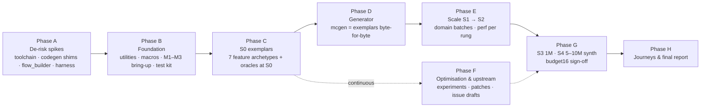

# mini-client Enterprise Plan (T-0013)

_Assembled by the Tech Lead on 2026-11-23 from five planner sections. Status: **Verified**. Three independent audits ([reviews/](reviews/)): V1 Tide core (conforms with issues), V2 Tide app, navigation and testing (conforms with issues), V3 Bazel (feasible with issues). All 49 findings resolved: 47 fixed, 1 accepted deviation, 1 spike._

## 1. Goal
Build an **enterprise Marvel app** in Tide's *Project Miniclient* "Lego" architecture and stack, then use it as the workload to **stress-test, profile and optimise** `ai_rules_dart` / `ai_rules_flutter`. We report every issue upstream. The bar:
- the app builds
- cache hits are accurate
- incremental builds rebuild only what changed
- RAM is optimal for AOT and JIT, so 5 to 10M LOC is workable on a 16 GB laptop

The codebase floor is **≥ 100 modules, ≥ 500k LOC, BDD tests** ([Q-006](../open-questions.md#q-006)).

## 2. Plan sections
| # | Section | Owner | Size | What it decides |
|---|---|---|---|---|
| 00 | [Planning brief](00-planning-brief.md) | TL | — | Binding cross-cutting decisions D1 to D12 |
| 01 | [Architecture & modules](01-architecture-and-modules.md) | P1 | ~11k words | Tide mapping and deviations, package templates, navigation, `mc_mocked_backend`, **169-module catalogue**, archetypes, LOC budget |
| 02 | [Generation & scale](02-generation-and-scale.md) | P2 | ~9k | Exemplar-first + `tool/mcgen`, realism gates, `tool/loc`, **S0 to S4 ladder**, `tool/edits` corpus (oracle) |
| 03 | [Bazel integration](03-bazel-integration.md) | P3 | ~10k | Pins, patch queue, `.bazelrc` configs, `@pub_deps`, BUILD macros, **codegen per generator**, iOS assembly, IDE sync, spikes |
| 04 | [Profiling, optimisation & upstream](04-profiling-optimization-upstream.md) | P4 | ~10k | KPIs and targets, scenario matrix, **budget16**, four correctness oracles, 23 experiment cards, upstream pipeline |
| 05 | [Testing & BDD](05-testing-and-bdd.md) | P5 | ~10k | Tide's two test tiers, `mc_test_*` packages, BDD conventions and AC tags, Bazel test targets, e2e, verification at scale |

Research inputs: [`../research/`](../research/).

## 3. The plan in one page
- **Architecture:** Tide Lego, three layers (`utility/` → `feature/` → `app/`), and features never import each other.
  - 52 utilities (`mc_*`), 100 features in 25 Marvel/enterprise domains, 8 app-layer libraries (`app_core` + 7 group wirings), and **9 apps**: `mini_client`, the `ds_catalog` design-system catalogue, and 7 group **sandboxes** that run one domain group standalone (our extension, D-29; the articles don't describe sandboxes).
  - **169 modules, about 634k LOC** at S2 [01 §6, §8].
- **Stack, as in the articles:**
  - state: flutter_bloc with freezed states
  - DI: get_it + injectable behind `mc_di` initializers
  - networking: dio + retrofit + json_serializable
  - a `Result` type in `mc_prelude`
  - intra-feature navigation: `mc_feature_flow` over flow_builder
  - testing: mocktail + bdd_widget_test

  **Additions:** go_router (typed routes) for cross-feature navigation, per-package gen-l10n, a console monitoring sink. **Data:** `mc_mocked_backend`, a Dio adapter engine, plus per-domain `mc_fixtures_<domain>` packages [01 §5].
- **Production method:** exemplar-first.
  - Hand-build one verified reference module per archetype: 7 feature archetypes, 7 utility archetypes and 5 app archetypes.
  - Then `tool/mcgen` (a Dart CLI over mason bricks) generates the rest from per-module specs, with seeded realism variation. Each exemplar is the generator's golden test [02 §2, §3].
- **Build:** Bazel 9.3.0 (bzlmod) with pinned `ai_rules_dart` `e7163aa` (v0.28.3) and `ai_rules_flutter` `876e263` (v0.30.2), Flutter 3.47.7.
  - Our fixes live in an in-repo **patch queue**, one patch per upstream PR.
  - **Code generation:**
    - freezed, json_serializable, go_router_builder and gen-l10n use stock support.
    - retrofit, injectable and bdd_widget_test get **new shims** on our rules_dart fork; these are our first upstream contributions.
    - A shim that misses its Phase A timebox falls back to the `build_runner` overlay with committed outputs until it lands (R28).
  - BUILD files come from `mcgen buildgen` calling our macros [03 KD1 to KD7].
- **Measurement:** a custom harness (`tool/perf`) using upstream's flow vocabulary.
  - **Four oracles:** cache accuracy across clones and paths, incremental minimality against the edit corpus's expected rebuilt sets, incremental = clean, and determinism.
  - **budget16:** a 16 GB laptop simulated on the 48 GB Mac by wired-memory ballast, with the Simulator and the analysis server running; then a VM, then real hardware [04 KD-5].
  - Results go to `documents/perf/`, and issues follow the upstream pipeline to `documents/upstream/`.
- **Scale ladder:**

  | Rung | Packages | LOC |
  |---|---|---|
  | S0 | 15 | ~35k |
  | S1 | 50 | ~150k |
  | **S2 (PO floor)** | **169** | **~634k** |
  | S3 | ~190 | ~1.0M |
  | S4 (synthetic, out of tree) | ~915 / ~1,820 | 5M / 10M |

  Every rung has a LOC gate, a build gate, a test gate and an oracle gate [02 §5].
- **Verification:** ADR-0006 throughout. Given / When / Then ACs, BDD scenarios tagged `@T-XXXX-ACn` and traced automatically, a fresh Verifier per task, and for generated batches sampled deep audits plus mutation and chaos canaries [05 §7].

## 4. Conflict resolutions (TL decisions)
Each row resolves a conflict that a planner raised. Rows marked ★ are deviations from Tide and appear in [01 §2's deviation table](01-architecture-and-modules.md) (R4 → D-05, R5 → D-03, R6 → D-30, R13 → D-22, R15 → D-31, R16 → D-15, R17 → D-17).

**Fix pass 2026-11-23** (resolving the [wave-3 audits](reviews/)). Changed: **R4** (justification and barrel rule, V2-08), **R6** (engine exception removed, V2-04), **R7** (app-layer libraries gated, V2-05), **R13** (concrete mechanism, V2-01), **R14** (own invocation, V3-12), **R15** (route targets in wirings; Flutter-free bloc imports), **R16** (Tide's `state.when` and private cases kept; the old rationale was wrong, V1-F1), **R17** (generated root imports, resolve test, transactional init, V1-F4), **R19** (e2e filter file, V3-02), **R25** (single `budget16` definition, V3-05), **R28** (exact overlay mechanics, go_router contingency, BDD traceability; V3-03, V3-01, V2-07). Added: **R29** (boot and router lifecycle, V2-03).

| # | Topic | Decision | Raised in |
|---|---|---|---|
| R1 | **LOC definition** | The D8 metric counts **committed first-party `.dart`**, which includes `mcgen`-scaffolded source and excludes **build-time generated** files (freezed, json, injectable, retrofit, l10n, BDD). `tool/loc` reports `hand` and `scaffold` separately; hand share ≥ 5 %. Tests and generated code are reported separately too. **Confirm with the PO: [Q-010](../open-questions.md#q-010).** | P2 C1, P1 C8 |
| R2 | Module count | S2 is P1's **169-module** catalogue. S3 grows to about 190 modules, with about 20 % of features moving up a size class. D8's 130 to 170 band applies to S2 only. | P1 C5, P2 C2 |
| R3 | Fixtures | Per-domain `utility/mc_fixtures_<domain>` hold JSON assets, a route manifest **and** small pure-Dart handlers (pagination, search, mutations). `mc_mocked_backend` is a data-free engine. | P1 C3, P2 C3 |
| R4 ★ | Feature barrel | Exports the flow(s), the **navigator interface(s)** and the flow argument and result types, as `package:` exports with `show` and no `library;` directive. The articles prefer the flow alone; the app implements the navigators, so it must see them (in-package tests could reach `src/`). `mc_arch_check` rejects any other barrel export, which also makes "a route builds a flow, never a page" structural. | P1 C4, P5 C6 |
| R5 ★ | App layer | `app_core` + 7 `<group>_wiring` + 9 apps; features are grouped as `feature/<domain>/`. The app stays "glue", spread over libraries, so a navigator edit rebuilds 1 of 7 wirings. **The verification wave must judge this against the articles.** | P1 C2 |
| R6 ★ | Feature tests | Features get **BDD (sociable, enter through the flow) + contract + l10n + golden** tests and **no solitary unit tests**. Generic pure logic lives in utilities with solitary tests (validators in `mc_forms`); feature-specific engines (quiz scoring) run as Scenario Outlines over the spec's examples through the flow. So integrity rule R7 (no `src/` imports outside `test/contract/`) needs no exemption. P2's templates drop bloc and repository unit tests. | P5 C1, P1 C7 |
| R7 | Coverage | **90 % per package** over hand-written `lib/` (Tide), with generated code excluded. This includes the app-layer libraries (`app_core`, the 7 wirings), measured on their own route, navigator, mapper, guard and flow-scope tests. Only the 9 app targets are exempt and gated by journeys. This supersedes ADR-0006 §2's 80 % rule (ADR-0010). | P5 C2 |
| R8 | BUILD files | `mcgen buildgen` emits every `BUILD.bazel`, hand-written packages included. Macros live in `//tool/bazel:defs.bzl`, owned by P3's tasks. There is one library target per package; codegen goes through `dart_codegen` per file, never the curated wrapper macros (they split packages and kill summaries). | P2 C4, P3 KD5 |
| R9 | Test granularity | Default: **one aggregated target per package and kind** (`:unit_test`, `:bdd_test`, `:golden_test`, `:contract_test`, `:l10n_test`). A per-file switch exists, and experiment X-16 decides the S2 default with data. `mc_test_utils` owns a global-reset hook. | P2 C5, P3 X5, P4 C-7, P5 KD6 |
| R10 | pub | One pub workspace and one root lock with **third-party packages only**, as a single hub named `@pub_deps`. No generator or `build_runner` in our lock. Annotation versions move in lockstep with the generators rules_dart pins (freezed_annotation 3.1.0, json_annotation 4.12.x, …), with a CI drift check. **No runtime dependency on bdd_widget_test.** | P3 KD3/KD4/X2 |
| R11 | Forks | The committed form is an in-repo **patch queue** (`third_party/rules_patches/`) through `git_override(patches=…)`. Local fork checkouts are wired in by `--override_module`. We move to real GitHub forks once the PO enables access ([Q-013](../open-questions.md#q-013)). | P3 X1 |
| R12 | Unsupported generators | injectable uses a **vendored injectable_generator 3.1.3 without lean_builder**, two-stage (per file, then aggregate). bdd_widget_test is pinned to **3.0.5**, using a parser-based generator (no writes outside declared outputs). retrofit gets a SharedPart shim. Upstream issues go to injectable, lean_builder and rules_dart. | P3 X3/X4, P5 C4 |
| R13 ★ | Run configuration | **No `--dart-define` and no flavors in sim-debug apps**, since they force the whole-program worker of about 1.75 GiB. Each environment has one typed `config/<env>.json`; the `string_flag` `--//tool/bazel/config:env` selects which one is bundled as the asset `app_config.json`, and `mc_config` reads it at boot (01 §3.4). Switching environment changes an asset, never a kernel. Experiment X-06 measures the cost of defines. | P3 KD9, P4 C-5 |
| R14 | App targets | Every app target is `manual`; simulator coverage comes from `flutter_ios_simulator_build_test` (tag `app`, macOS only), run in its **own invocation** (`--config=app`) because it transitions to `-c dbg`. Host-test invocations exclude the tag. `bazel build //...` must never AOT 9 apps. | P3 KD8, P4 C-6, V3-12 |
| R15 ★ | Codegen purity | A library a generator reads must not import Flutter, directly or transitively: blocs import `package:bloc`, `FeatureFlowController` lives in pure-Dart `mc_bloc_kit`, and `mc_monitoring` is pure Dart (the Flutter error hooks sit in `app_core`). Each wiring's route files import a `RouteTargets` interface, not the features. This keeps analyzer summaries on for about 95 % of codegen. The go_router shim over a Flutter closure is unproven upstream, so it is spiked in P3-01 (AC7). | P3 KD6/X6, V3-01 |
| R16 ★ | freezed 4 | Templates use freezed 4.0.2 / json_serializable 6.14.1 (the rules' pins). **Revised:** the earlier rationale ("`when`/`map` are gone in freezed ≥ 3") was wrong, since freezed_annotation 3.1.0, our pin, restored them. So we keep Tide's shape: private union cases and `state.when`. The only deviation is freezed 4's `sealed` modifier. P3-01 AC6 confirms the stock shim emits `when`; only if it doesn't do the templates fall back to `switch` over public cases. | P2 KD12/C6, V1-F1 |
| R17 ★ | Per-flow DI | Each flow instance has a child container; UI code calls `context.di<T>()` instead of the articles' `diContainer<T>()`, and tests use `McTestContainer` (= the production root list with edge overrides). The `RootImport` list is generated by `mcgen wire` from the injectable constructors (`lib/src/di/flow_scope.dart`); `mcgen check` fails on drift, `FeatureFlow` fails fast on an unregistered import, and each wiring's generated `flow_scopes_test` resolves every registration of every flow (01 §4.5). Root init is transactional (published only on success). | P1 C9, V1-F4, V2-09, V2-12 |
| R18 | Toolchain | Flutter **3.47.7**, pinned in `.fvmrc` (`fvm install 3.47.7`). FVM's global 3.47.8 isn't a stock pin and stays untouched. Bazel **9.3.0** in `.bazelversion`, through a `tool/bazelw` wrapper over the installed (unlinked) bazelisk, which is confirmed in spike P3-01. | P3 KD1/X7, P4 C-9 |
| R19 | iOS integration tests | `flutter_integration_test(platform="ios")` stays `manual` until our patch U-F1 lets the T-0012 runner pass its private simulator (`RULES_FLUTTER_IOS_SIMULATOR_UDID`). Until then, app e2e goes through `tool/e2e_ios.sh` with a Bazel `--runner-cmd`. `Platform.environment` is empty on iOS, so the journey filter is a file, `tmp/mc_e2e_filter`, written into the app's data container between install and launch (05 §6.2). | P3 KD10, P4 C-10, P5 C3, V3-02 |
| R20 | Perf hygiene | Timed and memory runs hold `/tmp/mc-perf.lock` in a **nightly window (01:00 to 07:00) and on weekends with no crew dispatched**. Deterministic count gates can run any time. Contaminated runs are discarded. | P4 KD-4/C-1 |
| R21 | Exec logs | `--execution_log_compact_file` plus Bazel's converter at every rung; JSON only at S0 to S1. | P4 KD-7/C-4 |
| R22 | Edit repeats | `tool/edits apply <id> --variant k` changes the edited literal deterministically, so repeats don't hit caches. | P4 C-3 |
| R23 | Shared disk cache | Accepted for Verifiers, since it's content-addressed, with a **nightly cold verify** on an empty cache. | P5 C9 |
| R24 | Pseudo-locale | `en_XA` exists for l10n tests and is filtered out of release `supportedLocales`. | P5 C10 |
| R25 | `.bazelrc` ownership | P3 tasks own the structure. P4 experiments change values only through a task with A/B evidence. `budget16` is defined once, in 04 §7.2 (incl. singleplex `DartKernel`, `DartSqlCodegen`, `DartAggregateCodegen`, `DartAnalyzerSummary`, `DartAnalyze`, `DartKernelLink`); 03 §1.4 carries the identical block, checked by a test. The TL regenerates indexes (`documents/perf/DASHBOARD.md`, `documents/upstream/README.md`). | P4 C-8/C-11, V3-05 |
| R26 | Native plugins | None in v1 (`mc_storage` uses `dart:io`). One deliberate plugin probe module is added in Phase F to exercise the pods and SwiftPM paths. | P1 C10 |
| R28 | **build_runner fallback** (PO question, 2026-11-23) | freezed, json_serializable, go_router_builder and gen-l10n stay Bazel-native (go_router_builder joins the fallback only if the P3-01 AC7 spike fails). Each **unsupported** generator shim (retrofit P3-03, injectable P3-04, BDD P3-05) is **timeboxed in Phase A** (one crew task plus one fix round). If a shim misses its box, that generator temporarily runs through **`tool/build_runner_overlay/`** (03 §7.3): a pubspec outside the pub workspace with its own lock, so R10 holds (no generator or `build_runner` in our lock). Its outputs are committed and listed in `fallback.yaml`, which drives git-ignore negations, explicit `srcs` with the `dart_codegen` target omitted, the collision checker's allowlist, `ide_sync` skips and `tool/loc`'s `generated` bucket. A file may not have both a fallback output and a Bazel-generated part of the same name. CI regenerates in the overlay and requires `git diff --exit-code`. This isn't upstream's dual-build mode, which only tolerates stale files. Under a BDD fallback, AC traceability is unchanged: `mcTestWidgets` puts the AC tags into test names, and `trace_acs` also joins `.feature` tags to scenario titles (P3-05 AC5, P5-07 AC4). Bazel compiles everything else. The shim work continues in Phase F; when it lands, the committed outputs are deleted. **Also, build_runner vs Bazel codegen (time, RAM, incremental) is measured as a baseline in P4-14** for the report and upstream issues. Using build_runner for all codegen was rejected: it hides codegen from Bazel's cache and incrementality, which is half the stress-test goal. | PO |
| R29 | Boot and router lifecycle | Nothing feature-side builds before DI is done (Tide's BootPage guarantee). A `PendingLinks` observer, registered before `runApp`, holds the cold-start link and any link that arrives during boot. `McApp` shows `MaterialApp(home: BootPage)` until `BootBloc` is `ready`, so no `GoRouter`, route builder or `redirect` exists yet. It then creates the `GoRouter` once with the held link as `initialLocation`. Root DI init publishes only on success, so Retry never re-registers (01 §3.4; P1-16 AC5/AC6, P5-11 AC1). | V2-03 |
| R27 | Release AOT at 5 to 10M | **Goal split, proposed:** the dev loop (sim debug, tests, analysis) must pass budget16 at every rung. Release AOT must pass up to S3, and is measured and reported at S4 (one whole-program process can't be scheduled smaller). If a single process exceeds 8 GiB, escalate to the Dart SDK. **PO decision: [Q-011](../open-questions.md#q-011).** | P4 C-2 |

## 5. Delivery roadmap
P-task IDs refer to the section that specifies them. Each one becomes a `T-` task with its Given / When / Then ACs **when it is dispatched**, so BOARD only lists work in flight or ready. The critical path is in **bold**.

| Phase | Goal | P-tasks | Exit gate |
|---|---|---|---|
| **A. De-risk** | Prove the unknowns before building on them | **P3-01** toolchain + Dart version + `state.when` and go_router-over-Flutter spikes (S1), **P3-02** patch queue, **P3-03** retrofit shim, **P3-04** injectable two-stage, **P3-05** BDD generator, P3-07 go_router + l10n + app shell, P1-04 `flow_builder` on 3.47.7, P1-01 workspace skeleton + architecture guard, P2-02 `tool/loc`, P4-01 to P4-03 harness / ingestion / macOS sampler; finish T-0012 | A hello-world Flutter iOS app builds under Bazel on the simulator. Every generator in the stack produces compiling output for one sample file. `tool/loc` and the sampler work. |
| **B. Foundation** | The utility layer, Bazel macros, and the first feature built end to end | P1-02, 03, 05 to 16, **P3-06** macros, **P3-09** M1 to M3 bring-up (mc_prelude → mc_api_client → characters_list → full app on the simulator), P3-10 `ide_sync`, P3-11 fvm baseline, P3-12 lockstep and layering checks, P5-01 to P5-04, **P5-09** `tool/verify.sh` on Bazel | `bazel test //...` green; the app runs on a private simulator through T-0012; the IDE sees generated code |
| **C. S0 exemplars** | One verified reference module per archetype (about 15 packages, about 35k LOC) | **P1-17 to P1-23** (LD, SC, SR, FW, DB, ST, IX), P1-24 mason bricks, P5-05 to P5-08 (goldens, coverage, AC traceability, integrity), P5-10 e2e under Bazel, P2-10 edit corpus, P4-04 to P4-09 (budget16, runner, baseline, oracles O1 to O4) | The S0 gate passes: LOC, build, test, and **all four oracles at S0**. A conformance audit against the articles passes. |
| **D. Generator** | `mcgen` reproduces every exemplar exactly | **P2-01**, P2-03 calibration, P2-04 to P2-07 templates, **P2-08** wire + buildgen, P2-09 realism gates | Golden tests: `mcgen gen` = exemplars byte-for-byte (keep regions aside); realism gates pass |
| **E. Scale to S2** | 169 modules, about 634k LOC (the PO floor) | **P2-11** S0 gate, **P2-12** S1 (5 domain-group batches), **P2-13** S2 (12 batches), P4-10 scaling study per rung, the **Haiku-vs-Sonnet A/B** on the first batch | **S2 gate:** ≥ 500k LOC by R1, ≥ 100 modules, `bazel test //...` green, oracles pass, KPI baseline recorded |
| **F. Optimise & upstream** (continuous from C) | Find, fix, prove and upstream | P4-11 to P4-16 (AOT memory, JIT / dev loop, workers / scheduling / JVM, codegen, tests, graph / analysis / disk), P4-17 to P4-19 (upstream pipeline, rebase routine, reporting and gates), P3-08 U-F1/U-F2 patches, P3-13 upstream drafts, the R26 plugin probe | Each experiment card closed with A/B evidence; each patch has a draft in `documents/upstream/` |
| **G. S3 + S4** | About 1M in-tree; 5M and 10M synthetic | **P2-14** S3 (10 batches), **P2-15** `mcgen synth`, P4-10 at S3 and S4, P4-20 L2 VM, P4-21 L3 sign-off | S3 gate; budget16 dev-loop pass at S4; release AOT reported per R27 |
| **H. Journeys & report** | Prove the product and publish the results | P5-11 to P5-16, the final perf and upstream report | MVP / enterprise journeys green with screenshots; final report |

**Crew model allocation** (agreed with the PO, 2026-11-23):
- **Opus:** planning, Bazel rule changes, debugging, Verifiers, review
- **Sonnet:** standard engineering (scripts, macros, exemplars, harness)
- **Haiku:** bulk generation batches, benchmark runs, mechanical checks. The Phase E A/B decides the batch default with data.

**Concurrency rules:**
- at most **3 crew agents at once**, because we hit the 5-hour usage limit three times on 2026-11-22/23
- no crew during perf windows (R20)
- batches never share files [02 §7]

## 6. Superseded and rescoped tasks
| Old task | Now |
|---|---|
| T-0003 Flutter scaffold | → P1-01 + P3-01 (workspace skeleton, toolchain) |
| T-0004 Architecture decisions | → done by this plan + ADR-0007 to ADR-0010 |
| T-0005 `tool/verify.sh` + CI | → P5-09 (Bazel-based) + P4-19 (gates). CI on GitHub Actions is still pending (macOS minutes cost; see P4) |
| T-0007 `mocked_backend` | → P1-06 (engine) + P1-07 to P1-10 (fixtures) |
| T-0010 E2E harness | → P5-10 (runner-cmd, Bazel) |
| T-0011 MVP journey | → P5-12 |
| T-0012 Simulator runner | Continues: review fixes, then Verifier, then merge |
| Q-008 MVP features F1 to F5 | Superseded by the 169-module catalogue (F1 to F5 are inside it) |

## 7. Decisions needed from the PO
- **[Q-010](../open-questions.md#q-010):** LOC definition (R1). Does committed scaffolded source count toward the 500k to 1M?
- **[Q-011](../open-questions.md#q-011):** the goal split for release AOT at 5 to 10M (R27).
- **[Q-012](../open-questions.md#q-012):** budget16 fidelity. Approval to install a VM tool for L2, and whether a real 16 GB Mac (or a cloud Mac) is available for L3 sign-off.
- **[Q-013](../open-questions.md#q-013):** GitHub access for upstream work: `gh auth login`, plus permission to fork the Mivr repos under your account and to file issues and PRs in your name.
- **[Q-014](../open-questions.md#q-014):** Apple Developer team and provisioning for device builds; until then, device builds are deferred.
- Still open: **Q-004** bundle id spelling, **Q-007** public store release vs Marvel IP.

## 8. Verification of this plan (wave 3)
Fresh Verifier agents that didn't write any of the plan audit it:
- **V1:** conformance to the utility-layer, feature-level and introduction articles
- **V2:** conformance to the application-layer, navigation and testing articles
- **V3:** feasibility against the pinned rules sources

Reports go to `documents/plan/reviews/`. Every deviation is either fixed or recorded as intentional with a justification (T-0013-AC4).
