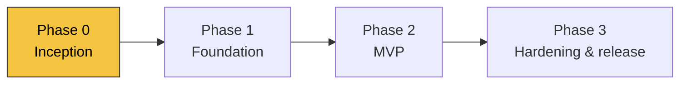

# Roadmap

_Last updated: 2026-11-22. Phases 2 and 3 get concrete once the charter ([T-0002](../tasks/T-0002-product-charter.md)) is accepted._

| Phase | Goal | Exit criteria | Status |
|---|---|---|---|
| **0 — Inception** | Shared understanding and a documentation system | Docs scaffold in place; Q-001 to Q-003 answered; charter accepted | In progress |
| **1 — Foundation** | A runnable, well-structured skeleton with quality gates | T-0003, T-0004 and T-0005 done; app builds, analyzes clean and passes tests on target platforms | Not started |
| **2 — MVP** | Core features from the charter | _TBD from charter_ | Not started |
| **3 — Hardening & release** | Production readiness | _TBD: release pipeline, observability, accessibility, store/distribution_ | Not started |

## Milestones
| ID | Milestone | Target | Status |
|---|---|---|---|
| M0 | Documentation scaffold & fleet protocol | 2026-11-22 | Done |
| M1 | Charter accepted | after Q-001 to Q-003 | Not started |
| M2 | Skeleton app green (build, analyze, test) | after M1 | Not started |
| M3 | MVP feature-complete | _TBD_ | Not started |

