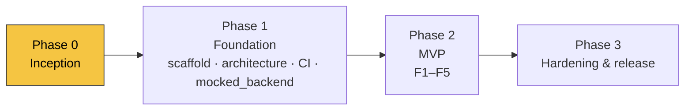

# Roadmap

_Last updated: 2026-11-22._ Product: a mobile-first Marvel app for iOS and Android, backed by `mocked_backend` ([charter](charter.md)).

| Phase | Goal | Exit criteria | Status |
|---|---|---|---|
| **0 — Inception** | Shared understanding and a documentation system | Docs scaffold; direction answered; charter accepted (Q-008) | In progress: charter drafted |
| **1 — Foundation** | A runnable, well-structured skeleton with quality gates and the mock data layer | T-0003, T-0004, T-0005 and T-0007 done; app builds, analyzes clean and passes tests on iOS and Android | Not started: waits on the PO stack (Q-006) |
| **2 — MVP** | Features F1 to F5 from the charter | F1 to F5 Done with tests; runs on both platforms against `mocked_backend` | Not started |
| **3 — Hardening & release** | Production readiness | Release builds for both stores, accessibility pass, observability decision (P-004), distribution decision (Q-007) | Not started |

## Milestones
| ID | Milestone | Target | Status |
|---|---|---|---|
| M0 | Documentation scaffold & fleet protocol | 2026-11-22 | Done |
| M1 | Charter accepted | after Q-008 | In progress |
| M2 | Skeleton app green (build, analyze, test) with `mocked_backend` wired in | after Q-006 | Not started |
| M3 | MVP feature-complete (F1 to F5) | _TBD_ | Not started |
| M4 | Release candidate builds (iOS + Android) | _TBD_ | Not started |

