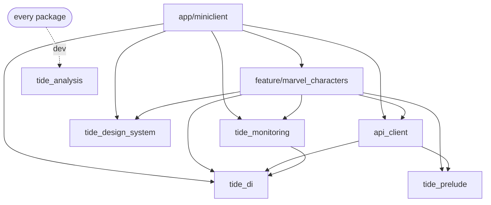

# Tide Project Miniclient: core architecture (introduction, utility layer, feature level)

- **Task:** T-0013, wave 1 research (AC1)
- **Author:** Researcher (crew), 2026-11-22
- **Status:** Draft for wave-2 planners
- **Sister document:** application, navigation and testing articles (covered separately in `documents/research/tide-miniclient/`)

## Sources and citation key

The three articles below were read in full, along with their three diagrams. They are local copies taken from the publication's RSS feed, because Medium blocks direct fetches. All three were published on 17 Jul 2024.

| Tag | Article | URL |
|---|---|---|
| `intro` | Project Miniclient — Introduction | https://medium.com/tide-engineering-team/project-miniclient-introduction-0a94aefa5638 |
| `utility-layer` | Project Miniclient — Utility layer | https://medium.com/tide-engineering-team/project-miniclient-utility-layer-fc9ff4a11d6f |
| `feature-level` | Project Miniclient — Feature level | https://medium.com/tide-engineering-team/project-miniclient-feature-level-1030f3174e79 |
| `app-layer`, `navigation`, `testing` | Sister articles, cited only for cross-references | see sister doc |

A citation looks like `[utility-layer › DI — tide_di]`, which means article › section heading. **(inferred)** marks anything I deduced rather than read in the text. Code excerpts are quoted from the articles, lightly condensed (joined lines, and `...` for elisions).

---

## 1. Summary

1. **Three layers, three folders:** `utility/`, `feature/` and `app/`. The app lives at `app/miniclient` (`flutter create --platforms=android,ios miniclient`) [intro › First Things First].
2. **Dependency rule:** utilities depend only on utilities, and features only on utilities. "An application can depend on anything" [intro › Project Structure]. "No feature should know about another feature" [feature-level › feature structure].
3. **Each module is a local pub package** with `publish_to: none`, `sdk: ^3.2.0` (plus `flutter: ^3.16.3` for Flutter packages) and relative `path:` dependencies. No workspace tool is mentioned [utility-layer, all sections].
4. **Shared lints:** every package has a dev dependency on `tide_analysis` and a one-line `analysis_options.yaml` that includes it. The shared config excludes generated files (`*.g.dart`, `*.freezed.dart`, `*.config.dart`) and BDD tests [utility-layer › Linter].
5. **Encapsulation:** everything lives under `lib/src/`, and only the barrel `lib/<package>.dart` exports. "The less you export the better" [utility-layer › Foundation components].
6. **Errors are values:** `tide_prelude`'s sealed `Result<S, F>` (`Success` / `Failure`, with `fold`, `map`, `flatMap`, `fromAsync` and more). Repositories return `Future<Result<T, Exception>>` [utility-layer › Foundation components; feature-level › Domain layer].
7. **DI:** get_it plus injectable codegen. `tide_di` exposes `DIContainer` / `diContainer<T>()` and `TideDIInitializer`. The app composes one initializer per package with `initializeDIContainer([...])` [utility-layer › DI — tide_di].
8. **Identical DI boilerplate per package:** `lib/src/di/di_initializer.dart` with an `@injectableInit` function, which generates `di_initializer.config.dart`. Tide scaffolds it with **mason** [feature-level › DI].
9. **Networking:** dio plus retrofit. `api_client` owns the `Dio` lazy singleton (base URL and interceptor) and the `MarvelResponse<T>` envelope. Each feature declares its own `@RestApi` interface [utility-layer › Networking; feature-level › Domain layer].
10. **Feature folders:** `di/`, `domain/{api,model,repository}`, `navigator/`, `presentation/{bloc}`. There is **no data layer**; API services and DTOs sit in `domain` [feature-level › feature structure].
11. **State management:** flutter_bloc `Bloc` (not Cubit), with hand-written sealed events and freezed union states rendered through `state.when(...)`. The bloc is "an implementation detail for the UI" [feature-level › Presentation].
12. **Monitoring stays out of business logic:** error states are logged in `Bloc.onTransition`, not in handlers [feature-level › Presentation].
13. **The only DI call in the UI** is `diContainer<Bloc>()` inside `BlocProvider.create` [feature-level › Presentation].
14. **A feature's entry point is always a widget.** The barrel first exports the page and the DI initializer; the navigation article narrows it to the flow widget alone [feature-level › Presentation; navigation › Marvel Characters].
15. **"Feature flow" is navigation, not state management.** It is the `feature_flow` utility (wrapping `flow_builder`) from the *navigation* article. **No article mentions l10n.** Codegen runs on build_runner: freezed, json_serializable, injectable_generator and retrofit_generator, plus bdd_widget_test in testing.

---

## 2. Project structure

### 2.1 Folders

| Folder | Contents | Source |
|---|---|---|
| `<root>/` (e.g. `miniclient/`) | Repo root; any name works | [intro › First Things First] |
| `app/miniclient/` | The Flutter app created by `flutter create --platforms=android,ios miniclient`. It starts as the default Counter App. | [intro › First Things First] |
| `feature/<feature>/` | One package per feature, e.g. `feature/marvel_characters` | [feature-level › intro] |
| `utility/<utility>/` | One package per utility, e.g. `utility/tide_di` | [utility-layer, every section] |
| `.vscode/launch.json` (root) | Run configurations with `cwd: app/miniclient` (cross-reference) | [app-layer] |

### 2.2 Package naming

- **Utilities** mostly use the `tide_` prefix (`tide_analysis`, `tide_prelude`, `tide_di`, `tide_monitoring`, `tide_design_system`). `api_client`, and the sister articles' `feature_flow` and `test_utils`, have none.
- **Features** are named after their domain (`marvel_characters`). **The app** is `miniclient`.
- The `package_names` lint enforces snake_case [utility-layer › Linter].

### 2.3 Pubspec conventions

| Package | `version` | `publish_to` | `environment` | Notes |
|---|---|---|---|---|
| `tide_analysis` | 0.0.1 | *not set* | `sdk: ^3.2.0 # or newer` | No dependencies at all [utility-layer › Linter] |
| `tide_prelude` | 0.0.1 | `none` | `sdk: ^3.2.0` | dev: `tide_analysis` (`path: ../tide_analysis`) |
| `tide_di` | **0.1.0** | `none` | `sdk: ^3.2.0` | `get_it: ^7.6.4` |
| `api_client` | 0.0.1 | `none` | `sdk: ^3.2.0` | Pure Dart (no `flutter` dependency) |
| `tide_monitoring` | 0.0.1 | `none` | `sdk: ^3.2.0`, `flutter: ^3.16.3` | Firebase |
| `tide_design_system` | 0.0.1 | `none` | `sdk: ^3.2.0`, `flutter: ^3.16.3` | `flutter: uses-material-design: true` |
| `marvel_characters` | 0.0.1 | `none` | `sdk: ^3.2.0`, `flutter: ^3.16.3` | [feature-level › intro] |
| `miniclient` (app) | 1.0.0+1 | `'none'` | `sdk: ^3.2.0`, `flutter: ^3.16.3` | cross-reference [app-layer] |

Conventions:

- **Path dependencies only.** Utilities use `../<pkg>`; features and the app use `../../utility/<pkg>`. `api_client` and `tide_monitoring` reach `tide_analysis` through `../../utility/tide_analysis`, which is inconsistent but resolves.
- **Caret constraints only**, duplicated per pubspec and already drifting: `retrofit_generator` is `^8.0.4` in `api_client` but `^8.0.5` in the feature. Lockfiles are never mentioned.
- **Generators are dev dependencies:** `build_runner`, `freezed`, `json_serializable` and the `*_generator` packages.

### 2.4 Inside a package

```
<package>/
  pubspec.yaml
  analysis_options.yaml        # include: package:tide_analysis/analysis_options.yaml
  lib/
    <package>.dart             # barrel: the ONLY public surface
    src/                       # everything else (package-private by convention)
      di/ ...  model/ ...  api/ ...  widget/ ...
```

- "We tend to put as many files as we can under `src`". "The only way to make a class visible outside the package is by exporting it via barrel file". The article suggests the `barrel_files` generator as optional [utility-layer › Foundation components].
- `tide_analysis` keeps its rules at `lib/analysis_options.yaml`, so other packages can include it through a `package:` URI [utility-layer › Linter].
- `always_use_package_imports` forces `package:<self>/src/...` imports even inside a package.

---

## 3. Dependency rules

### 3.1 Stated rules

| From → To | Allowed? | Source |
|---|---|---|
| utility → utility | Yes. "Every utility package can rely solely on another utility package." | [utility-layer › intro], [intro › Project Structure] |
| feature → utility | Yes | [intro › Project Structure] |
| feature → feature | **No.** "No feature should know about another feature." | [feature-level › feature structure (`navigator`)] |
| app → anything | Yes | [intro › Project Structure] |
| utility → feature / app | No (implied by the first rule) | [utility-layer › intro] |

Utilities are "not directly tied to the project itself" and reusable elsewhere [utility-layer › intro]. The introduction points to Tide's Flutter Vikings talk "Writing Flutter Apps in Lego style" [intro › Project Structure].

### 3.2 How features communicate

- **Navigation between features uses dependency inversion:** "we create a navigator class that will be defined in the feature, and implemented on the application level" [feature-level › feature structure]. The `navigator/` folder is never implemented. **(inferred)** The app implements it and registers it in DI.
- **Two navigation mechanisms:** internal with `flow_builder`, external with `auto_route` [feature-level › Bonus exercise]. The navigation article builds the internal one as `feature_flow`.
- **Sharing data or events between features is not covered** (§10).

### 3.3 Where shared models live

- Only the transport envelope `MarvelResponse<T>` is shared, exported by `api_client` [utility-layer › Networking, step 10].
- Domain models (`MarvelCharacter`) stay private to the feature [feature-level › Presentation].
- **(inferred)** A model two features need must move to a utility or be duplicated per feature.

### 3.4 Dependency graph of the tutorial



Sources: the pubspecs in [utility-layer], [feature-level › intro] and [app-layer]. **(inferred)** `api_client`, `tide_monitoring` and `marvel_characters` import `get_it` without declaring it and rely on `tide_di` bringing it in transitively. Pub tolerates this; Bazel strict deps will not.

---

## 4. Utility layer, package by package

### 4.1 `tide_analysis`: shared lints

- **Purpose:** one coding standard for "over 60" mobile developers (the introduction says "70+") [utility-layer › Linter].
- **Public API:** the single file `lib/analysis_options.yaml`, consumed through `include:`. Contents:

```yaml
analyzer:
  exclude:
    - '**/*.g.dart'       # common generated files
    - '**/*.freezed.dart' # generated freezed models
    - '**/*.config.dart'  # DI configuration files
    - '**/feature**/*_test.dart' # BDD tests
  language:
    strict-casts: true
    strict-raw-types: true
  errors:
    missing_required_param: error
    missing_return: error
    invalid_assignment: warning
    invalid_annotation_target: ignore
```

- **Lint rules (22):**
  - `always_declare_return_types`, `always_put_control_body_on_new_line`, `always_use_package_imports`, `annotate_overrides`, `directives_ordering`
  - `null_check_on_nullable_type_parameter`, `package_names`, `package_prefixed_library_names`, `parameter_assignments`
  - 13 `unnecessary_*` rules: `await_in_return`, `brace_in_string_interps`, `const`, `constructor_name`, `getters_setters`, `library_directive`, `new`, `null_aware_assignments`, `null_checks`, `null_in_if_null_operators`, `nullable_for_final_variable_declarations`, `overrides`, `parenthesis`
- **Codegen:** none. **Notable:** no `publish_to: none`. **(inferred)** `invalid_annotation_target: ignore` exists because freezed puts `@JsonKey` on factory parameters. The exclude list doubles as an inventory of generated-file suffixes.

### 4.2 `tide_prelude`: foundation types

- **Purpose:** a "prelude" of foundational components. The tutorial version holds a single class, `Result` [utility-layer › Foundation components].
- **Public API** (barrel `lib/tide_prelude.dart` exports `src/result.dart`):
  - `sealed class Result<S, F>` with a private `Result._()` constructor
  - `Success<S, F>` and `Failure<S, F>` (each with a `.value` getter and value equality)
  - top-level helpers `success<S, F>(S)` and `failure<S, F>(F)`
  - instance methods `fold`, `map`, `flatMap`, `asyncFlatMap`, `forEach`, `getOrElse`, `getOrNull`
  - static constructors `fromAsync`, `fromAction` (both return `Result<T, Exception>`), `fromNullable`, `fromPredicate`

```dart
sealed class Result<S, F> {
  const Result._();
  B fold<B>(B Function(S s) ifSuccess, B Function(F f) ifFailure);
  Result<S2, F> map<S2>(S2 Function(S s) f) =>
      fold((S s) => success(f(s)), failure);
  ...
  static Future<Result<T, Exception>> fromAsync<T>(
    Future<T> Function() func,
  ) async {
    try { return success(await func()); }
    on Exception catch (e) { return failure(e); }
    on Error catch (e) {
      return failure(Exception('${e.runtimeType}: ${e.stackTrace}'));
    }
  }
}
```

- **Dependencies:** dev `tide_analysis` only. Pure Dart, no codegen.
- **Patterns:** `fold` is "the only way to get a value from the Result monad". `Result` is preferred over a tuple or record for clarity, type safety, helpers and consistency. `fromAsync` / `fromAction` turn a thrown `Error` into an `Exception` built from its type and stack trace; **(inferred)** the message is lost.

### 4.3 `tide_di`: DI facade

- **Purpose:** service-locator DI built on get_it, configured by injectable and build_runner [utility-layer › DI — tide_di].
- **Public API** (the barrel exports both files below):
  - `TideDIInitializer` (`src/tide_di_initializer.dart`)
  - `typedef GetItInitializer = FutureOr<void> Function(GetIt, String? environment)`
  - `DIContainer`, `diContainer` and `initializeDIContainer` (`src/tide_di_container.dart`)

```dart
class TideDIInitializer {
  const TideDIInitializer(this._initializer);
  final GetItInitializer _initializer;
  FutureOr<void> init(GetIt getIt) => _initializer(getIt, null);
}

final diContainer = _TideDIContainer(_getIt);
Future<DIContainer> initializeDIContainer(
  List<TideDIInitializer> initializers,
) async {
  for (final initializer in initializers) { await initializer.init(_getIt); }
  return diContainer;
}
abstract class DIContainer {
  T call<T extends Object>({dynamic parameter, String? name});
  bool isRegistered<T extends Object>({String? name});
}
```

- **Internals:** the private `_TideDIContainer` wraps `GetIt.instance`. `call` maps to `_getIt<T>(param1: parameter, instanceName: name)`, so only one factory parameter is exposed.
- **Dependencies:** `get_it: ^7.6.4`. **Codegen:** none.
- **Patterns:** modular composition, with one `TideDIInitializer` subclass per package. Initializers run sequentially in list order. The environment is always `null`, so injectable environments go unused.
- **Later changes (cross-references):** testing adds `await GetIt.instance.reset()` to `initializeDIContainer` [testing › Test DI Initializer]. Navigation's `FeatureFlow` calls `pushNewScope` / `dropScope` on `GetIt.I` [navigation › Feature flow].

### 4.4 `api_client`: networking

- **Purpose:** the Marvel API client foundation [utility-layer › Networking — api_client].
- **Dependencies:** `crypto`, `dio`, `injectable`, `json_annotation`, `retrofit`, `tide_prelude`, `tide_di`; dev `build_runner`, `injectable_generator`, `json_serializable`, `retrofit_generator`, `tide_analysis` (versions in §6). It is pure Dart.
- **Public API** (barrel): `ApiClientDIInitializer` and `MarvelResponse<T>`. The interceptor and `Dio` reach consumers only through DI.
- **Internal files:**

| File | Contents |
|---|---|
| `lib/src/model/marvel_response.dart` | `@JsonSerializable(genericArgumentFactories: true, constructor: '_') class MarvelResponse<T>` with `final T data` (`@JsonKey(name: 'data')`); `part 'marvel_response.g.dart'` |
| `lib/src/di/di_parameter_name.dart` | `abstract class ApiClientDiParameterName { static const privateApiKey = 'ApiClientPrivateApiKey'; static const publicApiKey = 'ApiClientPublicApiKey'; }` |
| `lib/src/di/di_module.dart` (step 7 calls it `dio_module.dart`) | `@module abstract class DioModule` with `@Named` API keys read through `String.fromEnvironment(...)` and a `@lazySingleton Dio dio(...)` |
| `lib/src/api/marvel_api_auth_interceptor.dart` (step 7 imports it as `marvel_interceptor.dart`) | `@lazySingleton class MarvelApiAuthInterceptor extends Interceptor`. It adds `ts`, `apikey` and `hash = md5(ts+private+public)` query parameters. |
| `lib/src/di/di_initializer.dart` | `ApiClientDIInitializer` plus the `@injectableInit _init`, which imports the generated `di_initializer.config.dart` |

```dart
@module
abstract class DioModule {
  @Named(ApiClientDiParameterName.privateApiKey)
  String get privateApiKey => const String.fromEnvironment('MARVEL_PRIVATE_API_KEY');
  ...
  @lazySingleton
  Dio dio(MarvelApiAuthInterceptor marvelApiAuthInterceptor) =>
      Dio(BaseOptions(baseUrl: 'https://gateway.marvel.com:443/'))
        ..interceptors.add(marvelApiAuthInterceptor);
}
```

- **Codegen:** json_serializable (`marvel_response.g.dart`) and injectable (`di_initializer.config.dart`). **(inferred)** `retrofit_generator` and `tide_prelude` are declared but unused here, because no `@RestApi` exists in the package.
- **Patterns:** one shared `Dio`, configured once and injected into every feature's retrofit API. Cross-cutting HTTP concerns are interceptors. Secrets are compile-time `--dart-define` values passed by the launch.json in [app-layer].

### 4.5 `tide_monitoring`: crash reporting and logging

- **Purpose:** a wrapper over Firebase Crashlytics [utility-layer › Monitoring — tide_monitoring].
- **Dependencies:** `firebase_core`, `firebase_crashlytics`, `flutter`, `injectable`, `tide_di`; dev `build_runner`, `injectable_generator`, `tide_analysis`.
- **Setup:** run the official FlutterFire setup in the *app*, then move `firebase_options.dart` into `utility/tide_monitoring/lib/src`.
- **Public API** (barrel): `MonitoringDIInitializer` and `Monitoring`. `Monitoring` has `Future<void> log(String message)`, which calls `_firebase.log('log: $message')`.

```dart
@module
abstract class MonitoringModule {
  @singleton
  @preResolve
  Future<FirebaseCrashlytics> getCrashlytics() async {
    await Firebase.initializeApp(options: DefaultFirebaseOptions.currentPlatform);
    FlutterError.onError = FirebaseCrashlytics.instance.recordFlutterFatalError;
    PlatformDispatcher.instance.onError = (error, stack) {
      FirebaseCrashlytics.instance.recordError(error, stack, fatal: true);
      return true;
    };
    return FirebaseCrashlytics.instance;
  }
}
```

- **Codegen:** injectable (`di_initializer.config.dart`). **(inferred)** `@preResolve` makes the generated `init` async, hence `FutureOr<GetIt> _init`.
- **Patterns:** global error hooks are installed as a side effect of DI initialization. `Monitoring` is a concrete `@lazySingleton`, which the testing article mocks with mocktail.
- **Inconsistencies (cross-references):** the navigation article imports `package:monitoring/monitoring.dart` and `test_utils` depends on `../monitoring`, though the package is `tide_monitoring`. The testing mock stubs `trackEvent`, which is never defined [navigation › Application; testing › Mocking Monitoring].

### 4.6 `tide_design_system`: theme and common widgets

- **Purpose:** reusable components, patterns and standards for a consistent look and feel [utility-layer › Design system].
- **Dependencies:** `flutter` only, plus dev `tide_analysis`; `uses-material-design: true`.
- **Public API** (barrel):
  - `miniclientThemeData`: `ThemeData(colorScheme: ColorScheme.fromSeed(seedColor: Colors.deepPurple), useMaterial3: true)`
  - `Loading`: a centred `CircularProgressIndicator`
  - `Error({required String message})`: a centred `Text`
- **Files:** `src/miniclient_theme.dart`, `src/widget/loading.dart`, `src/widget/error.dart`.
- **Codegen:** none.
- **Notable:** **(inferred)** The widget named `Error` shadows `dart:core`'s `Error` in any file that imports the design system, including inside `on Error catch`. An enterprise design system should namespace its widgets, e.g. `TideError`.

### 4.7 Utilities added in other articles (cross-references only)

- `feature_flow`: depends on `flow_builder ^0.1.0`, `get_it` and `tide_di`. It provides `FeatureFlow<T>` and `FeatureFlowController<T>`, which give each flow a get_it scope and run an optional `flowInitializer` [navigation › Feature flow].
- `test_utils`: provides `FeatureTestInterceptor`, mocks, `TestContainer` and `initFlow` [testing].

The sister document covers both.

---

## 5. Feature layer anatomy

### 5.1 Pubspec

`marvel_characters` depends on five utilities (`api_client`, `tide_design_system`, `tide_monitoring`, `tide_prelude`, `tide_di`) and on `dio`, `flutter`, `flutter_bloc`, `freezed_annotation`, `injectable` and `retrofit`. Its dev dependencies are `build_runner`, `freezed`, `injectable_generator`, `json_serializable`, `retrofit_generator` and `tide_analysis` (versions in §6) [feature-level › intro]. **(inferred)** It imports `get_it` without declaring it.

### 5.2 Folder layout

These are Tide's layers as the article states them [feature-level › feature structure]:

```
lib/
|- src/
|---- di            # DI initializer and DI modules
|---- domain/       # domain models, API services, repositories, use cases
|-------- api/
|-------- model/
|-------- repository/
|---- navigator     # outbound navigation contracts, implemented by the app
|---- presentation/ # UI; bloc is an implementation detail of the UI
|-------- bloc/
|- marvel_characters.dart
```

The navigation article later adds `src/flow/`, which holds the flow state and the flow widget [navigation › Marvel Characters].

### 5.3 Files of the tutorial feature

| Layer | File | Key types |
|---|---|---|
| di | `src/di/di_initializer.dart` (+ generated `.config.dart`) | `MarvelCharactersDIInitializer` |
| domain/model | `src/domain/model/marvel_character.dart` | freezed `MarvelCharacter(name, description, thumbnail)`, freezed `Thumbnail(path, extension)`, `extension ThumbnailX { String get url => '$path.$extension'; }` |
| domain/model | `src/domain/model/marvel_characters_response.dart` | freezed `MarvelCharactersResponse(@JsonKey(name: 'results') List<MarvelCharacter> characters)` |
| domain/api | `src/domain/api/marvel_characters_api.dart` | retrofit `MarvelCharactersApi` |
| domain/repository | `src/domain/repository/mavel_characters_repository.dart` (the article's typo; the bloc imports `marvel_characters_repository.dart`) | `MarvelCharactersRepository` |
| presentation/bloc | `marvel_characters_bloc.dart`, with parts `marvel_characters_event.dart` and `marvel_characters_state.dart` | `MarvelCharactersBloc`, `MarvelCharactersEvent`, `MarvelCharactersState` |
| presentation | `src/presentation/marvel_characters_page.dart` | `MarvelCharactersPage`, `_MarvelCharactersPageContent`, `CharacterList`, `CharacterItem` |

### 5.4 Models

- Models are freezed classes with `fromJson` and an explicit `@JsonKey(name: ...)` on every field [feature-level › Domain layer].
- The response DTO sits next to the domain model. "For big features, that's a problem and we would need to split them. For most features — it is not, as our features are granular."

### 5.5 API client

```dart
@injectable
@RestApi()
abstract class MarvelCharactersApi {
  @factoryMethod
  factory MarvelCharactersApi(Dio dio) = _MarvelCharactersApi;

  @GET('v1/public/characters')
  Future<MarvelResponse<MarvelCharactersResponse>> getCharacters();
}
```

injectable registers the retrofit-generated `_MarvelCharactersApi` as a factory. It receives the `Dio` that `api_client` registered [feature-level › Domain layer].

### 5.6 Repository and error handling

The repository unwraps networking models, so "the rest of the app would not know about models intended to be used inside the domain layer only", and deals with networking errors [feature-level › Domain layer].

```dart
@injectable
class MarvelCharactersRepository {
  const MarvelCharactersRepository(this._api);
  final MarvelCharactersApi _api;

  Future<Result<List<MarvelCharacter>, Exception>> getCharacters() async {
    final result = await Result.fromAsync(_api.getCharacters);
    return result.map((s) => s.data.characters);
  }
}
```

Error path: `Result.fromAsync` catches the `DioException` → the bloc folds it into an `error` state → `onTransition` logs it → the UI renders `Error(message: e.toString())`. There are no domain error types, no retry and no status-code mapping.

### 5.7 Use cases

Named in the domain description, but there is no `usecase/` folder or class; the bloc calls the repository directly [feature-level › feature structure].

### 5.8 State management

**`flutter_bloc` ^8.1.3**, using the event-driven `Bloc<Event, State>` rather than Cubit [feature-level › Presentation].

- **Events:** a hand-written sealed class with private constructor and subclasses that "mimics freezed unions". It is a `part of` the bloc file, so the bloc can match on the private types.
- **State:** a freezed union (`loading`, `success(List<MarvelCharacter>)`, `error(Exception)`), also a `part of` the bloc, so it generates into `marvel_characters_bloc.freezed.dart`.
- The bloc dispatches `load` from its own constructor.

```dart
@injectable
class MarvelCharactersBloc extends Bloc<MarvelCharactersEvent, MarvelCharactersState> {
  MarvelCharactersBloc(this._charactersRepository, this._monitoring)
      : super(const MarvelCharactersState.loading()) {
    on<MarvelCharactersEvent>((event, emit) => switch (event) {
          _LoadMarvelCharactersEvent() => _onLoad(emit, event),
        });
    add(const MarvelCharactersEvent.load());
  }
  ...
  @override
  Future<void> onTransition(Transition<...> transition) async {
    super.onTransition(transition);
    final state = transition.nextState;
    if (state is _ErrorMarvelCharactersState)
      await _monitoring.log('MarvelCharactersBloc Error: ${state.error}');
  }
}
```

- **Monitoring rule:** "We never mess up logging/monitoring with the business logic itself". Handlers set state; `onTransition` observes it.
- **"Feature flow" is separate.** The navigation article's `feature_flow` drives the navigation stack. A bloc injects `FeatureFlowController<MarvelCharactersFlowState>` and calls `update(...)` [navigation › Marvel Characters].

### 5.9 DI registration

| Annotation | Where | Lifetime |
|---|---|---|
| `@injectable` | `MarvelCharactersApi` (with `@factoryMethod`), `MarvelCharactersRepository`, `MarvelCharactersBloc` | factory (new instance per resolve) |
| `@lazySingleton` | `MarvelApiAuthInterceptor`, `DioModule.dio`, `Monitoring` | lazy singleton |
| `@singleton` + `@preResolve` | `MonitoringModule.getCrashlytics` | eager singleton, awaited during init |
| `@module` | `DioModule`, `MonitoringModule` | third-party factories |
| `@Named(...)` | API key strings | qualified registrations |
| `@injectableInit` | `_init` in each `di_initializer.dart` | codegen entry point |

The feature's initializer is the same boilerplate every package uses ("It will always be like that in every package"). Tide generates it with mason [feature-level › DI]:

```dart
class MarvelCharactersDIInitializer extends TideDIInitializer {
  const MarvelCharactersDIInitializer() : super(_init);
}

@injectableInit
FutureOr<GetIt> _init(GetIt getIt, String? environment) =>
    getIt.init(environment: environment);
```

**(inferred)** injectable resolves dependencies registered by other packages, such as `Dio` and `Monitoring`, only at runtime. The generator may warn about types it cannot see in the package, and the articles do not say how those warnings are handled.

### 5.10 UI and DI in the UI

- A page is a `BlocProvider(create: (_) => diContainer<MarvelCharactersBloc>(), child: const _Content())`. "That is the only valid scenario for DI usage in the UI layer" [feature-level › Presentation].
- The content is "a mapper from bloc states into different UIs", built as `BlocBuilder` plus `state.when(loading:, error:, success:)`. It uses the design system's `Loading` and `Error`, a 3-column `GridView`, and a `Card` containing `Image.network(character.thumbnail.url)` and the name with `EdgeInsets.all(12)` padding.

### 5.11 Public API and l10n

- "The entry point to the feature package is always a widget." The barrel exports `di/di_initializer.dart` and `presentation/marvel_characters_page.dart` [feature-level › Presentation].
- The navigation article reduces this to `export '.../flow/marvel_characters_flow.dart'`. The DI initializer then becomes the flow's `flowInitializer`, so features initialize themselves [navigation › Marvel Characters; app-layer › DI: "At Tide, we tend to make features initialize themselves"].
- **l10n / i18n is not mentioned anywhere.** User-facing strings are hard-coded, for example `'Character Details'` and `'Miniclient'` in the sister articles.

### 5.12 Running a feature standalone

Not described. The closest is the testing article's `initFlow`, which boots a `TestContainer` (a test `Dio` with `FeatureTestInterceptor` and a mock `Monitoring`) and pumps the flow in a bare `MaterialApp` [testing › Flow Initializer]. **(inferred)** So a feature needs only a `Dio`, a `Monitoring` and the design system.

---

## 6. Tech stack table

| Package | Constraint (as stated) | Used in | Purpose | build_runner codegen? |
|---|---|---|---|---|
| Dart SDK | `^3.2.0` | all | language (sealed classes, patterns, records) | n/a |
| Flutter SDK | `^3.16.3` | tide_monitoring, tide_design_system, marvel_characters, app | UI framework | n/a |
| get_it | `^7.6.4` | tide_di (and imported transitively elsewhere) | service locator | no |
| injectable | `^2.3.2` | api_client, tide_monitoring, marvel_characters | DI annotations | annotations only |
| injectable_generator | `^2.4.1` (dev) | api_client, tide_monitoring, marvel_characters | generates `*.config.dart` | **yes** (injectable_generator) |
| build_runner | `^2.4.7` (dev) | api_client, tide_monitoring, marvel_characters | codegen driver | is the driver |
| dio | `^5.4.0` | api_client, marvel_characters | HTTP client and interceptors | no |
| retrofit | `^4.0.3` | api_client, marvel_characters | REST annotations | annotations only |
| retrofit_generator | `^8.0.4` (api_client), `^8.0.5` (feature) (dev) | api_client (unused), marvel_characters | generates API implementation into `.g.dart` | **yes** (retrofit_generator) |
| json_annotation | `^4.8.1` | api_client | JSON annotations | annotations only |
| json_serializable | `^6.7.1` (dev) | api_client, marvel_characters | `fromJson`/`toJson` into `.g.dart` | **yes** (json_serializable) |
| freezed_annotation | `^2.4.1` | marvel_characters | `@freezed` (re-exports `JsonKey`) | annotations only |
| freezed | `^2.4.5` (dev) | marvel_characters | immutable models and unions into `.freezed.dart` | **yes** (freezed) |
| flutter_bloc | `^8.1.3` | marvel_characters | state management (Bloc) | no |
| crypto | `^3.0.3` | api_client | MD5 for Marvel auth hash | no |
| firebase_core | `^2.24.1` | tide_monitoring | Firebase bootstrap | no (FlutterFire CLI produces `firebase_options.dart`, **(inferred)**) |
| firebase_crashlytics | `^3.4.7` | tide_monitoring | crash and log reporting | no |
| Material 3 | `useMaterial3: true` | tide_design_system | theming | no |
| mason / mason_cli | unversioned | dev tooling | scaffolds `di_initializer.dart` (and, **(inferred)**, whole packages) | template scaffolding, not build_runner |
| barrel_files | unversioned, suggested only | optional | generates barrel files | **(inferred)** yes, a build_runner builder |
| flow_builder, auto_route | named only | not used in these three articles | internal and external navigation | flow_builder no; auto_route **(inferred)** yes (route generator) |

Cross-references from the sister articles: `flow_builder ^0.1.0`, `mocktail ^1.0.4`, `test ^1.16.5`, `bdd_widget_test ^1.7.4` (codegen: yes), `cached_network_image ^3.4.1`, and `go_router` (named only).

---

## 7. Code generation inventory

### 7.1 Generators and their files

| Generator | Trigger in source | Input | Output | Packages | Files in the tutorial |
|---|---|---|---|---|---|
| **freezed** | `@freezed` + `part 'x.freezed.dart'` | the library, including its `part` files | `x.freezed.dart` (part) | marvel_characters | `marvel_character.freezed.dart`, `marvel_characters_response.freezed.dart`, `marvel_characters_bloc.freezed.dart` (the state is a `part of` the bloc). Navigation adds `marvel_characters_flow_state.freezed.dart`. |
| **json_serializable** | explicit `@JsonSerializable(...)`, or implicit through a freezed `fromJson` factory; `part 'x.g.dart'` | library, plus the freezed output for freezed classes **(inferred)** | `x.g.dart` (part) | api_client, marvel_characters | `marvel_response.g.dart` (`genericArgumentFactories: true`, `constructor: '_'`), `marvel_character.g.dart`, `marvel_characters_response.g.dart` |
| **retrofit_generator** | `@RestApi()` + `part 'x.g.dart'` | library, plus resolved types from deps (`MarvelResponse` from api_client) | `x.g.dart` (part) containing `_MarvelCharactersApi` | marvel_characters | `marvel_characters_api.g.dart` |
| **injectable_generator** | `@injectableInit` on `_init`, aggregating every `@injectable`, `@lazySingleton`, `@singleton`, `@module`, `@Named`, `@preResolve` and `@factoryMethod` in the package | **all** annotated libraries of the package | `di_initializer.config.dart`, a separate *library* that is imported, not a part. It defines the `getIt.init(environment:)` extension. | api_client, tide_monitoring, marvel_characters (in sister articles: any package with registrations) | one per package |
| **bdd_widget_test** (cross-reference) | `test/feature/*.feature` (Gherkin) | `.feature` files | `*_test.dart` and step stubs under `test/feature/step/` | marvel_characters | excluded from lints by `'**/feature**/*_test.dart'` [testing › Feature File] |
| mason (scaffolding) | `mason make <brick>` **(inferred)** | brick templates | hand-owned source (committed) | all packages | `di_initializer.dart` [feature-level › DI] |
| FlutterFire CLI **(inferred)** | `flutterfire configure` | Firebase project | `firebase_options.dart`, moved by hand into tide_monitoring | tide_monitoring | 1 file [utility-layer › Monitoring] |
| gen-l10n | — | — | — | **none** | not used anywhere |
| mocks | — | — | — | — | mocktail, hand-written (no mockito codegen) [testing] |

### 7.2 How the generators interact (inferred)

These points come from how the generators work in general. The articles do not state them.

- json_serializable and retrofit_generator are both `source_gen` shared-part builders. Each writes a `.g.part` shard, and `source_gen|combining_builder` merges the shards into the single `x.g.dart`.
- freezed writes its own `x.freezed.dart`, which is not merged.
- freezed must run *before* json_serializable, because the `@JsonSerializable` class that json_serializable reads is emitted inside `.freezed.dart`.
- injectable is a two-phase builder:
  - a per-library pass writes `.injectable.json` summaries to build_runner's hidden cache;
  - an aggregating pass then writes `.config.dart` beside the `@injectableInit` file.
- retrofit and injectable need deps resolved through the analyzer: `Dio`, `MarvelResponse`, and types registered in other packages.

### 7.3 Commands, config and committed files

- **Commands:**
  - `dart pub run build_runner build -d` [utility-layer › Networking, step 4]. `-d` is `--delete-conflicting-outputs`.
  - The testing article uses `dart run build_runner build --delete-conflicting-outputs`.
  - The other articles say only "Run code generation" [utility-layer › Networking, step 9; feature-level › DI, Domain layer].
- **`build.yaml`:** none shown. A bonus exercise says to "Use it to optimize code generation" [utility-layer › Networking bonus].
- **Committed or not:** **not stated.** The steps ("you have a compilation error … run code generation") imply developers generate locally **(inferred)**. The lint excludes show that generated files sit in the source tree next to their inputs.

### 7.4 Codegen per package

| Package | freezed | json_serializable | retrofit | injectable | Generated files |
|---|---|---|---|---|---|
| tide_analysis, tide_prelude, tide_di, tide_design_system | – | – | – | – | 0 |
| api_client | – | ✓ | (declared, unused) | ✓ | 2 |
| tide_monitoring | – | – | – | ✓ | 1 |
| marvel_characters | ✓ (3) | ✓ (2) | ✓ (1) | ✓ (1) | 7 (and more with flow state and BDD tests) |

---

## 8. Homework and bonus exercises

| Article › section | Exercise | Enterprise extension it hints at |
|---|---|---|
| utility-layer › Linter | Enable more rules from dart.dev/tools/linter-rules | a stricter shared lint set |
| utility-layer › Foundation components | Find a real usage for, and unit-test, every `Result` function | prelude test coverage |
| utility-layer › Foundation components | Draft an `Optional` monad (absence rather than failure) | a richer prelude (Optional and other functional types) |
| utility-layer › DI | Replace get_it with another service locator | DI is pluggable behind `tide_di` |
| utility-layer › Networking | Make the base URL a compile-time setting; work out the DI changes | per-environment configuration (flavours) |
| utility-layer › Networking | Implement SSL pinning in dio | security hardening in api_client |
| utility-layer › Networking | Use `build.yaml` to optimise codegen | codegen scoping (`generate_for`) at scale |
| utility-layer › Monitoring | Add methods beyond `log` | a full monitoring API (events, errors, keys) |
| utility-layer › Monitoring | Add Datadog RUM and make tide_monitoring wrap both providers | multi-vendor facade |
| utility-layer › Monitoring | More Firebase-backed packages | one utility per platform service (analytics, remote config, …) |
| utility-layer › Design system | Customise `ThemeData` | a branded theme and design tokens |
| utility-layer › Design system | Add more common widgets | a full component library |
| feature-level › Bonus | Why is hard-coded padding bad, and how do you fix it? | spacing tokens in the design system |
| feature-level › Bonus | Switch between grid and list by device width, with reuse in mind | responsive layout primitives in the design system |
| feature-level › Bonus | BDD with widget testing (YouTube playlist) | covered by the testing article |
| feature-level › Bonus | Navigation: internal (flow_builder) and external (auto_route) | covered by the navigation article |

The introduction calls the series "a codelab with homework" [intro › Introduction]. The sister articles add bonuses on initialisation failures and timeouts, `--dart-define-from-file`, external navigation, the details page, and coverage.

---

## 9. Diagrams

### 9.1 `project-miniclient-introduction-1.png`: layer diagram

[intro › Project Structure]

- **Layout:** three labelled bands: **Application** (grey, top), **Features** (yellow) and **Utilities** (peach, bottom). Nodes are light-blue rounded boxes, and arrows point from a dependent to its dependency.
- **Edges** (confirmed by zooming in):
  - Application → Feature A, B, C
  - Feature A → Utility A, B, C
  - Feature B → Utility A, C, E, F
  - Feature C → Utility B, C, D, E, F
  - inside the utility band: A → B, D → E and F → E
- **What it shows:** no feature-to-feature or upward edges. Utility C is shared by all three features, and B, C and E are leaves. No Application → Utility edge is drawn, although the text allows one and the tutorial app has them.

### 9.2 `project-miniclient-introduction-2.png`: initial folder tree

[intro › First Things First]

A dark VS Code Explorer with root **MINICLIENT** and three collapsed entries: `app/miniclient` (compact-folder display, since `app` has one child), `feature` and `utility`. The utility folder's green badge is just the icon theme. It matches the three-folder instruction exactly.

### 9.3 `project-miniclient-feature-level-1.png`: target screen

[feature-level › intro]

- **Device:** status bar at 3:53, Flutter's **DEBUG** ribbon, and a home indicator. **(inferred)** An iOS device or simulator.
- **Screen:** a red app bar titled **"Marvel App"** over a three-column grid of cards. Each card has a thumbnail and a name that wraps where needed. The characters run 3-D Man, A-Bomb (HAS), A.I.M., Aaron Stack, Abomination (Emil Blonsky), … Agent Brand (15 visible), and several show Marvel's "IMAGE NOT FOUND" placeholder.
- **Mismatch with the code (inferred):** the tutorial page has no `AppBar`, the app title is `'Miniclient'` and the seed colour is `deepPurple`. The screenshot comes from another build, so treat it as the target layout, not as pixel truth.

---

## 10. Gaps and ambiguities

An enterprise implementation must decide each of these.

1. **Workspace and resolution.** No tool (melos, pub workspaces) and no lockfile policy. Constraints are duplicated and drifting. **(inferred)** Each package resolves on its own.
2. **Generated files.** Whether they are committed is not stated. No `build.yaml` is shown. Codegen order is left to build_runner.
3. **Dependency hygiene.** `get_it` is imported but not declared in api_client, tide_monitoring and marvel_characters. `retrofit_generator` and `tide_prelude` are declared but unused in api_client.
4. **Slips in the articles' code.** `di_module.dart` vs `dio_module.dart`; `marvel_api_auth_interceptor.dart` vs `marvel_interceptor.dart`; the `mavel_` file-name typo; `tide_monitoring` vs `monitoring`; `log` vs `trackEvent`; "60+" vs "70+" engineers.
5. **Data vs domain.** There is no data layer; DTOs sit in `domain/model`, and big features "would need to split them". Use cases are named but have no folder or example.
6. **Talking across features.** The navigator contract is described but not implemented (naming, DI registration, how the app implements it). Sharing data or events between features is not covered, e.g. a favourites change, a session, or an event bus.
7. **Shared domain models.** Where they live is unspecified. Only the transport envelope is shared.
8. **Who initializes a feature.** In feature-level the app calls the feature initializers. App-layer notes "At Tide, we tend to make features initialize themselves", and navigation settles on per-flow get_it scopes, with utilities staying global.
9. **DI details.** Environments are unused (always `null`), only one factory parameter is exposed, and the global `diContainer` is process-wide. The articles do not say how missing registrations across packages are handled, nor when a scope may be dropped.
10. **Error model.** `Exception` everywhere, with no typed failures and no retry. The UI prints `e.toString()`. `fromAsync` reduces an `Error` to its type and stack trace.
11. **Monitoring vendor lock-in.** Firebase is wired in as a DI side effect. Native setup (**(inferred)** including `GoogleService-Info.plist`) is left to the FlutterFire docs.
12. **Design system scope.** One seed theme and two widgets: no tokens, typography or icons. Padding is hard-coded, which the articles flag themselves, and the `Error` widget name clashes with `dart:core`.
13. **l10n.** Not covered, though the PO lists it in the stack.
14. **Data access and images.** No pagination, search or caching: `getCharacters()` takes no parameters, and images load through bare `Image.network`.
15. **Running a feature standalone.** No sandbox or example app per feature, only the test harness.
16. **Version freshness (inferred, from outside the articles).** The code is freezed 2.x style (`@freezed class X with _$X`, `state.when`). As far as I know, freezed 3 removed `when`/`map` and requires `sealed`/`abstract` classes, and flutter_bloc, get_it and retrofit_generator have newer majors too. The version choice changes code shape, so make it explicitly.

---

## 11. Implications for our project

These follow from our constraints: no Marvel API (`mocked_backend` provides all data), verification on iOS only, a Bazel build through `ai_rules_dart` / `ai_rules_flutter`, and a target of 100+ modules and 500k to 1M LOC. All of them are recommendations for wave-2 planners and ADRs.

| Element | Carry over as | Why / notes |
|---|---|---|
| `app/`, `feature/`, `utility/` | **Verbatim.** One Bazel package per Dart package; keep the pubspecs for IDE and analyzer tooling **(inferred)** | Directory = module = Bazel package keeps the T-0013-AC4 audit simple. |
| `flutter create --platforms=android,ios` | `--platforms=ios` | A justified deviation (Q-009). Record it. |
| Dependency rules | Bazel `visibility`: `//utility/...` public, `//feature/...` visible only to `//app/...` and the feature's own tests. A CI `bazel query` asserts no feature → feature edges **(inferred)** | Turns the convention into a build failure. |
| Direct deps | Declare every imported package, e.g. `get_it` wherever `di_initializer.dart` exists | **(inferred)** Bazel strict deps reject the articles' transitive imports. |
| Versions | One repo-wide version set and lockfile | Avoids the 8.0.4/8.0.5 drift. Decide freezed 2 vs 3 explicitly (§10.16). |
| `tide_analysis`, `tide_prelude`, `tide_di` | Verbatim. Prelude gains `Optional` and tests (bonus). tide_di gains `reset()` (testing) and scopes (navigation) | Analysis runs as a Bazel action that depends on `//utility/tide_analysis` **(inferred)**. `TideDIInitializer` stays the only contract between packages. |
| `api_client` | Keep the shared `Dio`, the envelope model and the interceptor pattern. **Drop** the Marvel auth interceptor, `@Named` keys, `crypto`/MD5 and `--dart-define` keys | The Marvel auth and keys are irrelevant to us. The base URL becomes a constant. |
| `mocked_backend` (ADR-0005) | A **utility** that serves fixtures through a dio `HttpClientAdapter` or interceptor **(inferred)**. Only the app wires it in. | Keeps retrofit and JSON models real, so their codegen stays in the build graph. It mirrors the testing article's `FeatureTestInterceptor` and answers ADR-0005's deferred transport question. It must never import features. |
| `tide_monitoring` | Keep the `Monitoring` API (add `trackEvent`) and the module pattern, including one `@preResolve`. Replace Firebase with a console or in-memory sink. | Firebase needs a real project, a plist and native SDKs, which is heavy under Bazel iOS. Record this as a deviation. |
| `tide_design_system` | Verbatim, then grow: tokens, responsive grid/list, an image widget with a placeholder, namespaced names | Answers the bonus exercises. A natural place to split into several modules. |
| Feature anatomy | A **mason brick** emitting `di/`, `domain/{api,model,repository}`, `navigator/`, `presentation/bloc/`, `flow/` and BDD `test/feature/` | The articles say Tide uses mason. It keeps 100+ features uniform. |
| Granularity and LOC | Many small features per entity (characters, comics, series, events, creators, stories): list, details, search, filters, favourites | "Our features are granular". **(inferred)** The sample feature is about 250 hand-written lines, while 500k to 1M LOC over about 100 modules means 5 to 10k per module. Features must be much richer, and planners must define whether generated code counts. |
| State and navigation | flutter_bloc `Bloc` with freezed states. `feature_flow` handles navigation inside a feature; navigator interfaces implemented in the app (go_router or auto_route) handle navigation between features | Settle the navigator naming and DI convention the articles leave open. |
| l10n | **An extension.** Per-feature ARB files with `flutter gen-l10n`; the app aggregates the delegates | `ai_rules_flutter` has `flutter_gen_l10n` (`flutter/private/flutter_gen_l10n.bzl`). The PO's stack requires it. |
| Codegen under Bazel | freezed and json_serializable through `ai_rules_dart` ext macros (`dart/ext/freezed`, `dart/ext/json_serializable`). injectable (aggregating, one per package), retrofit and bdd_widget_test have **no macro**, so they need `dart_codegen` / `dart_aggregate_codegen` or new shims. Generated files are not committed. | The prime stress-test and upstream target. Order matters: freezed, then json_serializable, then combining. Inputs must include `part` files (the bloc state). retrofit and injectable need resolved deps. The IDE still needs the outputs, which raises a dual-build question (see the bazel-rules research). |
| Images, errors, DI in UI | Local or bundled images (no internet). `Result` plus typed domain failures. Keep the single `BlocProvider.create` DI call site | Deterministic iOS simulator e2e. ADR-0005's injected failures map to distinct UI states. |

**Open decisions for wave 2:**

- package prefix: keep `tide_*` verbatim for traceability, or rename with a mapping and record it as a deviation;
- generated vs hand-written DI in hot packages, to compare Bazel costs;
- freezed and bloc major versions;
- the LOC counting rule;
- the `mocked_backend` transport.
