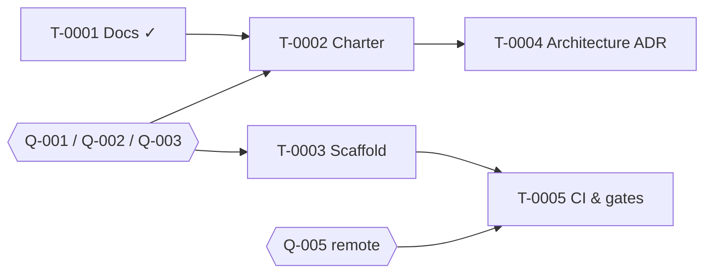

# Task Board

_Owned by Tech Lead. Last updated 2026-11-22._ Status values and lifecycle: [fleet/protocol.md](../fleet/protocol.md#task-lifecycle).

| ID | Title | Status | Owner | Depends on | Branch |
|---|---|---|---|---|---|
| [T-0001](T-0001-documentation-scaffold.md) | Documentation scaffold & fleet protocol | **Done** | Tech Lead | — | `continue-previous-work` |
| [T-0002](T-0002-product-charter.md) | Product charter & MVP scope | **Blocked** | Tech Lead | Q-001, Q-003 | — |
| [T-0003](T-0003-flutter-project-scaffold.md) | Flutter project scaffold | **Blocked** | crew: Engineer | Q-001, Q-002 | — |
| [T-0004](T-0004-architecture-decision.md) | Architecture & state-management ADR | **Blocked** | Tech Lead + Planner | T-0002 (Q-006 non-blocking) | — |
| [T-0005](T-0005-ci-quality-gates.md) | CI & quality gates | **Blocked** | crew: Engineer | T-0003; CI part on Q-005 | — |

## Summary
| Status | Count | Tasks |
|---|---|---|
| Done | 1 | T-0001 |
| In Progress | 0 | — |
| In Review | 0 | — |
| Ready | 0 | — |
| Blocked | 4 | T-0002, T-0003, T-0004, T-0005 |
| Backlog | 0 | — |

