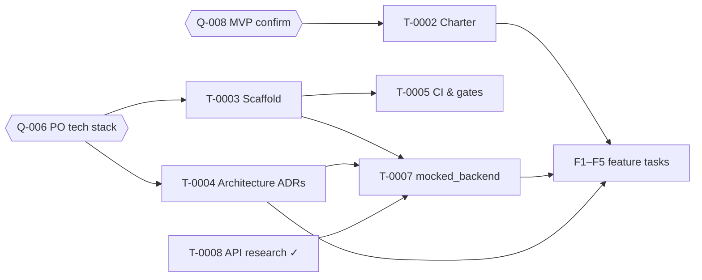

# Task Board

_Owned by Tech Lead. Last updated 2026-11-22._ Status values and lifecycle: [fleet/protocol.md](../fleet/protocol.md#task-lifecycle).

| ID | Title | Status | Owner | Depends on | Branch |
|---|---|---|---|---|---|
| [T-0001](T-0001-documentation-scaffold.md) | Documentation scaffold & fleet protocol | **Done** | Tech Lead | — | merged to `main` |
| [T-0002](T-0002-product-charter.md) | Product charter & MVP scope | **In Review** (PO: Q-008) | Tech Lead | Q-008 | `main` (docs) |
| [T-0003](T-0003-flutter-project-scaffold.md) | Flutter project scaffold | **Blocked** | crew: Engineer | Q-006 | — |
| [T-0004](T-0004-architecture-decision.md) | Architecture & tech-stack decisions | **Blocked** | Tech Lead + Planner | Q-006 | — |
| [T-0005](T-0005-ci-quality-gates.md) | CI & quality gates | **Blocked** | crew: Engineer | T-0003 | — |
| [T-0006](T-0006-link-github-remote.md) | Link GitHub remote | **Done** | Tech Lead | — | merged to `main` |
| [T-0007](T-0007-mocked-backend-module.md) | `mocked_backend` module | **Backlog** | crew: Engineer | T-0003, T-0004 | — |
| [T-0008](T-0008-marvel-api-research.md) | Marvel API status & contract research | **Done** | crew: Researcher | — | — |

## Summary
| Status | Count | Tasks |
|---|---|---|
| Done | 3 | T-0001, T-0006, T-0008 |
| In Progress | 0 | — |
| In Review | 1 | T-0002 |
| Ready | 0 | — |
| Blocked | 3 | T-0003, T-0004, T-0005 |
| Backlog | 1 | T-0007 |

