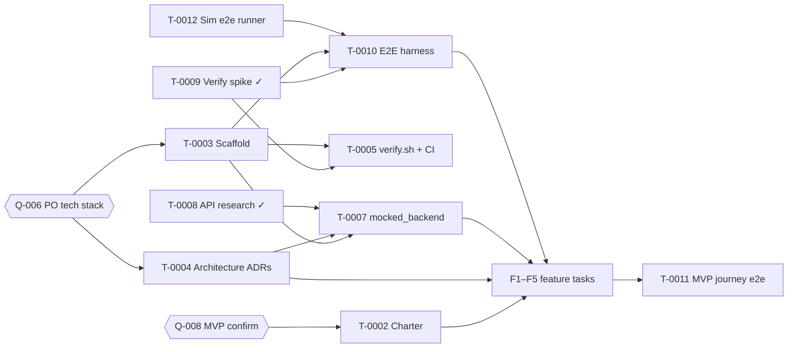

# Task Board

_Owned by Tech Lead. Last updated 2026-11-22._ Status values and lifecycle: [fleet/protocol.md](../fleet/protocol.md#task-lifecycle). Merge gate: [ADR-0006](../adr/0006-verification-strategy.md).

| ID | Title | Status | Owner | Depends on | Branch |
|---|---|---|---|---|---|
| [T-0001](T-0001-documentation-scaffold.md) | Documentation scaffold & fleet protocol | **Done** | Tech Lead | — | merged to `main` |
| [T-0002](T-0002-product-charter.md) | Product charter & MVP scope | **In Review** (PO: Q-008) | Tech Lead | Q-008 | `main` (docs) |
| [T-0003](T-0003-flutter-project-scaffold.md) | Flutter project scaffold | **Blocked** | crew: Engineer | Q-006 | — |
| [T-0004](T-0004-architecture-decision.md) | Architecture & tech-stack decisions | **Blocked** | Tech Lead + Planner | Q-006 | — |
| [T-0005](T-0005-ci-quality-gates.md) | Local gate (`tool/verify.sh`) & CI | **Blocked** | crew: Engineer | T-0003 | — |
| [T-0006](T-0006-link-github-remote.md) | Link GitHub remote | **Done** | Tech Lead | — | merged to `main` |
| [T-0007](T-0007-mocked-backend-module.md) | `mocked_backend` module | **Backlog** | crew: Engineer | T-0003, T-0004 | — |
| [T-0008](T-0008-marvel-api-research.md) | Marvel API status & contract research | **Done** | crew: Researcher | — | — |
| [T-0009](T-0009-verification-pipeline-spike.md) | Verification pipeline spike (iOS) | **Done** ([PASS](../evidence/T-0009/verification-report.md)) | crew: Engineer (background) | — | — (scratchpad) |
| [T-0010](T-0010-e2e-visual-harness.md) | E2E & visual verification harness (iOS) | **Blocked** | crew: Engineer | T-0003, T-0012 | — |
| [T-0011](T-0011-mvp-journey-e2e.md) | Full MVP journey e2e + visual sign-off | **Backlog** | crew: Engineer + Verifier | F1 to F5, T-0010 | — |
| [T-0012](T-0012-ios-sim-e2e-runner.md) | iOS simulator e2e runner script | **In Progress** | crew: Engineer (worktree) | — | `fleet/T-0012-ios-sim-e2e-runner` |

## Summary
| Status | Count | Tasks |
|---|---|---|
| Done | 4 | T-0001, T-0006, T-0008, T-0009 |
| In Progress | 1 | T-0012 |
| In Verification | 0 | — |
| In Review (PO) | 1 | T-0002 |
| Ready | 0 | — |
| Blocked | 4 | T-0003, T-0004, T-0005, T-0010 |
| Backlog | 2 | T-0007, T-0011 |

