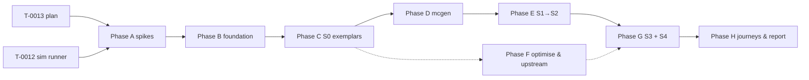

# Task Board

_Owned by Tech Lead. Last updated 2026-11-23._ Status values and lifecycle: [fleet/protocol.md](../fleet/protocol.md#task-lifecycle). Merge gate: [ADR-0006](../adr/0006-verification-strategy.md). The delivery roadmap (Phases A to H, with P-task IDs) is in [plan/README.md §5](../plan/README.md#5-delivery-roadmap). P-tasks become `T-` tasks here when they are dispatched.

## Active and recent
| ID | Title | Status | Owner | Depends on | Branch |
|---|---|---|---|---|---|
| [T-0020](T-0020-config-monitoring-eventbus-storage.md) | `mc_config`, `mc_monitoring`, `mc_event_bus`, `mc_storage` (P1-03) | **In Progress** | Engineer (Sonnet) | T-0017 | `fleet/T-0020-core-utils` |
| [T-0018](T-0018-mocked-backend-and-character-fixtures.md) | `mc_mocked_backend` + character and media fixtures (P1-06, P1-07) | **In Progress** | Engineer (Sonnet) | T-0014 | `fleet/T-0018-mocked-backend` |
| [T-0019](T-0019-design-system-foundation.md) | Design-system foundation (P1-11) | **In Progress** | Engineer (Sonnet) | T-0014 | `fleet/T-0019-design-system` |

## Done
| ID | Title | Result |
|---|---|---|
| [T-0001](T-0001-documentation-scaffold.md) | Documentation scaffold & fleet protocol | merged |
| [T-0006](T-0006-link-github-remote.md) | Link GitHub remote | merged |
| [T-0008](T-0008-marvel-api-research.md) | Marvel API status research | F-0003 |
| [T-0009](T-0009-verification-pipeline-spike.md) | Verification pipeline spike (iOS) | PASS, F-0004 |
| [T-0017](T-0017-workspace-and-foundation.md) | Workspace, `mc_arch_check`, `mc_analysis`, `mc_prelude`, `mc_di` (P1-01, P1-02) | merged; Verifier [PASS](../evidence/T-0017/verification-report.md); F-0013 |
| [T-0014](T-0014-toolchain-bring-up.md) | Toolchain bring-up: Bazel 9.3.0, Flutter 3.47.7, first Flutter iOS app (P3-01) | merged; Verifier [PASS](../evidence/T-0014/verification-report.md); F-0006, F-0007, F-0009 to F-0012 |
| [T-0016](T-0016-perf-harness.md) | Perf harness, ingestion, macOS sampler (P4-01 to P4-03) | merged; Verifier [PASS](../evidence/T-0016/verification-report.md); F-0008 |
| [T-0015](T-0015-tool-loc.md) | `tool/loc` LOC counter (P2-02) | merged; Verifier [PASS](../evidence/T-0015/verification-report.md) |
| [T-0013](T-0013-enterprise-plan.md) | Enterprise plan (Tide × Bazel stress test) | verified; 49 audit findings resolved |
| [T-0012](T-0012-ios-sim-e2e-runner.md) | iOS simulator e2e runner (`tool/e2e_ios.sh`) | merged; Verifier [PASS](../evidence/T-0012/verification-report.md); F-0005 |

## Superseded by the enterprise plan (2026-11-23)
| ID | Title | Replaced by |
|---|---|---|
| [T-0002](T-0002-product-charter.md) | Product charter & MVP scope | Plan README §1, §3 and the plan 01 catalogue (Q-008 superseded) |
| [T-0003](T-0003-flutter-project-scaffold.md) | Flutter project scaffold | P1-01 + P3-01 |
| [T-0004](T-0004-architecture-decision.md) | Architecture & tech-stack decisions | Plan + ADR-0007 to ADR-0010 |
| [T-0005](T-0005-ci-quality-gates.md) | `tool/verify.sh` & CI | P5-09 + P4-19 |
| [T-0007](T-0007-mocked-backend-module.md) | `mocked_backend` module | P1-06 to P1-10 |
| [T-0010](T-0010-e2e-visual-harness.md) | E2E & visual harness | P5-10 |
| [T-0011](T-0011-mvp-journey-e2e.md) | Full MVP journey e2e | P5-12 |

## Next up (Phase A waves A2 to A4)
P3-01 toolchain + Dart version · P3-02 patch queue · P3-03 retrofit shim · P3-04 injectable two-stage · P3-05 BDD generator · P3-07 go_router + l10n + app shell · P1-04 flow_builder on 3.47.7 · P1-01 workspace skeleton · P2-02 `tool/loc` · P4-01 to P4-03 perf harness and sampler.

