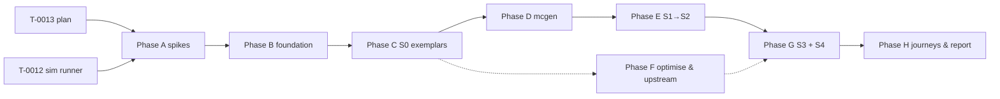

# Task Board

_Owned by Tech Lead. Last updated 2026-11-24._ Status values and lifecycle: [fleet/protocol.md](../fleet/protocol.md#task-lifecycle). Merge gate: [ADR-0006](../adr/0006-verification-strategy.md). The delivery roadmap (Phases A to H, with P-task IDs) is in [plan/README.md §5](../plan/README.md#5-delivery-roadmap). P-tasks become `T-` tasks here when they are dispatched.

## Active and recent
| ID | Title | Status | Owner | Depends on | Branch |
|---|---|---|---|---|---|
| [T-0070](T-0070-settings-home.md) | `settings_home` (F055) with the `/settings` parent route | merged `d235ffee` |
| [T-0069](T-0069-mcgen-list-detail.md) | `mcgen` list-detail archetype: `characters_list` regenerates byte for byte (P2-04) | **In Progress** | Engineer (Opus) / ADR-0015 | T-0065 | `fleet/T-0069-mcgen-list-detail` |
| [T-0071](T-0071-characters-search.md) | `characters_search`: prefix search, facets, history (F003) | **In Progress** | Engineer (Sonnet) / ADR-0015 | T-0046, T-0067 | `fleet/T-0071-characters-search` |
| [T-0068](T-0068-ci-github-actions.md) | CI: GitHub Actions (macOS, Bazel caches) runs the merge gates on `main`, `fleet/**`, PRs and on demand | merged `fe063d24` |
| [T-0066](T-0066-auth-sign-in.md) | `auth_signin` (F045) and the `/me/**` sign-in guard; fixture sheet removed | merged `4607381c` |
| [T-0067](T-0067-characters-details.md) | `characters_details` (F002): the profile behind "See full profile" | merged `21b57873` |
| [T-0065](T-0065-mcgen-core.md) | `tool/mcgen` core (P2-01); ADR-0016 | merged `a6da9bde` |
| [T-0063](T-0063-settings-appearance-exemplar.md) | `settings_appearance`, the ST exemplar (P1-22); `mc_appearance`; ADR-0013 | merged `9b85870` |
| [T-0064](T-0064-trivia-quiz-exemplar.md) | `trivia_quiz`, the IX exemplar (P1-23); ADR-0014 | merged `09171cc` |
| [T-0062](T-0062-tooling-hygiene.md) | Tooling hygiene: format gate, e2e bundle id and roles, sheet handle pin | merged `acfe0c5` |
| [T-0056](T-0056-store-home-exemplar.md) | `store_home`, the DB exemplar (P1-21); ADR-0012 | merged `ee4317f` |
| [T-0061](T-0061-fixtures-identity-preferences.md) | Identity preferences routes (GET/PATCH, `ifVersion`) for ST | merged `a16a332` |
| [T-0060](T-0060-fixtures-editorial-trivia.md) | `mc_fixtures_editorial` trivia: seeded rounds, server-side scoring | merged `a6e5df7` |
| [T-0058](T-0058-ds-overlays.md) | `mc_ds_overlays`; sign-in sheet on `McSheet` | merged `f0f1539` |
| [T-0059](T-0059-ds-charts.md) | `mc_ds_charts`: bar, line, donut, radar, timeline | merged `6ae4a7f` |
| [T-0057](T-0057-appflows-async-guard-pins.md) | Pin the `AppFlows` async-guard paths (P-110) | merged `95396a7` |
| [T-0055](T-0055-e2e-false-pass.md) | `tool/e2e_ios.sh` false PASS fixed; e2e re-baselined 11/11 | merged `5e33a15` |
| [T-0054](T-0054-flow-results-hardening.md) | `AppFlows` hardening: per-call page keys, safe extras, results under overlays, not-found way home | merged `5c9053a` |
| [T-0052](T-0052-feature-flags.md) | `mc_feature_flags` + flags slice of `mc_fixtures_platform` | merged `1b00a7e` |
| [T-0053](T-0053-analytics.md) | `mc_analytics`: typed events, consent gate, app sessions, screen observer, BDD steps | merged `113e895` |
| [T-0050](T-0050-auth-first-send-pin.md) | `mc_api_auth` first-send epoch pin; favourite and reading-list writes pinned | merged `17d0caa` |
| [T-0049](T-0049-deep-link-back-stack.md) | Cold deep links get a back stack; flow-result futures always complete | merged `d6ef20d` |
| [T-0051](T-0051-fixtures-commerce.md) | `mc_fixtures_commerce`: store sections, cart in cents, promotions | merged `7b6a1f4` |

## Done
| ID | Title | Result |
|---|---|---|
| [T-0001](T-0001-documentation-scaffold.md) | Documentation scaffold & fleet protocol | merged |
| [T-0006](T-0006-link-github-remote.md) | Link GitHub remote | merged |
| [T-0008](T-0008-marvel-api-research.md) | Marvel API status research | F-0003 |
| [T-0009](T-0009-verification-pipeline-spike.md) | Verification pipeline spike (iOS) | PASS, F-0004 |
| [T-0046](T-0046-discovery-search-exemplar.md) | **`discovery_search`, the SR exemplar** (P1-19): debounced search, grouped results, history, `discovery_wiring`, `DebouncedQuery.submit` | merged; Verifier [PASS](../evidence/T-0046/verification-report.md) (Opus, then a narrow Sonnet merge re-check); F-0046 |
| [T-0048](T-0048-reading-list-editor-exemplar.md) | **`library_reading_list_editor`, the FW exemplar** (P1-20): 3-step wizard, **flow-result pattern** (`FlowResultRoute` + `AppFlows`), server field errors via `reject()` | merged; Verifier [PASS](../evidence/T-0048/verification-report.md) (Opus, single pass); F-0048 |
| [T-0047](T-0047-fixtures-library.md) | `mc_fixtures_library`: per-user reading lists with CRUD, typed validation, 404 for foreign lists, bearer via identity | merged; Verifier [PASS](../evidence/T-0047/verification-report.md) (Sonnet, single pass) |
| [T-0045](T-0045-forms-kit.md) | `mc_forms` + `mc_ds_forms`: typed validators, form and wizard controllers, a blocked Next that reveals errors, form scaffold | merged; Verifier [PASS](../evidence/T-0045/verification-report.md) (Sonnet, single pass); F-0045 |
| [T-0044](T-0044-ds-inputs.md) | `mc_ds_inputs`: text and search fields, chips, segmented control, stepper (intrinsic-safe) | merged; Verifier [PASS](../evidence/T-0044/verification-report.md) (Sonnet, single pass); F-0043 |
| [T-0043](T-0043-fixtures-discovery.md) | `mc_fixtures_discovery`: global search (characters and comics), deterministic tiers, diacritic folding, suggestions | merged; Verifier [PASS](../evidence/T-0043/verification-report.md) (Sonnet, single pass) |
| [T-0041](T-0041-comics-details-exemplar.md) | **`comics_details`, the SC exemplar** (P1-18): sections, auth-gated favourite, `publishing_wiring`, comics deep link | merged; Verifier [PASS](../evidence/T-0041/verification-report.md) (re-verified after FAIL); F-0040 |
| [T-0042](T-0042-ide-sync.md) | **`tool/ide_sync`**: Bazel-generated code in the checkout, so the IDE, `flutter run`, debugging and hot reload work (P3-10) | merged; Verifier [PASS](../evidence/T-0042/verification-report.md) (Sonnet, re-verified); F-0041 |
| [T-0039](T-0039-session-and-auth.md) | Auth slice: `mc_session` (epoch), `mc_api_auth` (bearer, single refresh, no cross-account replay), `mc_fixtures_identity` (sign-in, favourites) | merged; Verifier [PASS](../evidence/T-0039/verification-report.md) (re-verified after FAIL); F-0038 |
| [T-0040](T-0040-ds-navigation.md) | `mc_ds_navigation`: `McAppBar` (large title, `bottom`), `McTabBar`, `McSectionHeader`; `characters_list` on `McAppBar` | merged; Verifier [PASS](../evidence/T-0040/verification-report.md) (re-verified, Sonnet narrow); F-0039 |
| [T-0038](T-0038-fixtures-comics.md) | `mc_fixtures_comics`: 2,400 comics, series, creators, variants (P1-08 subset) | merged; Verifier [PASS](../evidence/T-0038/verification-report.md) (re-verified after review fixes) |
| [T-0037](T-0037-flow-back-button-hardening.md) | `McFlowBackButton` hardened: outer-route changes, safe outside flows, local-history/drawer precedence, nested navigators, flow_builder patch change 5 | merged; Verifier [PASS](../evidence/T-0037/verification-report.md) (re-verified after review fixes); F-0036 |
| [T-0036](T-0036-flow-back-button.md) | `McFlowBackButton` + flow_builder stale-`PopScope` fix (P-074, P-076) | merged; Verifier [PASS](../evidence/T-0036/verification-report.md) (re-verified after FAIL); F-0035 |
| [T-0033](T-0033-universe-wiring-and-sandbox.md) | **`characters_list` in the app**: `universe_wiring`, `universe_sandbox`, home entry, deep links, simulator e2e | merged; Verifier [PASS](../evidence/T-0033/verification-report.md) (3 rounds; R1 fixed via T-0035); F-0032 |
| [T-0035](T-0035-flow-builder-deep-link-hijack.md) | Deep links survive a mounted `FeatureFlow`: flow_builder 0.1.0 vendored with a 3-hunk patch | merged; Verifier [PASS](../evidence/T-0035/verification-report.md) (re-verified after review fixes); F-0034 |
| [T-0034](T-0034-exemplar-workarounds-removal.md) | Exemplar matches plan 01: flow `provide:`/delegates/non-listening `di`/back button/test hook, `$PagedStateCopyWith`, release-safe base URL, card height | merged; Verifier [PASS](../evidence/T-0034/verification-report.md) (re-verified after review fixes); F-0033 |
| [T-0032](T-0032-characters-list-exemplar.md) | **`characters_list`, the first Marvel feature** (LD exemplar, P1-17 feature package) | merged; Verifier [PASS](../evidence/T-0032/verification-report.md) (re-verified after FAIL); F-0031 |
| [T-0031](T-0031-ds-lists-media-cards.md) | DS `mc_ds_media`, `mc_ds_lists`, `mc_ds_cards` (P1-12 subset): paged grid and list, `McImage`, `McMediaCard`, 80 goldens | merged; Verifier [PASS](../evidence/T-0031/verification-report.md) (re-verified after FAIL); F-0030 |
| [T-0030](T-0030-paging-and-media-kits.md) | `mc_paging` + `mc_media` kits (P1-14 subset, U14, U19) | merged; Verifier [PASS](../evidence/T-0030/verification-report.md) (re-verified after review fixes); F-0029 |
| [T-0029](T-0029-bdd-generator.md) | BDD generator (`.feature` → tests), `mc_bdd_tests`, `mc_test_steps` skeleton, patch 0003 (P3-05) | merged; Verifier [PASS](../evidence/T-0029/verification-report.md) (re-verified after FAIL); F-0027 |
| [T-0028](T-0028-injectable-shim.md) | injectable two-stage shim, vendored generator without lean_builder, patch 0002 (P3-04) | merged; Verifier [PASS](../evidence/T-0028/verification-report.md) (re-verified after review fixes); F-0028 |
| [T-0027](T-0027-retrofit-shim.md) | retrofit codegen shim, patch 0001 (P3-03): byte-identical to build_runner | merged; Verifier [PASS](../evidence/T-0027/verification-report.md) (re-verified after FAIL); F-0025, F-0026 |
| [T-0026](T-0026-test-utils-harness.md) | `mc_test_utils` harness: Tide's `test_utils` (P5-01) | merged; Verifier [PASS](../evidence/T-0026/verification-report.md); F-0024 |
| [T-0024](T-0024-rules-patch-queue.md) | Rules patch queue: `tool/rules_fork.sh` (P3-02) | merged; Verifier [PASS](../evidence/T-0024/verification-report.md) (3 rounds); F-0022 |
| [T-0025](T-0025-l10n-core.md) | `mc_l10n_core`, `mc_formatters`, `l10n_check` + workspace gate (P1-13) | merged; Verifier [PASS](../evidence/T-0025/verification-report.md); F-0023 |
| [T-0021](T-0021-app-shell.md) | **App shell on the iOS simulator**: `app_core`, `app/mini_client`, 7 wirings (P1-16) | merged; Verifier [PASS](../evidence/T-0021/verification-report.md); F-0020, F-0021 |
| [T-0022](T-0022-feature-flow-and-bloc-kit.md) | `mc_bloc_kit` + `mc_feature_flow` (P1-04, flow_builder spike) | merged; Verifier [PASS](../evidence/T-0022/verification-report.md) (3 rounds); F-0018 |
| [T-0023](T-0023-api-client-and-errors.md) | `mc_api_errors` + `mc_api_client` (P1-05 subset) | merged; Verifier [PASS](../evidence/T-0023/verification-report.md); F-0017, F-0019 |
| [T-0020](T-0020-config-monitoring-eventbus-storage.md) | `mc_config`, `mc_monitoring`, `mc_event_bus`, `mc_storage` (P1-03) | merged; Verifier [PASS](../evidence/T-0020/verification-report.md); F-0016 |
| [T-0018](T-0018-mocked-backend-and-character-fixtures.md) | `mc_mocked_backend` + character and media fixtures (P1-06, P1-07) | merged; Verifier [PASS](../evidence/T-0018/verification-report.md); F-0015 |
| [T-0019](T-0019-design-system-foundation.md) | Design-system foundation `mc_ds_*` (P1-11) | merged; Verifier [PASS](../evidence/T-0019/verification-report.md); F-0014 |
| [T-0017](T-0017-workspace-and-foundation.md) | Workspace, `mc_arch_check`, `mc_analysis`, `mc_prelude`, `mc_di` (P1-01, P1-02) | merged; Verifier [PASS](../evidence/T-0017/verification-report.md); F-0013 |
| [T-0014](T-0014-toolchain-bring-up.md) | Toolchain bring-up: Bazel 9.3.0, Flutter 3.47.7, first Flutter iOS app (P3-01) | merged; Verifier [PASS](../evidence/T-0014/verification-report.md); F-0006, F-0007, F-0009 to F-0012 |
| [T-0016](T-0016-perf-harness.md) | Perf harness, ingestion, macOS sampler (P4-01 to P4-03) | merged; Verifier [PASS](../evidence/T-0016/verification-report.md); F-0008 |
| [T-0015](T-0015-tool-loc.md) | `tool/loc` LOC counter (P2-02) | merged; Verifier [PASS](../evidence/T-0015/verification-report.md) |
| [T-0013](T-0013-enterprise-plan.md) | Enterprise plan (Tide × Bazel stress test) | verified; 49 audit findings resolved |
| [T-0012](T-0012-ios-sim-e2e-runner.md) | iOS simulator e2e runner (`tool/e2e_ios.sh`) | merged; Verifier [PASS](../evidence/T-0012/verification-report.md); F-0005 |

## Superseded by the enterprise plan (2026-11-23)
| ID | Title | Replaced by |
|---|---|---|
| [T-0002](T-0002-product-charter.md) | Product charter & MVP scope | Plan README §1, §3 and the plan 01 catalogue (Q-008 superseded) |
| [T-0003](T-0003-flutter-project-scaffold.md) | Flutter project scaffold | P1-01 + P3-01 |
| [T-0004](T-0004-architecture-decision.md) | Architecture & tech-stack decisions | Plan + ADR-0007 to ADR-0010 |
| [T-0005](T-0005-ci-quality-gates.md) | `tool/verify.sh` & CI | P5-09 + P4-19 |
| [T-0007](T-0007-mocked-backend-module.md) | `mocked_backend` module | P1-06 to P1-10 |
| [T-0010](T-0010-e2e-visual-harness.md) | E2E & visual harness | P5-10 |
| [T-0011](T-0011-mvp-journey-e2e.md) | Full MVP journey e2e | P5-12 |

## Next up (Phase A waves A2 to A4)
P3-01 toolchain + Dart version · P3-02 patch queue · P3-03 retrofit shim · P3-04 injectable two-stage · P3-05 BDD generator · P3-07 go_router + l10n + app shell · P1-04 flow_builder on 3.47.7 · P1-01 workspace skeleton · P2-02 `tool/loc` · P4-01 to P4-03 perf harness and sampler.

